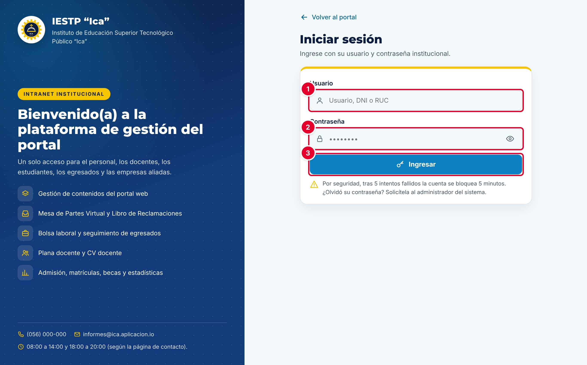

# 00 · Introducción y acceso a la plataforma

La plataforma tiene dos partes que trabajan con la misma información:

- **Portal web público** (`{{inst.dominio}}`): información institucional, programas de estudio, transparencia, noticias y servicios en línea (Mesa de partes, Libro de reclamaciones, consulta de certificados, bolsa laboral).
- **Intranet** (`{{inst.dominio}}/#/admin`): panel donde el personal autorizado administra ese contenido y atiende los trámites. Lo que se publica aparece en el portal en cuanto se guarda.

Las capturas se tomaron en una instalación de prueba del **IESTP “Ica”** con **datos ficticios**. En tu institución verás tu propio nombre, logotipo y colores.

## Ingresar a la intranet

| N.º | Elemento | Qué escribir |
|---|---|---|
| 1 | **Usuario** | Tu nombre de usuario, DNI o RUC (las empresas ingresan con RUC). |
| 2 | **Contraseña** | Tu contraseña. Con el ícono del ojo puedes verla. |
| 3 | **Ingresar** | Abre la intranet con los módulos de tu rol. |

1. Abre `{{inst.dominio}}` y pulsa **Intranet** en la franja superior, o entra a `{{inst.dominio}}/#/admin`.
2. Escribe tu usuario y tu contraseña y pulsa **Ingresar**.

**Seguridad**
- Tras **5 intentos fallidos**, la cuenta se bloquea **5 minutos**.
- La sesión se cierra sola tras **30 minutos sin actividad**; lo no guardado se pierde.
- Si olvidaste tu contraseña, pide al administrador que la restablezca.
- Al terminar, pulsa siempre **Salir**, sobre todo en una computadora compartida.

El menú lateral agrupa los módulos por área y cada usuario ve solo los de su rol. **Ver sitio web** abre el portal en otra pestaña y la campana muestra tus avisos pendientes.

## Roles y módulos

El rol de cada cuenta decide qué módulos ve. El administrador lo asigna en **Usuarios y roles**.

| Rol | Módulos principales | Publica directamente |
|---|---|---|
| Administrador | Todos (38 módulos), incluida la eliminación definitiva | Sí |
| Imagen institucional | Noticias, Eventos, Portada, Páginas institucionales, Enlaces, Campus y locales, Temas | Sí |
| Secretaría académica | Admisión, Matrícula, Becas, Estadísticas, Plana docente y jerárquica, Egresados, Alumnos, Horarios, Certificados, Títulos, CV Docente | Sí, salvo **Admisión** |
| Coordinador de programa | Su programa de estudios, Egresados, Alumnos y Horarios del programa | Sí, solo en su programa |
| Transparencia / administración | Documentos de gestión, TUPA, Inversiones, Licenciamiento, Convocatorias, Servicios complementarios | Sí, salvo **Documentos de gestión** y **Convocatorias** |
| Atención al ciudadano | Mensajes de contacto, Libro de reclamaciones, Mesa de partes, Bolsa laboral | No aplica |
| Directivo | Estadísticas, Reclamos, Expedientes, Alumnos, Horarios, Certificados, Títulos, Bolsa laboral | No publica contenido |
| Docente | Sus horarios y su CV | No aplica |
| Estudiante / Egresado | Horarios, certificados, títulos y bolsa laboral (solo consulta) | No aplica |
| Empresa | Bolsa laboral | No aplica |

Para cualquier rol distinto del Administrador, publicar o modificar algo publicado en **Documentos de gestión**, **Admisión** y **Convocatorias** lo deja **En revisión** hasta que el administrador lo apruebe en **Aprobaciones** (capítulo 01).

**Convenciones:** los campos obligatorios llevan asterisco rojo (*) y muchos solo se exigen al publicar; lo eliminado va a la papelera (**Ver papelera** › restaurar) y solo el administrador elimina definitivamente; un aviso en rojo indica que la operación **no** se completó.
