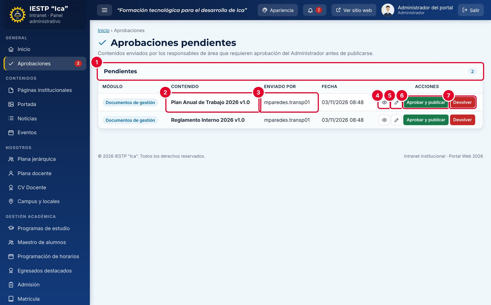

# 01 · Inicio y aprobaciones

**Para qué sirve:** **Inicio** resume la actividad del portal y los pendientes. **Aprobaciones** es la bandeja donde el Administrador revisa lo que otros publican en **Documentos de gestión**, **Convocatorias** y **Admisión**. **Quién lo usa:** todos ven su Inicio; solo el Administrador aprueba. **Dónde:** Menú › General › Inicio / Aprobaciones.

| N.º | Elemento | Para qué sirve |
|---|---|---|
| 1 | **Pendientes** | Cantidad de contenidos **En revisión**. |
| 2 | **Contenido** | Registro enviado; **Módulo** indica de dónde viene. |
| 3 | **Enviado por** | Usuario del último cambio; **Fecha**, cuándo. |
| 4–5 | Vista previa (ojo) / Abrir (lápiz) | Ver cómo quedará en el portal o abrir el formulario completo. |
| 6 | **Aprobar y publicar** | Publica el contenido en el portal. |
| 7 | **Devolver** | Lo regresa como **Borrador**, con observación obligatoria. |

### Cómo se hace (Administrador)
1. Entra a **Aprobaciones** y revisa el contenido con el ojo o el lápiz.
2. Pulsa **Aprobar y publicar** y confirma. Aparece «Contenido aprobado y publicado.»
3. Para corregir, pulsa **Devolver**, escribe la observación y confirma con **Devolver**.

### Enviar a aprobación (responsable de área)
1. En **Estado**, elige **Publicado** y pulsa **Guardar cambios**.
2. El registro queda **En revisión** y aún no se ve en el portal.
3. Si fue devuelto, lee la **Observación**, corrige y guarda otra vez como **Publicado**.

**Ten en cuenta**
- Estados: Borrador → En revisión → Publicado (→ Histórico, solo documentos reemplazados).
- Si se modifica un contenido ya **Publicado**, vuelve a **En revisión** y deja de verse hasta aprobarse de nuevo.
- En **Inicio**, atiende **Pendientes por atender** y usa **Exportar resumen** (CSV).
- **Incidencia:** el responsable no recibe aviso de aprobación ni de devolución; avísale por correo institucional.
