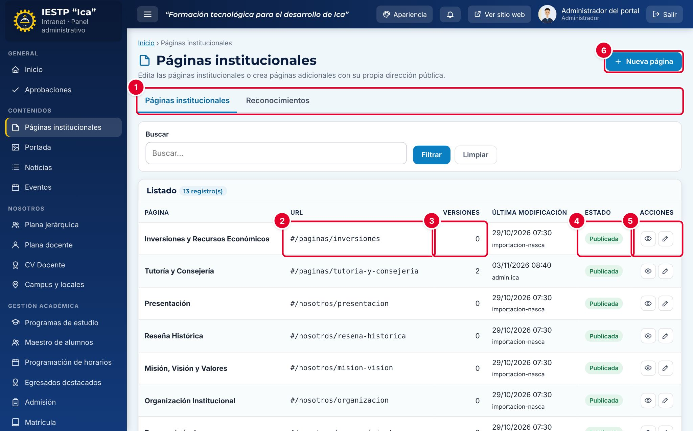

# 02 · Páginas institucionales

**Para qué sirve:** edita las páginas fijas del portal (Presentación, Misión, Visión y Valores, Preguntas Frecuentes, etc.), crea páginas adicionales y registra los **Reconocimientos** de **Nosotros › Reconocimientos**. **Quién lo usa:** Administrador (único que crea páginas nuevas) e Imagen institucional. **Dónde:** Menú › Contenidos › Páginas institucionales.

| N.º | Elemento | Para qué sirve |
|---|---|---|
| 1 | Pestañas **Páginas institucionales / Reconocimientos** | Cambian entre las páginas y los hitos institucionales. |
| 2 | **URL** | Dirección pública; las páginas nuevas usan `#/paginas/…`. |
| 3 | **Versiones** | Versiones anteriores guardadas (hasta 10). |
| 4 | **Estado** | **Publicada** o **Borrador**. |
| 5 | Acciones | **Vista previa** (ojo) y **Editar** (lápiz). |
| 6 | **Nueva página** | Crea una página adicional (solo Administrador). |

### Cómo se hace
1. Pulsa el lápiz de la página, o **Nueva página** para crear una.
2. Escribe el **Título de la página** y el **Contenido**.
3. Opcional: **Seleccionar imagen** y **Mensaje institucional destacado**.
4. En una página nueva, escribe la **URL amigable (slug)**, por ejemplo `tutoria-y-consejeria`.
5. Elige el **Estado** y pulsa **Vista previa** para revisar.
6. Pulsa **Guardar cambios**. Aparece «Cambios guardados.»

### Restaurar una versión anterior
1. Edita la página y, en **Historial**, busca **Versiones anteriores**.
2. Pulsa **Restaurar** y confirma con **Cargar versión**.
3. Revisa y pulsa **Guardar cambios**; hasta entonces el portal no cambia.

**Ten en cuenta**
- Estados: Borrador ↔ Publicada. Las páginas no se eliminan: para retirarlas, pásalas a **Borrador** (se verá «Página no encontrada»).
- En las páginas fijas la dirección no cambia aunque modifiques el slug. Las nuevas publicadas se agregan solas al menú **Otras Páginas**.
- **Reconocimientos:** **Año**, **Título** y **Estado** obligatorios; solo los **Publicado** se ven en el portal.
