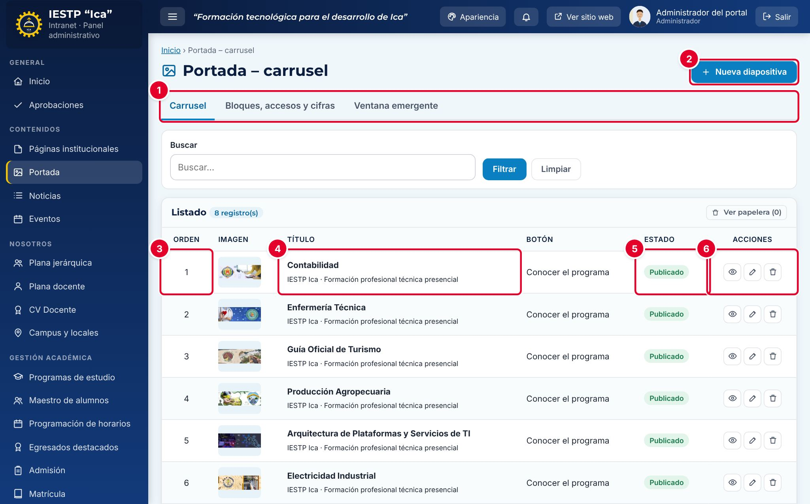

# 03 · Portada

**Para qué sirve:** arma la página de inicio del portal: diapositivas del **carrusel**, orden y visibilidad de los **bloques**, **accesos rápidos**, **cifras institucionales**, **¿Por qué estudiar aquí?** y la **ventana emergente**. **Quién lo usa:** Administrador e Imagen institucional. **Dónde:** Menú › Contenidos › Portada.

| N.º | Elemento | Para qué sirve |
|---|---|---|
| 1 | Pestañas | **Carrusel**, **Bloques, accesos y cifras** y **Ventana emergente**. |
| 2 | **Nueva diapositiva** | Abre el formulario de una diapositiva. |
| 3 | **Orden** | Posición en el carrusel (1 = primera). |
| 4 | **Título** | Título y texto; **Imagen** muestra una miniatura y **Botón**, su texto. |
| 5 | **Estado** | **Borrador**, **Publicado** o **Despublicado**. |
| 6 | Acciones | **Vista previa**, **Editar** y **Eliminar** (a la papelera). |

### Cómo se hace
1. En **Carrusel**, pulsa **Nueva diapositiva**.
2. Escribe el **Título**, el **Texto** y, si corresponde, el **Texto del botón** y su **Enlace del botón**.
3. Pulsa **Seleccionar imagen** (recomendado: 1600 × 600 px).
4. Escribe un **Orden** libre, elige **Publicado** y pulsa **Guardar cambios**.

### Publicar un comunicado en la ventana emergente
1. En **Ventana emergente**, marca **Mostrar ventana emergente en la portada**.
2. Escribe el **Título**, el **Texto** y, opcional, **Texto del botón** y **Enlace**.
3. Indica **Mostrar desde** y **Mostrar hasta**; opcional, carga una **Imagen**.
4. Pulsa **Guardar cambios**.

**Ten en cuenta**
- El **Orden** no puede repetirse entre diapositivas en Borrador o Publicado; **Despublicado** retira la diapositiva y libera su número.
- En **Bloques, accesos y cifras** marca **Visible**, usa **Subir**/**Bajar** y pulsa **Guardar cambios**. Cada cifra necesita **Año de corte**; `auto:anios`, `auto:programas`, `auto:matriculados` y `auto:egresados` se calculan solos.
- La ventana emergente se muestra **una sola vez por sesión del navegador**.
