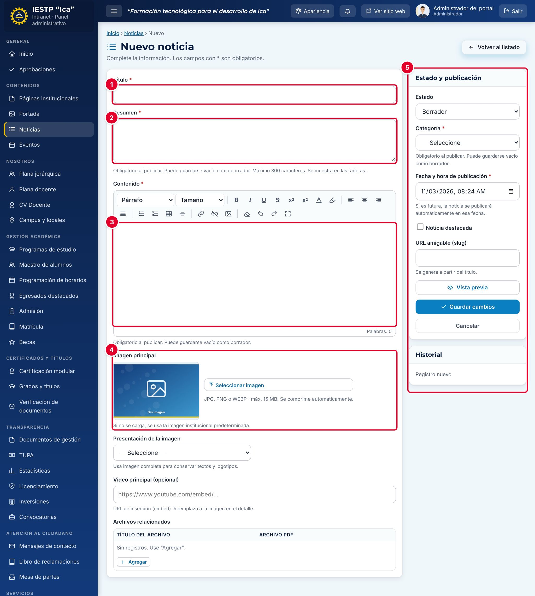

# 04 · Noticias

**Para qué sirve:** publica noticias, comunicados y notas académicas en la sección **Noticias**, en el bloque de noticias de la portada y en el buscador del sitio. **Quién lo usa:** Administrador e Imagen institucional. **Dónde:** Menú › Contenidos › Noticias.

| N.º | Elemento | Para qué sirve |
|---|---|---|
| 1 | **Título** | Titular de la noticia. |
| 2 | **Resumen** | Texto corto de las tarjetas del portal (hasta 300 caracteres). |
| 3 | **Contenido** | Cuerpo con editor de formato: títulos, listas, tablas, enlaces e imágenes. |
| 4 | **Imagen principal** | Foto o afiche (JPG, PNG o WEBP, hasta 15 MB). |
| 5 | **Estado y publicación** | Estado, categoría, fecha, destacada, URL, vista previa y guardado. |

### Cómo se hace
1. Pulsa **Nueva noticia**.
2. Escribe el **Título**, el **Resumen** y el **Contenido**.
3. Opcional: **Seleccionar imagen** y elige su **Presentación** (**Completa** si tiene texto o logotipos).
4. Elige el **Estado**, la **Categoría** y revisa la **Fecha y hora de publicación**.
5. Marca **Noticia destacada** si corresponde y pulsa **Vista previa**.
6. Pulsa **Guardar cambios**. Aparece «Cambios guardados.»

**Ten en cuenta**
- Estados: Borrador → Publicada (con fecha futura: **Programada**, sale sola en esa fecha) → Despublicada / Archivada. Solo **Publicada** se ve.
- **Resumen**, **Contenido** y **Categoría** son obligatorios al publicar; un borrador puede quedar incompleto.
- **Video principal**: usa la URL de inserción `https://www.youtube.com/embed/…`.
- **Eliminar** envía a la papelera (**Ver papelera** › **Restaurar**); solo el Administrador ve **Eliminar definitivamente**. **Duplicar como borrador** sirve para comunicados repetidos.
