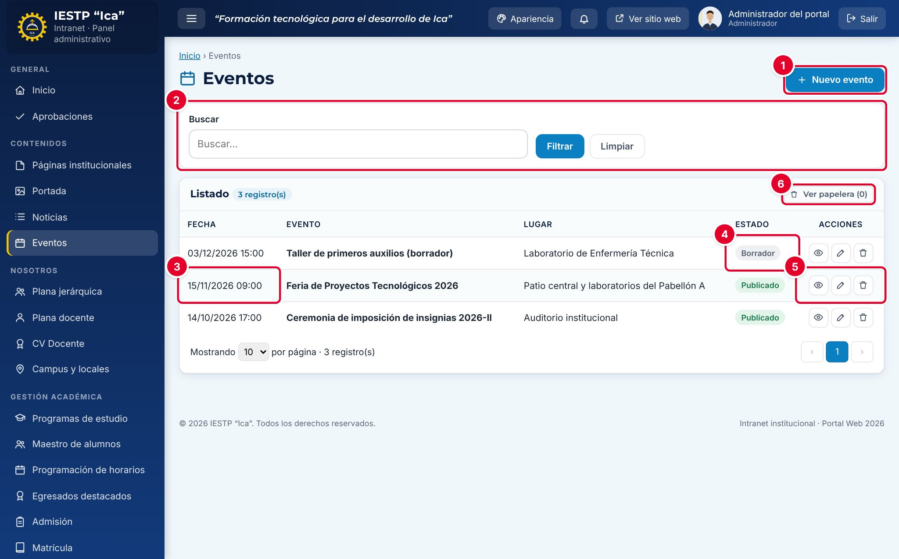

# 05 · Eventos

**Para qué sirve:** registra la agenda institucional (ferias, ceremonias, talleres, charlas). Los eventos publicados aparecen en **Eventos**, en el bloque **Próximos eventos** de la portada y en **Próximas fechas** del Inicio. **Quién lo usa:** Administrador e Imagen institucional. **Dónde:** Menú › Contenidos › Eventos.

| N.º | Elemento | Para qué sirve |
|---|---|---|
| 1 | **Nuevo evento** | Abre el formulario para registrar un evento. |
| 2 | **Buscar** | Filtra por título (**Filtrar** / **Limpiar**). |
| 3 | **Fecha** | Fecha y hora del evento. |
| 4 | **Estado** | **Borrador** (no visible) o **Publicado** (visible). |
| 5 | Acciones | **Vista previa**, **Editar** y **Eliminar**. |
| 6 | **Ver papelera** | Muestra los eventos eliminados para restaurarlos. |

### Cómo se hace
1. Pulsa **Nuevo evento**.
2. Escribe el **Título**, la **Fecha y hora**, el **Lugar** y la **Descripción**.
3. Elige el **Estado**: **Borrador** si faltan datos, **Publicado** si ya debe verse.
4. Pulsa **Vista previa** para revisar la agenda.
5. Pulsa **Guardar cambios**. Aparece «Cambios guardados.»

**Ten en cuenta**
- Estados: Borrador ↔ Publicado. Con fecha pasada, el evento publicado pasa a **Eventos realizados** de la agenda.
- La **Descripción** es obligatoria solo al publicar; si falta aparece «Obligatorio para publicar (puede guardarlo como borrador).»
- La portada muestra los tres eventos más cercanos; sin eventos futuros publicados, el bloque no aparece.
- Si el evento se posterga, cambia la fecha en lugar de crear otro. Solo el Administrador ve **Eliminar definitivamente**.
