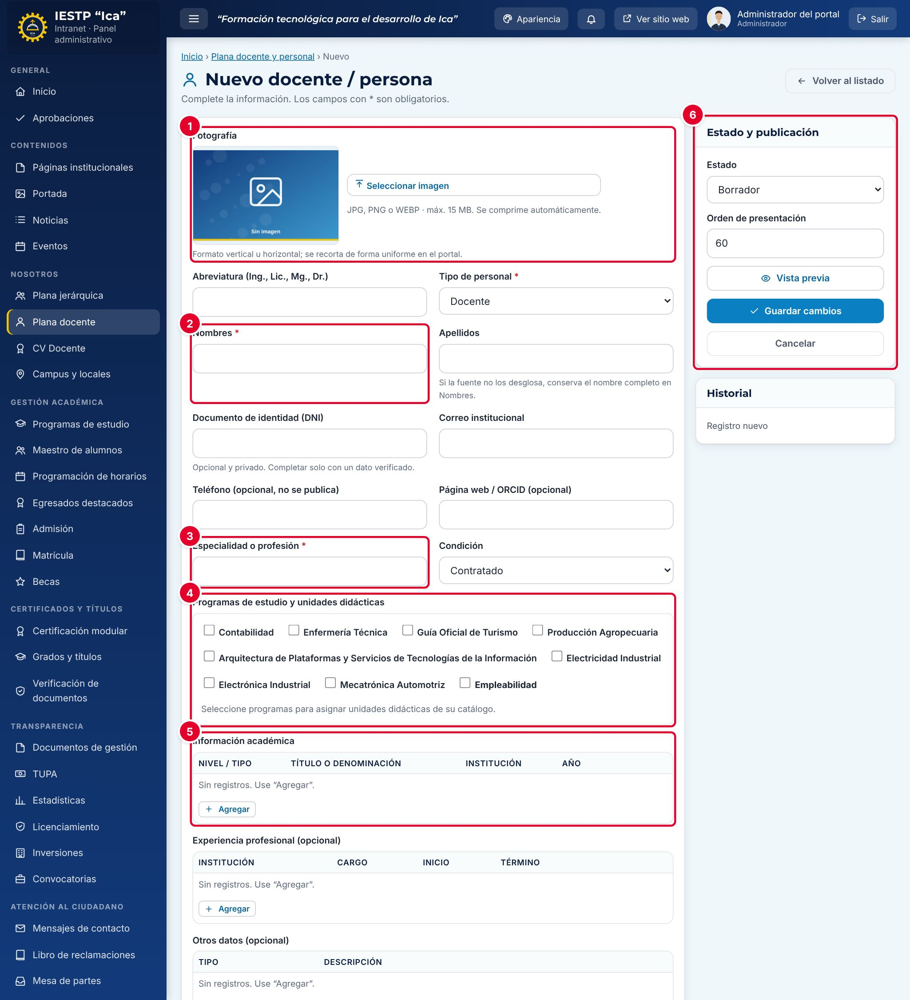

# 06 · Plana docente y plana jerárquica

**Para qué sirve:** registra a cada persona **una sola vez**, en una ficha única que se usa en **Plana docente**, **Plana jerárquica** y la página de cada programa. **Quién lo usa:** Administrador y Secretaría académica (Imagen institucional: mensaje de la Dirección). **Dónde:** Menú › Nosotros › Plana docente / Plana jerárquica.

| N.º | Elemento | Para qué sirve |
|---|---|---|
| 1 | **Fotografía** | Foto de la persona. |
| 2 | **Nombres** y datos personales | Abreviatura, tipo de personal, apellidos, DNI, correo, teléfono y web. |
| 3 | **Especialidad o profesión** | Acompaña al nombre en las tarjetas del portal. |
| 4 | **Programas de estudio y unidades didácticas** | Programas y unidades que dicta. |
| 5 | **Información académica** | Títulos y grados, en filas. |
| 6 | **Estado y publicación** | Estado, orden, vista previa y guardado. |

### Cómo se hace
1. Pulsa **Nuevo docente / persona** y carga la foto.
2. Completa nombres, apellidos, correo, **Especialidad o profesión** y **Condición**.
3. Marca el programa y las unidades didácticas que dicta.
4. En **Información académica**, pulsa **Agregar** y completa cada fila.
5. Elige el **Estado** y pulsa **Guardar cambios**.

### Registrar un integrante de la plana jerárquica
1. Con la ficha ya creada, pulsa **Nuevo integrante** en **Plana jerárquica**.
2. Elige la **Persona (ficha única)**, el **Cargo**, la **Unidad orgánica** y el **Orden de presentación**.
3. Marca **Es Director(a) General** si corresponde y pulsa **Guardar cambios**.

**Ten en cuenta**
- Estados: Borrador → Publicado → Despublicado. Para publicar, asocia un programa o **Empleabilidad**. El DNI y el teléfono **no se publican**.
- El directorio **Plana docente** solo muestra a quien autorizó (Ley N.º 29733) en **CV Docente**.
- Solo un Director(a) General publicado.
- **Incidencia:** **Ficha pública** de la plana jerárquica no hace nada si el integrante no autorizó; registra su autorización en **CV Docente**.
