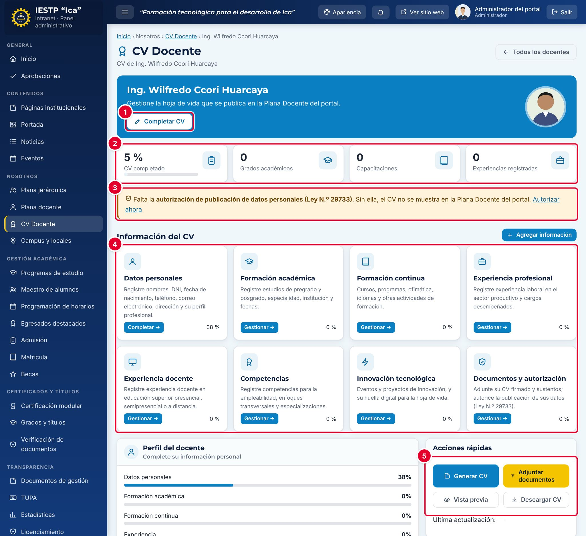

# 07 · CV docente

**Para qué sirve:** reúne la hoja de vida del docente, genera el CV en PDF y registra la **autorización de publicación (Ley N.º 29733)**, necesaria para aparecer en **Plana docente**. **Quién lo usa:** Administrador y Secretaría académica (todos los CV); Docente (solo el suyo). **Dónde:** Menú › Nosotros › CV Docente.

| N.º | Elemento | Para qué sirve |
|---|---|---|
| 1 | **Completar CV** | Abre la primera sección, **Datos personales**. |
| 2 | Indicadores | % de CV completado, grados, capacitaciones y experiencias. |
| 3 | Aviso de autorización | Falta la autorización; **Autorizar ahora** lleva a documentos. |
| 4 | **Información del CV** | Las ocho secciones, con su avance y **Gestionar**. |
| 5 | **Acciones rápidas** | **Generar CV**, **Adjuntar documentos**, **Vista previa** y **Descargar CV**. |

### Cómo se hace
1. Pulsa **Gestionar** en la fila del docente.
2. Pulsa **Completar CV**, llena **Datos personales** y pulsa **Guardar datos personales**.
3. En cada sección con tablas, pulsa **Agregar**, completa y pulsa **Guardar**.
4. En **Documentos y autorización**, adjunta los sustentos (opcional), marca **Acepto y autorizo la publicación de mis datos.** y pulsa **Registrar autorización**.

### Crear la cuenta de un docente
1. En **Programación de horarios › Configuración › Carga docente**, pulsa **+ Nuevo**, elige al docente y pulsa **Registrar**.
2. En **Usuarios y roles** › **Nuevo usuario**, elige **Rol** **Docente** y, en **Vinculado a**, al docente.
3. Pon una **Contraseña** temporal (12+ caracteres), elige la **Persona del docente (para su CV)** y pulsa **Guardar cambios**.

**Ten en cuenta**
- Autorización: Pendiente → Autorizado → Revocado (**Revocar autorización** lo retira del directorio).
- La ficha debe estar **Publicada** y con programa. El DNI, el teléfono y los sustentos **no se publican**.
- Registra la autorización solo con consentimiento del docente y guarda el respaldo firmado.
