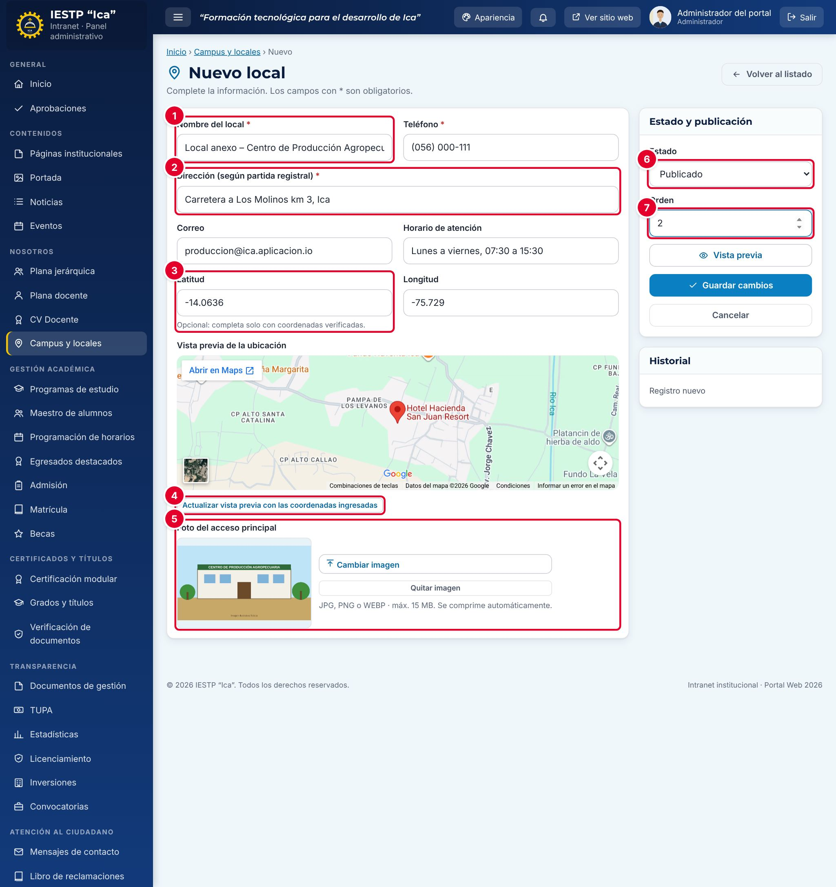

# 08 · Campus y locales

**Para qué sirve:** registra la sede principal y los locales anexos, que se muestran en **Campus e Informes** (mapa de ubicación y, con dos o más locales publicados, las tarjetas de **Locales**). **Quién lo usa:** Administrador e Imagen institucional. **Dónde:** Menú › Nosotros › Campus y locales.

| N.º | Elemento | Para qué sirve |
|---|---|---|
| 1 | **Nombre del local** \* | Nombre con el que se publica. |
| 2 | **Dirección (según partida registral)** \* | Dirección completa; ubica el mapa del portal. |
| 3–4 | **Latitud** / **Longitud** y **Actualizar vista previa…** | Coordenadas verificadas (opcionales) y redibujar el mapa. |
| 5 | **Foto del acceso principal** | Foto de la fachada o del ingreso. |
| 6 | **Estado** | **Borrador**, **Publicado** o **Despublicado**. |
| 7 | **Orden** | El de menor número es el local principal. |

### Cómo se hace
1. Pulsa **Nuevo local**.
2. Escribe el **Nombre del local**, el **Teléfono** y la **Dirección**; luego el **Correo** y el **Horario de atención**.
3. Si tienes coordenadas verificadas, escribe **Latitud** y **Longitud** (en Perú ambas negativas).
4. Carga la **Foto del acceso principal** con **Seleccionar imagen**.
5. Elige el **Estado** y el **Orden** (anexos: mayor que la sede).
6. Pulsa **Guardar cambios**.

**Ten en cuenta**
- Estados: Borrador → Publicado → Despublicado. Asigna el **Orden 1** a la sede principal.
- Coordenadas: ambas o ninguna; fuera de rango aparece «Coordenadas fuera del territorio peruano.»
- Dirección, teléfono y correo de los recuadros superiores de la página vienen de **Configuración**, no de este módulo.
- **Incidencia:** el mapa (vista previa y portal) usa siempre la **Dirección**, no las coordenadas; escríbela completa y verifica el marcador.
