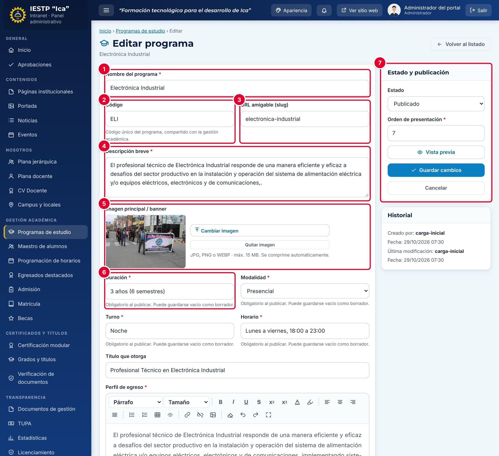

# 09 · Programas de estudio

**Para qué sirve:** mantiene la ficha de cada programa (datos, perfil de egreso, campo laboral, malla, brochure, coordinación) que arma su página pública y alimenta la gestión académica. **Quién lo usa:** Administrador; Coordinador de programa (solo el suyo, sin crear). **Dónde:** Menú › Gestión académica › Programas de estudio.

| N.º | Elemento | Para qué sirve |
|---|---|---|
| 1 | **Nombre del programa** | Nombre oficial. |
| 2–3 | **Código** / **URL amigable (slug)** | Código único compartido con la gestión académica y final de la dirección pública. |
| 4 | **Descripción breve** | Tarjeta y encabezado de la página (hasta 300 caracteres). |
| 5 | **Imagen principal / banner** | Fondo del encabezado y foto de la tarjeta. |
| 6 | Datos generales | **Duración**, **Modalidad**, **Turno**, **Horario** y **Título que otorga**. |
| 7 | **Estado y publicación** | Estado, orden de presentación, vista previa y guardado. |

### Cómo se hace
1. Pulsa el lápiz (**Editar**) del programa.
2. Revisa los datos generales, el **Perfil de egreso** y el **Campo laboral** (un ámbito por línea).
3. Carga el **Itinerario formativo** o el **Brochure vigente (PDF)** con **Cargar archivo** o **Reemplazar**.
4. Elige el **Coordinador(a) del programa** y escribe los **Convenios para EFSRT**.
5. Pulsa **Vista previa** y luego **Guardar cambios**.

### Armar la malla curricular
1. En cada módulo, completa **Código**, **Nombre del módulo** y **EFSRT**.
2. Pulsa **+ Agregar unidad didáctica** y completa **Sem.**, **Unidad didáctica**, **Créditos** y **Horas**.
3. Usa **+ Agregar módulo profesional** para otro módulo y pulsa **Guardar cambios**.

**Ten en cuenta**
- Estados: Borrador ↔ Publicado. No hay papelera: para retirarlo, pásalo a **Borrador** (queda inactivo en la gestión académica).
- Para publicar se exigen **Duración**, **Modalidad**, **Turno**, **Horario**, **Perfil de egreso** y **Campo laboral**.
- No se quita una unidad didáctica asignada a un docente; primero quita la asignación en **Plana docente**.
