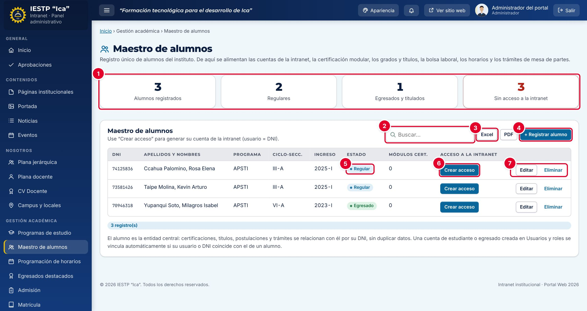

# 10 · Maestro de alumnos

**Para qué sirve:** registro único de estudiantes y egresados por DNI; alimenta horarios, certificaciones, títulos, bolsa laboral y cuentas de la intranet. **Quién lo usa:** Administrador (único que elimina), Secretaría académica, Coordinador (solo su programa); Directivo consulta. **Dónde:** Menú › **Gestión académica** › **Maestro de alumnos**.

| N.º | Elemento | Para qué sirve |
|---|---|---|
| 1 | Indicadores | **Alumnos registrados**, **Regulares**, **Egresados y titulados** y **Sin acceso a la intranet** (en rojo si hay alumnos sin cuenta). |
| 2 | **Buscar…** | Filtra la tabla mientras escribes. |
| 3 | **Excel** y **PDF** | Descargan la tabla filtrada. |
| 4 | **+ Registrar alumno** | Abre el formulario de un alumno nuevo. |
| 5 | **Estado** | Regular, Retirado, Egresado o Titulado. |
| 6, 7 | **Crear acceso**, **Editar** y **Eliminar** | Crean la cuenta de la intranet, modifican o borran el registro. |

### Cómo se hace
1. Pulsa **+ Registrar alumno**.
2. Completa **DNI** (8 dígitos, único), **Apellidos y nombres** y **Programa de estudios**.
3. Revisa el **Periodo de ingreso** y elige **Ciclo actual**, **Sección** y **Turno**.
4. Elige el **Estado académico** (**Regular** si estudia actualmente).
5. Opcional: **Correo electrónico** y **Celular** (9 dígitos).
6. Pulsa **Registrar**.

### Crear el acceso a la intranet
1. En la fila del alumno, pulsa **Crear acceso**.
2. Anota el **Usuario** (el DNI) y la **Contraseña temporal**: solo se muestran esta vez.
3. Entrégalos en persona. Al primer ingreso, el alumno la cambia (mínimo 12 caracteres).

**Ten en cuenta**
- Estados: Regular → Egresado → Titulado (automático al registrar el título); Retirado reemplaza a eliminar.
- La cuenta se crea como **Estudiante** (Regular) o **Egresado**; no hay **Crear acceso** para Retirados.
- No se elimina un alumno con certificaciones, títulos, postulaciones o cuenta activa.
- Carga masiva: **Bolsa laboral** › **Padrón de estudiantes y egresados**.
