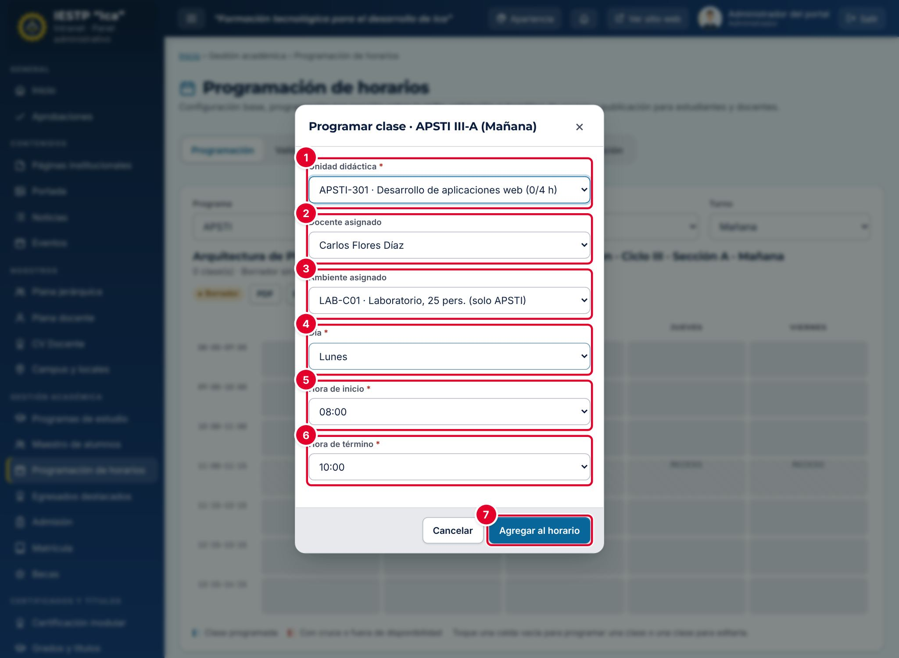
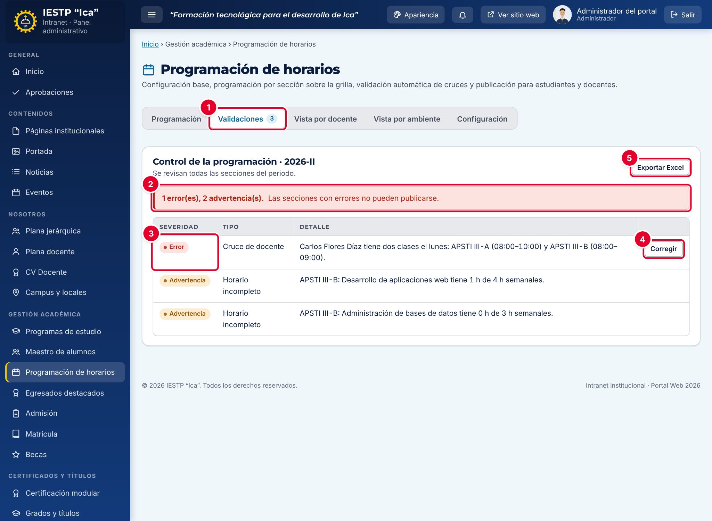

# 11 · Programación de horarios

**Para qué sirve:** arma el horario de cada sección (programa, ciclo, sección y turno) del periodo vigente, detecta cruces de docentes, ambientes y secciones, y publica solo horarios sin errores. **Quién lo usa:** Administrador (todo, incluida la configuración base); Secretaría académica y Coordinador (solo su programa) programan, validan y publican; Directivo consulta; Docente y Estudiante ven **Mi horario**. **Dónde:** Menú › **Gestión académica** › **Programación de horarios**.

| N.º | Campo | Para qué sirve |
|---|---|---|
| 1 | **Unidad didáctica** | Obligatorio. Unidades del programa y ciclo, con horas programadas/requeridas, p. ej. «(0/4 h)». |
| 2 | **Docente asignado** | Docentes con carga registrada. «Sin asignar» genera advertencia. |
| 3 | **Ambiente asignado** | Con tipo, capacidad y restricción. «Sin asignar» genera advertencia. |
| 4 | **Día** | Se toma de la celda pulsada; se puede cambiar. |
| 5, 6 | **Hora de inicio** y **Hora de término** | El término debe ser posterior al inicio (clase de dos horas: fin de la segunda hora). |
| 7 | **Agregar al horario** | Guarda la clase en la grilla. |

### Cómo se hace
1. En **Configuración**, registra **Unidades didácticas**, **Carga docente** (unidades que puede asumir y disponibilidad), **Ambientes** y **Bloques y receso**.
2. En **Programación**, elige **Programa**, **Ciclo**, **Sección** y **Turno**.
3. Pulsa una celda vacía (**+**), completa **Programar clase** y pulsa **Agregar al horario**.
4. Si aparece un cruce, corrige los datos (**Guardar de todos modos** impide publicar).
5. Revisa la pestaña **Validaciones** y pulsa **Corregir** en cada error.
6. Con «Sin observaciones.», pulsa **Publicar horario**.

| N.º | Elemento | Para qué sirve |
|---|---|---|
| 1 | **Validaciones** | Pestaña con el número de observaciones. |
| 2 | Resumen | Errores y advertencias. «Las secciones con errores no pueden publicarse.» |
| 3 | **Severidad** | **Error** (bloquea) o **Advertencia** (permite publicar). |
| 4 | **Corregir** | Abre la grilla y la ventana de una de las clases involucradas. |
| 5 | **Exportar Excel** | Descarga las observaciones. |

**Ten en cuenta**
- Estados: Borrador → Publicado (visible para estudiantes); agregar, editar o quitar una clase lo devuelve a borrador.
- Errores: cruce de docente, de ambiente o en la sección, fuera de disponibilidad y ambiente restringido. Advertencias: sin docente o ambiente, docente no habilitado, clase que cruza el receso, horario incompleto.
- El docente necesita su cuenta **Vinculado a** su carga docente (**Usuarios y roles**); el estudiante ve su sección según su ficha del Maestro de alumnos.
- **Incidencia:** Secretaría académica ve activos **Bloques y receso**; si los cambia, las clases se mueven pero los bloques no se guardan, así que solo el administrador debe usarlos.
