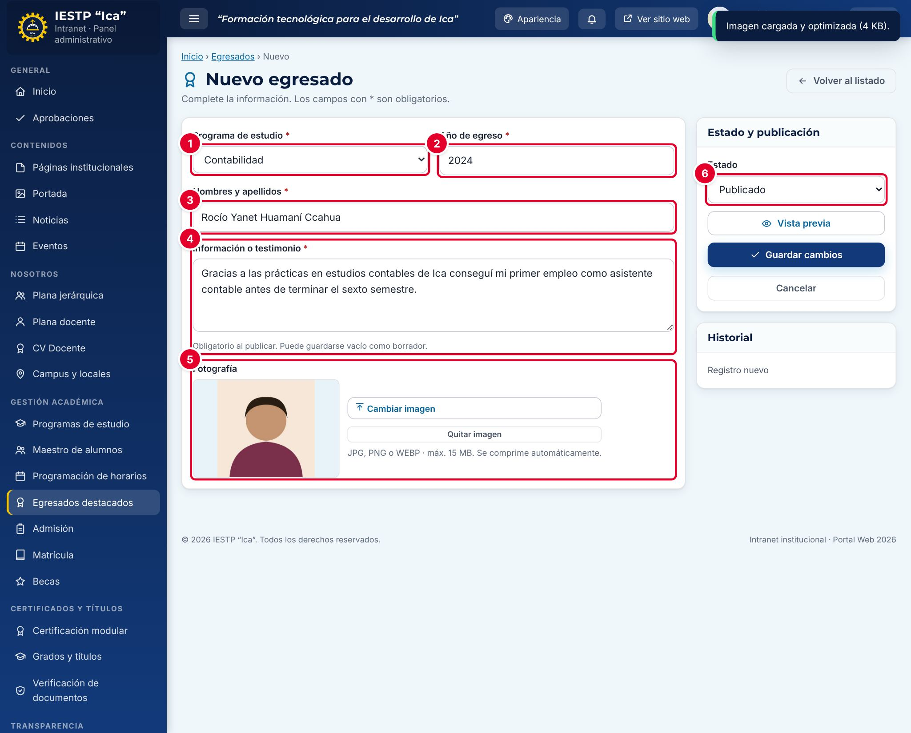

# 12 · Egresados destacados

**Para qué sirve:** registra egresados que la institución quiere destacar, con foto y testimonio; se muestran en **Nuestros egresados** (página del programa) y en **Lo que dicen nuestros egresados** (inicio). No es el padrón oficial (ese está en **Maestro de alumnos**). **Quién lo usa:** Administrador (incluida la eliminación definitiva), Secretaría académica, Coordinador de programa (solo su programa). **Dónde:** Menú › **Gestión académica** › **Egresados destacados**.

| N.º | Campo | Para qué sirve |
|---|---|---|
| 1 | **Programa de estudio** \* | Programa del que egresó. El coordinador solo elige el suyo. |
| 2 | **Año de egreso** \* | Se propone el año anterior al actual. |
| 3 | **Nombres y apellidos** \* | Nombre completo; no se repite en el mismo programa. |
| 4 | **Información o testimonio** | Hasta 400 caracteres. Obligatorio para publicar. |
| 5 | **Fotografía** | JPG, PNG o WEBP, hasta 15 MB. |
| 6 | **Estado** | **Borrador**, **Publicado** o **Despublicado**. |

### Cómo se hace
1. Pulsa **Nuevo egresado**.
2. Elige el **Programa de estudio** y escribe el **Año de egreso** y los **Nombres y apellidos**.
3. Escribe el testimonio: dos o tres oraciones sobre su experiencia o logro.
4. Pulsa **Seleccionar imagen** y carga la foto.
5. Elige el **Estado**: **Publicado** para verlo en el portal o **Borrador**.
6. Pulsa **Guardar cambios**. Aparece «Cambios guardados.».

**Ten en cuenta**
- Estados: Borrador → Publicado → Despublicado; **Eliminar** envía a la papelera (**Ver papelera** para restaurar).
- Publicar sin testimonio muestra «Obligatorio para publicar (puede guardarlo como borrador).».
- La página de inicio muestra hasta **tres** publicados (los más antiguos primero), solo si el bloque **Testimonios de egresados** está activo en **Portada**.
