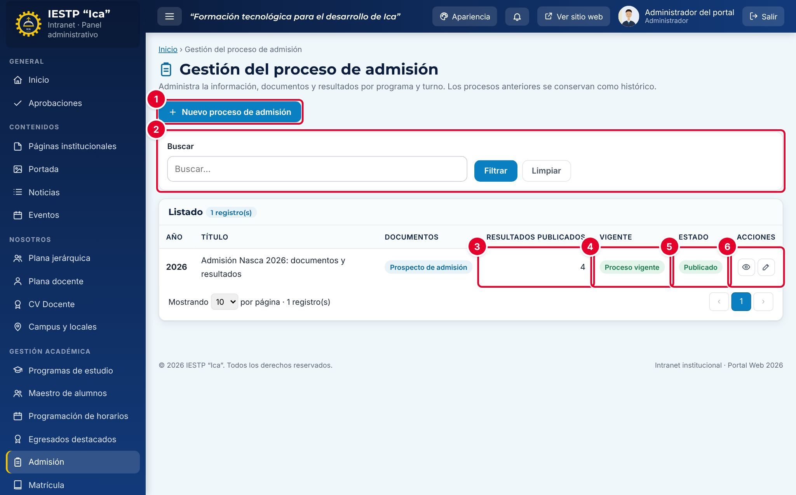

# 13 · Admisión

**Para qué sirve:** publica cada proceso de admisión; el **vigente** aparece en la página **Admisión** y los anteriores quedan como histórico. **Quién lo usa:** Administrador (publica, marca vigente, aprueba o devuelve); Secretaría académica (crea y edita; publicar requiere aprobación). **Dónde:** Menú › **Gestión académica** › **Admisión**.

| N.º | Elemento | Para qué sirve |
|---|---|---|
| 1 | **Nuevo proceso de admisión** | Abre el formulario de un proceso. |
| 2 | **Buscar** | Filtra el listado (**Filtrar** / **Limpiar**). |
| 3 | **Resultados publicados** | Archivos de resultados cargados. |
| 4 | **Vigente** | **Proceso vigente**: el que el portal muestra por defecto. Solo uno. |
| 5 | **Estado** | **Borrador**, **En revisión**, **Publicado** o **Cerrado**. |
| 6 | Acciones | **Vista previa** muestra la página pública; **Editar** abre el formulario. |

### Cómo se hace
1. Pulsa **Nuevo proceso de admisión** y completa **Título principal**, **Subtítulo** y **Descripción**.
2. En **Prospecto de admisión** y **Reglamento de admisión**, pulsa **Cargar archivo** (PDF, hasta 20 MB).
3. Carga resultados (**Cargar PDF** por programa y turno), vacantes, **Cronograma**, **Requisitos (uno por línea)** y **Modalidades de admisión**.
4. Guarda como **Borrador** (no se ve en el portal).
5. Para publicar, cambia el **Estado** a **Publicado**, marca **Proceso vigente** y pulsa **Guardar cambios**.

**Ten en cuenta**
- Estados: Borrador → En revisión → Publicado → Cerrado. No se eliminan; el vigente anterior pierde la marca solo.
- Cada cambio de Secretaría académica pasa a **En revisión** y retira el proceso del portal hasta que el Administrador pulse **Aprobar y publicar** (o **Devolver**) en **Aprobaciones**.
- Un borrador no puede ser vigente.
- **Incidencia:** con dos PDF de resultados por programa, el portal solo muestra uno; une ambos turnos en un solo PDF.
