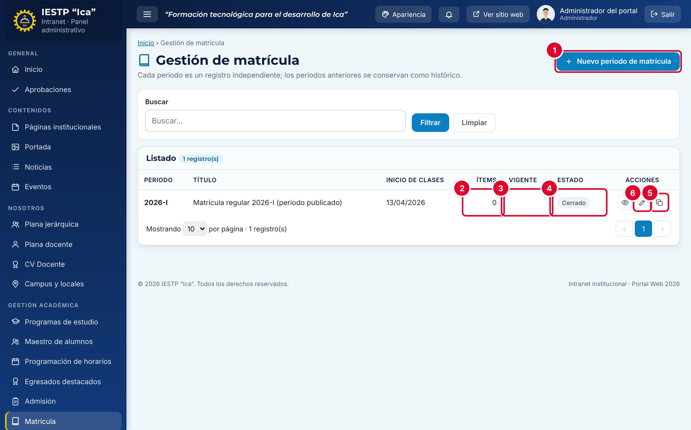

# 14 · Matrícula

**Para qué sirve:** publica cada periodo de matrícula (requisitos, tasas y cronograma); el **vigente** aparece en la página **Matrícula** del portal. **Quién lo usa:** Administrador y Secretaría académica (publica directamente, sin aprobación). **Dónde:** Menú › **Gestión académica** › **Matrícula**.

| N.º | Elemento | Para qué sirve |
|---|---|---|
| 1 | **Nuevo periodo de matrícula** | Crea un periodo vacío. |
| 2 | **Ítems** | Requisitos o indicaciones del periodo. |
| 3 | **Vigente** | Marca el periodo que muestra el portal. Solo uno. |
| 4 | **Estado** | **Borrador**, **Publicado** o **Cerrado**. |
| 5 | **Crear nuevo periodo copiando esta estructura** | Crea un periodo a partir de este. |
| 6 | **Editar** | Abre el formulario. El ojo (**Vista previa**) muestra la página pública. |

### Cómo se hace
1. En el periodo anterior, pulsa **Crear nuevo periodo copiando esta estructura**, escribe el periodo (p. ej. 2027-I) y pulsa **Crear periodo**.
2. Revisa el **Título principal**, la **Fecha de inicio de clases** y la **Descripción del proceso**.
3. En **Costos de matrícula**, **Matrícula de ingresantes** y **Ratificación de matrícula**, usa **+ Agregar ítem**.
4. Carga el **Documento oficial de tasas y costos** (PDF, hasta 20 MB) y completa el **Cronograma del periodo**.
5. Cambia el **Estado** a **Publicado**, marca **Periodo vigente (se muestra en el portal)** y pulsa **Guardar cambios**.

**Ten en cuenta**
- Estados: Borrador → Publicado → Cerrado. No se eliminan; solo hay un vigente.
- La copia queda en **Borrador**, sin tasas ni cronograma; revisa la fecha de inicio de clases.
- Para publicar se exigen título y fecha de inicio; un borrador no puede ser vigente.
- No se ven en el portal los ítems con candado naranja ni un periodo publicado no vigente.
