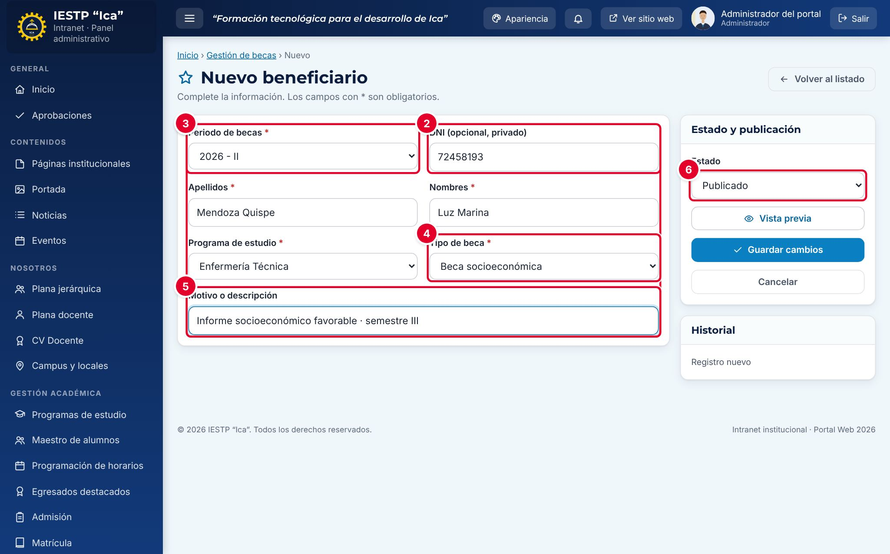

# 15 · Becas

**Para qué sirve:** registra periodos, tipos de beca y beneficiarios (uno a uno o por CSV); el portal los muestra en **Becas** sin el DNI. **Quién lo usa:** Administrador (incluye periodos **Cerrados** y eliminación definitiva) y Secretaría académica. **Dónde:** Menú › **Gestión académica** › **Becas**.

| N.º | Campo | Para qué sirve |
|---|---|---|
| 1 | **Periodo de becas** | Se propone el vigente. Los cerrados solo los ve el Administrador. |
| 2 | **DNI (opcional, privado)** | 8 dígitos. Permite buscar la beca por DNI en el portal; no se publica. |
| 3 | **Apellidos** y **Nombres** | Como en el documento de identidad. |
| 4 | **Programa de estudio** | Programa del beneficiario. |
| 5 | **Tipo de beca** | Solo tipos **Activos**. |
| 6, 7 | **Motivo o descripción** y **Estado** | El motivo se publica bajo el tipo; estado **Borrador**, **Publicado** (por defecto) o **Despublicado**. |

### Cómo se hace
1. En **Periodos de becas**, pulsa **Nuevo periodo**: **Año académico**, **Periodo** (I o II) y, si corresponde, **Marcar como periodo vigente**.
2. En **Tipos de beca**, revisa o crea el tipo (**Nombre** y **Descripción y requisitos**).
3. En **Beneficiarios**, pulsa **Nuevo beneficiario**, completa el formulario y pulsa **Guardar cambios**.

### Importar desde Excel
1. En **Importar desde Excel/CSV**, pulsa **Descargar plantilla** y complétala.
2. Guárdala como **CSV UTF-8 (delimitado por comas)**, hasta 2 MB.
3. Elige **Periodo de destino** y **Archivo CSV**; revisa el resumen.
4. Pulsa **Importar N beneficiario(s)**. Con alguna fila con error no se importa nada.

**Ten en cuenta**
- Estados: periodo Borrador → Publicado → Cerrado (solo el Administrador edita); beneficiario Publicado ⇄ Despublicado; **Eliminar** va a la papelera.
- No copies el DNI en **Motivo**: ese campo se publica.
- **Incidencia:** al pasar un tipo a **Inactivo**, el portal deja en blanco el tipo de sus beneficiarios; no desactives tipos con beneficiarios publicados.
