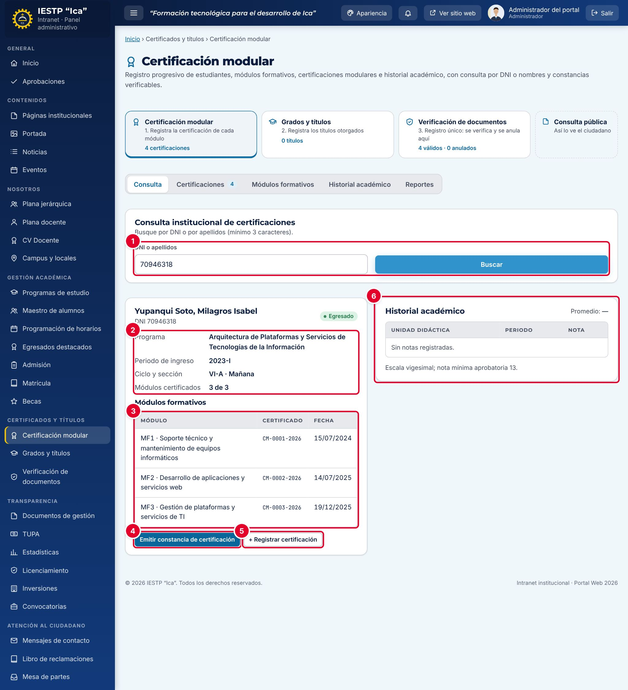

# 16 · Certificación modular

**Para qué sirve:** registra módulos formativos, certificaciones y notas; emite la **Constancia de certificación modular** con código y QR. Cada certificación se publica sola en **Verificación de documentos**. **Quién lo usa:** Administrador (módulos formativos y eliminación), Secretaría académica, Directivo (consulta); el estudiante ve su ficha. **Dónde:** Menú › **Certificados y títulos** › **Certificación modular**.

| N.º | Elemento | Para qué sirve |
|---|---|---|
| 1 | **DNI o apellidos** | Busca al estudiante (mínimo 3 caracteres). |
| 2 | Datos | Programa, ingreso, ciclo y sección, y módulos certificados (p. ej. 3 de 3). |
| 3 | **Módulos formativos** | Número y fecha del certificado, o **Pendiente**. |
| 4 | **Emitir constancia de certificación** | Genera la constancia; requiere al menos una certificación. |
| 5 | **+ Registrar certificación** | Registra una certificación para este estudiante. |
| 6 | **Historial académico** | Notas por unidad didáctica y periodo, con promedio. |

### Cómo se hace
1. Una vez por programa, el administrador registra los módulos en **Módulos formativos** › **+ Nuevo** (**Código**, **Nombre del módulo**, **Ciclos asociados**).
2. En **Consulta**, escribe el **DNI o apellidos** y pulsa **Buscar**.
3. Pulsa **+ Registrar certificación**, elige el **Módulo certificado**, la **Fecha de certificación** (no futura) y el **N.º de certificado** (se propone `CM-0001-2026`).
4. Pulsa **Registrar**. El estudiante recibe una notificación.
5. Para notas, usa **Historial académico** › **+ Registrar nota** (**Nota final (0–20)**).
6. Pulsa **Emitir constancia de certificación** y luego **Descargar PDF**.

**Ten en cuenta**
- Estados en Verificación de documentos: Válido → Anulado.
- No se registra dos veces el mismo módulo ni un módulo de otro programa.
- Solo el administrador elimina; si ya hay constancia, primero se anula en **Verificación de documentos**. Corrige con **Editar**.
- El formato de la constancia está en **Configuración académica** › **Constancias y reportes**.
