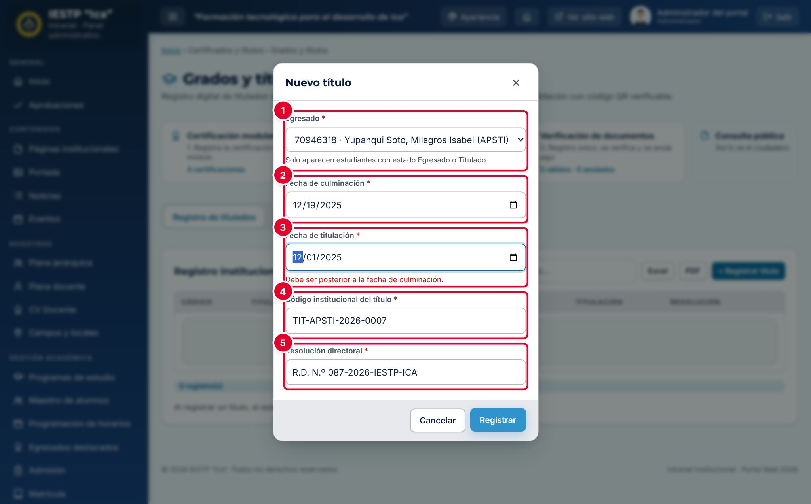

# 17 · Grados y títulos

**Para qué sirve:** registro institucional de titulados (fechas, código del título y resolución directoral); emite el **Reporte de validación de título** con código y QR. Cada título se publica solo en **Verificación de documentos**. **Quién lo usa:** Administrador (incluida la eliminación), Secretaría académica, Directivo (consulta); el egresado ve su título. **Dónde:** Menú › **Certificados y títulos** › **Grados y títulos**.

| N.º | Campo | Para qué sirve |
|---|---|---|
| 1 | **Egresado** | Solo alumnos **Egresado** o **Titulado** en el Maestro de alumnos. Un título por egresado. |
| 2 | **Fecha de culminación** | Fecha en que culminó sus estudios. |
| 3 | **Fecha de titulación** | Igual o posterior a la culminación; si no, «Debe ser posterior a la fecha de culminación.». |
| 4 | **Código institucional del título** | Único, en mayúsculas. Ej.: TIT-APSTI-2026-0007. |
| 5 | **Resolución directoral** | Ej.: R.D. N.º 087-2026-IESTP-ICA. |

### Cómo se hace
1. Verifica que el alumno esté como **Egresado** en el Maestro de alumnos.
2. Pulsa **+ Registrar título**.
3. Elige el **Egresado** y completa fechas, código y resolución.
4. Pulsa **Registrar**. El alumno pasa a **Titulado** y recibe una notificación.
5. Para el reporte, pulsa **Validación** en la fila y luego **Descargar PDF**.

**Ten en cuenta**
- Estados del alumno: Regular → Egresado → Titulado; solo el Egresado puede recibir título.
- La pestaña **Consulta y validación** busca por **DNI o apellidos** (mínimo 3 caracteres).
- Solo el administrador elimina, y no si ya se emitió un reporte (anúlalo antes). Eliminar no devuelve al alumno a Egresado.
- El portal verifica el título en **Servicios** › **Consulta de certificados** por código o DNI.
