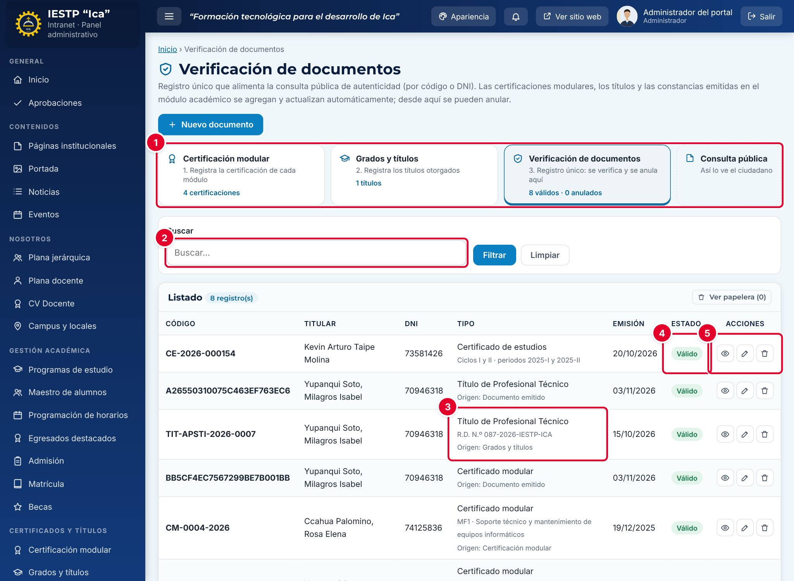

# 18 · Verificación de documentos

**Para qué sirve:** registro único de los documentos verificables en el portal; se alimenta solo de los capítulos 16 y 17 y admite registros a mano. Aquí se **anula** un documento. **Quién lo usa:** Administrador, Secretaría académica; el ciudadano verifica en el portal. **Dónde:** Menú › **Certificados y títulos** › **Verificación de documentos**; portal: **Servicios** › **Consulta de certificados** (`{{inst.dominio}}/#/servicios/consulta-certificados`).

| N.º | Elemento | Para qué sirve |
|---|---|---|
| 1 | Accesos del grupo | Módulos del grupo, con válidos y anulados, y **Consulta pública**. |
| 2 | **Buscar** | Por código, DNI o nombre (**Filtrar** / **Limpiar**). |
| 3 | **Tipo** | Tipo, detalle y **Origen** (Certificación modular, Grados y títulos o Documento emitido). |
| 4 | **Estado** | **Válido** o **Anulado**. |
| 5 | Acciones | Vista previa, Editar y Eliminar (envía a la papelera). |

### Anular un documento
1. Pulsa **Editar** en la fila.
2. En **Estado**, elige **Anulado**.
3. Escribe el **Motivo de anulación** (se muestra en el portal).
4. Pulsa **Guardar cambios**. Para revertir, vuelve a **Válido**.

### Registrar un documento a mano
1. Pulsa **+ Nuevo documento** (solo documentos no emitidos por el sistema).
2. Completa **Código de verificación** (igual al impreso), **DNI del titular**, **Nombres y apellidos**, **Programa**, **Tipo de documento** y **Fecha de emisión**.
3. Pulsa **Guardar cambios**.

**Ten en cuenta**
- Estados: Válido ⇄ Anulado; en la papelera la consulta dice «NO SE ENCONTRÓ EL DOCUMENTO». Prefiere anular a eliminar.
- Los documentos sincronizados se corrigen en su módulo de origen; aquí solo cambia el **Estado**.
- **Incidencia:** constancias y reportes se registran con el tipo del documento de origen, así que por DNI pueden aparecer dos «Título de Profesional Técnico»; el de código largo es el reporte.
