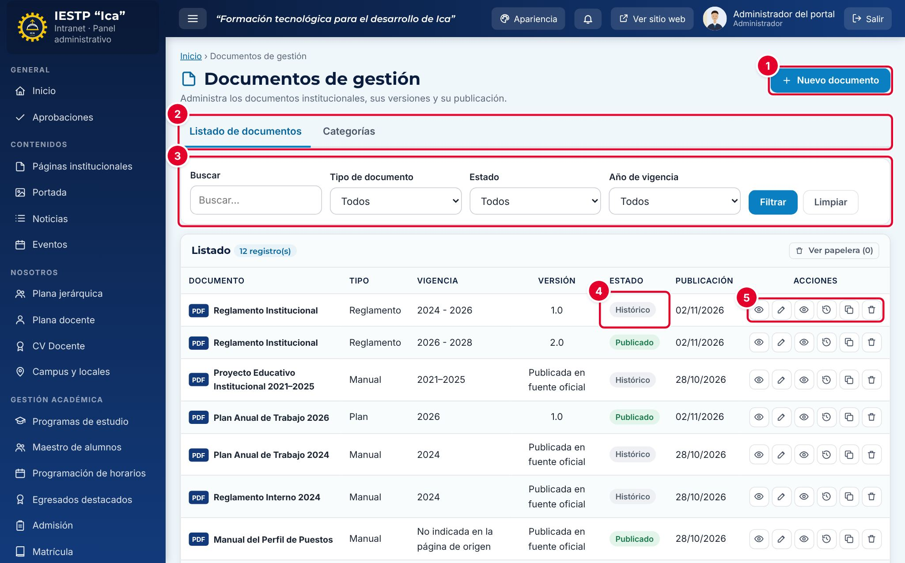

# 19 · Documentos de gestión

**Para qué sirve:** publica en PDF, con sus versiones, los documentos de gestión (planes, reglamentos, manuales, directivas, resoluciones, informes) en **Transparencia** › **Documentos de Gestión** del portal. **Quién lo usa:** Administrador (todo); Transparencia / administración (crea y edita, pero publica solo con aprobación). **Dónde:** Menú › **Transparencia** › **Documentos de gestión**.

| N.º | Elemento | Para qué sirve |
|---|---|---|
| 1 | **Nuevo documento** | Abre el formulario para registrar un documento. |
| 2 | Pestañas **Listado de documentos / Categorías** | Cambian entre documentos y tipos de documento. |
| 3 | Filtros | Buscan y filtran por **Tipo de documento**, **Estado** y **Año de vigencia**. |
| 4 | **Estado** | **Borrador**, **En revisión**, **Publicado** (vigente) o **Histórico**. |
| 5 | Acciones de la fila | **Vista previa**, **Editar**, **Ver archivo**, **Historial de versiones**, **Nueva versión** y **Eliminar**. |

### Cómo se hace
1. Pulsa **Nuevo documento**.
2. Completa **Nombre del documento**, **Tipo de documento**, **Año o periodo de vigencia** y **Versión**.
3. En **Origen del archivo** deja **Archivo propio (cargar PDF)** y pulsa **Cargar archivo** (PDF, hasta 20 MB).
4. Elige el **Estado**: **Borrador** o **Publicado**.
5. Pulsa **Guardar cambios**. Si eres de Transparencia, queda **En revisión** hasta que el Administrador lo apruebe o devuelva en **Aprobaciones**.
6. Para actualizarlo, usa **Nueva versión**, carga el PDF nuevo (la copia no lo conserva) y publícala.

**Ten en cuenta**
- Estados: Borrador → En revisión → Publicado → Histórico · En papelera.
- Usa siempre el mismo nombre: al publicar una versión nueva, la anterior pasa sola a **Histórico**.
- Al devolver, la observación es obligatoria; solo el Administrador puede **Eliminar definitivamente**.
- **Incidencia:** si Transparencia envía una versión como **Histórico** y se aprueba, queda **Publicado** y la vigente pasa a Histórico; además, la fecha de publicación se muestra un día antes.
