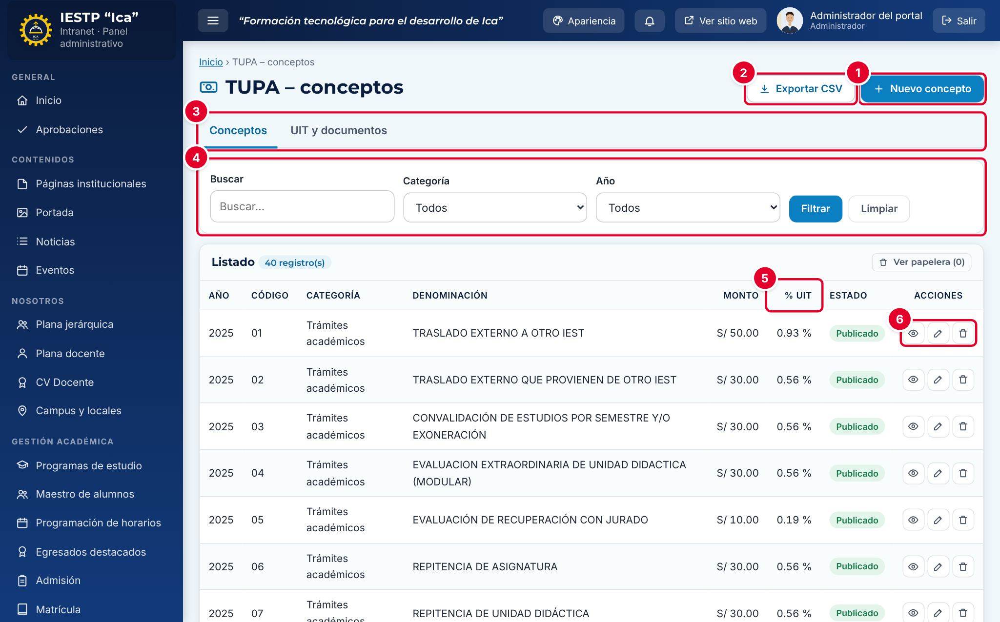

# 20 · TUPA

**Para qué sirve:** registra los conceptos del **Texto Único de Procedimientos Administrativos (TUPA)** (código, trámite, monto, lugar de pago, requisitos), los PDF del TUPA y su resolución, y la **UIT** de cada año. Se publica en **Transparencia** › **TUPA**. **Quién lo usa:** Administrador; Transparencia / administración (publica sin aprobación). **Dónde:** Menú › **Transparencia** › **TUPA**.

| N.º | Elemento | Para qué sirve |
|---|---|---|
| 1 | **Nuevo concepto** | Abre el formulario de una tasa. |
| 2 | **Exportar CSV** | Descarga los conceptos para abrirlos en Excel. |
| 3 | Pestañas **Conceptos / UIT y documentos** | Cambian entre conceptos y configuración de UIT y PDF. |
| 4 | Filtros | Buscan por código o denominación; filtran por **Categoría** y **Año**. |
| 5 | **% UIT** | Porcentaje del monto respecto de la UIT del año; «—» si no hay UIT. |
| 6 | Acciones de la fila | **Vista previa**, **Editar** y **Eliminar**. |

### Cómo se hace
1. Pulsa **Nuevo concepto**.
2. Revisa el **Año**; escribe el **Código** y elige la **Categoría**.
3. Escribe el **Monto (S/)** y la **Denominación del procedimiento**.
4. Revisa la **Cuenta / lugar de pago** y escribe los **Requisitos**, uno por línea.
5. Elige el **Estado** y pulsa **Guardar cambios**.

### Cargar el TUPA y la UIT
1. Abre **UIT y documentos** y revisa el **Año del TUPA vigente**.
2. Carga **Resolución de aprobación (PDF)** y **TUPA vigente (PDF)**.
3. En **Valor de la UIT por año**, pulsa **Agregar** si falta el año.
4. Pulsa **Guardar cambios**.

**Ten en cuenta**
- Estados: Borrador → Publicado · En papelera. Solo se ven los publicados del año del TUPA vigente.
- El **Código** no se repite dentro del mismo año.
- **Incidencia:** Transparencia no puede guardar la UIT («Tu rol no puede modificar esa configuración.»); la registra el Administrador.
