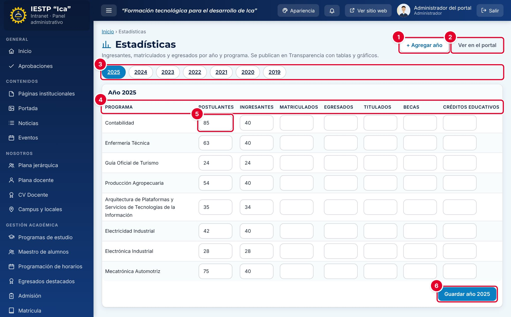

# 21 · Estadísticas

**Para qué sirve:** registra por año y por programa de estudio los indicadores institucionales, que se publican en **Transparencia** › **Estadísticas** con gráficos de los últimos cinco años, una tabla por programa y un CSV descargable. **Quién lo usa:** Administrador, Secretaría académica y Directivo. **Dónde:** Menú › **Transparencia** › **Estadísticas**.

| N.º | Elemento | Para qué sirve |
|---|---|---|
| 1 | **+ Agregar año** | Crea un año con una fila vacía por programa. |
| 2 | **Ver en el portal** | Abre la página pública en otra pestaña. |
| 3 | Años | Cada botón abre las cifras de ese año. |
| 4 | Indicadores | **Postulantes**, **Ingresantes**, **Matriculados**, **Egresados**, **Titulados**, **Becas** y **Créditos educativos**. |
| 5 | Celda | Cifra de un programa; vacía = «dato no publicado», no cero. |
| 6 | **Guardar año AAAA** | Guarda todas las cifras del año visible. |

### Cómo se hace
1. Pulsa **+ Agregar año**, escribe el **Año a registrar** y pulsa **Aceptar**.
2. Pulsa el botón del año.
3. Escribe las cifras; deja vacías las que aún no tengas.
4. Pulsa **Guardar año AAAA**. Aparece «Estadísticas del año 2026 guardadas.».

**Ten en cuenta**
- No hay estados ni aprobación: lo guardado se publica **de inmediato**.
- Año entre 2000 y 2100, sin repetir («El año ya existe.»). Cifras enteras, 0 o mayor.
- Si el valor real es cero, escribe **0**; una celda vacía se ve como «—».
- Los años no se eliminan; los cambios quedan en la **Auditoría**.
