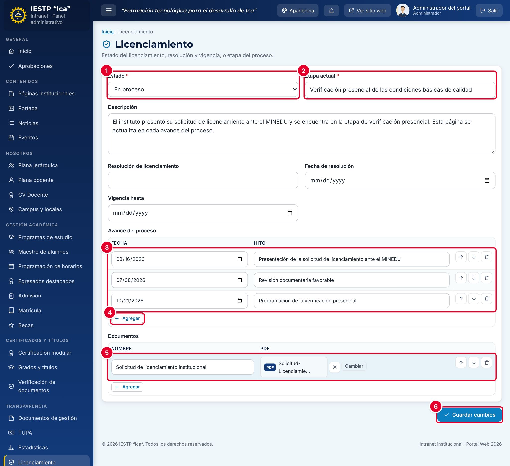

# 22 · Licenciamiento

**Para qué sirve:** informa la situación del licenciamiento institucional ante el MINEDU (estado, etapa, resolución, vigencia, hitos y documentos) en **Transparencia** › **Licenciamiento**. Es una sola ficha que se actualiza en cada avance. **Quién lo usa:** Administrador y Transparencia / administración. **Dónde:** Menú › **Transparencia** › **Licenciamiento**.

| N.º | Elemento | Para qué sirve |
|---|---|---|
| 1 | **Estado** | **No iniciado**, **En proceso**, **Licenciado** o **Denegado**. |
| 2 | **Etapa actual** | Frase corta del paso en que está el proceso. |
| 3 | Hitos registrados | **Avance del proceso**, con **Fecha** e **Hito**. |
| 4 | **Agregar** | Añade un hito nuevo. |
| 5 | **Adjuntar** | Elige el PDF de un documento de sustento. |
| 6 | **Guardar cambios** | Guarda la ficha y la publica. |

### Cómo se hace
1. Revisa el **Estado**; mientras el MINEDU evalúa, usa **En proceso**.
2. Actualiza la **Etapa actual** y, si hace falta, la **Descripción**.
3. En **Avance del proceso**, pulsa **Agregar**, elige la **Fecha** y escribe el **Hito**.
4. Ordénalos de más antiguo a más reciente con **Subir** y **Bajar**.
5. En **Documentos**, pulsa **Agregar**, escribe el **Nombre** y pulsa **Adjuntar** (PDF, hasta 20 MB).
6. Pulsa **Guardar cambios**. Aparece «Cambios guardados.».

**Ten en cuenta**
- Estados: No iniciado → En proceso → Licenciado · Denegado.
- Sin aprobación: lo guardado se publica **de inmediato**.
- Con **Licenciado** es obligatoria la **Resolución de licenciamiento** («Indique la resolución de licenciamiento.»); registra también **Fecha de resolución** y **Vigencia hasta**.
- Los hitos salen en el portal en el orden del formulario, no por fecha.
