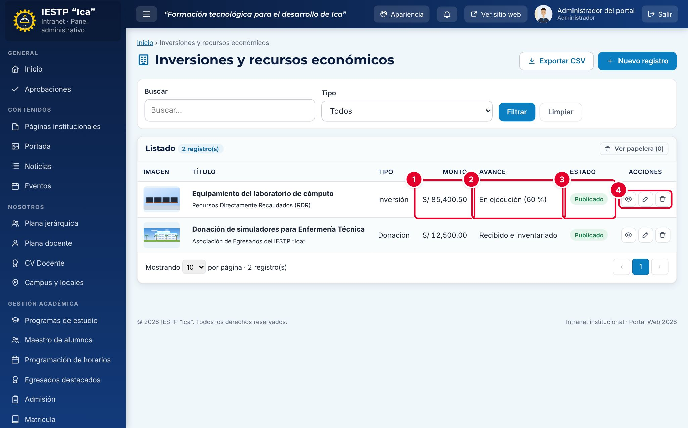

# 23 · Inversiones y recursos económicos

**Para qué sirve:** registra inversiones, reinversiones, obras (incluidas las obras por impuestos), donaciones y otros recursos, con monto, fuente, avance y documento de sustento. Se publican en **Transparencia** › **Inversiones y Recursos Económicos**. **Quién lo usa:** Administrador; Transparencia / administración (sin aprobación). **Dónde:** Menú › **Transparencia** › **Inversiones**.

| N.º | Elemento | Para qué sirve |
|---|---|---|
| 1 | **Monto** | Importe en soles del registro. |
| 2 | **Avance** | Situación actual de la obra o del recurso. |
| 3 | **Estado** | **Borrador** o **Publicado**. |
| 4 | Acciones de la fila | **Vista previa**, **Editar** y **Eliminar**. |

### Cómo se hace
1. Pulsa **Nuevo registro**.
2. Completa **Título**, **Tipo**, **Fuente de financiamiento**, **Monto (S/)** y **Fecha**.
3. Escribe el **Estado o avance** y la **Descripción**.
4. Opcional: pulsa **Seleccionar imagen** para cargar una foto.
5. Pulsa **Cargar archivo** en **Documento sustentatorio** (PDF, hasta 20 MB).
6. Elige el **Estado** y pulsa **Guardar cambios**. Aparece «Cambios guardados.».

**Ten en cuenta**
- Estados: Borrador → Publicado · En papelera (solo el Administrador elimina definitivamente).
- Para publicar son obligatorios **Estado o avance** y **Descripción** («Obligatorio para publicar (puede guardarlo como borrador).»).
- Actualiza el avance con **Editar**; usa **Reemplazar** si hay un documento nuevo.
- **Exportar CSV** descarga el listado para rendiciones de cuentas.
