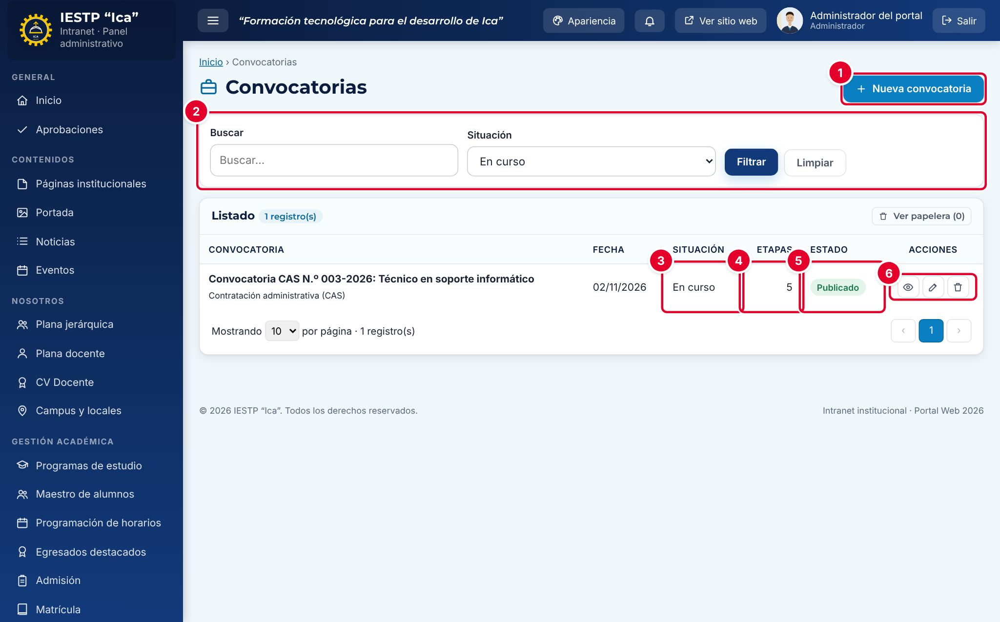

# 24 · Convocatorias

**Para qué sirve:** publica los procesos de selección (contratación docente, CAS, encargaturas y otros) con sus **bases** en PDF y un **cronograma por etapas** con sus resultados, en **Transparencia** › **Convocatorias**. **Quién lo usa:** Administrador (publica y aprueba); Transparencia / administración (crea y edita, publica solo con aprobación). **Dónde:** Menú › **Transparencia** › **Convocatorias**.

| N.º | Elemento | Para qué sirve |
|---|---|---|
| 1 | **Nueva convocatoria** | Abre el formulario. |
| 2 | Filtros | **Buscar** por título y filtrar por **Situación**. |
| 3 | **Situación** | Estado no confirmado, En curso, Concluida, Desierta o Cancelada. |
| 4 | **Etapas** | Cantidad de etapas del cronograma. |
| 5 | **Estado** | **Borrador**, **En revisión** o **Publicado**. |
| 6 | Acciones de la fila | **Vista previa**, **Editar** y **Eliminar**. |

### Cómo se hace
1. Pulsa **Nueva convocatoria**.
2. Escribe el **Título**; elige **Tipo**, **Fecha de publicación** y **Situación** (**En curso** si está abierta).
3. Escribe la **Descripción** y pulsa **Cargar archivo** en **Bases**.
4. En **Cronograma y resultados por etapa**, pulsa **Agregar** por cada etapa, con nombre y fecha.
5. Elige **Publicado** en **Estado** y pulsa **Guardar cambios**. Si eres de Transparencia, queda **En revisión** hasta que el Administrador pulse **Aprobar y publicar**.
6. Para cada resultado, edita la convocatoria, pulsa **Adjuntar** en la etapa y guarda; al terminar, cambia la **Situación** a **Concluida**.

**Ten en cuenta**
- Estados: Borrador → En revisión → Publicado · En papelera. La **Situación** describe el proceso; el **Estado**, si se ve en el portal.
- Las **Bases** son obligatorias para publicar.
- Cada cambio de Transparencia en una convocatoria publicada vuelve a **En revisión** y la retira del portal hasta la aprobación: coordina que se apruebe el mismo día.
