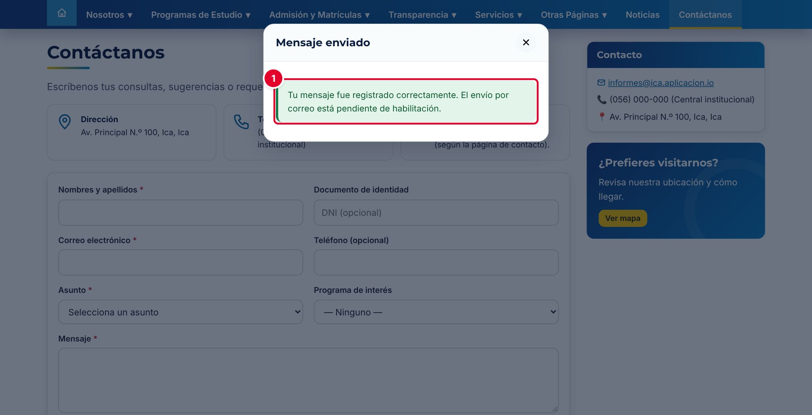
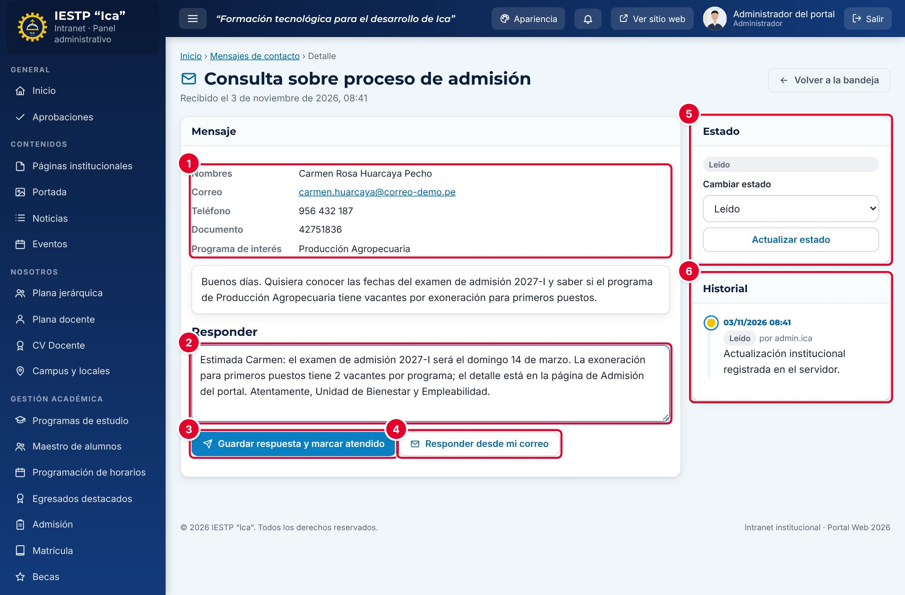

# 25 · Mensajes de contacto

**Para qué sirve:** recibe en una bandeja de la intranet las consultas, sugerencias y pedidos de información que el público envía desde el formulario **Contáctanos** del portal; ahí se leen, se responden y se marcan como atendidos. **Quién lo usa:** Administrador y Atención al ciudadano; el ciudadano envía sin cuenta. **Dónde:** Menú › **Atención al ciudadano** › **Mensajes de contacto** (portal: `{{inst.dominio}}/#/contacto`).

| N.º | Elemento | Para qué sirve |
|---|---|---|
| 1 | **Mensaje enviado** | Confirma que el mensaje fue registrado; el formulario se limpia. |

### Cómo envía el ciudadano
1. Abre **Contáctanos** y completa **Nombres y apellidos***, **Correo electrónico***, **Asunto*** y **Mensaje*** (10 a 1500 caracteres).
2. Resuelve la **Verificación anti-spam** y acepta la Política de Privacidad.
3. Pulsa **Enviar mensaje**.

| N.º | Elemento | Para qué sirve |
|---|---|---|
| 1 | Datos del remitente | Nombres, correo, teléfono, documento, programa y el mensaje. |
| 2 | **Responder** | Texto de la respuesta institucional. |
| 3 | **Guardar respuesta y marcar atendido** | Guarda la respuesta y pasa a **Atendido**. |
| 4 | **Responder desde mi correo** | Abre tu correo con la respuesta escrita y marca **Atendido**. |
| 5 | **Estado** | Cambio manual con **Actualizar estado**. |
| 6 | **Historial** | Cada cambio con fecha, usuario y nota. |

### Cómo se atiende
1. En la bandeja, pulsa el ojo (**Ver detalle**). El mensaje pasa solo a **Leído**.
2. Escribe la respuesta en **Responder** (mínimo 5 caracteres).
3. Pulsa **Responder desde mi correo** y luego **Enviar** en tu correo; o **Guardar respuesta y marcar atendido** si respondiste por teléfono o en persona.

**Ten en cuenta**
- Estados: Nuevo → Leído → Atendido · Papelera (se restaura con **Restaurar**).
- No genera código de seguimiento: el ciudadano no puede consultar el estado en el portal.
- El portal **no envía correos** («Correo desactivado.»): la respuesta solo llega con **Responder desde mi correo** o por teléfono.
- Responde en un plazo máximo de 2 días hábiles.
