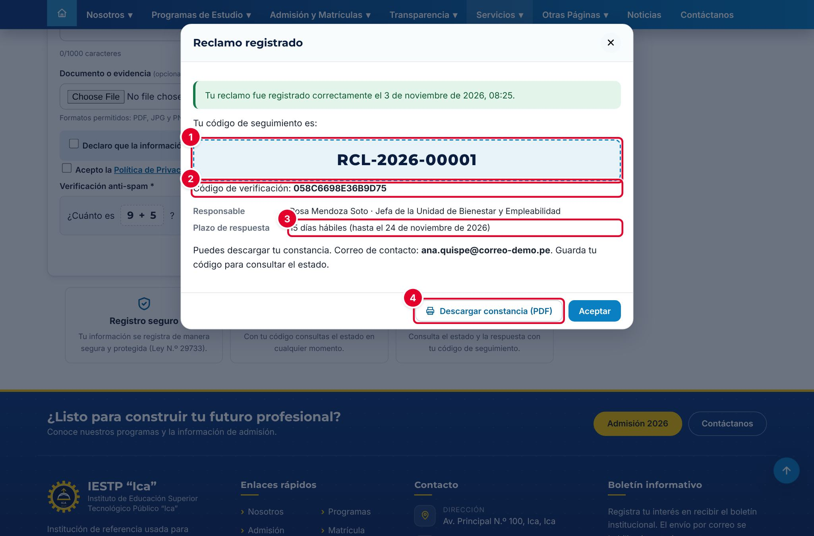
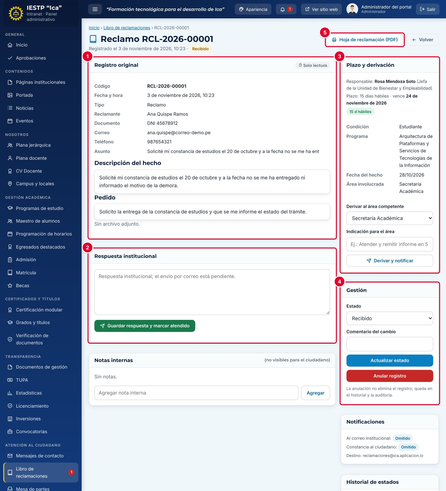

# 26 · Libro de reclamaciones

**Para qué sirve:** recibe desde el portal los **reclamos** (disconformidad con el servicio o un trámite) y las **quejas** (malestar por la atención); en la intranet se derivan, se atienden y se responden dentro del plazo. **Quién lo usa:** Administrador, Atención al ciudadano, Directivo (consulta); el ciudadano registra sin cuenta. **Dónde:** Menú › **Atención al ciudadano** › **Libro de reclamaciones** (portal: **Servicios** › **Libro de Reclamaciones**).

| N.º | Elemento | Para qué sirve |
|---|---|---|
| 1 | **Código de seguimiento** (RCL-AAAA-NNNNN) | Consultar el estado del caso. |
| 2 | **Código de verificación** | Sirve en lugar del DNI para consultar y validar la constancia. |
| 3 | Responsable y **plazo de respuesta** | Fecha máxima de respuesta, en días hábiles. |
| 4 | **Descargar constancia (PDF)** | Hoja de reclamación con código QR. |

### Cómo registra el ciudadano
1. En **Registrar reclamo o queja**, completa **Datos del usuario** y elige **Reclamo** o **Queja**.
2. Escribe la **Descripción de los hechos***, la **Fecha del hecho*** y el **Pedido concreto***; adjunta evidencia si tienes (hasta 10 MB).
3. Acepta las declaraciones, resuelve la **Verificación anti-spam** y pulsa **Enviar reclamo**.
4. Para ver la respuesta, usa **Consultar estado** con el código y el DNI.

| N.º | Elemento | Para qué sirve |
|---|---|---|
| 1 | **Registro original** | Datos y hechos del reclamo, solo lectura. |
| 2 | **Respuesta institucional** | Respuesta que verá el ciudadano. |
| 3 | **Plazo y derivación** | Responsable, vencimiento y derivación al área. |
| 4 | **Gestión** | Cambio de estado con comentario, y anulación. |
| 5 | **Hoja de reclamación (PDF)** | Descarga la constancia oficial. |

### Cómo se atiende
1. Abre el caso con el ojo en **Bandeja de reclamos**.
2. Elige el área en **Derivar al área competente**, escribe la **Indicación para el área** y pulsa **Derivar y notificar**.
3. En **Gestión**, elige **En atención**, escribe el **Comentario del cambio** y pulsa **Actualizar estado**.
4. Escribe la **Respuesta institucional** (mínimo 10 caracteres) y pulsa **Guardar respuesta y marcar atendido**.

**Ten en cuenta**
- Estados: Recibido → Derivado → En atención → Atendido · Anulado (no se borra).
- Plazo: 15 días hábiles para reclamos y para quejas (configurable de 1 a 30). Nadie puede modificar el registro original.
- El correo está desactivado (notificaciones «Omitido»): el ciudadano consulta la respuesta con su código.
- **Incidencia:** en **Responsable y plazos**, **Guardar** muestra «Configuración guardada.» pero no guarda nada; el responsable se carga con apoyo técnico.
