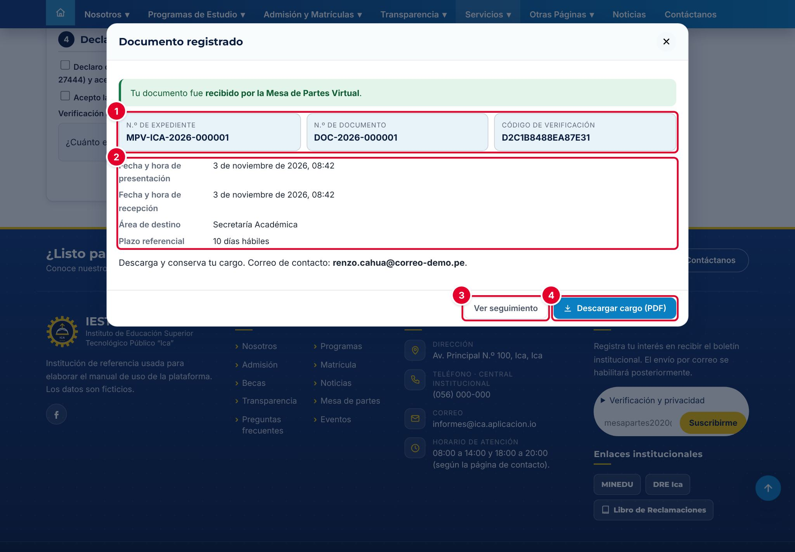
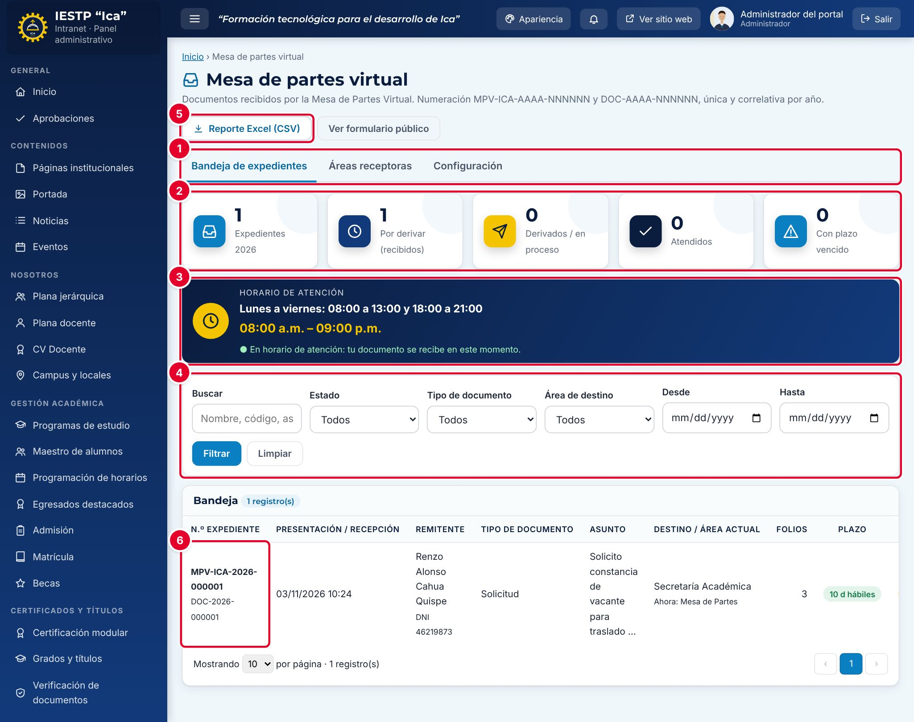

# 27 · Mesa de partes virtual

**Para qué sirve:** recibe por internet, las 24 horas, solicitudes, oficios, cartas, FUT y otros documentos. Cada uno obtiene un **N.º de expediente** y un **cargo de recepción en PDF** con QR; en la intranet se deriva al área, que lo atiende. **Quién lo usa:** Administrador, Atención al ciudadano, Directivo (solo lectura), personal de un área (sus expedientes); el ciudadano registra sin cuenta. **Dónde:** Menú › **Atención al ciudadano** › **Mesa de partes virtual** (portal: **Servicios** › **Mesa de Partes**).

| N.º | Elemento | Para qué sirve |
|---|---|---|
| 1 | **N.º de expediente**, **N.º de documento** y **Código de verificación** | Consultar el expediente; el código reemplaza al DNI. |
| 2 | Fechas, área de destino y plazo referencial | Indica «Fuera de horario: siguiente día hábil» si corresponde. |
| 3 | **Ver seguimiento** | Abre la consulta del expediente. |
| 4 | **Descargar cargo (PDF)** | Cargo con sello, archivos con huella SHA-256 y QR. |

### Cómo registra el ciudadano
1. En **Nuevo trámite**, completa los datos del remitente.
2. Elige **Tipo de documento a presentar***, **Área de destino***, escribe el **Asunto*** y el **N.º de folios***.
3. Adjunta el **Documento principal y anexos*** (hasta 5 archivos de 40 MB).
4. Acepta las declaraciones, resuelve la verificación y pulsa **Registrar y obtener cargo**.

| N.º | Elemento | Para qué sirve |
|---|---|---|
| 1 | Pestañas | **Bandeja de expedientes**, **Áreas receptoras** y **Configuración**. |
| 2 | Indicadores | Del año, por derivar, en proceso, atendidos y vencidos. |
| 3 | Horario de atención | El mismo recuadro que ve el ciudadano. |
| 4 | Filtros | **Buscar**, **Estado**, **Tipo de documento**, **Área de destino** y fechas. |
| 5 | **Reporte Excel (CSV)** | Descarga la bandeja filtrada. |
| 6 | Fila del expediente | Datos, área actual, plazo y estado; el ojo abre el detalle. |

### Cómo se atiende
1. Abre el expediente con el ojo.
2. En **Derivar a un área**, elige el **Área receptora**, escribe el **Proveído / indicación** y pulsa **Derivar expediente**.
3. En **Actualizar estado**, elige el **Nuevo estado** y escribe la **Nota / respuesta**.
4. Pulsa **Guardar estado**.

**Ten en cuenta**
- Estados: Recibido → Derivado → En proceso → Atendido → Archivado · Observado. **Observado** y **Atendido** exigen nota, visible en el portal.
- Plazo en días hábiles por tipo (Solicitud 10, Oficio 7, Recurso administrativo 30); lo presentado fuera de horario se recibe el siguiente día hábil. No se envían correos.
- **Incidencia:** **Guardar configuración** muestra el mensaje de guardado pero no guarda; los cambios se hacen con apoyo técnico.
