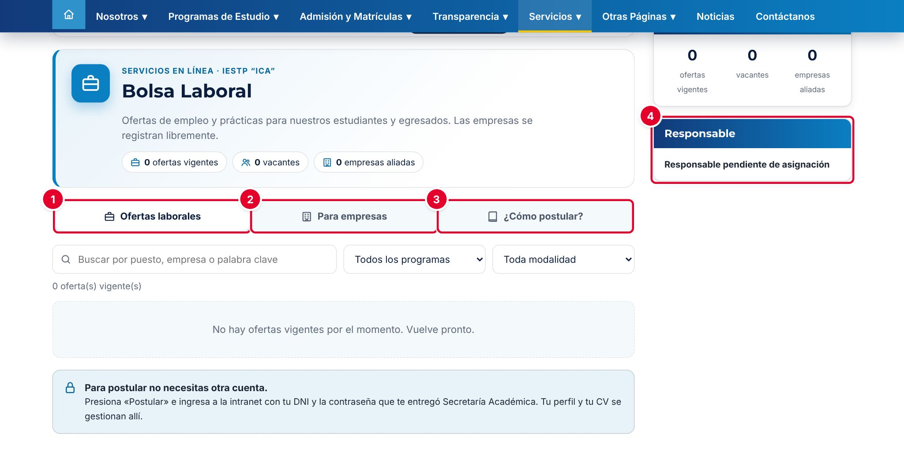
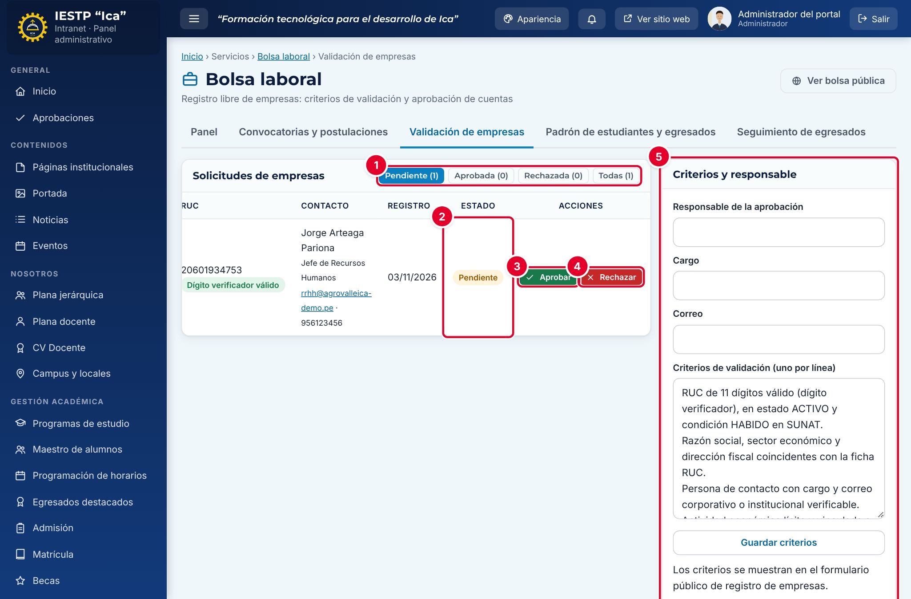

# 28 · Bolsa laboral

**Para qué sirve:** conecta a estudiantes y egresados con empresas validadas. Las empresas se registran gratis en el portal y publican ofertas; el instituto valida empresas y ofertas, y los alumnos postulan con su CV desde la intranet. **Quién lo usa:** Administrador y Atención al ciudadano (validan), Directivo (consulta), Empresa, Estudiante y Egresado; el público ve las ofertas. **Dónde:** Menú › **Servicios** › **Bolsa laboral** (portal: **Servicios** › **Bolsa Laboral**).

| N.º | Elemento | Para qué sirve |
|---|---|---|
| 1 | **Ofertas laborales** | Ofertas vigentes, con buscador y filtros por programa y modalidad. |
| 2 | **Para empresas** | Registro de empresas, acceso a la intranet y empresas aliadas. |
| 3 | **¿Cómo postular?** | Pasos para estudiantes y egresados, y preguntas frecuentes. |
| 4 | **Responsable** | Responsable de validar a las empresas. |

### Cómo se registra y publica la empresa
1. En **Para empresas**, completa **RUC***, **Razón social***, contacto y **Contraseña para la intranet*** (mínimo 12 caracteres).
2. Acepta la declaración jurada y pulsa **Crear cuenta de empresa**. Queda pendiente de validación.
3. Ya aprobada, ingresa con su RUC y en **Mis ofertas** pulsa **+ Publicar oferta** y **Registrar**.

| N.º | Elemento | Para qué sirve |
|---|---|---|
| 1 | Filtros | **Pendiente**, **Aprobada**, **Rechazada** o **Todas**. |
| 2 | **Estado** | Situación actual de la empresa. |
| 3 | **Aprobar** | Valida a la empresa. |
| 4 | **Rechazar** | Rechaza con motivo (mínimo 5 caracteres). |
| 5 | **Criterios y responsable** | Responsable y criterios del formulario de registro. |

### Cómo valida el instituto
1. En **Validación de empresas**, revisa los datos y comprueba en SUNAT que el RUC esté **activo y habido**.
2. Pulsa **Aprobar** o **Rechazar**.
3. En **Convocatorias y postulaciones** › **Ofertas**, ubica las **Por validar** y pulsa **Aprobar** o **Rechazar**.

El alumno sube su CV (PDF, hasta 5 MB) en **Mi perfil profesional** y pulsa **Postular**; la empresa cambia el estado en **Postulantes**.

**Ten en cuenta**
- Estados: empresa Pendiente → Aprobada · Rechazada; oferta Por validar → Publicada → Cerrada · Rechazada; postulación Recibida → En revisión → Seleccionado · No seleccionado.
- Una oferta solo se ve si está **Publicada**, en plazo y con empresa **Aprobada**. Los avisos llegan solo a la campana: no se envían correos.
- **Incidencia:** **Guardar criterios** muestra «Criterios guardados.» pero no guarda el responsable; se carga con apoyo técnico.
