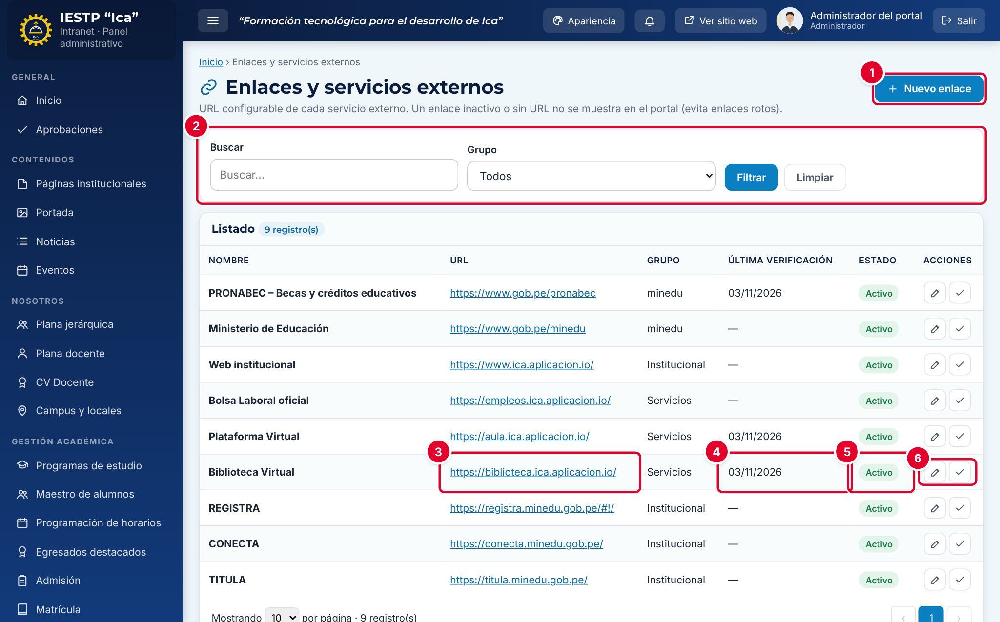

# 29 · Enlaces y servicios externos

**Para qué sirve:** configura la URL de los servicios externos que enlaza el portal: biblioteca virtual, aula virtual, MINEDU y otras entidades. **Quién lo usa:** Administrador e Imagen institucional. **Dónde:** Menú › **Servicios** › **Enlaces y servicios**.

| N.º | Elemento | Para qué sirve |
|---|---|---|
| 1 | **Nuevo enlace** | Abre el formulario para registrar un enlace. |
| 2 | Filtros | Buscan por nombre y filtran por **Grupo**. |
| 3 | **URL** | Dirección del servicio; vacía, dice **Sin configurar**. |
| 4 | **Última verificación** | Fecha de la última comprobación; tras un mes aparece **Revisar**. |
| 5 | **Estado** | **Activo** (se muestra en el portal) o **Inactivo**. |
| 6 | Acciones de la fila | **Editar** y **Marcar como verificado hoy** (✓). |

### Cómo se hace
1. Pulsa el lápiz (**Editar**) del servicio; por ejemplo, **Biblioteca Virtual**.
2. Escribe la nueva **URL** completa, con `https://`.
3. Comprueba que carga y escribe la **Fecha de última verificación**.
4. Revisa que el **Estado** sea **Activo** y pulsa **Guardar cambios**.
5. Cada mes, en las filas con **Revisar**, pulsa ✓: abre la URL y registra la fecha de hoy.

**Ten en cuenta**
- Los enlaces no se eliminan: se dejan **Inactivo**. Un enlace inactivo o sin URL no se muestra.
- La franja superior, los menús y el pie usan un **código interno fijo**: un enlace nuevo no los reemplaza; edita el existente.
- Solo los enlaces del grupo **MINEDU y entidades** aparecen en el bloque **Enlaces institucionales** de la página de inicio.
- **Incidencia:** faltan los registros de **Correo institucional**, **Avanza** y la **DRE** y no se pueden crear con su código interno.
