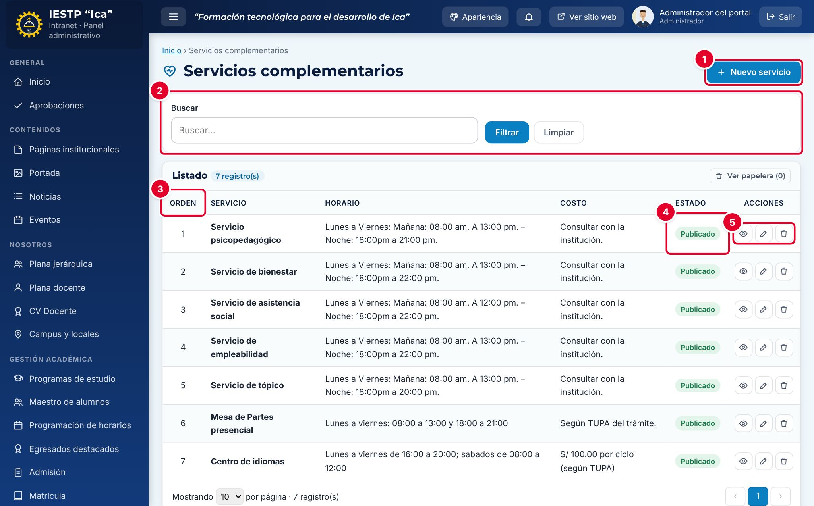

# 30 · Servicios complementarios

**Para qué sirve:** registra los servicios que la institución ofrece (psicopedagógico, bienestar, tópico, centro de idiomas, etc.) con descripción, ubicación, horario, personal a cargo y costo; se publican en **Servicios** › **Servicios Complementarios**. **Quién lo usa:** Administrador (todo, incluida la eliminación definitiva) y Transparencia / administración (sin aprobación). **Dónde:** Menú › **Servicios** › **Servicios complementarios**.

| N.º | Elemento | Para qué sirve |
|---|---|---|
| 1 | **Nuevo servicio** | Abre el formulario. |
| 2 | Filtros | Buscan por nombre. |
| 3 | **Orden** | Posición del servicio en el portal; el listado se ordena por este número. |
| 4 | **Estado** | **Borrador**, **Publicado** o **Despublicado**. |
| 5 | Acciones de la fila | **Vista previa**, **Editar** y **Eliminar** (envía a la papelera). |

### Cómo se hace
1. Pulsa **Nuevo servicio**.
2. Escribe el **Nombre** y elige el **Ícono** (`heart`, `users`, `briefcase`, `book`, etc.).
3. Completa **Descripción**, **Ubicación**, **Horario (días y horas)**, **Personal a cargo** y **Costo**.
4. Escribe el **Orden**: el número siguiente al último del listado.
5. Elige el **Estado** y pulsa **Guardar cambios**. Aparece «Cambios guardados.».

**Ten en cuenta**
- Son obligatorios **Nombre**, **Descripción**, **Horario** y **Costo**.
- El **Orden** no puede repetirse entre servicios activos: si sale «El orden N ya está asignado a “…”.», mueve antes uno a un número libre (por ejemplo, 99).
- **Despublicado** retira el servicio y libera su número de orden; **Eliminar** lo envía a la papelera (**Ver papelera** › **Restaurar**).
- **Plataformas en línea**, en la misma página del portal, muestra los enlaces configurados en **Enlaces y servicios** (capítulo 29).
