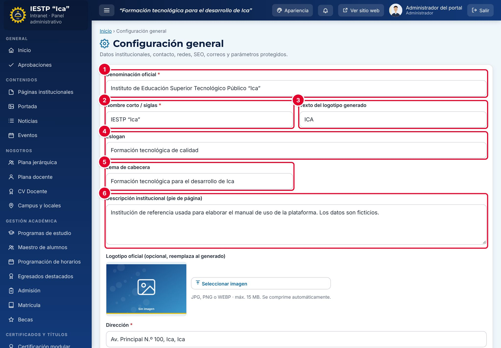

# 31 · Configuración general

**Para qué sirve:** registra los datos que identifican a la institución en todo el portal: denominación, siglas, logotipo, contacto, redes sociales, WhatsApp, SEO y los correos que reciben los avisos del Libro de Reclamaciones y de Contáctanos. **Quién lo usa:** solo el Administrador. **Dónde:** Menú › **Configuración y seguridad** › **Configuración**.

| N.º | Elemento | Para qué sirve |
|---|---|---|
| 1 | **Denominación oficial** | Nombre completo; sale en la cabecera, el pie y los derechos reservados. |
| 2 | **Nombre corto / siglas** | Nombre grande junto al logotipo, en la intranet y en el acceso. |
| 3 | **Texto del logotipo generado** | Hasta 10 caracteres; se usa si no hay logotipo oficial. |
| 4 | **Eslogan** | Frase de la barra superior y bajo el nombre. |
| 5 | **Lema de cabecera** | Frase destacada a la derecha de la cabecera. |
| 6 | **Descripción institucional (pie de página)** | Párrafo de presentación del pie de página. |

### Cómo se hace
1. Entra a **Configuración y seguridad** › **Configuración**.
2. Corrige los campos; los obligatorios llevan asterisco rojo.
3. Para el logotipo, pulsa **Seleccionar imagen** en **Logotipo oficial** (JPG, PNG o WEBP).
4. Para WhatsApp, marca **Mostrar botón flotante de WhatsApp** y escribe el número con código de país, sin «+» ni espacios (ej. 51956000111).
5. Pulsa **Guardar cambios** al final y espera «Cambios guardados.».
6. Comprueba el cambio con **Ver sitio web**.

**Ten en cuenta**
- Es un formulario único con un solo botón de guardar; si algo falla, aparece «Revise los campos marcados en rojo.».
- **Título SEO** hasta 70 caracteres; **Descripción SEO** hasta 170; redes sociales con `https://`.
- Ventana emergente, UIT, colores y periodo académico se configuran en **Portada**, **TUPA**, **Temas y apariencia** y **Configuración académica**.
- Cada guardado queda en la auditoría como «Cambiar configuración».
