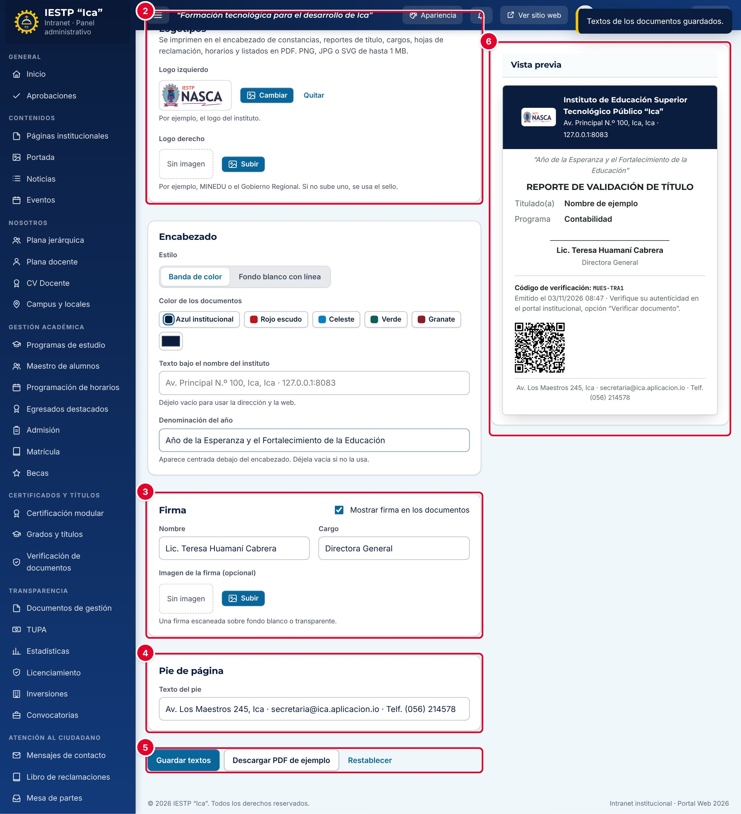

# 32 · Configuración académica

**Para qué sirve:** define el **periodo académico vigente** (base de horarios y formularios) y el formato de los documentos PDF que emite el sistema (constancias, reportes, cargos, hojas de reclamación, horarios). **Quién lo usa:** solo el Administrador. **Dónde:** Menú › **Configuración y seguridad** › **Configuración académica**.

| N.º | Elemento | Para qué sirve |
|---|---|---|
| 1 | **Logotipos** | **Logo izquierdo** y **Logo derecho**; PNG, JPG, SVG o WEBP hasta 1 MB. Se guardan al instante. |
| 2 | **Encabezado** | **Estilo**, **Color de los documentos**, texto bajo el nombre y **Denominación del año**. |
| 3 | **Firma** | **Mostrar firma en los documentos**, **Nombre**, **Cargo** e imagen opcional. |
| 4 | **Pie de página** | **Texto del pie** (hasta 160 caracteres). |
| 5 | Botones | **Guardar textos**, **Descargar PDF de ejemplo** y **Restablecer**. |
| 6 | **Vista previa** | Muestra encabezado, firma, código de verificación y pie. |

### Cómo se hace
1. En la pestaña **Constancias y reportes**, sube los logotipos.
2. Elige el estilo y el color del encabezado (se guardan al pulsarlos).
3. Escribe la denominación del año, el nombre y cargo de quien firma y el texto del pie.
4. Pulsa **Guardar textos**. Aparece «Textos de los documentos guardados.».
5. Pulsa **Descargar PDF de ejemplo** y revísalo impreso.

### Cambiar el periodo vigente
1. En la pestaña **Periodo académico**, escribe el periodo (ej. `2027-I`).
2. Pulsa **Guardar**.

**Ten en cuenta**
- El periodo usa el formato `AAAA-I` o `AAAA-II`; si no, sale «Use el formato 2026-I o 2026-II.».
- Al cambiar el periodo, la grilla de horarios empieza vacía; los anteriores no se borran. Cámbialo solo al inicio del semestre.
- Los cambios de formato valen para los documentos emitidos desde ese momento.
