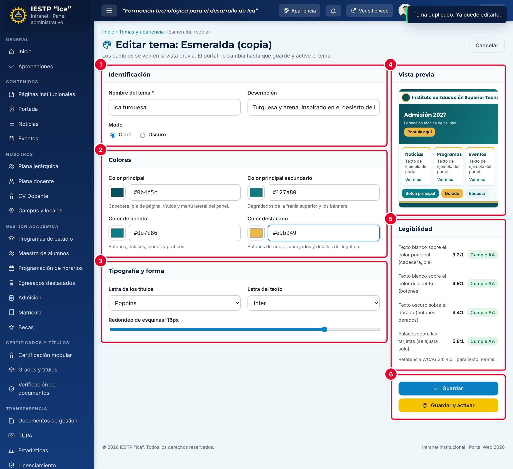

# 33 · Temas y apariencia

**Para qué sirve:** elige los colores, las letras y el redondeo de esquinas; el **tema activo** se aplica a la vez al portal y a la intranet. **Quién lo usa:** Administrador e Imagen institucional. **Dónde:** Menú › **Configuración y seguridad** › **Temas y apariencia** (o botón **Apariencia** de la barra superior).

| N.º | Zona | Para qué sirve |
|---|---|---|
| 1 | **Identificación** | **Nombre del tema**, **Descripción** y **Modo** (**Claro** u **Oscuro**). |
| 2 | **Colores** | Cuatro colores con selector y código hexadecimal. |
| 3 | **Tipografía y forma** | **Letra de los títulos**, **Letra del texto** y **Redondeo de esquinas**. |
| 4 | **Vista previa** | Muestra del portal que cambia mientras editas. |
| 5 | **Legibilidad** | Contraste de las combinaciones principales según WCAG 2.1. |
| 6 | Botones | **Guardar**, **Guardar y activar** y **Restaurar valores originales**. |

### Cómo se hace
1. Pulsa el botón Duplicar de un tema parecido. Aparece «Tema duplicado. Ya puede editarlo.».
2. Cambia el **Nombre del tema** y la **Descripción**.
3. Elige los cuatro colores o escribe su código (ej. `#0b4f5c`).
4. Elige las letras y el redondeo de esquinas.
5. Revisa que todas las filas de **Legibilidad** digan **Cumple AA**.
6. Pulsa **Guardar** (el portal no cambia) o **Guardar y activar** (cambia de inmediato).

**Ten en cuenta**
- Para cambiar de tema, pulsa **Activar** en su tarjeta; el cambio es inmediato para todos.
- Con contraste **Insuficiente**, al guardar aparece una advertencia: pulsa **Cancelar** y corrige el color.
- Los temas incluidos con la plataforma y el tema activo no se pueden eliminar; borrar un tema **Personalizado** no se puede deshacer.
