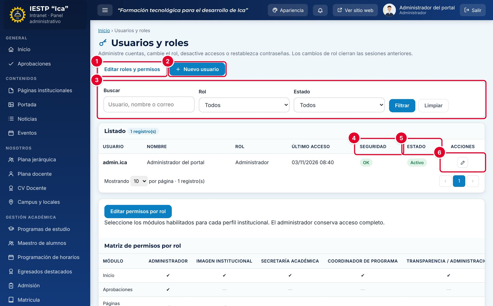

# 34 · Usuarios y roles

**Para qué sirve:** crea y administra las cuentas de la intranet. El **rol** define qué módulos ve cada cuenta y qué puede hacer. **Quién lo usa:** solo el Administrador edita cuentas; Secretaría académica y Coordinador crean accesos de alumnos desde **Maestro de alumnos**. **Dónde:** Menú › **Configuración y seguridad** › **Usuarios y roles**.

| N.º | Elemento | Para qué sirve |
|---|---|---|
| 1 | **Editar roles y permisos** | Activa o desactiva módulos de cada rol. |
| 2 | **Nuevo usuario** | Abre el formulario para crear una cuenta. |
| 3 | Filtros | Buscan por usuario, nombre o correo; filtran por **Rol** y **Estado**. |
| 4 | **Seguridad** | **OK** o **Bloqueado** (tras 5 intentos fallidos). |
| 5 | **Estado** | **Activo** (puede ingresar) o **Inactivo**. |
| 6 | Acciones | **Editar** (lápiz) y **Desbloquear** (candado). |

| Rol | Módulos principales |
|---|---|
| Administrador | Todos; único que aprueba y elimina definitivamente |
| Imagen institucional | Noticias, eventos, portada, páginas, enlaces, temas |
| Secretaría académica | Admisión, matrícula, becas, certificados, plana docente |
| Coordinador de programa | Su programa, sus alumnos y horarios |
| Transparencia / administración | Documentos de gestión, TUPA, inversiones, convocatorias, licenciamiento |
| Atención al ciudadano | Mensajes, Libro de Reclamaciones, Mesa de partes, bolsa laboral |
| Directivo | Estadísticas y supervisión |
| Docente | Su horario y CV |
| Estudiante | Su horario, certificados, bolsa laboral |
| Egresado | Sus certificados, títulos, bolsa laboral |
| Empresa | Bolsa laboral |

### Cómo se hace
1. Pulsa **Nuevo usuario**.
2. Escribe el **Usuario** (ej. `rmendoza.imagen`) y el **Nombre completo**.
3. Elige el **Rol**; para Coordinador, también el **Programa**.
4. Escribe una **Contraseña** temporal de al menos 12 caracteres y repítela.
5. Escribe el **Correo electrónico** y, si atenderá expedientes, el **Área de Mesa de partes (bandeja)**.
6. Deja el **Estado** en **Activo** y pulsa **Guardar cambios**.

### Restablecer, desbloquear o desactivar
1. Pulsa **Editar** en la fila de la cuenta.
2. Para olvido de contraseña, escribe una temporal en **Nueva contraseña (dejar vacío para mantener)** y repítela.
3. Para retirar el acceso, elige **Estado** › **Inactivo**. Pulsa **Guardar cambios**.
4. Si dice **Bloqueado**, pulsa el candado **Desbloquear** (o espera 5 minutos).

**Ten en cuenta**
- Toda contraseña asignada es temporal: en el primer ingreso se cambia en **Cuentas del portal** (`{{inst.dominio}}/accounts.php`).
- Estudiante, Egresado, Docente y Empresa deben vincularse en **Vinculado a** con un registro existente.
- Las cuentas no se eliminan; siempre debe quedar un administrador activo.
- **Incidencia:** **Acceso denegado** dice que el intento quedó en la auditoría, pero no se registra.
