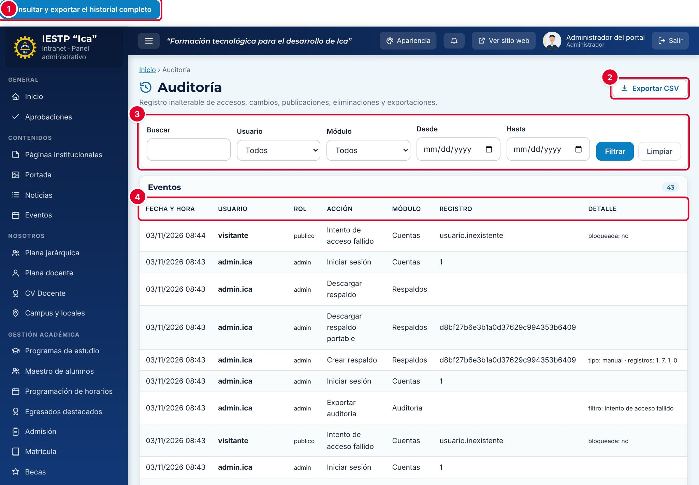

# 35 · Auditoría

**Para qué sirve:** registra lo que pasa en la plataforma: ingresos, intentos fallidos, cambios de registros, cuentas y roles, exportaciones y respaldos, con fecha, usuario, rol, acción y detalle. Nadie puede editar ni borrar estos eventos. **Quién lo usa:** solo el Administrador. **Dónde:** Menú › **Configuración y seguridad** › **Auditoría**.

| N.º | Elemento | Para qué sirve |
|---|---|---|
| 1 | **Consultar y exportar el historial completo** | Abre el historial completo (`{{inst.dominio}}/auditoria.php`). |
| 2 | **Exportar CSV** | Descarga `auditoria.csv` con los eventos filtrados. |
| 3 | Filtros | **Buscar**, **Usuario**, **Módulo**, **Desde** y **Hasta**; **Filtrar** o **Limpiar**. |
| 4 | Tabla de eventos | **Fecha y hora**, **Usuario**, **Rol**, **Acción**, **Módulo**, **Registro** y **Detalle**. |

### Cómo se hace
1. Escribe una palabra en **Buscar**; por ejemplo, «Intento».
2. Elige el **Módulo** (ej. **Cuentas**) y, si quieres, el **Usuario** y el rango **Desde** / **Hasta**.
3. Pulsa **Filtrar**; **Limpiar** vuelve a mostrar todo.
4. Para buscar más atrás, abre el historial completo, filtra y pulsa **Filtrar historial**.
5. Para exportarlo todo, pulsa **Exportar todos los resultados a CSV** (separado por punto y coma, para Excel).

**Ten en cuenta**
- La vista de la intranet muestra solo los últimos 1000 eventos; el historial completo, todos, de 100 en 100.
- En los intentos fallidos, **Registro** muestra el usuario escrito y el detalle indica `"bloqueada":"sí"` si se bloqueó la cuenta.
- Los eventos se conservan aunque se restaure una copia de seguridad.
- **Incidencia:** el intento de **Acceso denegado** no llega a la auditoría, aunque la pantalla diga que quedó registrado.
