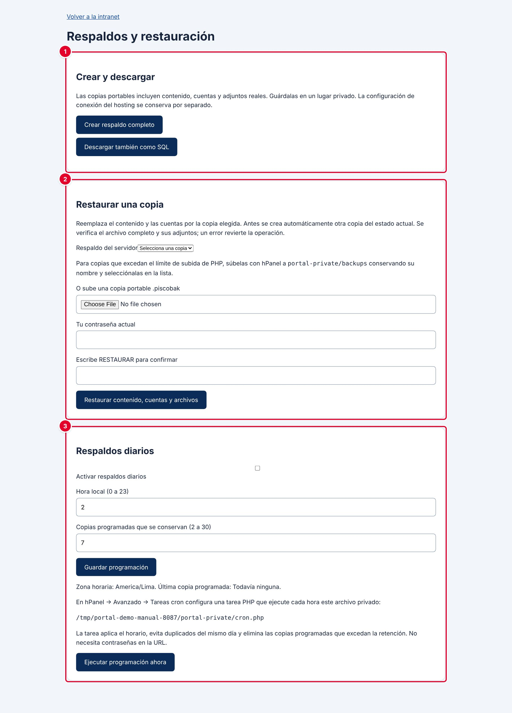

# 36 · Copias de seguridad

**Para qué sirve:** guarda contenido, cuentas, roles, adjuntos y visitas para recuperar el portal. **Quién lo usa:** Administrador; soporte técnico (tarea cron). **Dónde:** Menú › **Configuración y seguridad** › **Copias de seguridad** › **Administrar respaldos y restauración**.

| N.º | Sección | Para qué sirve |
|---|---|---|
| 1 | **Crear y descargar** | Crea una copia completa, descarga la base en SQL y lista las copias del servidor. |
| 2 | **Restaurar una copia** | Reemplaza el contenido y las cuentas actuales por los de una copia. |
| 3 | **Respaldos diarios** | Programa una copia automática al día y cuántas se conservan. |

### Cómo se hace
1. Pulsa **Crear respaldo completo**.
2. Pulsa **Descargar copia portable** (`.piscobak`) y guárdala en un medio externo y privado.
3. Marca **Activar respaldos diarios**, escribe la **Hora local (0 a 23)** y las **Copias programadas que se conservan (2 a 30)**.
4. Pulsa **Guardar programación**; soporte técnico crea en hPanel una tarea que ejecute `cron.php` **cada hora**.

### Restaurar una copia
1. Elige la copia en **Respaldo del servidor** o sube el `.piscobak`.
2. Escribe **Tu contraseña actual** y la palabra **RESTAURAR**.
3. Pulsa **Restaurar contenido, cuentas y archivos**.
4. Ingresa con una cuenta administradora que exista en la copia.

**Ten en cuenta**
- Restaurar reemplaza todo; antes se crea una copia **previo-restauracion** y, ante un error, se revierte todo.
- La copia `.sql` no se restaura desde esta pantalla; las copias manuales no se borran solas.
- **Incidencia:** la página **Copias de seguridad** se abre sin menú lateral ni barra superior.
