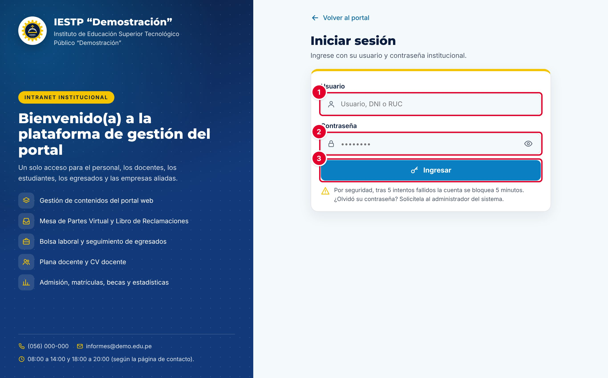
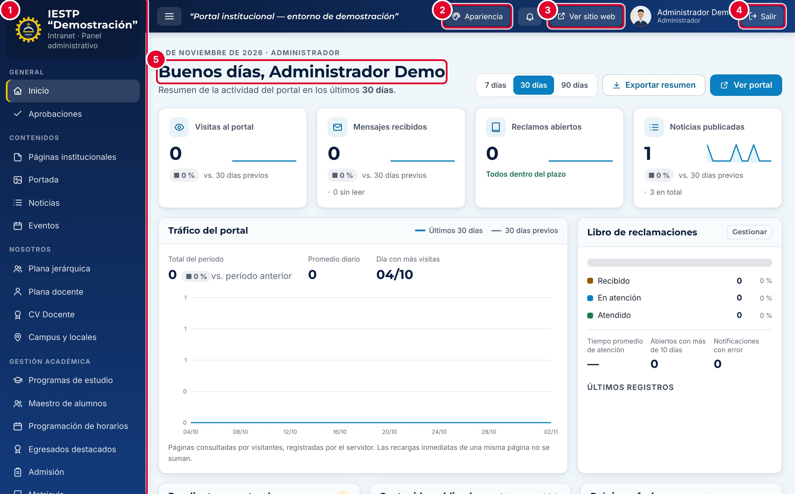

# 00 · Introducción y acceso a la plataforma

## Qué es la plataforma

La plataforma tiene dos partes que trabajan con la misma información:

- **Portal web público** (`{{inst.dominio}}`): lo que ve cualquier persona. Muestra la información institucional, los programas de estudio, la transparencia y las noticias, y ofrece servicios en línea como Mesa de partes, Libro de reclamaciones, consulta de certificados y bolsa laboral.
- **Intranet** (`{{inst.dominio}}/#/admin`): el panel donde el personal autorizado administra ese contenido y atiende los trámites. Todo lo que se publica en la intranet aparece en el portal en cuanto se guarda; no hay que hacer ningún otro paso.

Este manual describe la versión estándar de la plataforma, que es la misma en todas las instituciones. Las capturas provienen de una **instalación de demostración con datos ficticios** («IESTP “Demostración”»). En tu institución verás tu propio nombre, logotipo y colores.

## Ingresar a la intranet

| N.º | Elemento | Qué escribir |
|---|---|---|
| 1 | **Usuario** | Tu nombre de usuario, DNI o RUC (las empresas ingresan con RUC). |
| 2 | **Contraseña** | Tu contraseña. Con el ícono del ojo puedes verla mientras la escribes. |
| 3 | **Ingresar** | Abre la intranet con los módulos que corresponden a tu rol. |

1. Abre `{{inst.dominio}}` y pulsa **Intranet** en la franja superior, o entra directamente a `{{inst.dominio}}/#/admin`.
2. Escribe tu usuario y tu contraseña y pulsa **Ingresar**.

> **Seguridad**
> - Después de **5 intentos fallidos**, la cuenta se bloquea durante **5 minutos**.
> - La sesión se cierra sola tras **30 minutos sin actividad**. Lo que no hayas guardado se pierde.
> - Si olvidaste tu contraseña, pídele al administrador del sistema que la restablezca.
> - Al terminar, pulsa siempre **Salir**, sobre todo si usas una computadora compartida.

## Recorrido por el panel

| N.º | Elemento | Para qué sirve |
|---|---|---|
| 1 | **Menú lateral** | Lista los módulos agrupados por área. Cada usuario ve solo los módulos de su rol. El botón ☰ de la barra superior oculta o muestra el menú. |
| 2 | **Apariencia** | Atajo al módulo **Temas y apariencia**, donde se eligen los colores y el tema del portal. Solo aparece si tu rol tiene ese módulo. |
| 3 | **Ver sitio web** | Abre el portal público en otra pestaña, para comprobar cómo quedó lo que publicaste. |
| 4 | **Salir** | Cierra la sesión. |
| 5 | **Inicio** | Resumen de los últimos 7, 30 o 90 días: visitas, mensajes, reclamos, noticias, tareas pendientes y «Salud del portal». |

La campana de la barra superior muestra un número cuando tienes avisos pendientes, por ejemplo un reclamo nuevo.

### Grupos del menú

| Grupo | Módulos |
|---|---|
| General | Inicio, Aprobaciones |
| Contenidos | Páginas institucionales, Portada, Noticias, Eventos |
| Nosotros | Plana jerárquica, Plana docente, CV Docente, Campus y locales |
| Gestión académica | Programas de estudio, Maestro de alumnos, Programación de horarios, Egresados destacados, Admisión, Matrícula, Becas |
| Certificados y títulos | Certificación modular, Grados y títulos, Verificación de documentos |
| Transparencia | Documentos de gestión, TUPA, Estadísticas, Licenciamiento, Inversiones, Convocatorias |
| Atención al ciudadano | Mensajes de contacto, Libro de reclamaciones, Mesa de partes |
| Servicios | Bolsa laboral, Enlaces y servicios, Servicios complementarios |
| Configuración y seguridad | Configuración, Configuración académica, Temas y apariencia, Usuarios y roles, Auditoría, Copias de seguridad |

## Roles y módulos

Cada cuenta tiene un rol, y el rol decide qué módulos aparecen en el menú. El administrador asigna los roles en **Usuarios y roles**.

| Rol | Módulos principales | Publica directamente |
|---|---|---|
| Administrador | Todos (38 módulos), incluida la eliminación definitiva | Sí |
| Imagen institucional | Noticias, Eventos, Portada, Páginas institucionales, Enlaces, Campus y locales, Temas | Sí |
| Secretaría académica | Admisión, Matrícula, Becas, Estadísticas, Plana docente y jerárquica, Egresados, Alumnos, Horarios, Certificados, Títulos, CV Docente | No: deja el contenido en revisión para que el administrador lo apruebe en **Aprobaciones** |
| Coordinador de programa | Su programa de estudios, Egresados, Alumnos y Horarios del programa | No: requiere aprobación |
| Transparencia / administración | Documentos de gestión, TUPA, Inversiones, Licenciamiento, Convocatorias, Servicios complementarios | Sí, salvo documentos, admisiones y convocatorias, que pasan por aprobación |
| Atención al ciudadano | Mensajes de contacto, Libro de reclamaciones, Mesa de partes, Bolsa laboral | No aplica |
| Directivo | Estadísticas, Reclamos, Expedientes, Alumnos, Horarios, Certificados, Títulos, Bolsa laboral | No: requiere aprobación |
| Docente | Sus horarios y su CV | No aplica |
| Estudiante / Egresado | Horarios, certificados, títulos y bolsa laboral (solo consulta) | No aplica |
| Empresa | Bolsa laboral | No aplica |

## Convenciones comunes a todos los módulos

Casi todos los módulos de contenido funcionan igual:

- **Listado con filtros:** usa **Buscar** y los filtros, y luego pulsa **Filtrar**. **Limpiar** quita los filtros.
- **Acciones de cada fila:** vista previa (ojo), editar (lápiz), duplicar y eliminar (papelera).
- **Campos obligatorios:** se marcan con un asterisco rojo (*). Muchos solo se exigen al **publicar**, así que un borrador se puede guardar incompleto.
- **Papelera:** al eliminar un registro, este va a la papelera y deja de verse en el portal. Desde **Ver papelera** se puede restaurar. Solo el administrador puede **eliminar definitivamente**.
- **Historial y auditoría:** cada registro guarda quién lo creó y quién lo modificó por última vez. Todas las acciones quedan en **Auditoría**.
- **Mensajes de confirmación:** después de guardar aparece un aviso breve en la esquina superior derecha, por ejemplo «Cambios guardados.». Si aparece en rojo, la operación **no** se completó: lee el mensaje y corrige lo que indica.
