# 01 · Inicio y aprobaciones

## Para qué sirve

**Inicio** es la primera pantalla de la intranet. Resume la actividad del portal: visitas, mensajes, reclamos, contenido publicado, tareas pendientes y el estado general del sitio.

**Aprobaciones** es la bandeja donde el Administrador revisa los contenidos que otros responsables quieren publicar en **Documentos de gestión**, **Convocatorias** y **Admisión**. Nada de esos tres módulos llega al portal sin su aprobación.

## Quién lo usa

| Rol | Puede |
|---|---|
| Administrador | Ver el Inicio completo, exportar el resumen, aprobar y publicar, devolver con observaciones |
| Imagen institucional | Ver el Inicio con sus indicadores y la **Salud del portal** |
| Secretaría académica, Coordinador de programa, Transparencia / administración, Atención al ciudadano, Directivo | Ver el Inicio con los indicadores y pendientes de sus módulos. No ven **Aprobaciones** |
| Transparencia / administración, Secretaría académica | **Enviar a aprobación** documentos, convocatorias o procesos de admisión (no los publican directamente) |
| Docente, Estudiante, Egresado, Empresa | Ven su propio panel de la comunidad educativa (se explica en sus capítulos) |

Solo el Administrador tiene el permiso de aprobar. Los demás roles no ven el menú **Aprobaciones**.

## Cómo se llega

- **Inicio**: menú lateral › **General** › **Inicio**, o el logotipo de la parte superior del menú. Es la pantalla que se abre al iniciar sesión. Ruta: `#/admin/dashboard`
- **Aprobaciones**: menú lateral › **General** › **Aprobaciones**. Ruta: `#/admin/aprobaciones`

## Pantalla principal

### Inicio

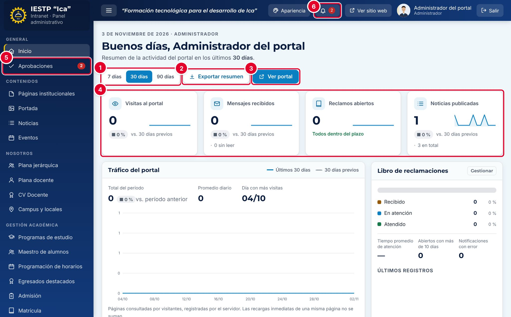

| N.º | Elemento | Para qué sirve |
|---|---|---|
| 1 | **7 días / 30 días / 90 días** | Cambia el período del resumen. Las cifras se comparan con el período anterior de la misma duración. |
| 2 | **Exportar resumen** | Descarga un archivo CSV (`resumen_panel_AAAA-MM-DD.csv`) con los indicadores, las visitas, los pendientes y el índice de salud del portal. La exportación queda registrada en la auditoría. |
| 3 | **Ver portal** | Abre el portal público en una pestaña nueva. |
| 4 | Indicadores | Hasta cuatro tarjetas según tu rol: **Visitas al portal**, **Mensajes recibidos**, **Reclamos abiertos**, **Noticias publicadas**, **Expedientes en trámite**, **Documentos vigentes**, **Eventos próximos**, etc. Pulsa una tarjeta para ir a su módulo. |
| 5 | Contador del menú | Número rojo junto a **Aprobaciones** (y junto a Mensajes, Reclamos o Expedientes): cuántos registros esperan atención. |
| 6 | Campana | Suma los pendientes de tus módulos. Al pulsarla te lleva a la bandeja con más urgencia: primero Aprobaciones, luego Reclamos y luego Mensajes. |

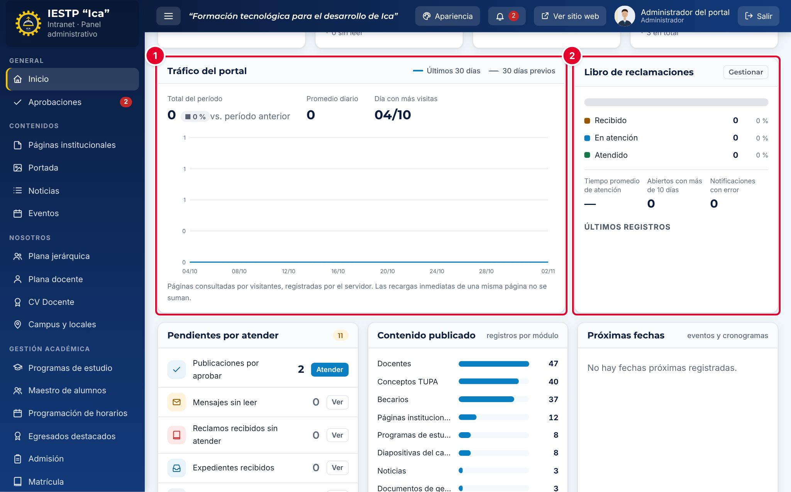

| N.º | Elemento | Para qué sirve |
|---|---|---|
| 1 | **Tráfico del portal** | Gráfico de páginas visitadas por día: la línea azul es el período elegido y la gris, el período anterior. Muestra el **Total del período**, el **Promedio diario** y el **Día con más visitas**. Las recargas inmediatas de una misma página no se suman. |
| 2 | **Libro de reclamaciones** | Reclamos por estado (Recibido, En atención, Atendido), tiempo promedio de atención, reclamos abiertos con más de 10 días, notificaciones con error y los tres últimos registros. Solo aparece a los roles que ven Reclamos. |

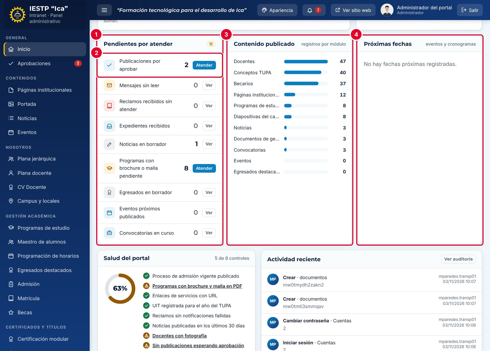

| N.º | Elemento | Para qué sirve |
|---|---|---|
| 1 | **Pendientes por atender** | Lista de tareas de tus módulos con su cantidad: publicaciones por aprobar, mensajes sin leer, reclamos sin atender, expedientes recibidos, noticias en borrador, programas sin brochure o malla, egresados en borrador, eventos y convocatorias en curso. |
| 2 | **Atender** / **Ver** | **Atender** (botón azul) indica que hay algo por resolver. **Ver** abre el módulo cuando la cifra es informativa o cero. |
| 3 | **Contenido publicado** | Barras con la cantidad de registros publicados por módulo (docentes, conceptos TUPA, becarios, páginas, programas, diapositivas, noticias, documentos, convocatorias, eventos, egresados). |
| 4 | **Próximas fechas** | Próximos eventos publicados y fechas de los cronogramas de Admisión y Matrícula vigentes, con la cuenta regresiva («Hoy», «Mañana», «En N días»). |

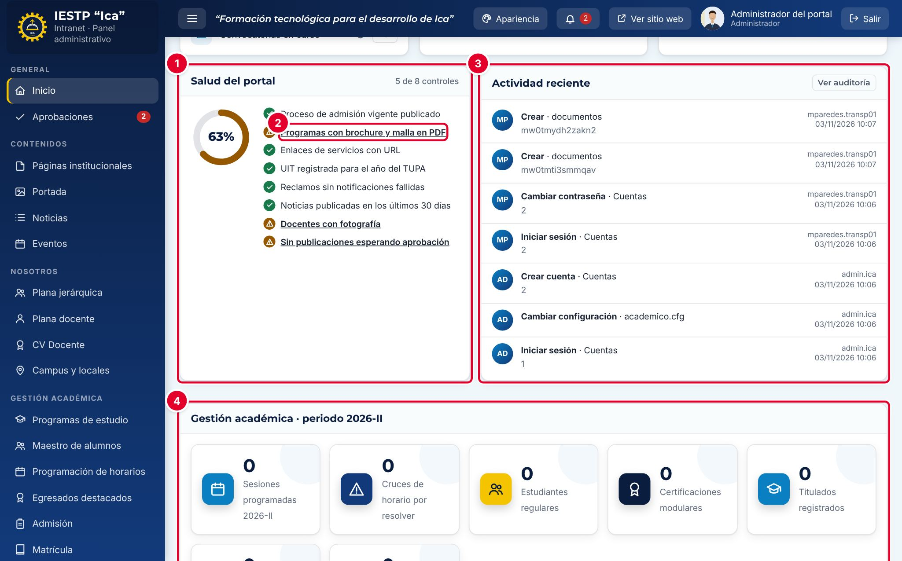

| N.º | Elemento | Para qué sirve |
|---|---|---|
| 1 | **Salud del portal** | Porcentaje de controles cumplidos (8 controles): admisión vigente publicada, programas con brochure y malla, enlaces con URL, UIT del año del TUPA, reclamos sin notificaciones fallidas, noticias en los últimos 30 días, docentes con fotografía y ninguna publicación esperando aprobación. Solo lo ven el Administrador e Imagen institucional. |
| 2 | Control pendiente | Los controles con triángulo naranja no se cumplen. Pulsa el texto subrayado para ir al módulo donde se corrige. |
| 3 | **Actividad reciente** | Últimas siete acciones registradas. El Administrador ve las de todos los usuarios; los demás roles, solo las suyas. **Ver auditoría** abre el registro completo (solo Administrador). |
| 4 | **Gestión académica · periodo** | Resumen académico del periodo vigente: sesiones programadas, cruces de horario, estudiantes, certificaciones, titulados, ofertas laborales y validaciones pendientes. Cada rol ve solo las cifras de sus módulos. |

### Aprobaciones

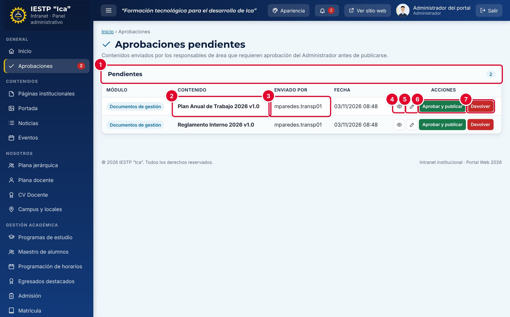

| N.º | Elemento | Para qué sirve |
|---|---|---|
| 1 | **Pendientes** | Cantidad de contenidos en estado **En revisión**. |
| 2 | **Contenido** | Nombre del registro enviado. La columna **Módulo** indica de dónde viene: Documentos de gestión, Convocatorias o Admisión. |
| 3 | **Enviado por** | Usuario que hizo el último cambio. **Fecha** indica cuándo. |
| 4 | Vista previa (ojo) | Muestra cómo se verá en el portal antes de aprobarlo. |
| 5 | Abrir (lápiz) | Abre el formulario completo del registro para revisarlo o corregirlo. |
| 6 | **Aprobar y publicar** | Publica el contenido en el portal. |
| 7 | **Devolver** | Lo regresa al responsable como **Borrador**, con una observación obligatoria. |

## Formulario

El Inicio no tiene formulario. En Aprobaciones solo se completa la observación al devolver un contenido.

| Campo | Obligatorio | Formato o límite | Ejemplo |
|---|---|---|---|
| Observación (al **Devolver**) | Sí | Texto libre | Falta adjuntar la resolución directoral que aprueba el reglamento. |

## Procedimientos

### Revisar el estado del portal cada día

1. Inicia sesión. Se abre el **Inicio**.
2. Elige el período (**7 días**, **30 días** o **90 días**).
3. Revisa **Pendientes por atender** y pulsa **Atender** en las filas con botón azul.
4. Baja a **Salud del portal** y corrige los controles con triángulo naranja.
5. Si debes informar a la Dirección, pulsa **Exportar resumen** y adjunta el CSV.

### Enviar un contenido a aprobación (responsable de área)

Este paso lo hace el usuario de Transparencia (documentos y convocatorias) o de Secretaría académica (admisión).

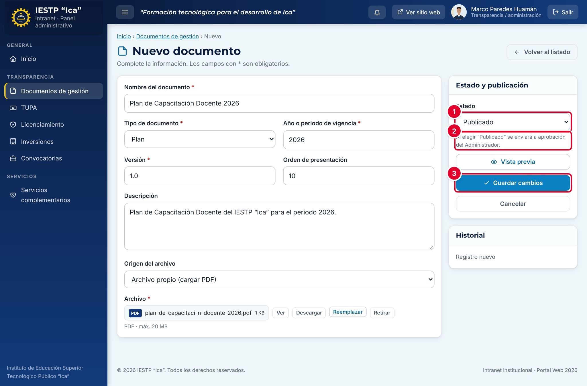

1. Crea o edita el registro en su módulo y completa los campos obligatorios.
2. En **Estado** ①, elige **Publicado**. Debajo aparece el aviso ②: «Al elegir “Publicado” se enviará a aprobación del Administrador.»
3. Pulsa **Guardar cambios** ③. Aparece el aviso «Guardado y enviado a aprobación del Administrador.»

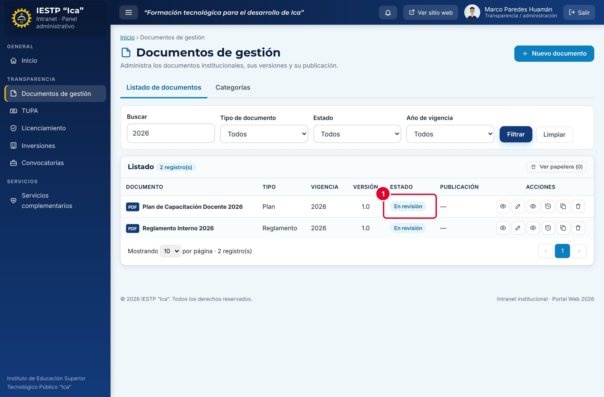

4. El registro queda con el estado **En revisión** ①. Todavía **no se ve en el portal**.

> Si el responsable modifica un documento, convocatoria o proceso de admisión que ya estaba **Publicado** y lo guarda como Publicado, el registro vuelve a **En revisión** y deja de verse en el portal hasta que el Administrador lo apruebe de nuevo. Para cambios urgentes, coordina con el Administrador antes de guardar.

### Aprobar y publicar (Administrador)

1. Entra a **Aprobaciones**. El contador del menú y la campana indican cuántos contenidos esperan.
2. Pulsa la vista previa (ojo) o el lápiz para revisar el contenido y su archivo.
3. Pulsa **Aprobar y publicar**.

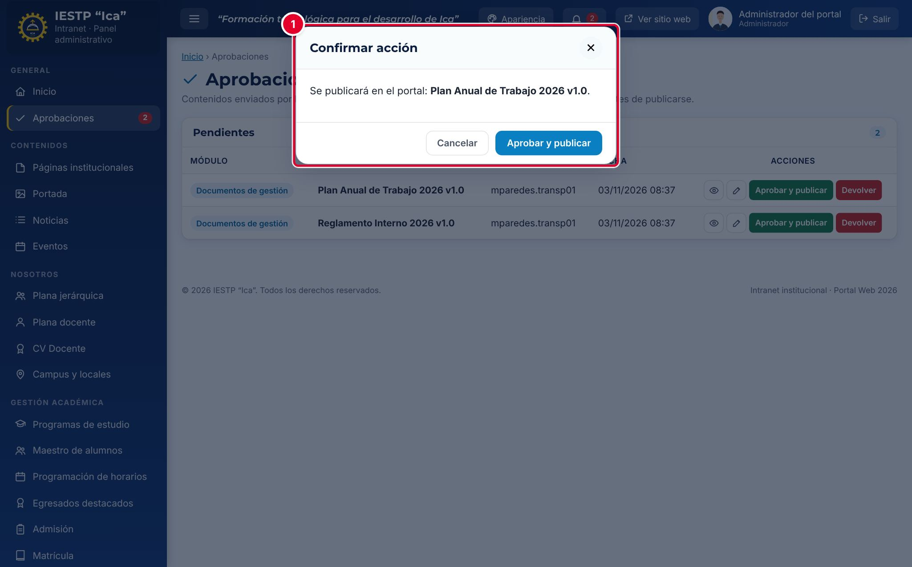

4. Confirma en la ventana ① con **Aprobar y publicar**. Aparece el aviso «Contenido aprobado y publicado.»

El contenido pasa a **Publicado** y se ve en el portal. Se registra quién lo aprobó y cuándo. En **Documentos de gestión**, si había una versión anterior publicada del mismo documento, esa versión pasa automáticamente a **Histórico**.

### Devolver con observaciones (Administrador)

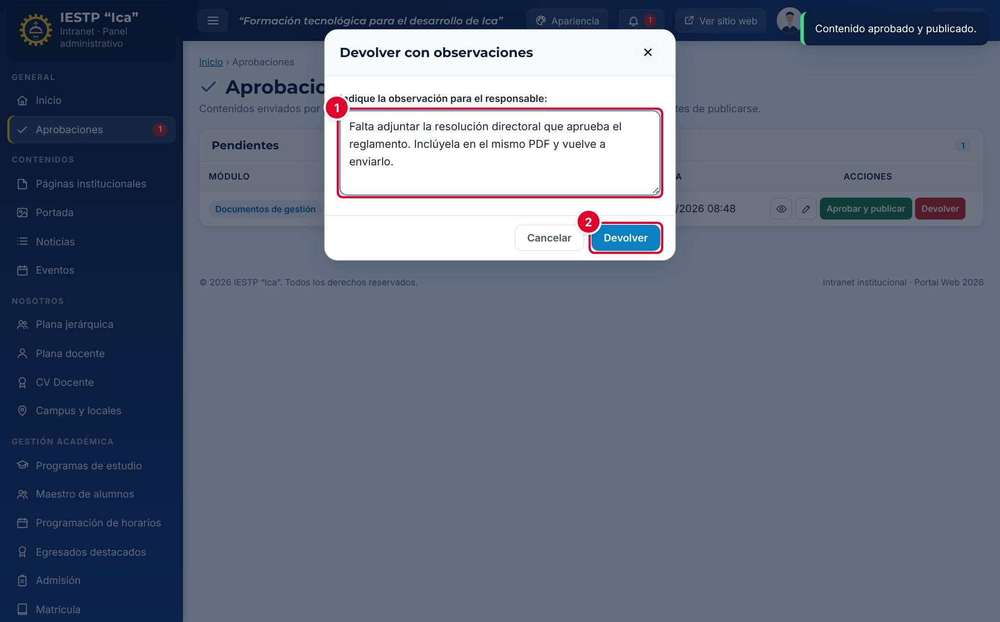

1. Pulsa **Devolver** en la fila.
2. Escribe la observación ①: qué falta o qué se debe corregir.
3. Pulsa **Devolver** ②. Aparece el aviso «Devuelto al responsable como borrador.»

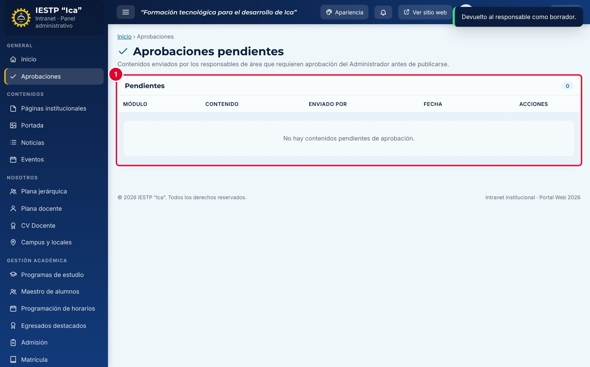

Cuando no queda nada por revisar, la bandeja muestra «No hay contenidos pendientes de aprobación.» ①

### Corregir un contenido devuelto (responsable de área)

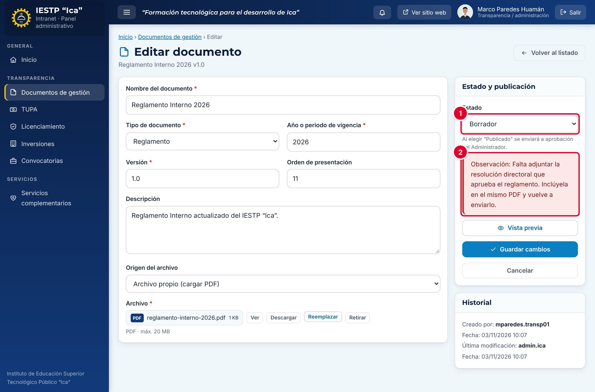

1. Abre el registro en su módulo. El **Estado** ① aparece en **Borrador**.
2. Lee la **Observación** ② en el recuadro rojo.
3. Corrige lo indicado y vuelve a elegir **Publicado**.
4. Pulsa **Guardar cambios**. El registro vuelve a **En revisión** y aparece otra vez en la bandeja del Administrador.

## Flujo y estados

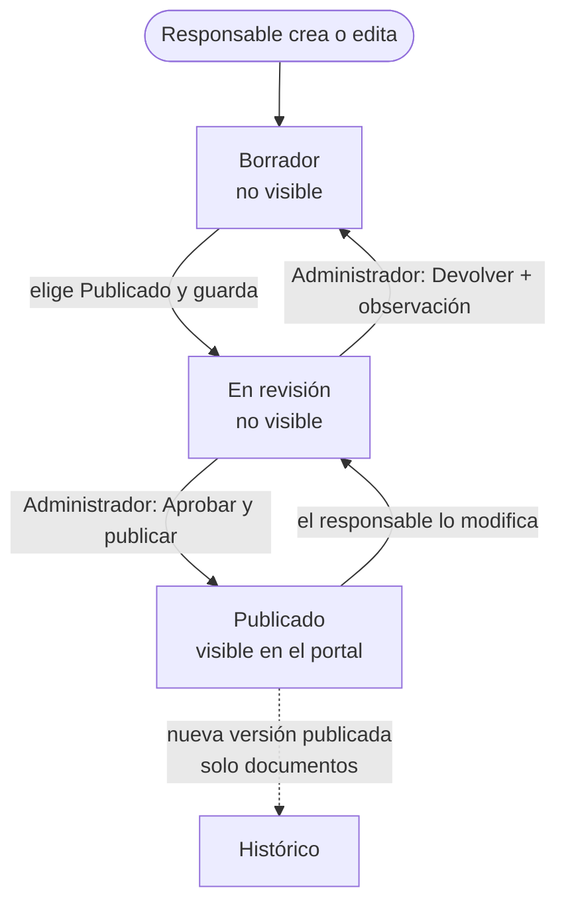

| Estado | Significado | Visible en el portal |
|---|---|---|
| Borrador | En preparación o devuelto con observaciones | No |
| En revisión | Enviado al Administrador; aparece en **Aprobaciones** | No |
| Publicado | Aprobado por el Administrador | **Sí** |
| Histórico (solo documentos) | Versión anterior de un documento reemplazada por una nueva | Sí, en el historial del documento |

## Resultado en el portal público

El Inicio y las Aprobaciones son pantallas internas. El efecto en el portal es que el contenido aprobado aparece en su sección: **Transparencia › Documentos de Gestión**, **Transparencia › Convocatorias** o **Admisión**.

## Mensajes y problemas frecuentes

| Mensaje o situación | Causa | Qué hacer |
|---|---|---|
| «Guardado y enviado a aprobación del Administrador.» | Tu rol no aprueba publicaciones en ese módulo | Espera la aprobación o avisa al Administrador |
| «Debe indicar la observación.» | Se pulsó **Devolver** sin escribir el motivo | Escribe la observación y pulsa **Devolver** |
| «La publicación requiere aprobación del administrador.» | Se intentó publicar sin pasar por la bandeja | Guarda con **Publicado** desde el formulario para que se envíe a revisión |
| Un documento publicado desapareció del portal | El responsable lo editó y volvió a **En revisión** | El Administrador debe aprobarlo de nuevo en **Aprobaciones** |
| El responsable no sabe que su contenido fue aprobado o devuelto | La plataforma no le envía un aviso automático | Comunícaselo por los canales internos. Al abrir el registro verá el estado y la observación |
| Las visitas aparecen en 0 | El portal aún no recibe visitantes o el período es muy corto | Cambia a **30 días** o **90 días** |

## Buenas prácticas

- Revisa **Aprobaciones** todos los días: mientras un contenido está **En revisión**, no se ve en el portal.
- Usa siempre la vista previa antes de aprobar y abre el PDF adjunto.
- Escribe observaciones concretas: qué falta, dónde y cómo corregirlo.
- Mantén la **Salud del portal** en 100 %. Cada control en naranja es información que el ciudadano no encuentra.
- Exporta el resumen al cierre de cada mes y archívalo como evidencia de gestión del portal.

> **Incidencia detectada al elaborar este manual (versión actual de la plataforma)**
> Al aprobar un contenido, la plataforma intenta registrar un correo de aviso para el autor («Contenido aprobado: …»), pero ese aviso no se guarda en el servidor ni se envía, y al devolver un contenido no se intenta ningún aviso. En la práctica, el responsable no recibe notificación de la aprobación ni de la devolución. Ya se reportó para su corrección. Mientras tanto, avisa al responsable por correo institucional o mensajería interna.
