# 02 · Páginas institucionales

## Para qué sirve

En este módulo se editan las páginas fijas del portal (Presentación, Reseña Histórica, Misión, Visión y Valores, Organización Institucional, Política de Privacidad, Preguntas Frecuentes, etc.) y se crean páginas adicionales con su propia dirección. La pestaña **Reconocimientos** registra los hitos y logros que aparecen en **Nosotros › Reconocimientos**.

## Quién lo usa

| Rol | Puede |
|---|---|
| Administrador | Crear páginas nuevas, editar, publicar, restaurar versiones anteriores y gestionar reconocimientos (incluida la eliminación definitiva) |
| Imagen institucional | Editar y publicar las páginas existentes, restaurar versiones y gestionar reconocimientos. **No** puede crear páginas nuevas |

Las páginas no se eliminan: para retirar una página del portal, cámbiala a **Borrador**.

## Cómo se llega

Menú lateral › **Contenidos** › **Páginas institucionales**. Ruta: `#/admin/paginas`

Reconocimientos: pestaña **Reconocimientos** del mismo módulo. Ruta: `#/admin/reconocimientos`

## Pantalla principal

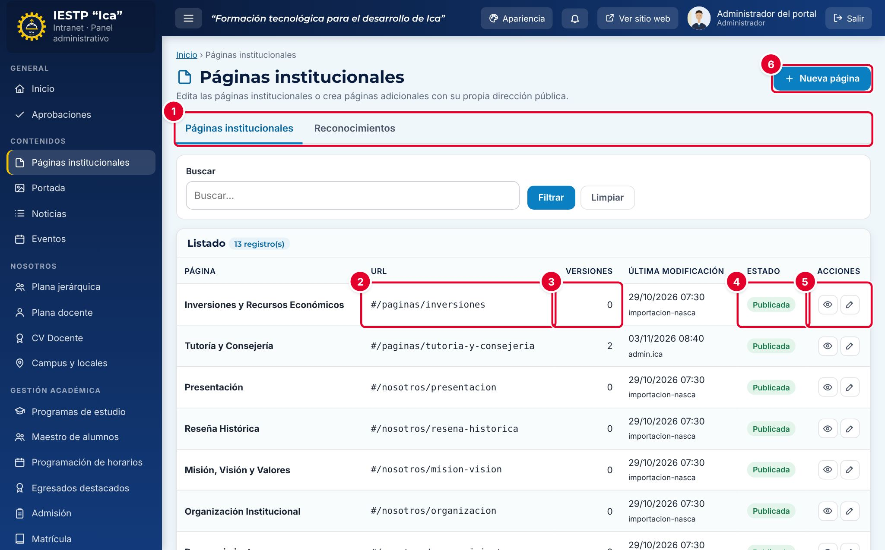

| N.º | Elemento | Para qué sirve |
|---|---|---|
| 1 | Pestañas **Páginas institucionales / Reconocimientos** | Cambian entre las páginas y los hitos institucionales. |
| 2 | **URL** | Dirección pública de la página. Las páginas fijas tienen una dirección propia (por ejemplo `#/nosotros/mision-vision`); las páginas nuevas usan `#/paginas/…`. |
| 3 | **Versiones** | Cuántas versiones anteriores se guardaron (hasta 10). |
| 4 | **Estado** | **Publicada** o **Borrador**. |
| 5 | Acciones | **Vista previa** (ojo) y **Editar** (lápiz). |
| 6 | **Nueva página** | Crea una página adicional. Solo la ve el Administrador. |

La columna **Última modificación** muestra la fecha y el usuario del último cambio. El buscador filtra por título.

## Formulario

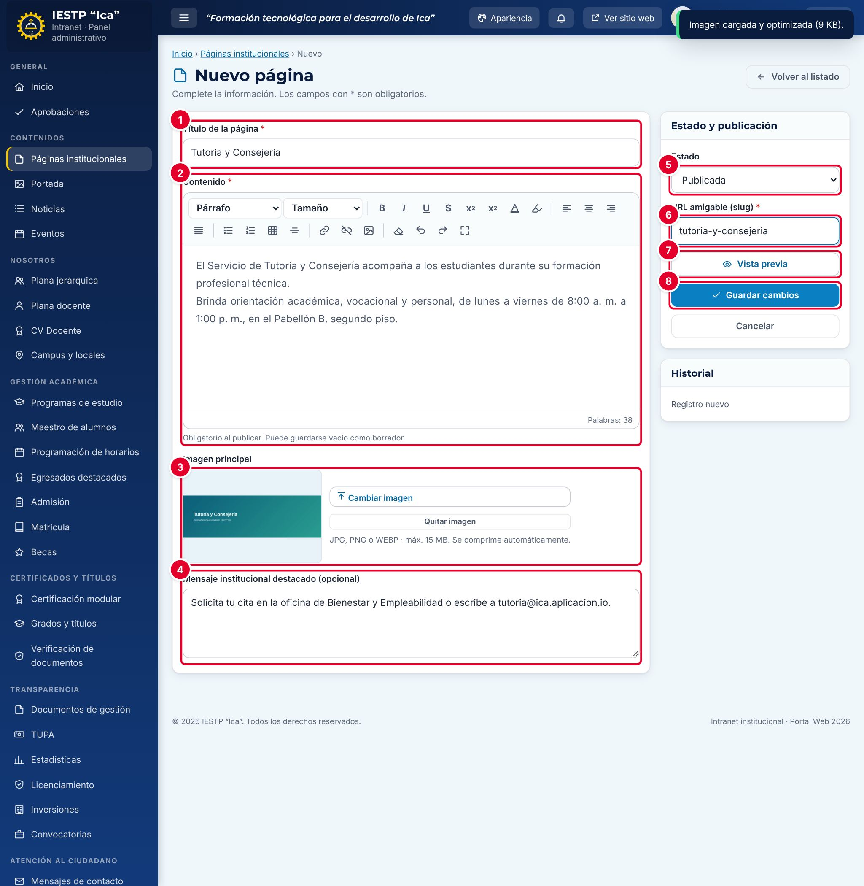

| N.º | Zona | Contenido |
|---|---|---|
| 1 | **Título de la página** | Título visible en el portal y en el menú. |
| 2 | **Contenido** | Editor con formato: párrafos y títulos, tamaño, negrita, color, alineación, listas, tablas, enlaces, imágenes, deshacer y pantalla completa. Muestra el conteo de **Palabras**. |
| 3 | **Imagen principal** | Imagen que acompaña la página. |
| 4 | **Mensaje institucional destacado (opcional)** | Frase que se muestra resaltada al final de la página. |
| 5 | **Estado** | **Borrador** o **Publicada**. |
| 6 | **URL amigable (slug)** | Parte final de la dirección de las páginas nuevas. |
| 7 | **Vista previa** | Muestra la página tal como se verá, sin publicarla. |
| 8 | **Guardar cambios** | Guarda la página. |

| Campo | Obligatorio | Formato o límite | Ejemplo |
|---|---|---|---|
| Título de la página | Sí | Texto | Tutoría y Consejería |
| Contenido | Al publicar | Texto con formato. Puede guardarse vacío como borrador | El Servicio de Tutoría y Consejería acompaña… |
| Descripción introductoria | Sí | Solo en Plana Jerárquica, Plana Docente y Campus e Informes, en lugar de **Contenido**. Texto sin formato, hasta 400 caracteres | — |
| Imagen principal | No | JPG, PNG o WEBP, hasta 15 MB. Se comprime automáticamente | Foto del servicio |
| Mensaje institucional destacado | No | Hasta 600 caracteres. En Plana Jerárquica se llama **Mensaje de la Dirección General** | Solicita tu cita en la oficina de Bienestar… |
| Estado | Sí | Borrador o Publicada | Publicada |
| URL amigable (slug) | Sí | Única. Se convierte a minúsculas y guiones al guardar | tutoria-y-consejeria |

## Procedimientos

### Editar una página existente

1. En el listado, pulsa el lápiz (**Editar**) de la página.
2. Cambia el texto en **Contenido**. Usa los títulos del editor para separar secciones.
3. Pulsa **Vista previa** para revisar.
4. Pulsa **Guardar cambios**. Aparece el aviso «Cambios guardados.»

La versión anterior se guarda automáticamente. En las páginas fijas, la dirección pública no cambia aunque modifiques el slug.

### Crear una página nueva (Administrador)

1. Pulsa **Nueva página**.
2. Escribe el **Título de la página** y el **Contenido**.
3. Opcional: pulsa **Seleccionar imagen** y escribe el **Mensaje institucional destacado**.
4. Escribe la **URL amigable (slug)**, por ejemplo `tutoria-y-consejeria`.
5. Elige el **Estado**: **Borrador** si aún no debe verse, **Publicada** si ya debe estar en el portal.
6. Pulsa **Guardar cambios**.

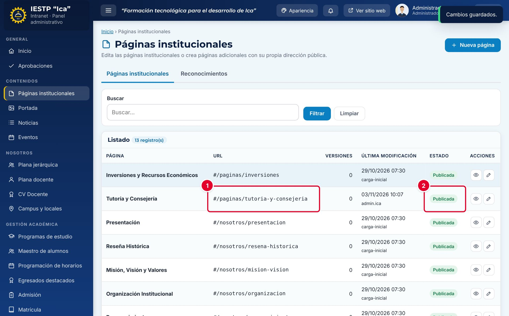

La página aparece en el listado con su **URL** ① y su **Estado** ②.

### Restaurar una versión anterior

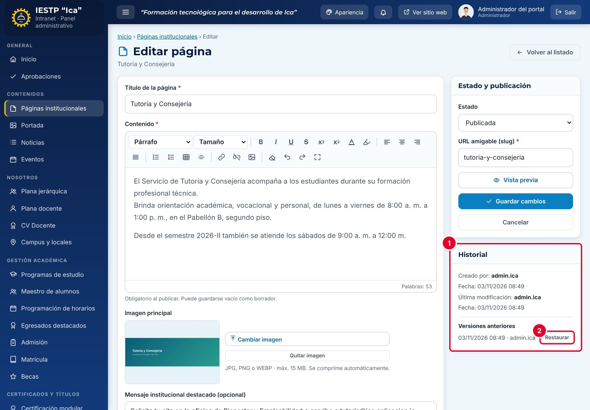

1. Edita la página. En el recuadro **Historial** ① aparece **Versiones anteriores**, con la fecha y el usuario de cada una.
2. Pulsa **Restaurar** ② en la versión que quieres recuperar.

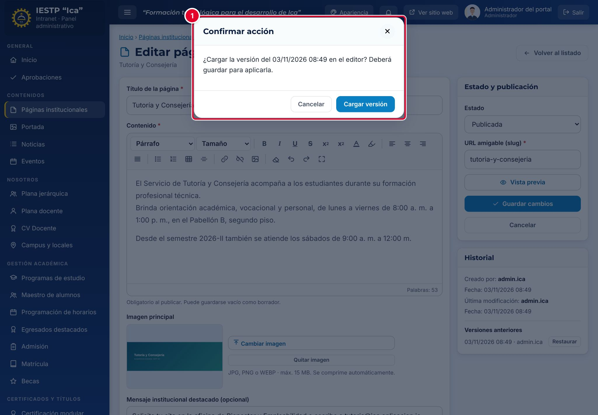

3. Confirma con **Cargar versión** ①. El título, el contenido, la imagen y el mensaje de esa versión se cargan en el editor.
4. Revisa el resultado y pulsa **Guardar cambios**. Hasta que no guardes, el portal no cambia.

Restaurar también crea una versión: siempre puedes volver al estado anterior.

### Retirar una página del portal

Edita la página, cambia el **Estado** a **Borrador** y pulsa **Guardar cambios**. Quien entre a su dirección verá la página de «no encontrada». Las páginas fijas en borrador también dejan de verse, así que úsalo con cuidado.

### Registrar un reconocimiento

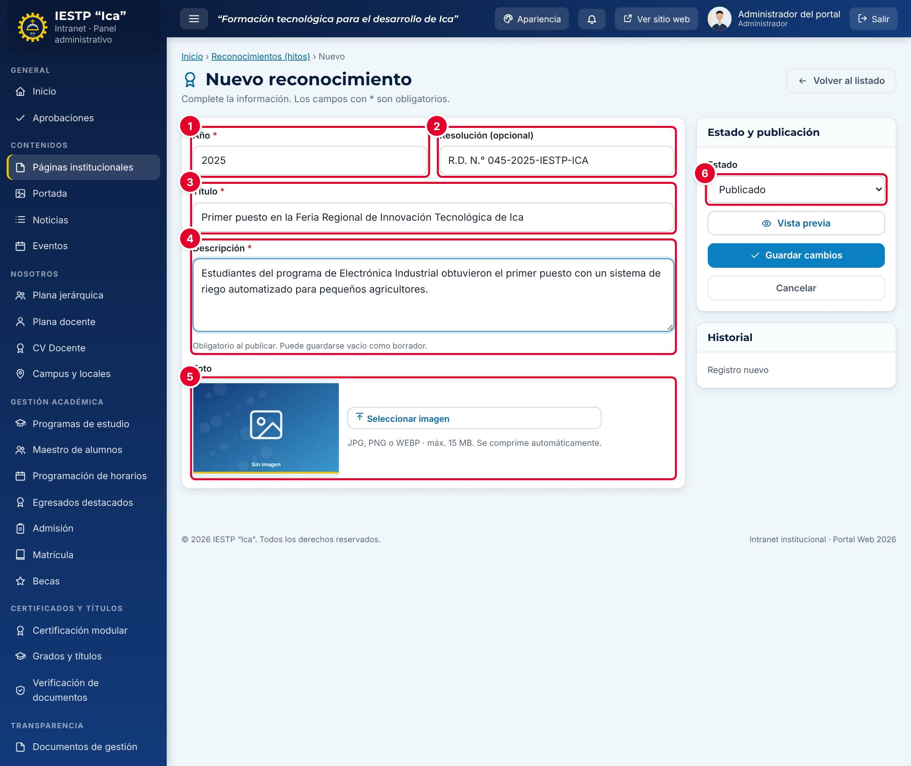

1. Abre la pestaña **Reconocimientos** y pulsa **Nuevo reconocimiento**.
2. Completa **Año** ①, **Resolución (opcional)** ②, **Título** ③ y **Descripción** ④.
3. Opcional: carga una **Foto** ⑤.
4. Elige el **Estado** ⑥ y pulsa **Guardar cambios**.

| Campo | Obligatorio | Formato o límite | Ejemplo |
|---|---|---|---|
| Año | Sí | Número | 2025 |
| Resolución | No | Texto | R.D. N.° 045-2025-IESTP-ICA |
| Título | Sí | Texto | Primer puesto en la Feria Regional de Innovación Tecnológica de Ica |
| Descripción | Al publicar | Texto | Estudiantes de Electrónica Industrial obtuvieron… |
| Foto | No | JPG, PNG o WEBP, hasta 15 MB | — |
| Estado | Sí | Borrador, Publicado o Despublicado | Publicado |

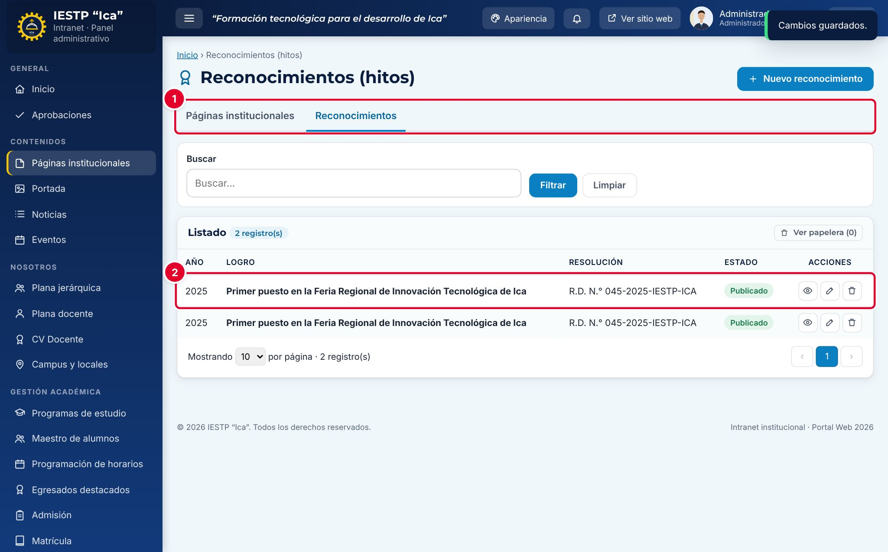

El reconocimiento aparece en el listado ②, ordenado del año más reciente al más antiguo. Desde la fila puedes verlo, editarlo o enviarlo a la papelera; **Ver papelera** permite restaurarlo.

## Flujo y estados

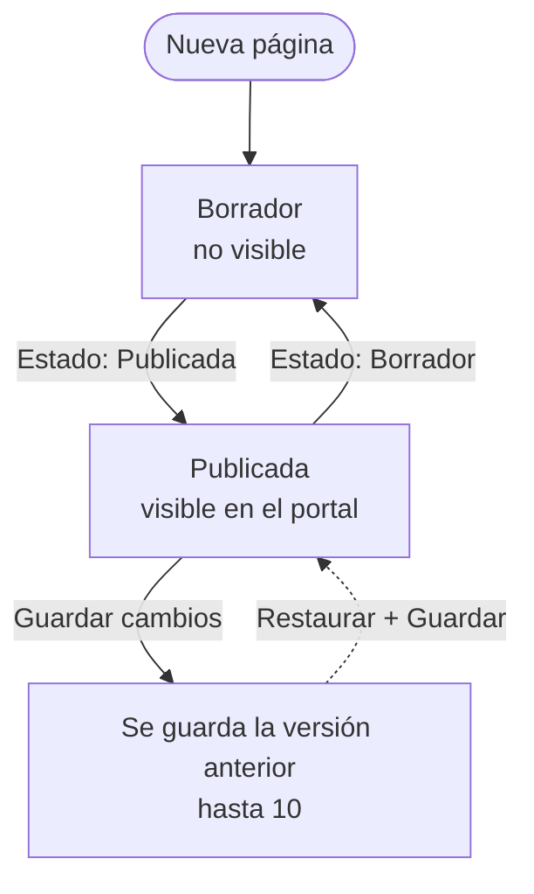

| Estado | Significado | Visible en el portal |
|---|---|---|
| Borrador | En preparación o retirada | No |
| Publicada | Página activa | **Sí** |

Los reconocimientos usan **Borrador**, **Publicado** y **Despublicado**; solo los **Publicado** aparecen en el portal.

## Resultado en el portal público

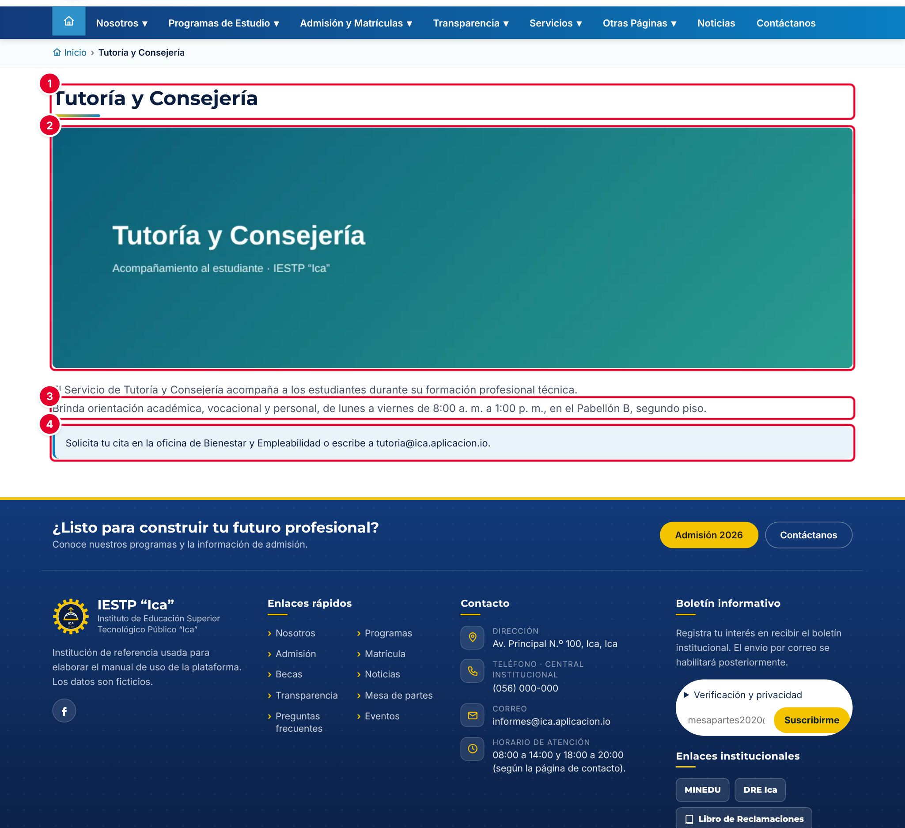

Las páginas nuevas se ven en `{{inst.dominio}}/#/paginas/<slug>` con su título ①, la imagen principal ②, el contenido ③ y el mensaje destacado ④.

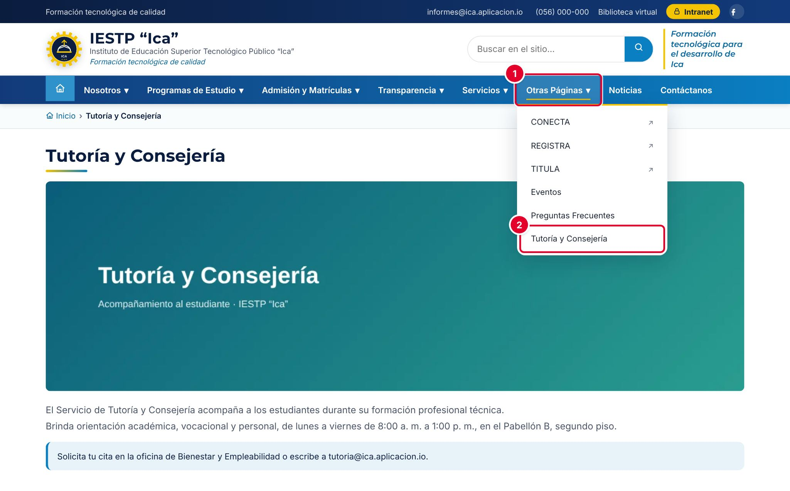

Las páginas nuevas publicadas se agregan solas al menú **Otras Páginas** ① ② y al buscador del sitio. Las páginas fijas aparecen en sus secciones de siempre (**Nosotros**, pie de página, etc.).

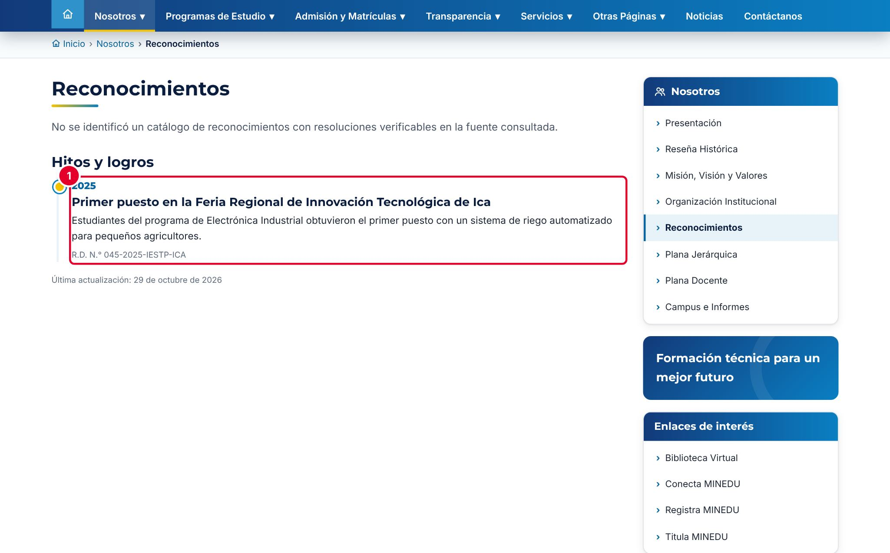

Los reconocimientos publicados se muestran en **Nosotros › Reconocimientos**, bajo **Hitos y logros** ①, con el año, el título, la descripción y la resolución.

## Mensajes y problemas frecuentes

| Mensaje o situación | Causa | Qué hacer |
|---|---|---|
| «Obligatorio para publicar (puede guardarlo como borrador).» | Se eligió **Publicada** con el contenido vacío | Escribe el contenido o guarda como **Borrador** |
| «Ya existe un registro con este valor (…).» | El slug ya lo usa otra página | Cambia la **URL amigable (slug)** |
| No aparece el botón **Nueva página** | Tu rol es Imagen institucional | Pide al Administrador que cree la página |
| La página muestra «no encontrada» | Está en **Borrador** o la dirección está mal escrita | Publícala o revisa el slug en el listado |
| Cambié el slug de una página fija y la dirección no cambió | Las páginas fijas tienen una dirección propia | Es normal; el slug solo cambia la dirección de las páginas nuevas |
| Borré texto por error | — | Edita la página y usa **Restaurar** en **Versiones anteriores** |

## Buenas prácticas

- Antes de una edición grande, revisa que exista una versión anterior reciente en el historial.
- Usa los títulos del editor (Título 1, Título 2) en lugar de texto en negrita para separar secciones: mejora la lectura y la accesibilidad.
- Elige slugs cortos, sin tildes ni espacios: `tutoria-y-consejeria`.
- No pegues tablas como imagen; usa **Insertar tabla** para que el contenido se pueda leer en celulares.
- En **Reconocimientos**, indica la resolución que respalda cada logro.
