# 03 · Portada

## Para qué sirve

Desde este módulo se arma la página de inicio del portal: las diapositivas del **carrusel**, el orden y la visibilidad de los **bloques**, los **accesos rápidos**, las **cifras institucionales**, la sección **¿Por qué estudiar aquí?** y la **ventana emergente** (comunicado) que aparece al entrar al portal.

## Quién lo usa

| Rol | Puede |
|---|---|
| Administrador | Todo, incluida la eliminación definitiva de diapositivas desde la papelera |
| Imagen institucional | Crear, editar, publicar y enviar a la papelera diapositivas; configurar bloques, accesos, cifras, beneficios y la ventana emergente |

## Cómo se llega

Menú lateral › **Contenidos** › **Portada**. El módulo tiene tres pestañas:

| Pestaña | Ruta |
|---|---|
| **Carrusel** | `#/admin/slides` |
| **Bloques, accesos y cifras** | `#/admin/portada` |
| **Ventana emergente** | `#/admin/popup` |

## Pantalla principal

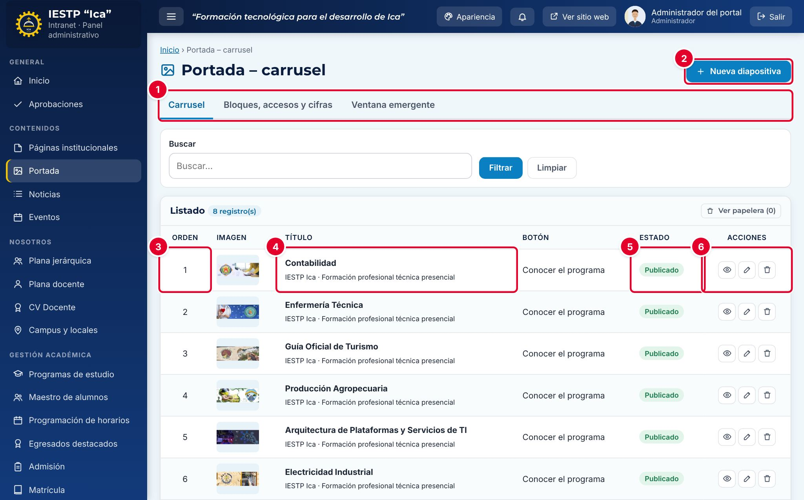

| N.º | Elemento | Para qué sirve |
|---|---|---|
| 1 | Pestañas | **Carrusel**, **Bloques, accesos y cifras** y **Ventana emergente**. |
| 2 | **Nueva diapositiva** | Abre el formulario de una diapositiva. |
| 3 | **Orden** | Posición de la diapositiva en el carrusel (1 = primera). |
| 4 | **Título** | Título y texto de la diapositiva. La columna **Imagen** muestra una miniatura y **Botón**, el texto del botón. |
| 5 | **Estado** | **Borrador**, **Publicado** o **Despublicado**. Solo las publicadas aparecen en el portal. |
| 6 | Acciones | **Vista previa** (abre la portada), **Editar** y **Eliminar** (envía a la papelera). |

**Ver papelera** muestra las diapositivas eliminadas; desde ahí se restauran. Solo el Administrador puede eliminarlas definitivamente.

## Formulario

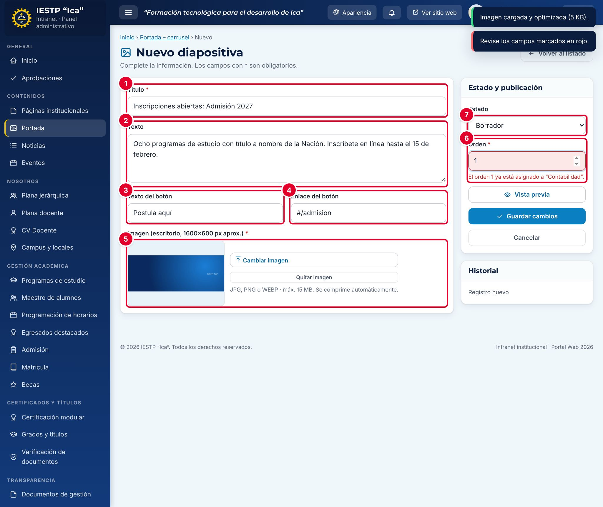

| N.º | Campo | Para qué sirve |
|---|---|---|
| 1 | **Título** | Texto grande de la diapositiva. |
| 2 | **Texto** | Frase de apoyo debajo del título. |
| 3 | **Texto del botón** | Texto del botón dorado. |
| 4 | **Enlace del botón** | Página a la que lleva el botón. |
| 5 | **Imagen** | Fondo de la diapositiva. |
| 6 | **Orden** | Posición en el carrusel. En la captura se ve el error por usar un orden ya ocupado. |
| 7 | **Estado** | **Borrador**, **Publicado** o **Despublicado**. |

| Campo | Obligatorio | Formato o límite | Ejemplo |
|---|---|---|---|
| Título | Sí | Hasta 70 caracteres | Inscripciones abiertas: Admisión 2027 |
| Texto | No | Hasta 180 caracteres | Ocho programas de estudio con título a nombre de la Nación… |
| Texto del botón | No | Hasta 30 caracteres. Si lo escribes, el enlace es obligatorio | Postula aquí |
| Enlace del botón | Si hay botón | Ruta interna (`#/admision`), URL completa (`https://…`) o servicio externo (`ext:id`). No se admite `#` solo | #/admision |
| Imagen | Sí | JPG, PNG o WEBP, hasta 15 MB. Tamaño recomendado: 1600 × 600 px | — |
| Orden | Sí | Número desde 1. No puede repetirse entre las diapositivas en Borrador o Publicado | 9 |
| Estado | Sí | Borrador, Publicado o Despublicado | Publicado |

## Procedimientos

### Agregar una diapositiva al carrusel

1. En la pestaña **Carrusel**, pulsa **Nueva diapositiva**.
2. Escribe el **Título**, el **Texto** y, si corresponde, el **Texto del botón** y su **Enlace del botón**.
3. Pulsa **Seleccionar imagen** y elige una imagen horizontal. Aparece el aviso «Imagen cargada y optimizada (… KB).»
4. Escribe el **Orden**. Usa un número que no esté ocupado; si está ocupado aparece «El orden N ya está asignado a “…”.»
5. Elige el **Estado** **Publicado** y pulsa **Guardar cambios**.

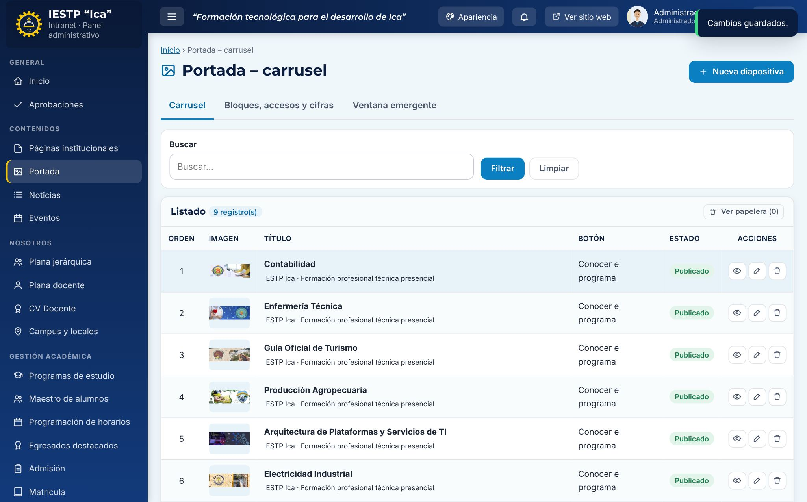

La diapositiva aparece en el listado ① con su orden y estado.

Para cambiar el orden del carrusel, edita las diapositivas y ajusta sus números. Para retirar una diapositiva sin borrarla, cámbiala a **Despublicado**: así además libera su número de orden.

### Ordenar y ocultar los bloques de la portada

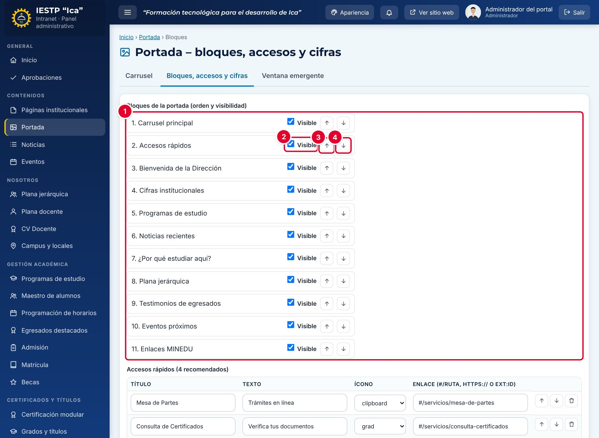

1. Abre la pestaña **Bloques, accesos y cifras**.
2. En **Bloques de la portada (orden y visibilidad)** ① están los once bloques en el orden en que aparecen en el portal.
3. Desmarca **Visible** ② para ocultar un bloque.
4. Usa las flechas **Subir** ③ y **Bajar** ④ para moverlo.
5. Pulsa **Guardar cambios** al final de la página. Aparece «Cambios guardados.»

| Bloque | Qué muestra | Se oculta solo si… |
|---|---|---|
| Carrusel principal | Diapositivas publicadas | No hay diapositivas publicadas |
| Accesos rápidos | Tarjetas de acceso directo | — |
| Bienvenida de la Dirección | Los dos primeros párrafos de la página **Presentación** y la foto del director | La página Presentación no está publicada |
| Cifras institucionales | Cifras con su año de corte | — |
| Programas de estudio | Tarjetas de los programas publicados | — |
| Noticias recientes | Las seis noticias más recientes | — |
| ¿Por qué estudiar aquí? | Hasta ocho beneficios | — |
| Plana jerárquica | Hasta seis autoridades publicadas | No hay autoridades publicadas |
| Testimonios de egresados | Tres egresados destacados | No hay egresados publicados |
| Eventos próximos | Los tres próximos eventos | No hay eventos futuros publicados |
| Enlaces MINEDU | Enlaces del grupo MINEDU con URL | — |

### Configurar los accesos rápidos y las cifras

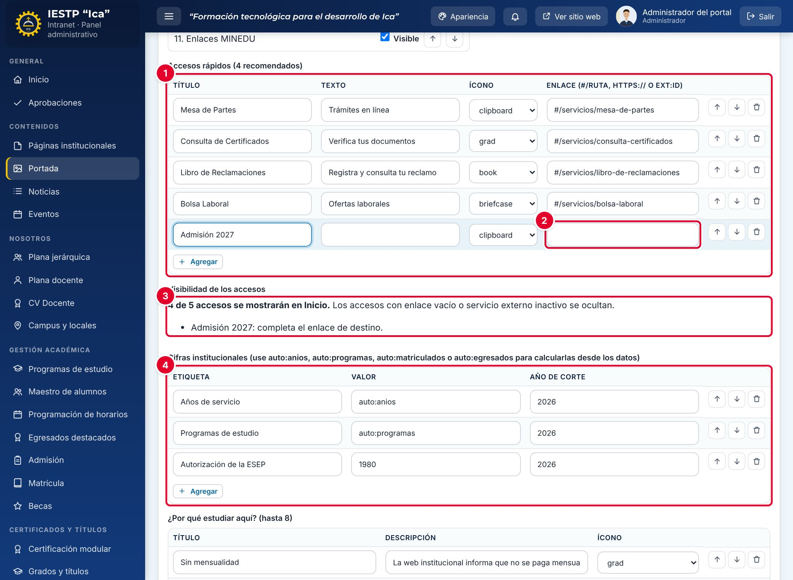

1. En **Accesos rápidos (4 recomendados)** ①, completa por cada fila **Título**, **Texto**, **Ícono** y **Enlace (#/ruta, https:// o ext:id)** ②. Usa **Agregar** para una fila nueva y los botones de la derecha para subir, bajar o quitar filas.
2. Revisa **Visibilidad de los accesos** ③: indica cuántos accesos se mostrarán y cuáles faltan completar. Un acceso con enlace vacío o con un servicio externo inactivo no se muestra.
3. En **Cifras institucionales** ④, escribe la **Etiqueta**, el **Valor** y el **Año de corte**. Para que la cifra se calcule sola, escribe en **Valor**:
   - `auto:anios`: años desde la fecha de creación de la institución.
   - `auto:programas`: cantidad de programas publicados.
   - `auto:matriculados`: matriculados del último año en Estadísticas.
   - `auto:egresados`: total de egresados en Estadísticas.
4. Pulsa **Guardar cambios**.

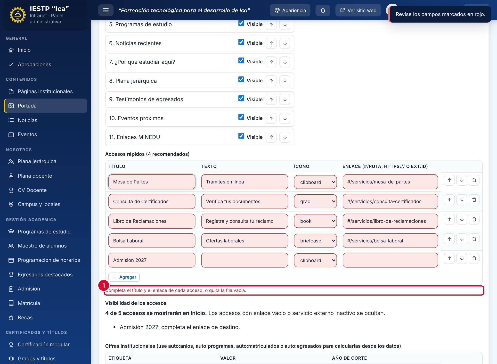

Si alguna fila está incompleta, no se guarda nada y aparece el mensaje ①: «Completa el título y el enlace de cada acceso, o quita la fila vacía.»

### Editar «¿Por qué estudiar aquí?»

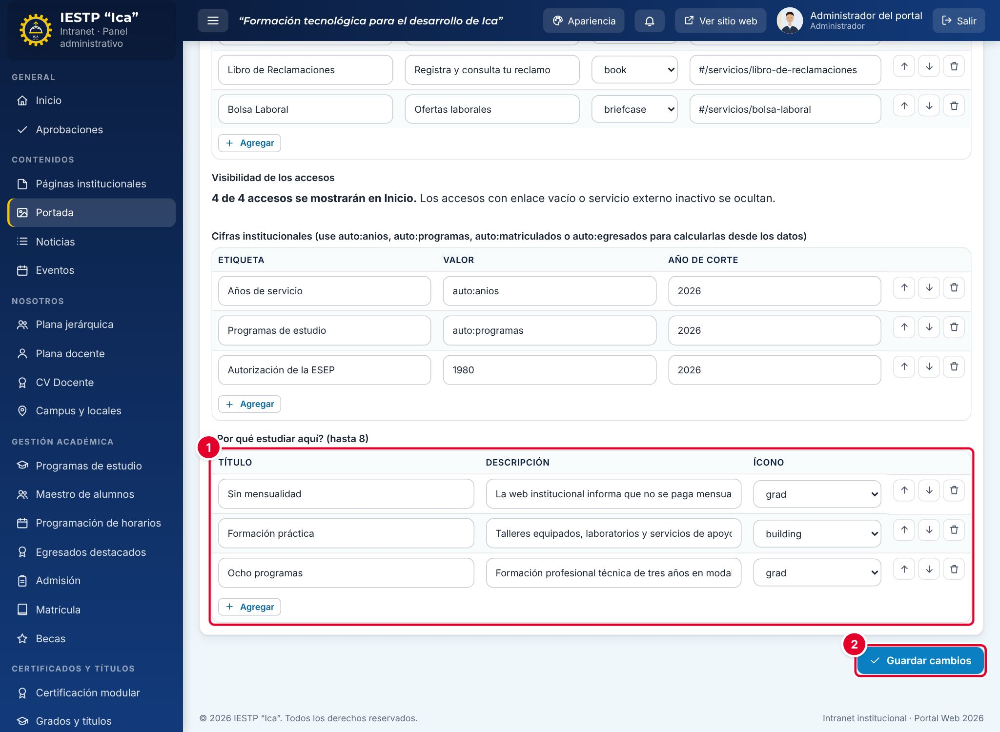

1. En **¿Por qué estudiar aquí? (hasta 8)** ①, escribe el **Título**, la **Descripción** y el **Ícono** de cada beneficio.
2. Pulsa **Guardar cambios** ②.

### Publicar un comunicado en la ventana emergente

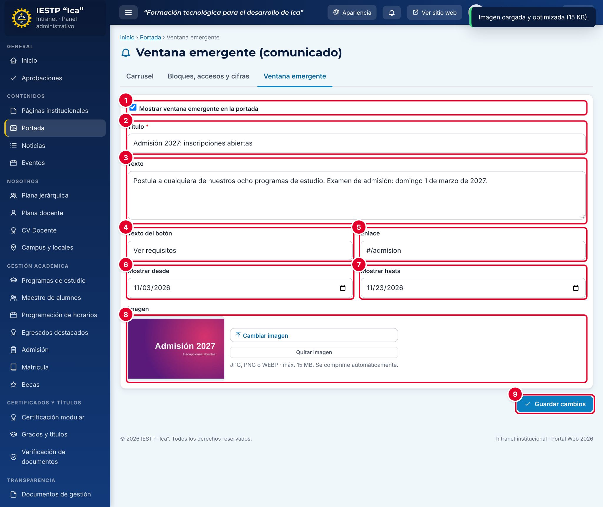

1. Abre la pestaña **Ventana emergente**.
2. Marca **Mostrar ventana emergente en la portada** ①.
3. Escribe el **Título** ② y el **Texto** ③.
4. Opcional: escribe el **Texto del botón** ④ y su **Enlace** ⑤.
5. Indica **Mostrar desde** ⑥ y **Mostrar hasta** ⑦. Fuera de esas fechas no se muestra.
6. Opcional: carga una **Imagen** ⑧. Si ya había una, confirma con **Reemplazar**.
7. Pulsa **Guardar cambios** ⑨.

| Campo | Obligatorio | Formato o límite | Ejemplo |
|---|---|---|---|
| Mostrar ventana emergente en la portada | No | Casilla. Desmarcada, el comunicado no se muestra | Marcada |
| Título | Sí | Texto | Admisión 2027: inscripciones abiertas |
| Texto | No | Texto | Postula a cualquiera de nuestros ocho programas… |
| Texto del botón | No | Texto. Si se deja vacío se usa «Ver más» | Ver requisitos |
| Enlace | No | `#/ruta`, `https://…` o `ext:id`. Sin enlace no se muestra botón | #/admision |
| Mostrar desde / Mostrar hasta | No | Fechas. La final no puede ser anterior a la inicial | 03/11/2026 – 23/11/2026 |
| Imagen | No | JPG, PNG o WEBP, hasta 15 MB | — |

Para retirar el comunicado, desmarca **Mostrar ventana emergente en la portada** y pulsa **Guardar cambios**.

## Resultado en el portal público

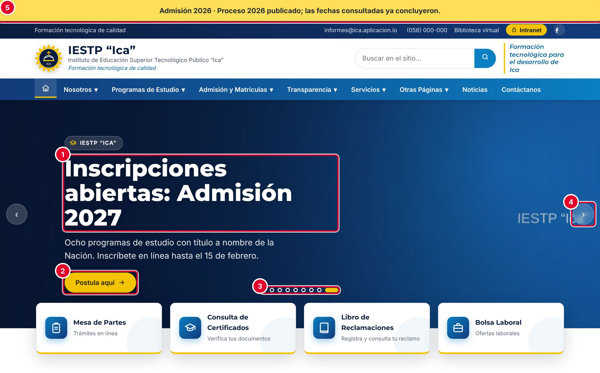

En `{{inst.dominio}}` el carrusel muestra el título ①, el texto y el botón ② de cada diapositiva publicada. Los puntos ③ y las flechas ④ permiten pasar de una diapositiva a otra. La franja amarilla superior ⑤ aparece cuando hay un proceso de **Admisión** vigente y publicado; su texto se edita en el módulo **Admisión**, no en Portada.

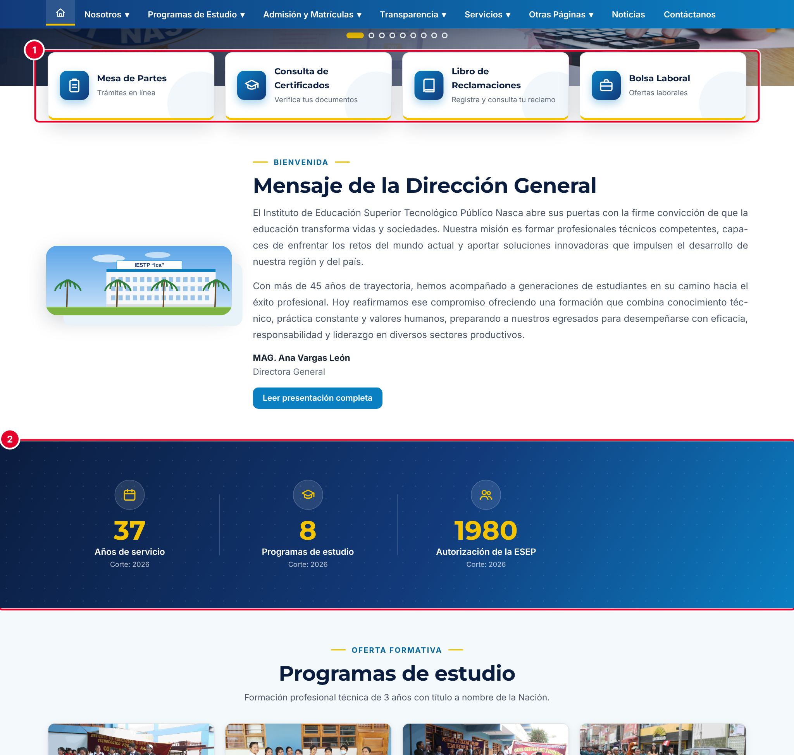

Debajo del carrusel aparecen los accesos rápidos ① y, más abajo, las cifras institucionales ② con su año de corte.

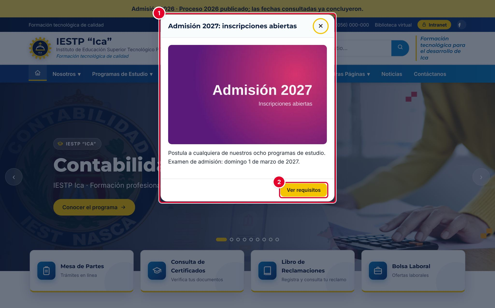

La ventana emergente ① aparece al abrir la portada con la imagen, el texto y el botón ②. Se muestra **una sola vez por sesión del navegador**: si el visitante la cierra, no vuelve a salir hasta que abra el portal en otra sesión.

## Mensajes y problemas frecuentes

| Mensaje o situación | Causa | Qué hacer |
|---|---|---|
| «El orden N ya está asignado a “…”.» | Otra diapositiva en Borrador o Publicado usa ese número | Usa otro número o despublica la otra diapositiva |
| «Indique el enlace del botón.» | Se escribió texto del botón sin enlace | Completa el **Enlace del botón** o borra el texto del botón |
| «Use una ruta interna (#/…) o una URL completa (https://…). No use “#” vacío.» | Enlace con formato no válido | Escribe `#/admision`, `https://…` o `ext:id` |
| «Completa el título y el enlace de cada acceso, o quita la fila vacía.» | Fila de acceso rápido incompleta | Complétala o quítala con el botón de papelera |
| «Cada cifra debe indicar su año de corte.» | Cifra sin **Año de corte** | Escribe el año de corte |
| «La fecha final debe ser posterior a la inicial.» | **Mostrar hasta** es anterior a **Mostrar desde** | Corrige las fechas |
| La ventana emergente no aparece | Está desmarcada, fuera de fechas o ya se mostró en esa sesión | Revisa la casilla y las fechas; prueba en una ventana privada del navegador |
| Un bloque no aparece aunque está **Visible** | No tiene contenido publicado (por ejemplo, eventos futuros) | Publica contenido en el módulo correspondiente |

## Buenas prácticas

- Usa imágenes de 1600 × 600 px sin texto importante en los bordes: el título de la diapositiva se superpone a la izquierda.
- Mantén entre tres y seis diapositivas publicadas; un carrusel muy largo no se recorre completo.
- Usa la ventana emergente solo para comunicados urgentes o de temporada y ponle siempre fecha de fin.
- Revisa la portada en el celular después de cada cambio.
- Prefiere los valores `auto:` en las cifras para que se actualicen solas, y actualiza el año de corte de las cifras manuales.
