# 04 · Noticias

## Para qué sirve

En este módulo se publican las noticias, los comunicados y las notas académicas de la institución. Lo publicado aparece en la sección **Noticias** del portal, en el bloque de noticias de la página de inicio y en el buscador del sitio.

## Quién lo usa

| Rol | Puede |
|---|---|
| Administrador | Crear, editar, publicar, destacar, duplicar, enviar a la papelera, restaurar y **eliminar definitivamente** |
| Imagen institucional | Crear, editar, publicar, destacar, duplicar, enviar a la papelera y restaurar |

## Cómo se llega

Menú lateral › **Contenidos** › **Noticias**. Ruta: `#/admin/noticias`

## Pantalla principal

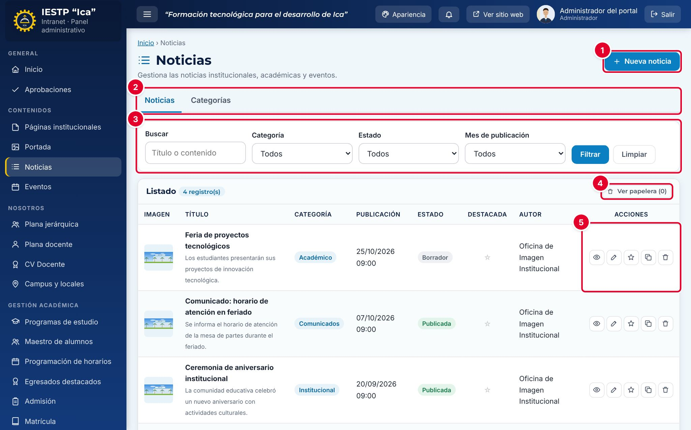

| N.º | Elemento | Para qué sirve |
|---|---|---|
| 1 | **Nueva noticia** | Abre el formulario para redactar una noticia. |
| 2 | Pestañas **Noticias / Categorías** | Cambian entre el listado de noticias y la gestión de categorías. |
| 3 | Filtros | Buscan por texto (título o contenido), **Categoría**, **Estado** y **Mes de publicación**. Pulsa **Filtrar** para aplicarlos y **Limpiar** para quitarlos. |
| 4 | **Ver papelera** | Muestra las noticias eliminadas. Desde ahí se pueden restaurar. |
| 5 | Acciones de la fila | Vista previa, Editar, Marcar como destacada, Duplicar como borrador y Eliminar. |

En la columna **Estado** se ve la situación de cada noticia. Si una noticia está **Publicada** con una fecha futura, aparece además la etiqueta **Programada**.

## Formulario

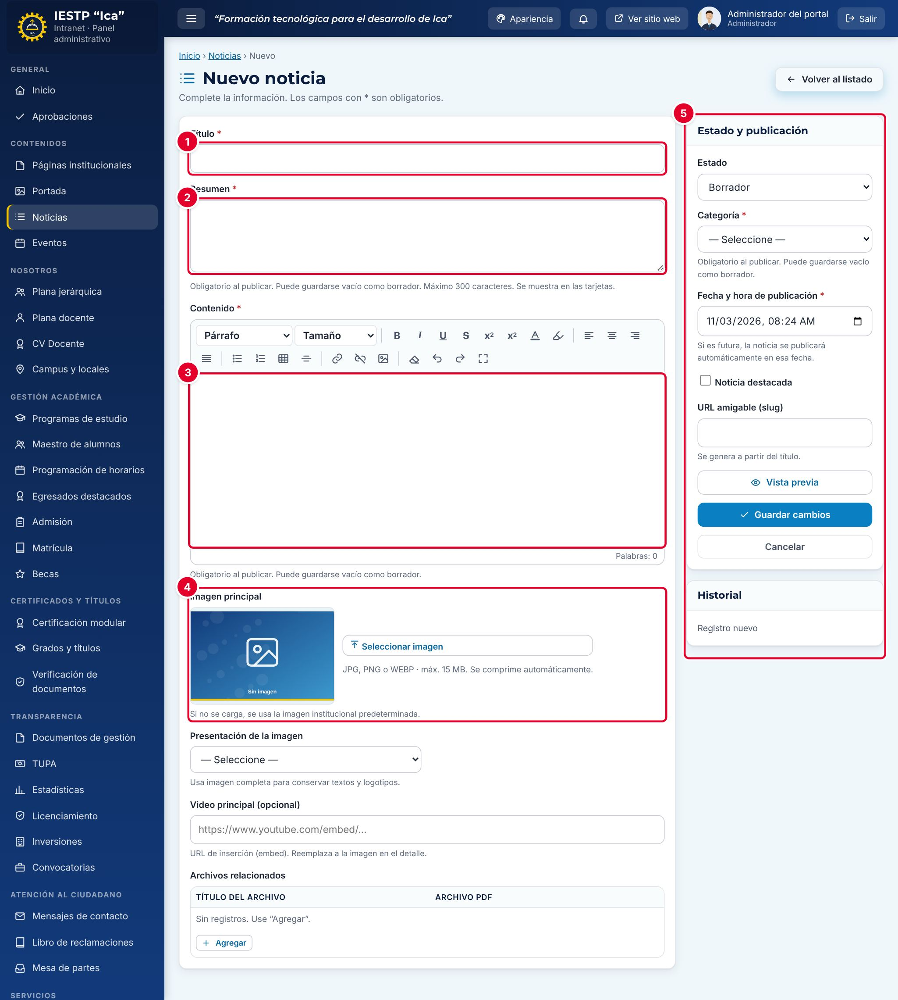

| N.º | Zona | Contenido |
|---|---|---|
| 1 | **Título** | Titular de la noticia. |
| 2 | **Resumen** | Texto corto que aparece en las tarjetas del portal. |
| 3 | **Contenido** | Cuerpo de la noticia, con editor de formato: títulos, negrita, listas, tablas, enlaces e imágenes. |
| 4 | **Imagen principal** | Foto o afiche de la noticia. |
| 5 | **Estado y publicación** | Estado, categoría, fecha, destacada, URL, vista previa y guardado. |

| Campo | Obligatorio | Formato o límite | Ejemplo |
|---|---|---|---|
| Título | Sí | Texto | Taller de primeros auxilios para la comunidad |
| Resumen | Al publicar | Hasta 300 caracteres | El programa de Enfermería Técnica organiza… |
| Contenido | Al publicar | Texto con formato | — |
| Imagen principal | No | JPG, PNG o WEBP, hasta 15 MB. Se comprime automáticamente | Si no se carga, se usa la imagen institucional predeterminada |
| Presentación de la imagen | No | **Automática**, **Completa** (para logotipos, afiches o documentos) o **Cubrir** (para fotografías) | Completa, si la imagen tiene texto |
| Video principal | No | URL de inserción de YouTube (`https://www.youtube.com/embed/…`). En la página de la noticia reemplaza a la imagen | — |
| Archivos relacionados | No | Título y archivo PDF; se pueden agregar varios | Bases del concurso (PDF) |
| Estado | Sí | Borrador, Publicada, Despublicada o Archivada | Borrador |
| Categoría | Al publicar | Una de las categorías activas | Académico |
| Fecha y hora de publicación | Sí | Fecha y hora. Si es futura, la noticia se publica sola en ese momento | 14/11/2026 08:00 |
| Noticia destacada | No | Casilla | — |
| URL amigable (slug) | No | Se genera a partir del título | taller-de-primeros-auxilios-para-la-comunidad |

## Procedimientos

### Redactar y guardar una noticia como borrador

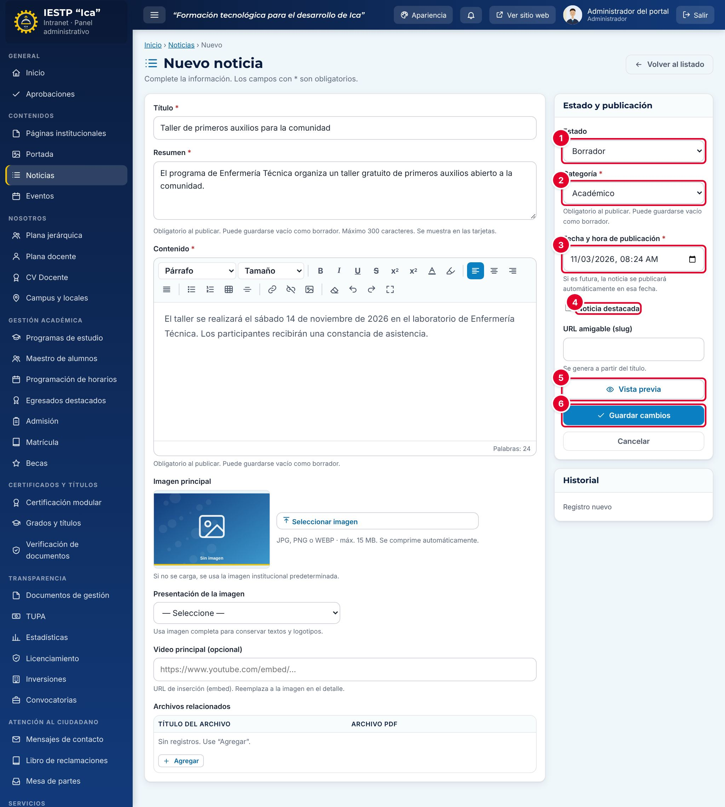

1. Pulsa **Nueva noticia**.
2. Escribe el **Título**, el **Resumen** y el **Contenido**.
3. Opcional: pulsa **Seleccionar imagen** para cargar la imagen principal y elige su **Presentación**.
4. En **Estado y publicación**, deja el **Estado** ① en **Borrador** y elige la **Categoría** ②.
5. Revisa la **Fecha y hora de publicación** ③. Por defecto se propone el momento actual.
6. Marca **Noticia destacada** ④ si debe resaltarse en el portal.
7. Pulsa **Vista previa** ⑤ para ver cómo quedará (ver el siguiente apartado).
8. Pulsa **Guardar cambios** ⑥.

Aparece el aviso «Cambios guardados.» y la noticia queda en el listado con el estado **Borrador** ①. Un borrador **no se ve en el portal**.

### Revisar con la vista previa

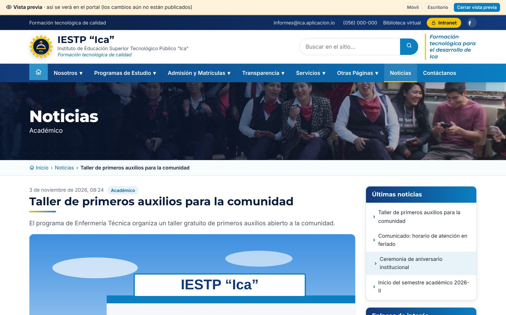

La vista previa muestra la noticia tal como se verá en el portal, aunque todavía no esté publicada. Los botones de la franja superior permiten verla en tamaño **Móvil** o **Escritorio**. Pulsa **Cerrar vista previa** para volver al formulario.

### Publicar una noticia

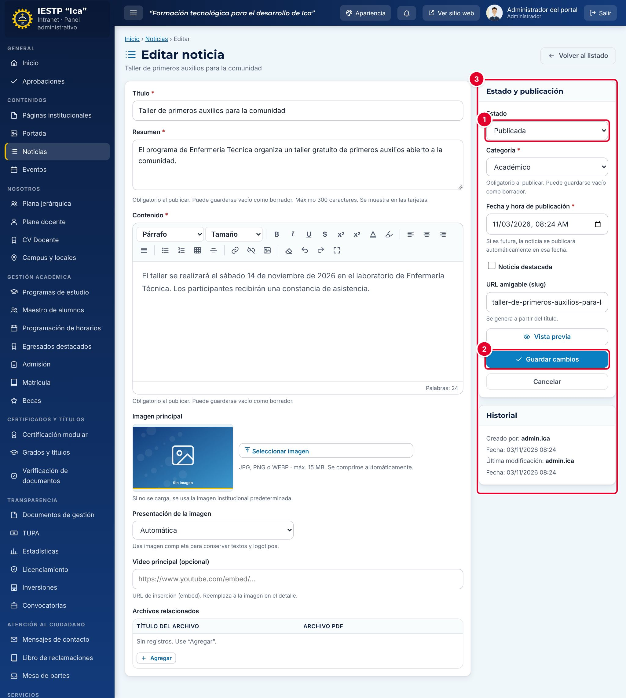

1. En el listado, pulsa el lápiz (**Editar**) de la noticia.
2. Cambia el **Estado** ① a **Publicada**.
3. Pulsa **Guardar cambios** ②.

En el **Historial** ③ queda registrado quién creó la noticia, quién la modificó por última vez y cuándo.

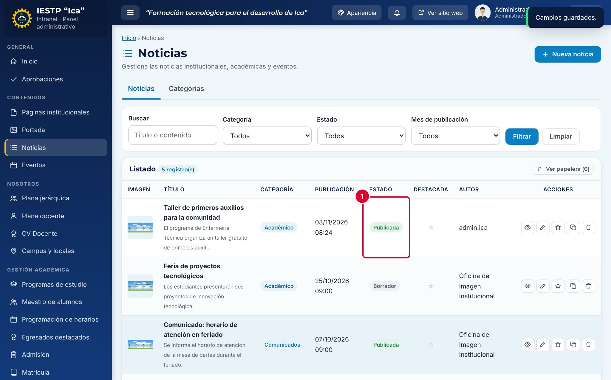

La noticia pasa a **Publicada** ① y desde ese momento se ve en el portal. Si la fecha de publicación es futura, se muestra la etiqueta **Programada** y la noticia aparece en el portal cuando llega esa fecha.

### Programar una publicación

1. Completa la noticia y elige **Estado: Publicada**.
2. En **Fecha y hora de publicación**, indica el día y la hora en que debe salir.
3. Pulsa **Guardar cambios**. La noticia queda **Programada** y se publica sola en esa fecha.

### Retirar una noticia del portal sin borrarla

Edita la noticia, cambia el **Estado** a **Despublicada** (si podría volver a publicarse) o a **Archivada** (si ya cumplió su ciclo) y pulsa **Guardar cambios**. En ambos casos deja de verse en el portal y se conserva en la intranet.

### Destacar o duplicar

- **Marcar como destacada** (estrella de la fila): la noticia aparece en el bloque «Noticias destacadas» del portal. Pulsa la estrella otra vez para quitar la marca.
- **Duplicar como borrador**: crea una copia en estado **Borrador**. Es útil para noticias que se repiten, como comunicados de feriados o convocatorias anuales.

### Eliminar y restaurar

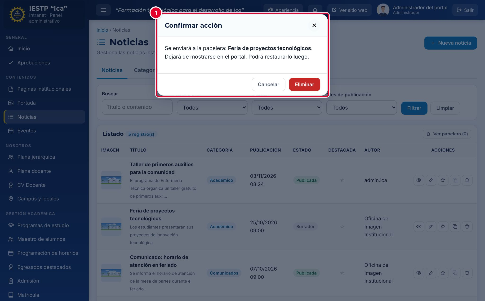

1. Pulsa la papelera (**Eliminar**) de la fila.
2. Lee la confirmación ①: la noticia se envía a la papelera, deja de mostrarse en el portal y se puede restaurar. Pulsa **Eliminar**.

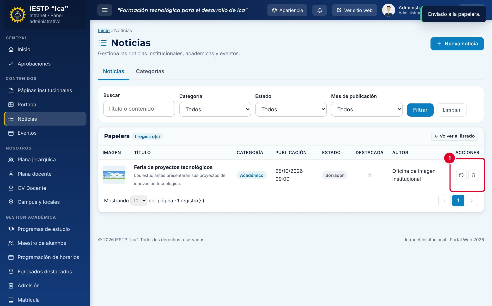

3. Para recuperarla, pulsa **Ver papelera** y luego **Restaurar** ① en la fila. Vuelve al listado con el estado que tenía.
4. Solo el **Administrador** ve el botón **Eliminar definitivamente**. Esta acción no se puede deshacer.

### Gestionar categorías

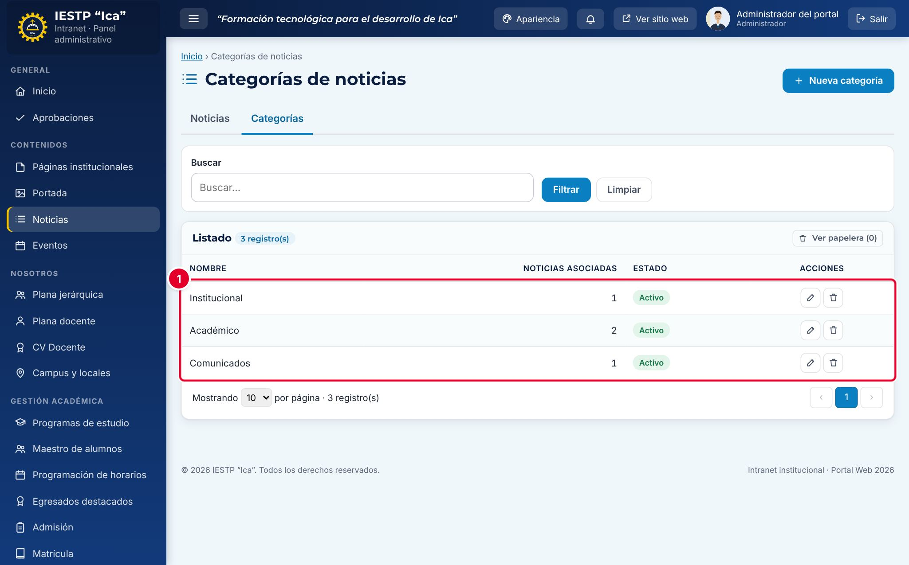

En la pestaña **Categorías** se crean, editan y desactivan las categorías ①. La columna **Noticias asociadas** indica cuántas noticias usa cada una. Las categorías activas aparecen como filtros en el portal. Antes de eliminar una categoría, pasa sus noticias a otra.

## Flujo y estados

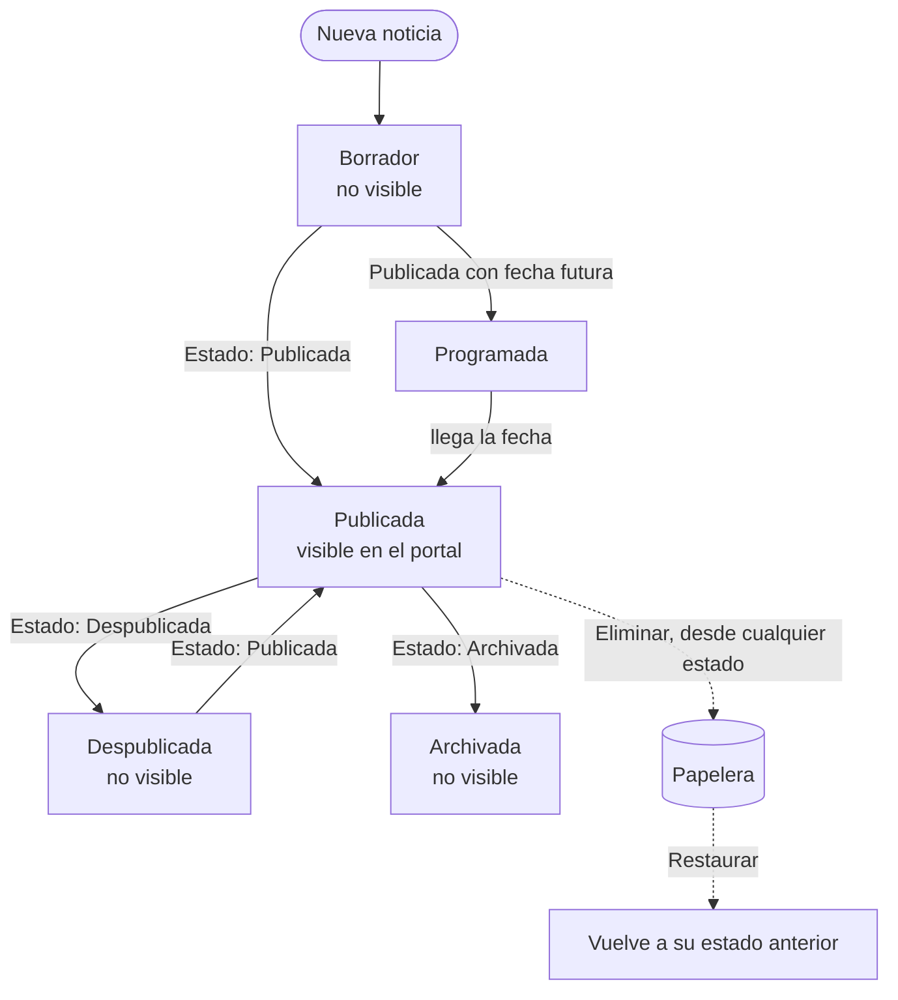

| Estado | Significado | Visible en el portal |
|---|---|---|
| Borrador | En redacción. Puede estar incompleta | No |
| Publicada | Publicada con fecha actual o pasada | **Sí** |
| Publicada (Programada) | Publicada con fecha futura | Desde la fecha indicada |
| Despublicada | Retirada temporalmente | No |
| Archivada | Retirada definitivamente; se conserva como registro | No |
| En papelera | Eliminada; se puede restaurar | No |

## Resultado en el portal público

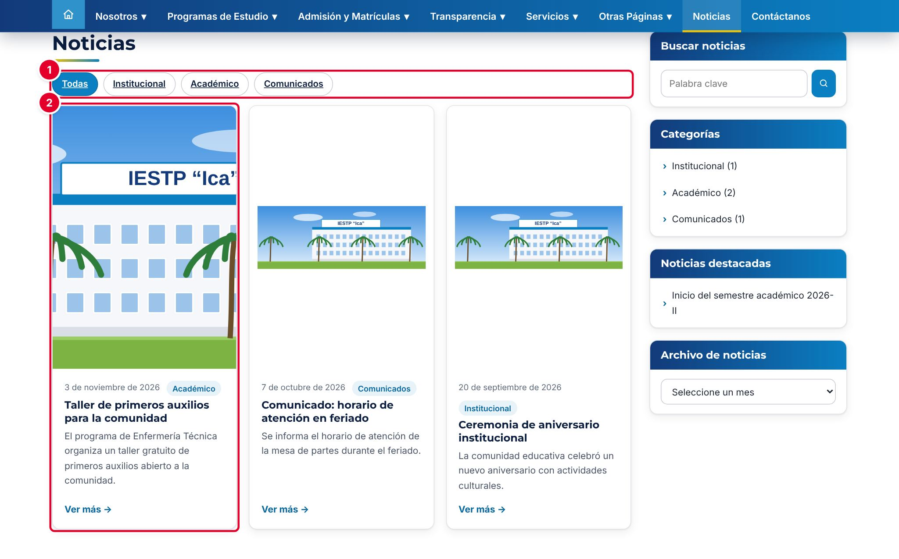

En `{{inst.dominio}}/#/noticias` el público ve las noticias publicadas, de la más reciente a la más antigua. Puede filtrarlas por categoría ① y abrir cada tarjeta ②. La columna lateral incluye un buscador, las categorías, las noticias destacadas y un archivo por mes.

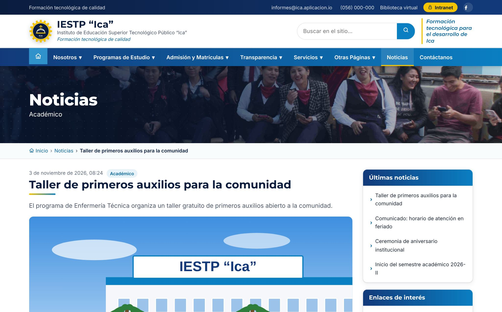

La página de cada noticia muestra la fecha, la categoría, el título, el resumen, la imagen o el video, el contenido y los archivos relacionados.

## Mensajes y problemas frecuentes

| Mensaje o situación | Causa | Qué hacer |
|---|---|---|
| No puedo publicar: falta un campo | Resumen, Contenido y Categoría son obligatorios al publicar | Complétalos o guarda la noticia como **Borrador** |
| La noticia está Publicada, pero no aparece en el portal | La fecha de publicación es futura (**Programada**) | Corrige la fecha si debía salir ya |
| La imagen sale recortada | La presentación es **Cubrir** o **Automática** | Cambia la presentación a **Completa** si la imagen tiene textos o logotipos |
| El video no se ve | Se pegó la URL normal de YouTube | Usa la URL de inserción: `https://www.youtube.com/embed/CÓDIGO` |
| Borré una noticia por error | — | Recupérala desde **Ver papelera** › **Restaurar** |

## Buenas prácticas

- Escribe títulos de menos de 90 caracteres y resúmenes de una o dos oraciones.
- Usa imágenes horizontales. Si la imagen es un afiche con texto, elige **Completa** para que no se recorte.
- Revisa siempre con **Vista previa** antes de publicar.
- No publiques datos personales (DNI, teléfonos, notas) ni fotografías de menores sin autorización (Ley N.º 29733).
- Adjunta los documentos oficiales en PDF en **Archivos relacionados**, en lugar de pegarlos como imagen.
- Mantén pocas noticias destacadas, para que el bloque de destacadas siga siendo útil.
