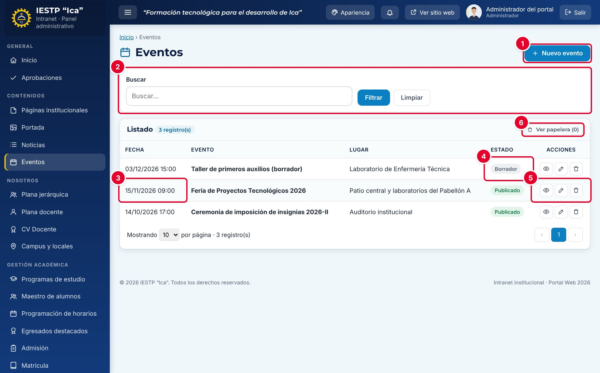
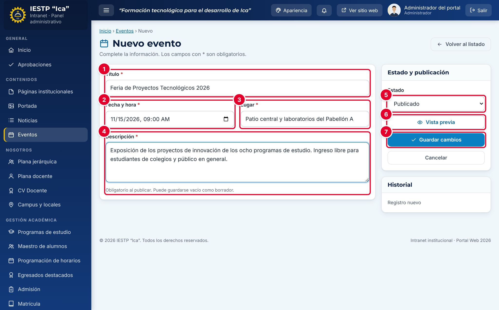
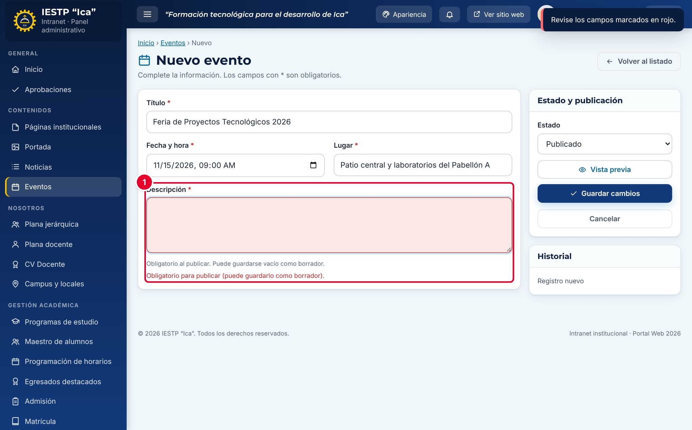
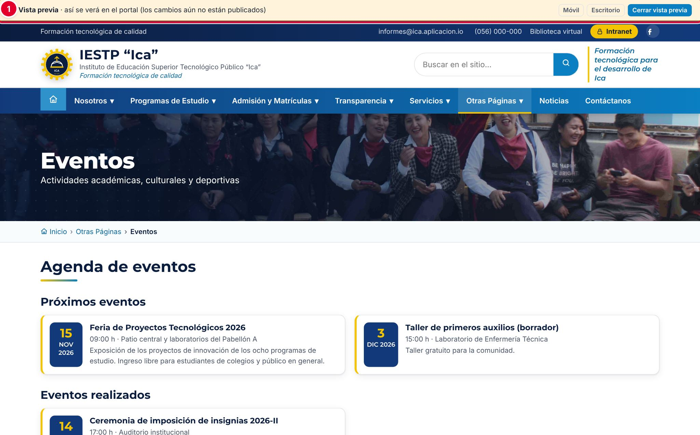
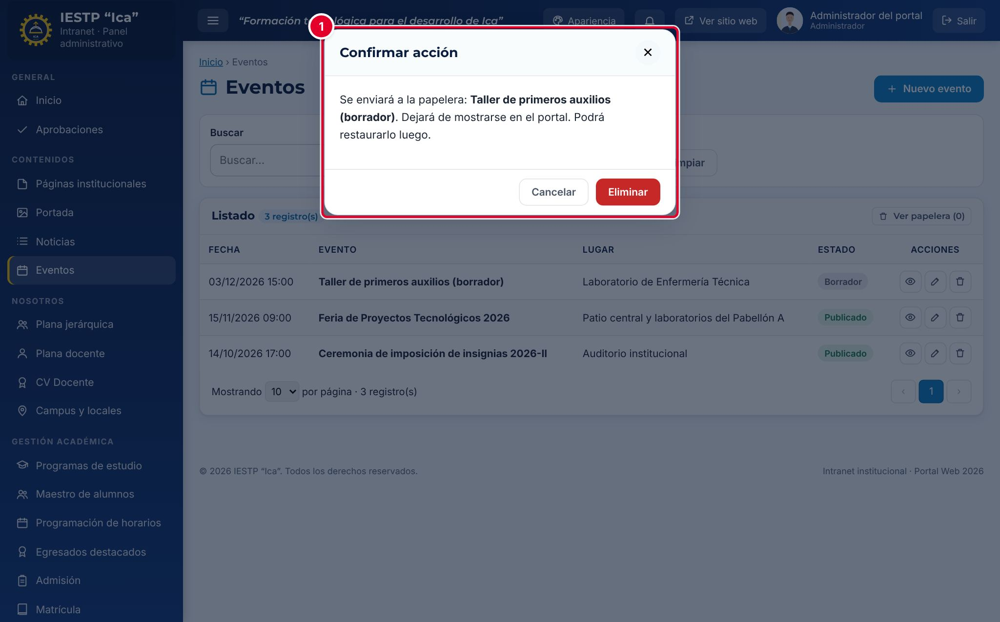
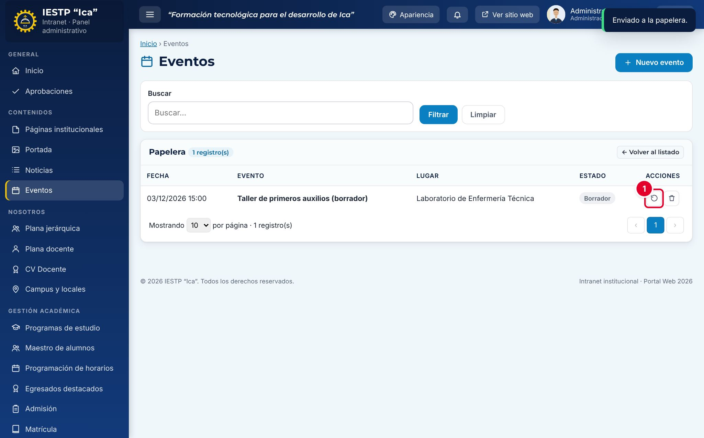
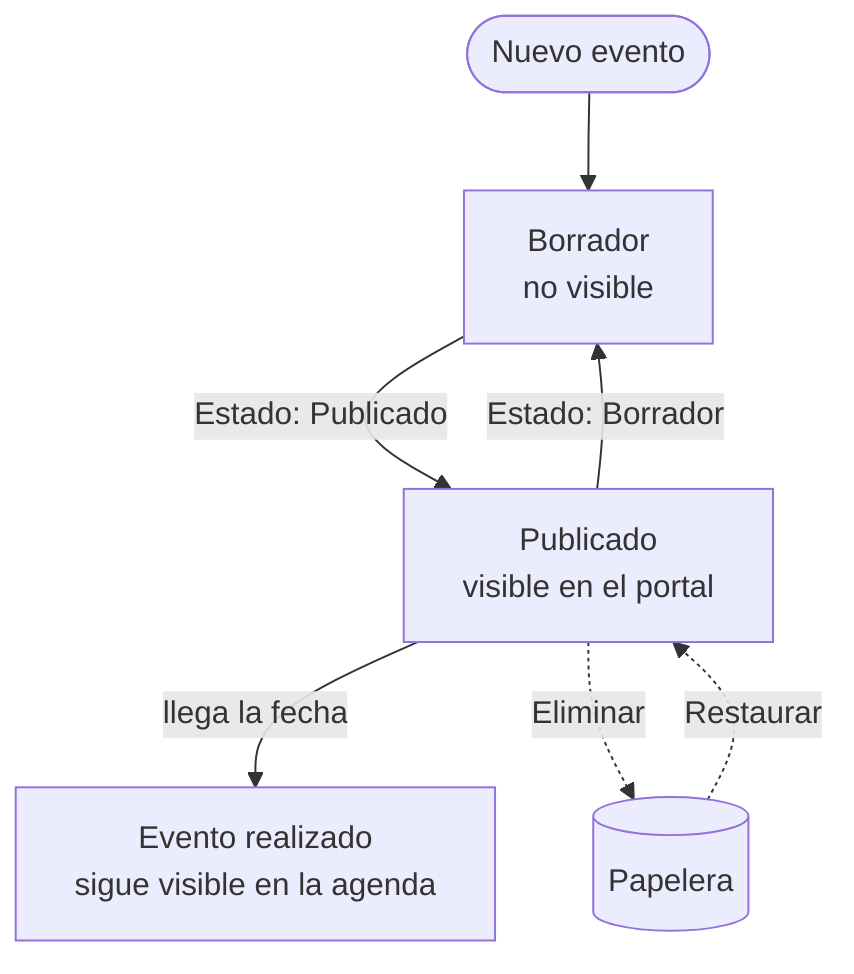
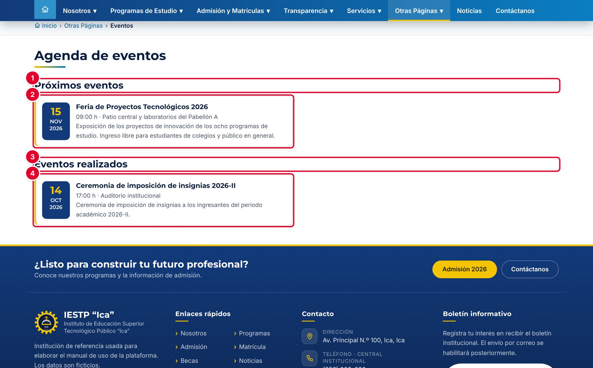
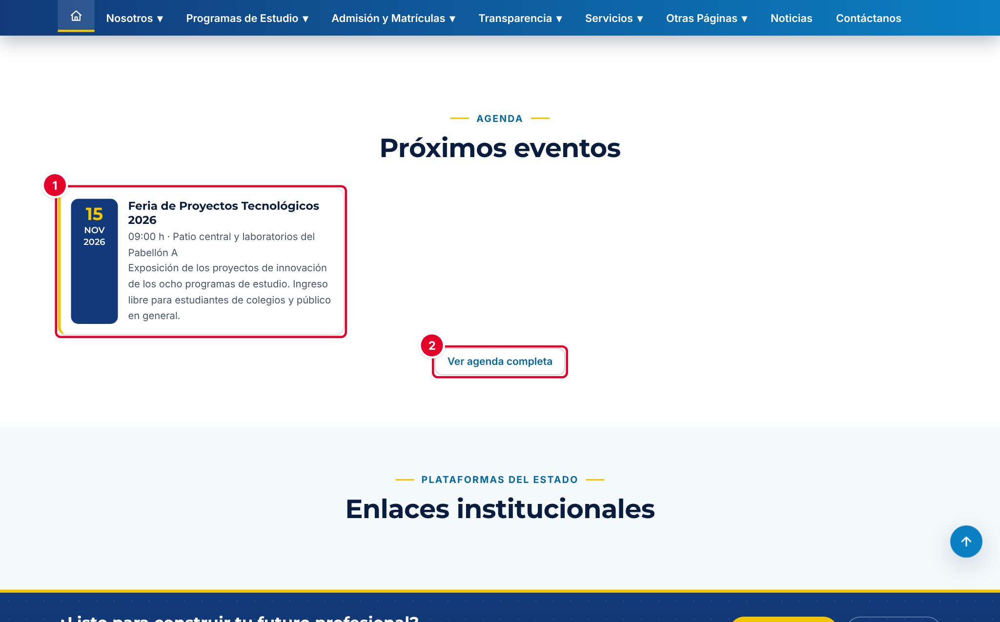

# 05 · Eventos

## Para qué sirve

En este módulo se registra la agenda institucional: ferias, ceremonias, talleres, charlas y actividades deportivas o culturales. Los eventos publicados aparecen en la página **Eventos** del portal, en el bloque **Próximos eventos** de la portada y en **Próximas fechas** del Inicio de la intranet.

## Quién lo usa

| Rol | Puede |
|---|---|
| Administrador | Crear, editar, publicar, enviar a la papelera, restaurar y **eliminar definitivamente** |
| Imagen institucional | Crear, editar, publicar, enviar a la papelera y restaurar |

## Cómo se llega

Menú lateral › **Contenidos** › **Eventos**. Ruta: `#/admin/eventos`

## Pantalla principal

| N.º | Elemento | Para qué sirve |
|---|---|---|
| 1 | **Nuevo evento** | Abre el formulario para registrar un evento. |
| 2 | **Buscar** | Filtra por título. Pulsa **Filtrar** para aplicar y **Limpiar** para quitar el filtro. |
| 3 | **Fecha** | Fecha y hora del evento. El listado se ordena del más lejano al más antiguo. |
| 4 | **Estado** | **Borrador** (no visible) o **Publicado** (visible en el portal). |
| 5 | Acciones | **Vista previa**, **Editar** y **Eliminar**. |
| 6 | **Ver papelera** | Muestra los eventos eliminados para restaurarlos. |

## Formulario

| N.º | Campo | Para qué sirve |
|---|---|---|
| 1 | **Título** | Nombre del evento. |
| 2 | **Fecha y hora** | Día y hora de inicio. Define si el evento es próximo o ya realizado. |
| 3 | **Lugar** | Dónde se realiza. |
| 4 | **Descripción** | Detalle del evento. |
| 5 | **Estado** | **Borrador** o **Publicado**. |
| 6 | **Vista previa** | Muestra la agenda del portal con el evento, sin publicarlo. |
| 7 | **Guardar cambios** | Guarda el evento. |

| Campo | Obligatorio | Formato o límite | Ejemplo |
|---|---|---|---|
| Título | Sí | Texto | Feria de Proyectos Tecnológicos 2026 |
| Fecha y hora | Sí | Fecha y hora | 15/11/2026 09:00 |
| Lugar | Sí | Texto | Patio central y laboratorios del Pabellón A |
| Descripción | Al publicar | Texto sin formato | Exposición de los proyectos de innovación… |
| Estado | Sí | Borrador o Publicado | Publicado |

## Procedimientos

### Registrar y publicar un evento

1. Pulsa **Nuevo evento**.
2. Escribe el **Título**, la **Fecha y hora**, el **Lugar** y la **Descripción**.
3. Elige el **Estado**: **Borrador** si aún falta confirmar datos, **Publicado** si ya debe verse.
4. Pulsa **Vista previa** para revisar cómo quedará la agenda.
5. Pulsa **Guardar cambios**. Aparece el aviso «Cambios guardados.»

Si eliges **Publicado** sin descripción, el campo se marca en rojo ① con el mensaje «Obligatorio para publicar (puede guardarlo como borrador).»

### Revisar con la vista previa

Desde el listado, el ojo de la fila abre la agenda pública con ese evento incluido, aunque esté en **Borrador**. La franja superior ① indica que es una vista previa; usa **Móvil** o **Escritorio** para cambiar el tamaño y **Cerrar vista previa** para volver.

### Editar o retirar un evento

- Para cambiar fecha, lugar o descripción: pulsa el lápiz (**Editar**), corrige y pulsa **Guardar cambios**.
- Para retirarlo del portal sin borrarlo (por ejemplo, si se posterga sin fecha): cambia el **Estado** a **Borrador**.

### Eliminar y restaurar

1. Pulsa la papelera (**Eliminar**) de la fila.
2. Lee la confirmación ①: el evento se envía a la papelera, deja de mostrarse en el portal y se puede restaurar. Pulsa **Eliminar**.

3. Para recuperarlo, pulsa **Ver papelera** y luego **Restaurar** ①.
4. Solo el **Administrador** ve **Eliminar definitivamente**. Esta acción pide dos confirmaciones y no se puede deshacer.

## Flujo y estados

| Estado | Significado | Visible en el portal |
|---|---|---|
| Borrador | En preparación o retirado | No |
| Publicado con fecha futura o de hoy | Evento próximo | **Sí**: agenda, portada e Inicio de la intranet |
| Publicado con fecha pasada | Evento realizado | **Sí**: solo en **Eventos realizados** de la agenda |
| En papelera | Eliminado; se puede restaurar | No |

## Resultado en el portal público

En `{{inst.dominio}}/#/eventos` (menú **Otras Páginas** › **Eventos**) el público ve:

- **Próximos eventos** ①: los eventos publicados desde hoy en adelante ②, del más cercano al más lejano, con fecha, hora, lugar y descripción.
- **Eventos realizados** ③: los eventos publicados con fecha pasada ④, del más reciente al más antiguo.

En la portada, el bloque **Próximos eventos** muestra los tres eventos más cercanos ① y el botón **Ver agenda completa** ②. Si no hay eventos futuros publicados, el bloque no aparece.

## Mensajes y problemas frecuentes

| Mensaje o situación | Causa | Qué hacer |
|---|---|---|
| «Obligatorio para publicar (puede guardarlo como borrador).» | Falta la **Descripción** al publicar | Escríbela o guarda como **Borrador** |
| «Este campo es obligatorio.» | Falta el título, la fecha o el lugar | Completa el campo marcado |
| El evento no aparece en la portada | Está en Borrador, ya pasó su fecha o hay otros tres eventos más cercanos | Revisa el estado y la fecha; el evento sí aparece en la agenda completa |
| El bloque **Próximos eventos** no se ve en la portada | No hay eventos futuros publicados, o el bloque está oculto en **Portada** | Publica un evento o revisa **Portada › Bloques, accesos y cifras** |
| Eliminé un evento por error | — | Recupéralo desde **Ver papelera** › **Restaurar** |

## Buenas prácticas

- Registra el evento apenas tengas fecha y lugar confirmados, aunque falte la descripción final (guárdalo como **Borrador**).
- Indica en el lugar el pabellón o ambiente exacto y, si es externo, la dirección.
- Escribe en la descripción a quién está dirigido y si requiere inscripción.
- Si el evento se posterga, cambia la fecha en lugar de crear un evento nuevo.
- Para la cobertura posterior, publica una noticia en **Noticias**: el evento quedará en **Eventos realizados** como registro.
