# 06 · Plana docente y plana jerárquica

## Para qué sirve

Aquí se registra a cada docente y a cada trabajador **una sola vez**, en una ficha única por persona (foto, nombre, especialidad, programas y unidades didácticas). Esa ficha se reutiliza en tres lugares del portal:

- **Plana docente** (`{{inst.dominio}}/#/nosotros/plana-docente`): directorio de docentes por programa de estudio.
- **Plana jerárquica** (`{{inst.dominio}}/#/nosotros/plana-jerarquica`): equipo directivo, mensaje de la Dirección General y coordinadores de programa.
- **Página de cada programa de estudio**: sección **Plana docente del programa**.

El módulo tiene dos partes: **Plana docente** (las fichas de las personas) y **Plana jerárquica** (los cargos directivos, que se asignan a fichas ya registradas).

## Quién lo usa

| Rol | Puede |
|---|---|
| Administrador | Todo, incluida la **eliminación definitiva** y la edición de la página y el mensaje de la Dirección |
| Secretaría académica | Crear, editar, publicar, enviar a la papelera y restaurar fichas e integrantes de la plana jerárquica. Ve el DNI completo |
| Imagen institucional | Editar la **Página y mensaje de la Dirección** (desde **Páginas institucionales**) |

Los demás roles no ven este módulo. En el listado, el DNI aparece enmascarado para los roles que no tienen permiso de ver el DNI completo.

## Cómo se llega

- Menú lateral › **Nosotros** › **Plana docente**. Ruta: `#/admin/docentes`
- Menú lateral › **Nosotros** › **Plana jerárquica**. Ruta: `#/admin/jerarquica`

## Pantalla principal

### Plana docente

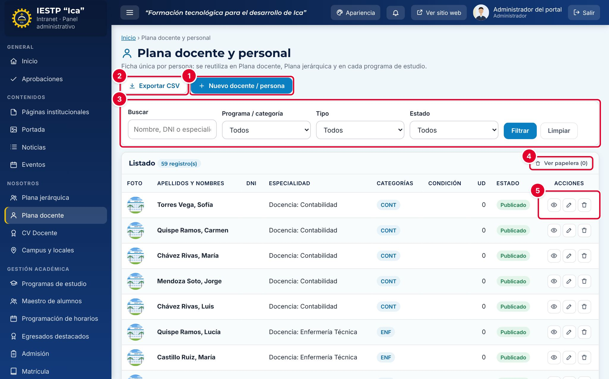

| N.º | Elemento | Para qué sirve |
|---|---|---|
| 1 | **Nuevo docente / persona** | Abre el formulario para registrar una ficha. |
| 2 | **Exportar CSV** | Descarga el listado filtrado (apellidos, nombres, correo, especialidad, condición, programas y estado) para abrirlo en Excel. |
| 3 | Filtros | **Buscar** por nombre, DNI o especialidad, y filtrar por **Programa / categoría** (incluye **Empleabilidad**), **Tipo** (Docente o Administrativo) y **Estado**. Pulsa **Filtrar** para aplicarlos y **Limpiar** para quitarlos. |
| 4 | **Ver papelera** | Muestra las fichas eliminadas. Desde ahí se pueden restaurar. |
| 5 | Acciones de la fila | **Vista previa** (cómo se ve en el portal), **Editar** y **Eliminar**. |

Las columnas **Categorías** y **UD** muestran las siglas de los programas asignados y cuántas unidades didácticas tiene a su cargo la persona.

### Plana jerárquica

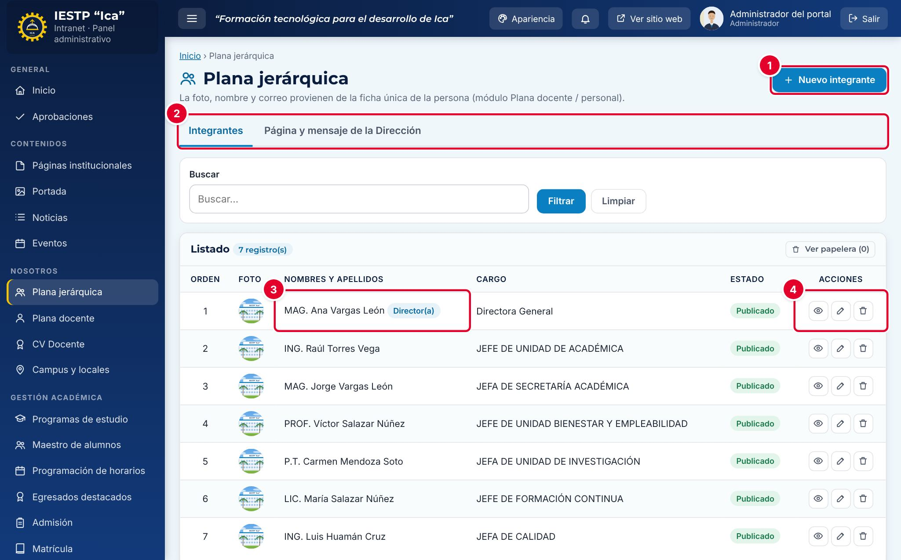

| N.º | Elemento | Para qué sirve |
|---|---|---|
| 1 | **Nuevo integrante** | Asigna un cargo directivo a una persona ya registrada en la plana docente. |
| 2 | Pestañas **Integrantes / Página y mensaje de la Dirección** | Cambian entre el listado de cargos y el texto de la página pública. |
| 3 | Nombre del integrante | La foto y el nombre se toman de la ficha de la persona. La etiqueta **Director(a)** marca a quien tiene el tratamiento de Director(a) General. |
| 4 | Acciones de la fila | **Vista previa**, **Editar** y **Eliminar**. |

Los integrantes se muestran según su **Orden** de presentación.

## Formulario

### Ficha de una persona (Plana docente)

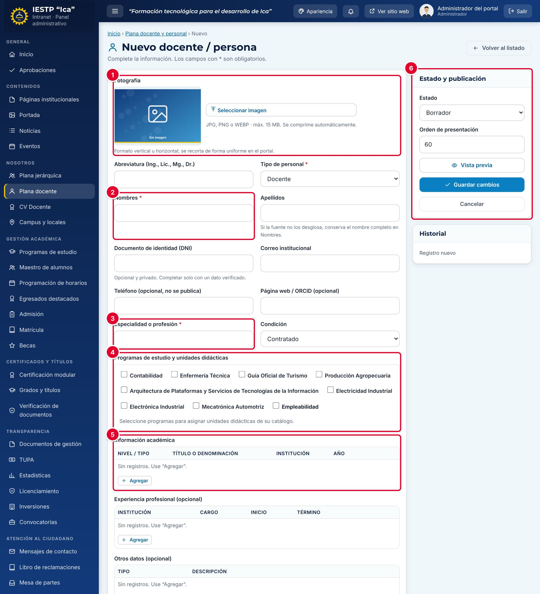

| N.º | Zona | Contenido |
|---|---|---|
| 1 | **Fotografía** | Foto de la persona. Se recorta de forma uniforme en el portal. |
| 2 | Datos personales | Abreviatura, tipo de personal, nombres, apellidos, DNI, correo, teléfono y página web. |
| 3 | **Especialidad o profesión** | Texto que acompaña al nombre en las tarjetas del portal. |
| 4 | **Programas de estudio y unidades didácticas** | Programas a los que pertenece el docente y unidades didácticas que dicta. |
| 5 | **Información académica** | Títulos y grados, en filas. Debajo están **Experiencia profesional** y **Otros datos** (opcionales). |
| 6 | **Estado y publicación** | Estado, orden de presentación, vista previa y guardado. |

| Campo | Obligatorio | Formato o límite | Ejemplo |
|---|---|---|---|
| Fotografía | No | JPG, PNG o WEBP, hasta 15 MB. Se comprime automáticamente | Si no se carga, se usa la imagen institucional |
| Abreviatura (Ing., Lic., Mg., Dr.) | No | Hasta 8 caracteres | Lic. |
| Tipo de personal | Sí | **Docente** o **Administrativo** | Docente |
| Nombres | Sí | Texto | Milagros Elena |
| Apellidos | No | Texto. Si la fuente no los separa, deja el nombre completo en **Nombres** | Yupanqui Ccahuana |
| Documento de identidad (DNI) | No | 8 dígitos; no puede repetirse. Es privado: **no se publica** | — |
| Correo institucional | No | Correo válido. Es el único dato de contacto que se publica | myupanqui@ica.aplicacion.io |
| Teléfono | No | Texto. **No se publica** | — |
| Página web / ORCID | No | Debe empezar con `http://` o `https://` | — |
| Especialidad o profesión | Sí | Texto | Licenciada en Enfermería |
| Condición | No | **Nombrado** o **Contratado** | Contratado |
| Programas de estudio y unidades didácticas | Para publicar a un docente | Al menos un programa o **Empleabilidad** | Enfermería Técnica |
| Información académica | No | Filas con **Nivel / tipo**, **Título o denominación** (obligatorio en cada fila), **Institución** y **Año** | Título profesional · Licenciada en Enfermería |
| Experiencia profesional | No | Filas con institución, cargo, inicio y término | — |
| Otros datos | No | Filas con tipo (Reconocimiento, Publicación, Certificación u Otro) y descripción | — |
| Estado | Sí | **Borrador**, **Publicado** o **Despublicado** | Publicado |
| Orden de presentación | No | Número desde 1. Se propone un número al final de la lista | 60 |

### Integrante de la plana jerárquica

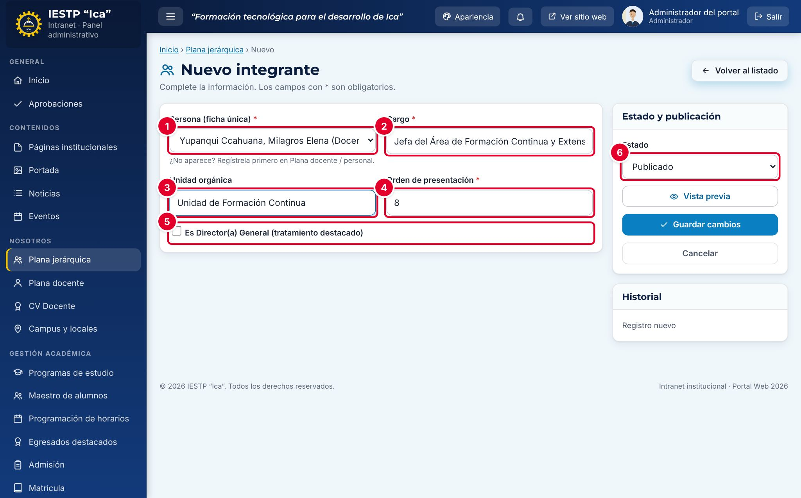

| N.º | Campo | Descripción |
|---|---|---|
| 1 | **Persona (ficha única)** \* | Persona ya registrada en la plana docente. Si no aparece, regístrala primero allí. |
| 2 | **Cargo** \* | Denominación del cargo tal como se publicará. |
| 3 | **Unidad orgánica** | Órgano o unidad a la que pertenece el cargo. |
| 4 | **Orden de presentación** \* | Número desde 1. No puede repetirse entre integrantes activos. |
| 5 | **Es Director(a) General (tratamiento destacado)** | La persona aparece primero y firma el **Mensaje de la Dirección General**. Solo puede haber un Director(a) General publicado. |
| 6 | **Estado** | **Publicado** o **Despublicado**. |

## Procedimientos

### Registrar a un docente

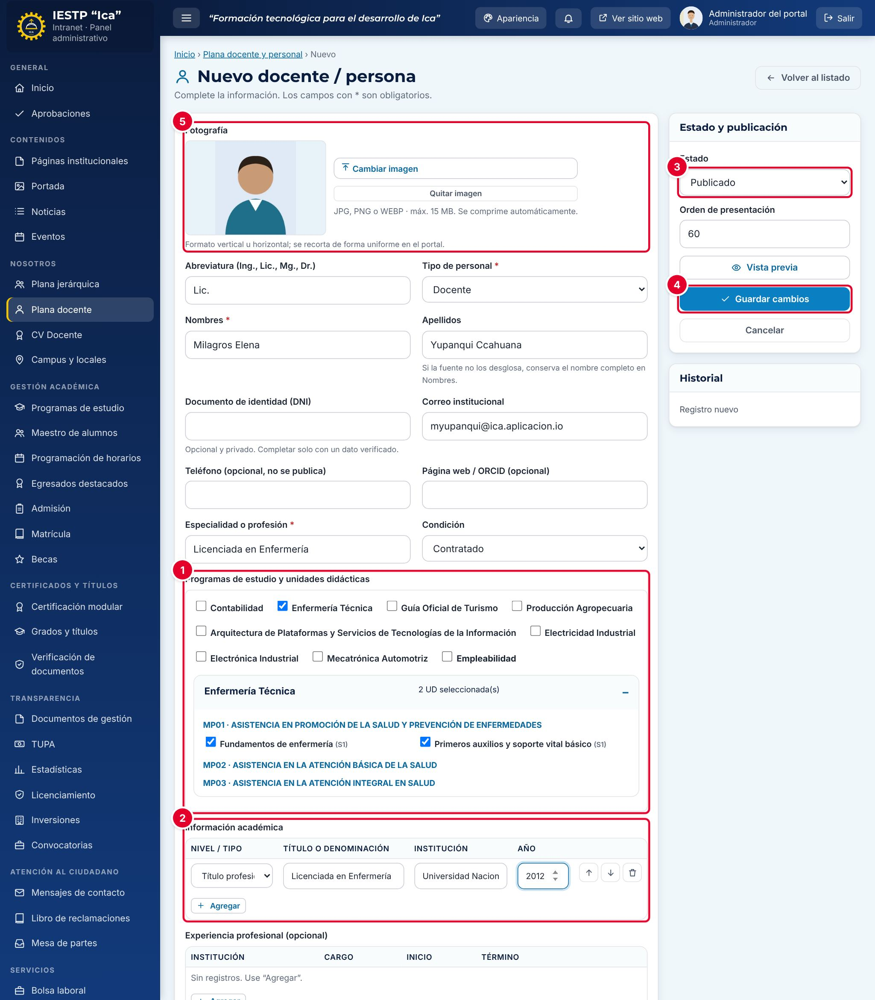

1. Pulsa **Nuevo docente / persona**.
2. Pulsa **Seleccionar imagen** ⑤ y carga la foto.
3. Completa la abreviatura, los nombres, los apellidos, el correo institucional, la **Especialidad o profesión** y la **Condición**.
4. En **Programas de estudio y unidades didácticas** ①, marca el programa. Se despliega su catálogo por módulos: marca las unidades didácticas que dicta el docente.
5. En **Información académica** ②, pulsa **Agregar** y completa cada fila. Usa las flechas para ordenar las filas y la papelera para quitar una.
6. Elige el **Estado** ③: **Publicado** para que aparezca en el portal o **Borrador** si aún falta información.
7. Pulsa **Guardar cambios** ④.

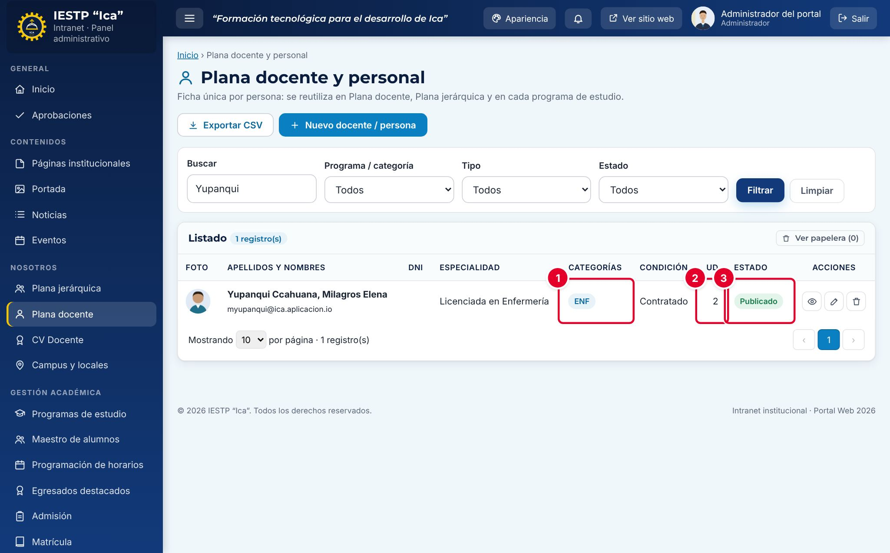

Aparece el aviso «Cambios guardados.». En el listado se ven las siglas del programa ①, la cantidad de unidades didácticas ② y el estado ③.

> **Importante:** un docente nuevo aparece de inmediato en la **Plana docente del programa** (página de cada programa), pero **no** en el directorio **Plana docente** del portal hasta que se registre su autorización de publicación de datos (Ley N.º 29733) en el módulo **CV Docente** (capítulo 07).

Las unidades didácticas se crean en el módulo **Programas de estudio** (capítulo 09). Si un programa no tiene unidades en su catálogo, solo se puede marcar el programa.

### Registrar a un integrante de la plana jerárquica

1. Verifica que la persona ya tenga su ficha en **Plana docente**.
2. En **Plana jerárquica**, pulsa **Nuevo integrante**.
3. Elige la **Persona (ficha única)**, escribe el **Cargo** y la **Unidad orgánica**.
4. Revisa el **Orden de presentación** y el **Estado**.
5. Marca **Es Director(a) General** solo si corresponde a la Dirección General.
6. Pulsa **Guardar cambios**.

Una misma persona puede tener más de un cargo, pero no el mismo cargo dos veces.

### Editar la página y el mensaje de la Dirección

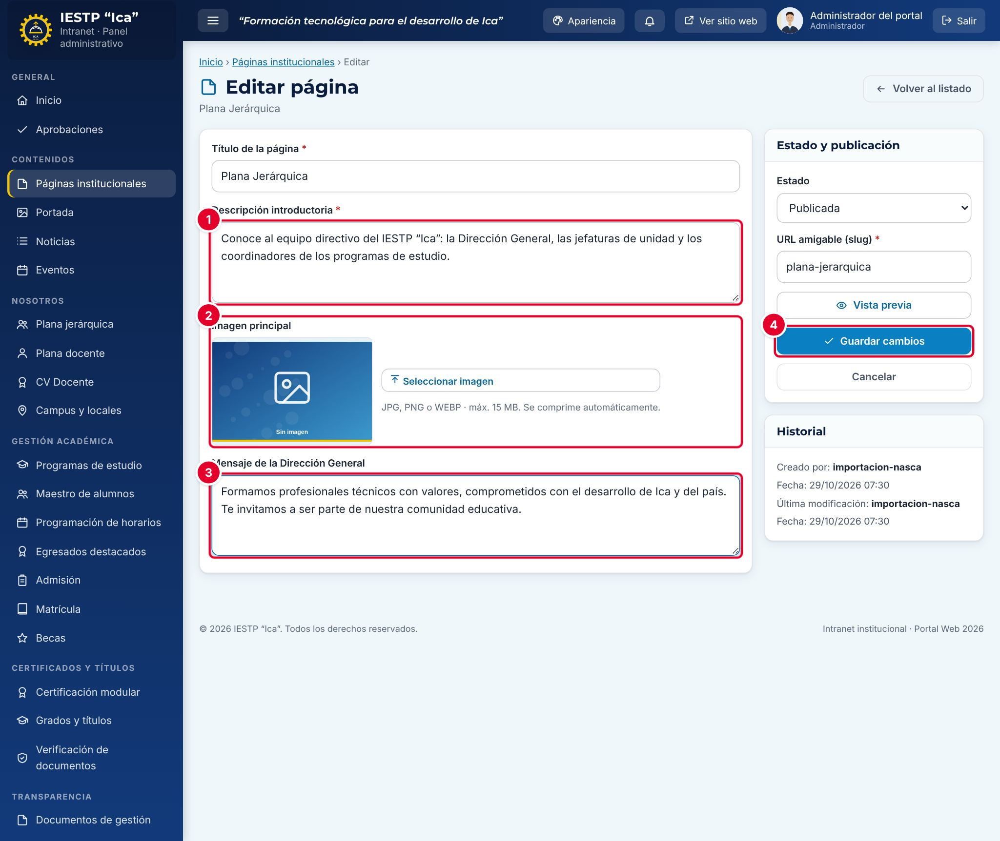

1. En **Plana jerárquica**, pulsa la pestaña **Página y mensaje de la Dirección**. Se abre la página **Plana Jerárquica** del módulo **Páginas institucionales**.
2. Escribe la **Descripción introductoria** ①: texto simple de hasta 400 caracteres, sin etiquetas como `
`.
3. Opcional: carga una **Imagen principal** ②.
4. Escribe el **Mensaje de la Dirección General** ③ (hasta 600 caracteres).
5. Pulsa **Guardar cambios** ④. La versión anterior queda guardada en el historial de la página.

Esta pestaña solo funciona para los roles con acceso a **Páginas institucionales** (Administrador e Imagen institucional). Para la Secretaría académica muestra «Acceso denegado».

### Cambiar una ficha, retirarla o eliminarla

- **Editar:** pulsa el lápiz de la fila, cambia los datos y pulsa **Guardar cambios**. Los cambios de foto, nombre o correo se reflejan en todos los lugares donde aparece la persona.
- **Retirar del portal sin borrar:** cambia el **Estado** a **Despublicado**.
- **Eliminar:** pulsa la papelera de la fila y confirma. La ficha va a la papelera y se puede restaurar desde **Ver papelera**.
- No se puede eliminar a una persona que integra la **plana jerárquica** publicada: primero retírala de allí.
- Solo el **Administrador** puede **Eliminar definitivamente**. No se permite si la persona es coordinadora de un programa o tiene clases asignadas en la programación de horarios.

## Flujo y estados

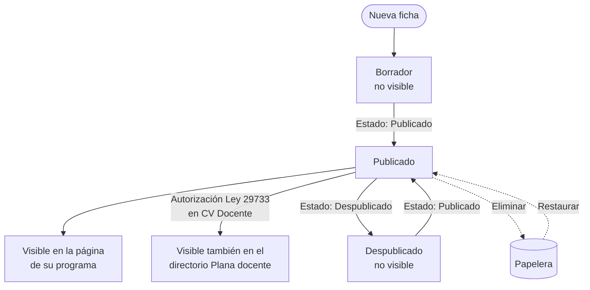

| Estado | Significado | Visible en el portal |
|---|---|---|
| Borrador | Ficha en preparación | No |
| Publicado | Ficha activa | Sí, en la página de su programa. En el directorio **Plana docente**, solo con autorización de publicación |
| Despublicado | Retirada temporalmente | No |
| En papelera | Eliminada; se puede restaurar | No |

Los integrantes de la plana jerárquica solo tienen los estados **Publicado** y **Despublicado**.

## Resultado en el portal público

### Plana docente

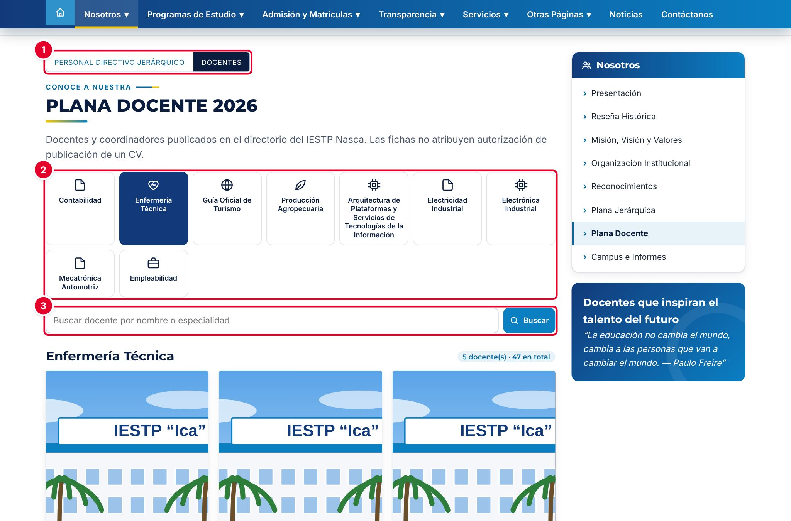

En `{{inst.dominio}}/#/nosotros/plana-docente` el público cambia entre **Personal directivo jerárquico** y **Docentes** ①, elige el programa de estudio o **Empleabilidad** ② y busca por nombre o especialidad ③.

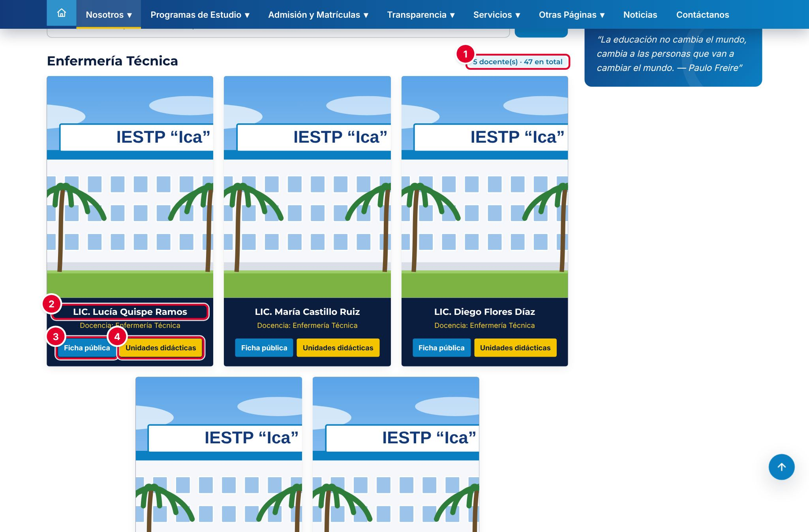

| N.º | Elemento | Descripción |
|---|---|---|
| 1 | Contador | Docentes de la categoría elegida y total del directorio. |
| 2 | Nombre | Abreviatura, nombres y apellidos; debajo, la especialidad, la condición y el correo institucional. |
| 3 | **Ficha pública** / **Hoja de vida** | Abre la ficha del docente. Si el docente autorizó la publicación de su CV, el botón dice **Hoja de vida** y abre el CV en PDF. |
| 4 | **Unidades didácticas** | Muestra el perfil del docente con las unidades que dicta en ese programa. |

### Página del programa

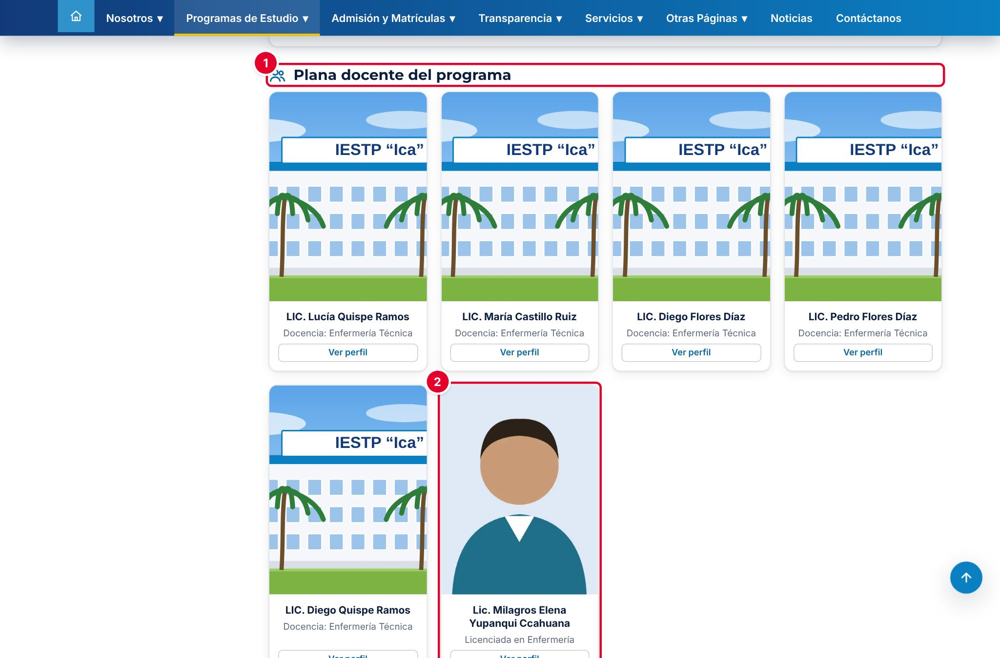

En la página de cada programa (`{{inst.dominio}}/#/programas/<programa>`), la sección **Plana docente del programa** ① muestra a todos los docentes publicados del programa ②, con el botón **Ver perfil**.

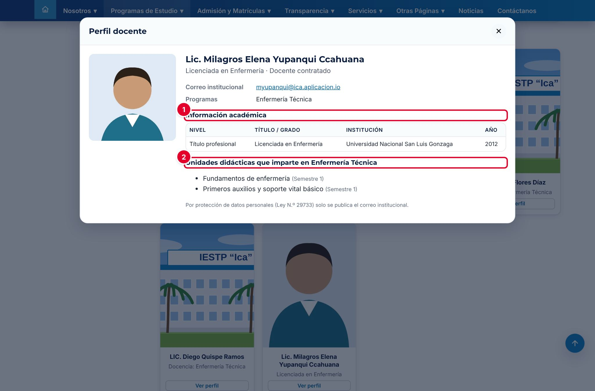

El perfil muestra la especialidad, la condición, el correo institucional, los programas, la **Información académica** ① y las **Unidades didácticas que imparte** ②. Por protección de datos, no se publican el DNI ni el teléfono.

### Plana jerárquica

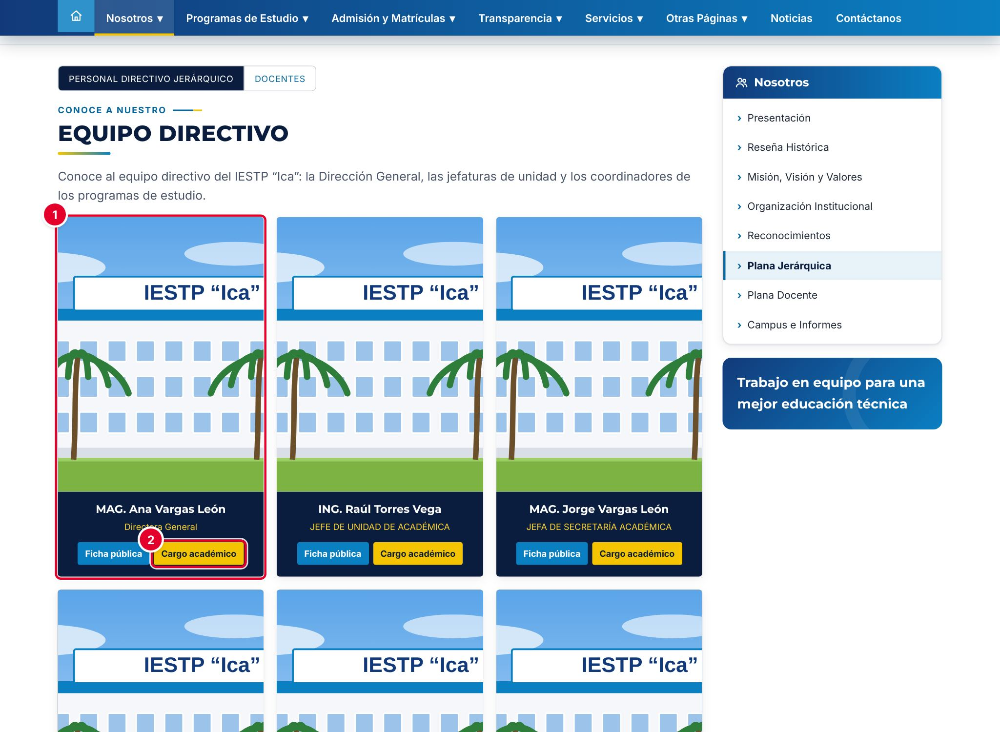

En `{{inst.dominio}}/#/nosotros/plana-jerarquica` se ve primero al Director(a) General y luego al resto del equipo según su orden ①. El botón **Cargo académico** ② abre los datos del cargo.

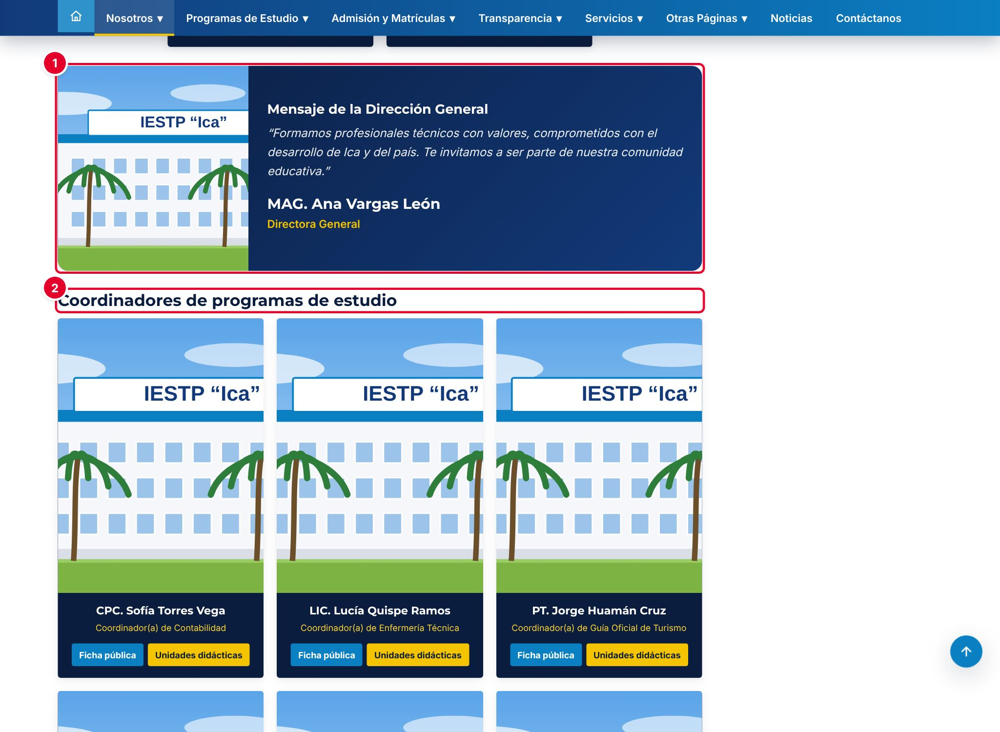

Debajo aparecen el **Mensaje de la Dirección General** ① y los **Coordinadores de programas de estudio** ②. Los coordinadores se toman automáticamente del campo **Coordinador(a) del programa** de cada programa (capítulo 09).

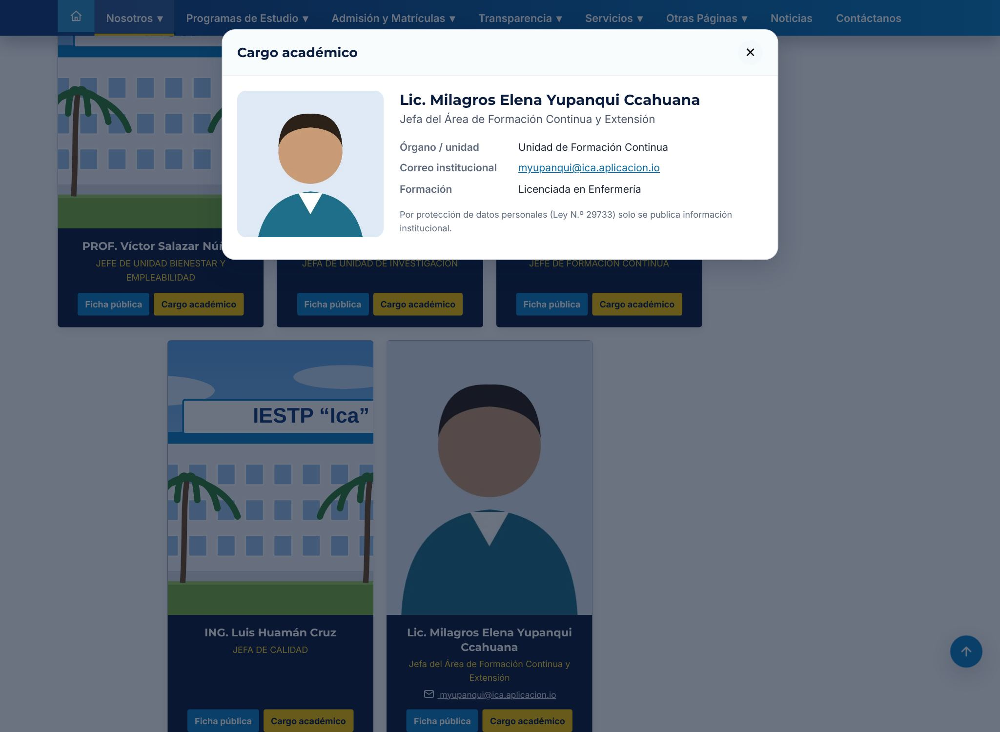

La ventana **Cargo académico** muestra el cargo, la unidad orgánica, el correo institucional y la formación de la persona.

> **Incidencia detectada al elaborar este manual (versión actual de la plataforma)**
> En la plana jerárquica, el botón **Ficha pública** **no hace nada** cuando el integrante no tiene registrada su autorización de publicación en **CV Docente**: no abre ninguna ventana ni muestra un aviso. Ocurre con todo integrante registrado en el portal (no importado del portal anterior) que aún no autorizó. Ya se reportó para su corrección. Mientras tanto, registra la autorización del integrante en **CV Docente › Documentos y autorización** (capítulo 07): el botón pasa a decir **Hoja de vida** y abre su CV.

## Mensajes y problemas frecuentes

| Mensaje o situación | Causa | Qué hacer |
|---|---|---|
| «Asocie al docente al menos a un programa o a Empleabilidad para publicarlo.» | Docente en estado **Publicado** sin programa | Marca un programa o **Empleabilidad**, o guárdalo como **Borrador** |
| «El DNI debe tener 8 dígitos.» | El DNI tiene letras o una longitud distinta | Corrígelo o déjalo vacío |
| «Ya existe un registro con este valor (…)» | El DNI ya está en otra ficha | Busca la ficha existente; no dupliques personas |
| «Complete el título de cada antecedente académico o quite la fila.» | Una fila de **Información académica** está sin título | Completa el título o quita la fila con la papelera |
| «La persona integra la plana jerárquica. Retírela de allí primero.» | Se intentó eliminar una ficha con cargo directivo publicado | Elimina o despublica primero su cargo en **Plana jerárquica** |
| «Ya existe un integrante marcado como Director(a) General.» | Ya hay un Director(a) General publicado | Desmarca o despublica al anterior antes de marcar al nuevo |
| «Esta persona ya está registrada con el mismo cargo.» | Cargo duplicado para la misma persona | Edita el registro existente |
| «El orden N ya está asignado a …» | Orden repetido en la plana jerárquica | Usa otro número de orden |
| El docente no aparece en el directorio **Plana docente** | Falta la autorización de publicación (Ley N.º 29733) | Regístrala en **CV Docente** (capítulo 07) |
| La descripción de la página muestra `
` | El texto se cargó con etiquetas HTML | Borra las etiquetas y deja solo el texto |

## Buenas prácticas

- Registra a cada persona **una sola vez**. Si cambia de programa o de cargo, edita su ficha en lugar de crear otra.
- Usa fotos de frente, con fondo claro y del mismo tamaño para todo el personal.
- No publiques DNI, teléfonos personales ni domicilios. El portal solo muestra el correo institucional.
- Antes de publicar un CV completo, obtén la autorización de la persona (Ley N.º 29733) y regístrala en **CV Docente**.
- Asigna las unidades didácticas de cada docente al inicio de cada periodo, para que el portal muestre la plana actualizada.
- Mantén un solo Director(a) General publicado y revisa el mensaje de la Dirección al cambiar de gestión.
