# 07 · CV docente

## Para qué sirve

El **Sistema de gestión de CV para docentes** reúne la hoja de vida de cada docente: datos personales, formación, experiencia, competencias, documentos sustentatorios y la **autorización de publicación de datos personales (Ley N.º 29733)**. Con esa información genera el CV en PDF con el formato institucional.

La autorización es la que habilita la publicación: un docente aparece en el directorio **Plana docente** del portal con su **Hoja de vida** solo si autorizó la publicación de sus datos.

La información parte de la ficha única de la persona registrada en **Plana docente** (capítulo 06).

## Quién lo usa

| Rol | Puede |
|---|---|
| Administrador | Ver y gestionar el CV de todos los docentes, registrar y revocar autorizaciones |
| Secretaría académica | Lo mismo que el administrador |
| Docente | Ver y completar **solo su propio CV**. No puede cambiar sus nombres, apellidos ni correo institucional |

Para que un docente use este módulo con su propia cuenta, la cuenta debe estar **vinculada a su ficha** (ver «Crear la cuenta de un docente»).

## Cómo se llega

Menú lateral › **Nosotros** › **CV Docente**. Ruta: `#/admin/cvdocente`

El docente también llega desde su página de inicio, con el botón **Actualizar mi CV docente**.

## Pantalla principal

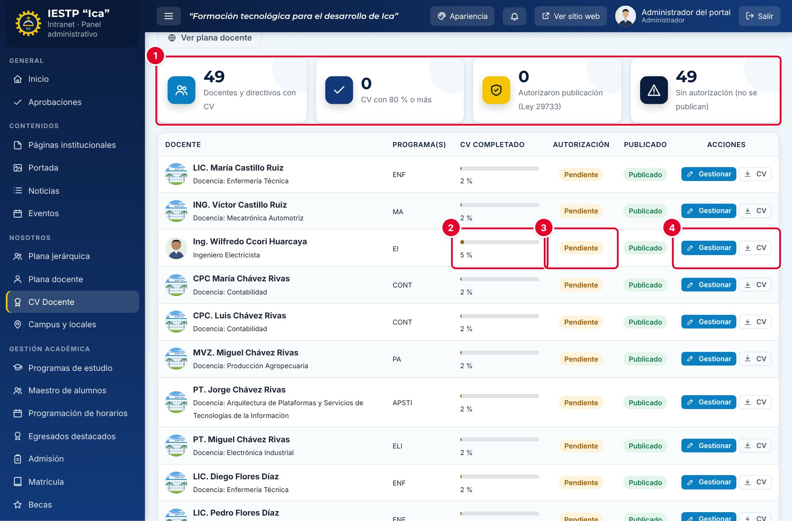

| N.º | Elemento | Para qué sirve |
|---|---|---|
| 1 | Indicadores | Docentes y directivos con CV, CV con 80 % o más, docentes que autorizaron la publicación y docentes sin autorización (no se publican). |
| 2 | **CV completado** | Porcentaje de avance del CV del docente. |
| 3 | **Autorización** | **Autorizado** (con la fecha) o **Pendiente**. |
| 4 | Acciones | **Gestionar** abre el panel del CV; **CV** descarga el PDF. |

La lista incluye a todas las fichas de tipo **Docente** de la plana docente, ordenadas por apellidos. El botón **Ver plana docente** abre el directorio público en otra pestaña.

### Panel del CV de un docente

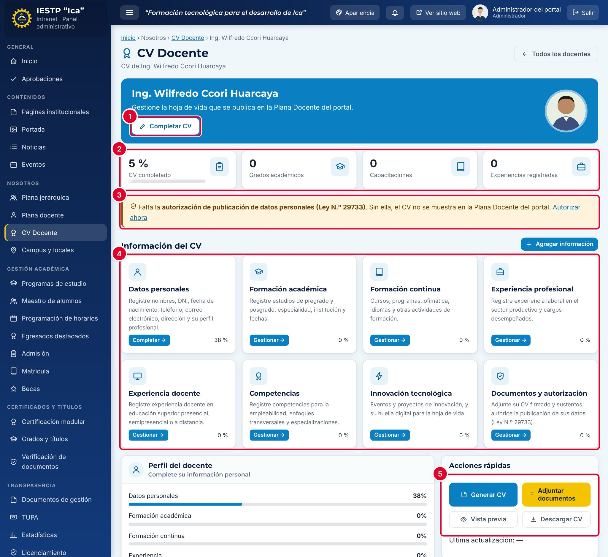

| N.º | Elemento | Para qué sirve |
|---|---|---|
| 1 | **Completar CV** | Abre la primera sección, **Datos personales**. |
| 2 | Indicadores | Porcentaje de CV completado, grados académicos, capacitaciones y experiencias registradas. |
| 3 | Aviso de autorización | Aparece mientras falte la autorización de la Ley N.º 29733. El enlace **Autorizar ahora** lleva a la sección de documentos. |
| 4 | **Información del CV** | Las ocho secciones del CV, con su porcentaje de avance y el botón **Gestionar**. |
| 5 | **Acciones rápidas** | **Generar CV** (descarga el PDF generado por el sistema), **Adjuntar documentos**, **Vista previa** (abre el PDF) y **Descargar CV** (descarga el CV firmado si se adjuntó; si no, el generado). |

Debajo, el bloque **Perfil del docente** muestra el avance de cada sección y la fecha de la última actualización.

## Formulario

El CV se completa por secciones. La barra superior de cada sección permite pasar de una a otra.

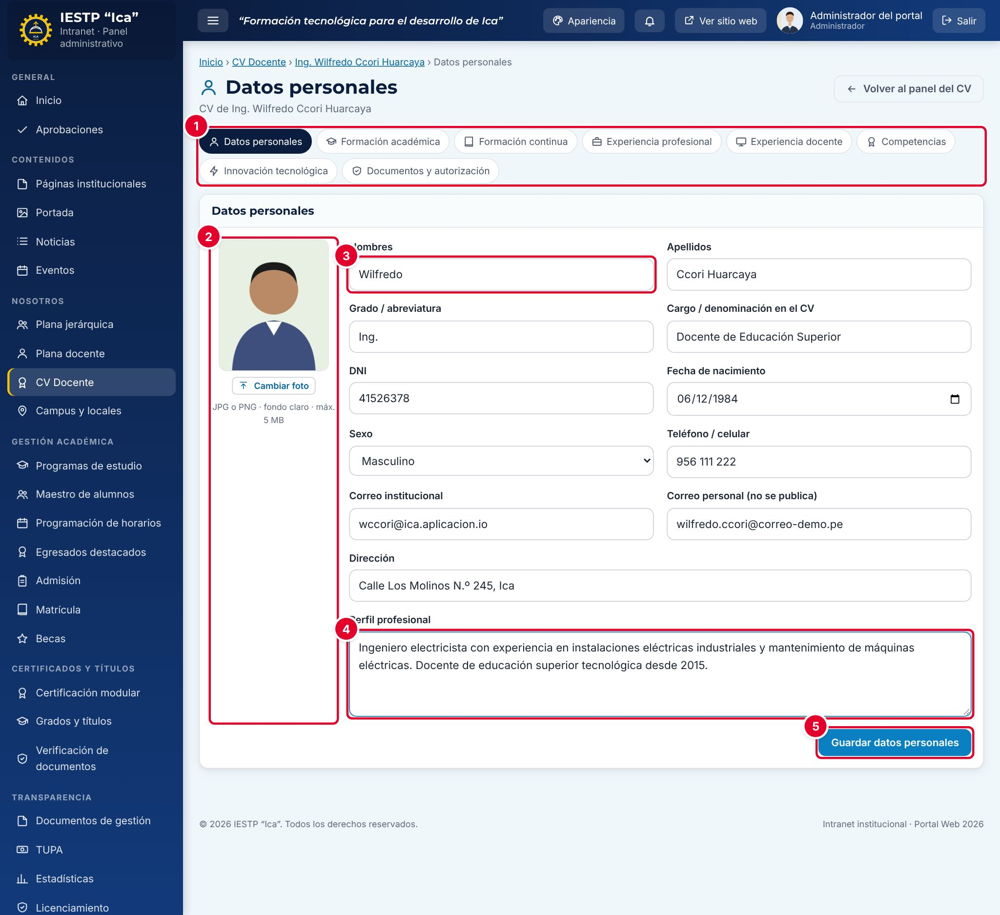

| N.º | Elemento | Descripción |
|---|---|---|
| 1 | Barra de secciones | **Datos personales**, **Formación académica**, **Formación continua**, **Experiencia profesional**, **Experiencia docente**, **Competencias**, **Innovación tecnológica** y **Documentos y autorización**. |
| 2 | Foto | **Cambiar foto** reemplaza la foto de la ficha (JPG o PNG, con fondo claro). |
| 3 | **Nombres**, **Apellidos** y **Correo institucional** | Solo los cambian el Administrador y la Secretaría académica. Para el docente son de solo lectura. |
| 4 | **Perfil profesional** | Resumen profesional, hasta 700 caracteres. |
| 5 | **Guardar datos personales** | Guarda la sección. |

| Sección | Qué se registra | Reglas |
|---|---|---|
| Datos personales | Grado o abreviatura, cargo o denominación en el CV, DNI, fecha de nacimiento, sexo, teléfono, correos, dirección y perfil profesional | DNI de 8 dígitos; correos válidos. El DNI, la fecha de nacimiento, la dirección y el teléfono **no se publican** en el directorio |
| Formación académica | **Estudios de pregrado** y **Estudios de posgrado**: año o periodo, nivel o grado, especialidad, institución y lugar | **Año / periodo** y **Nivel / grado obtenido** son obligatorios |
| Formación continua | Cursos y programas: curso, institución, tema, periodo y horas. Además, **Ofimática** e **Idioma extranjero** (uno por línea) | **Curso / programa** e **Institución** son obligatorios |
| Experiencia profesional | Experiencia en el sector productivo: institución, cargo, funciones, periodo y tiempo | **Institución / empresa** y **Cargo** son obligatorios |
| Experiencia docente | **Educación superior – presencial** y **semipresencial / a distancia** | Igual que la experiencia profesional |
| Competencias | **Competencias para la empleabilidad** y **Enfoques transversales**: casillas y un cuadro para otras (una por línea) | Se recomienda marcar al menos tres competencias |
| Innovación tecnológica | Eventos o proyectos (evento, participación y fecha) y la **Huella digital** (imagen JPG o PNG, opcional) | **Evento / proyecto** y **Participación** son obligatorios |
| Documentos y autorización | **Hoja de vida firmada (PDF)**, **Documentos sustentatorios** y la **Autorización Ley N.º 29733** | CV firmado: PDF hasta 10 MB. Sustentos: PDF, JPG o PNG hasta 10 MB |

## Procedimientos

### Completar el CV de un docente

1. En el listado, pulsa **Gestionar** en la fila del docente.
2. Pulsa **Completar CV**. Completa **Datos personales** y pulsa **Guardar datos personales**. Aparece «Datos personales guardados.».
3. Pasa a la siguiente sección con la barra superior.

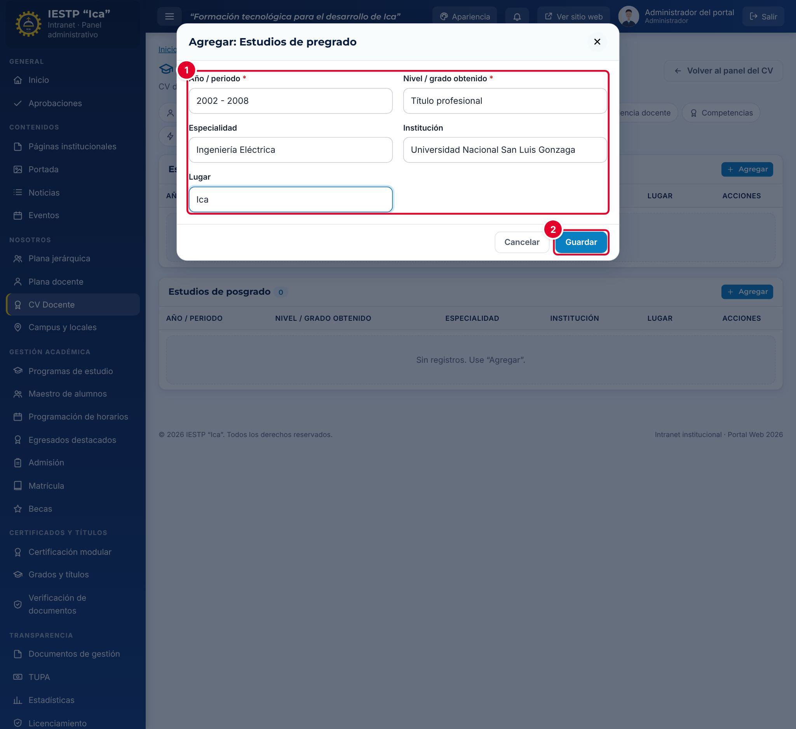

4. En las secciones con tablas, pulsa **Agregar**. En la ventana, completa los datos ① (los marcados con \* son obligatorios) y pulsa **Guardar** ②.

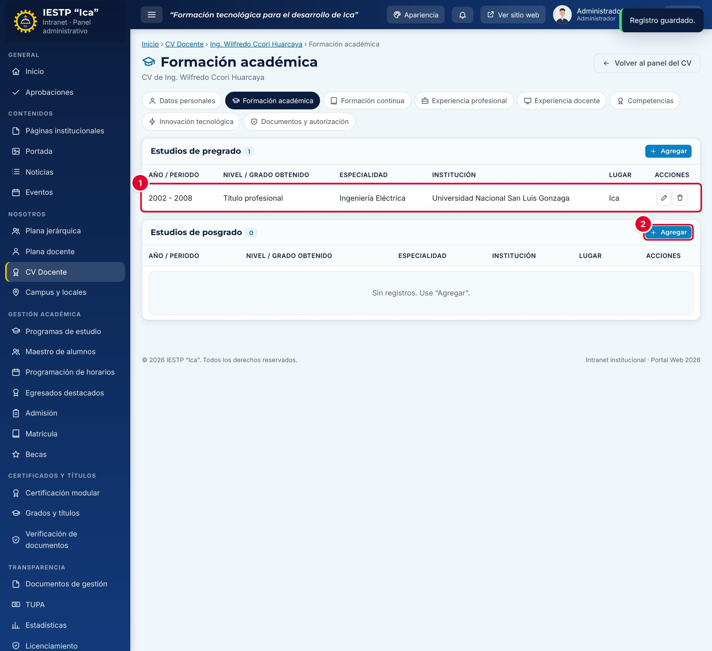

5. El registro aparece en la tabla ①, con el aviso «Registro guardado.». Usa el lápiz para corregirlo o la papelera para eliminarlo. Para agregar otro tipo de estudio, usa el **Agregar** de la tabla correspondiente ②.

### Adjuntar documentos y registrar la autorización

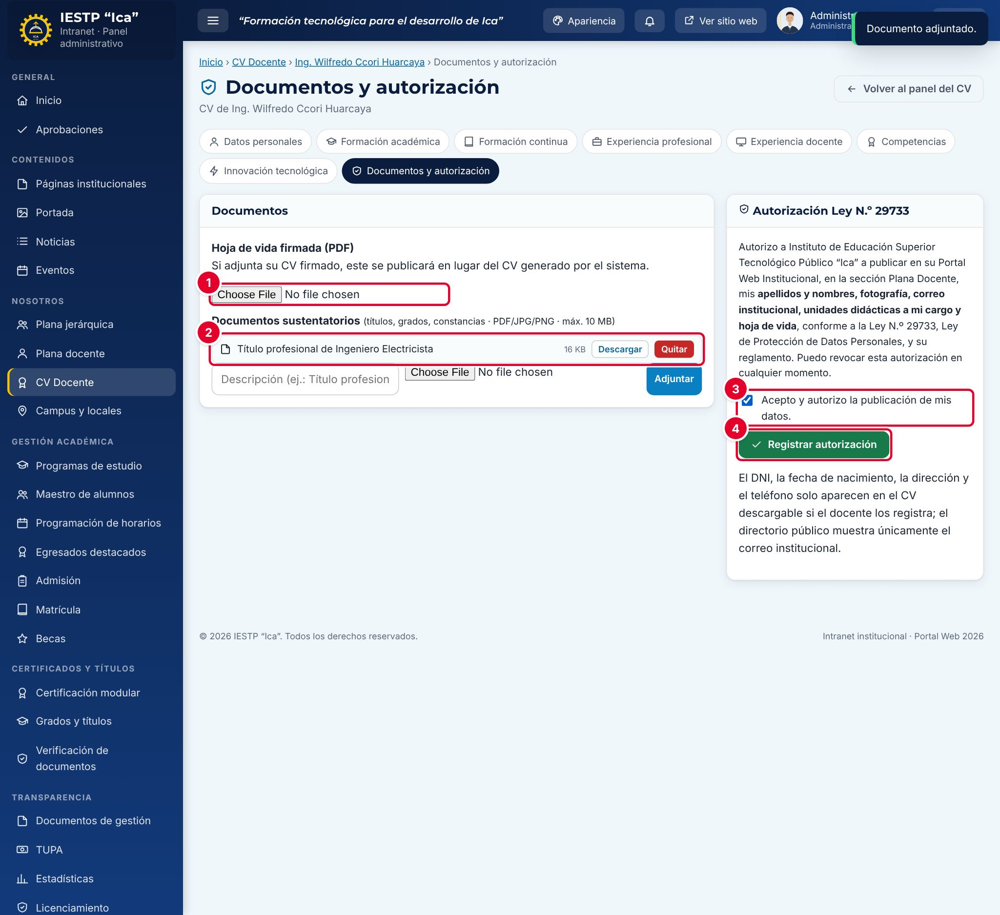

1. Abre la sección **Documentos y autorización**.
2. Opcional: en **Hoja de vida firmada (PDF)** ① elige el archivo del CV firmado. Si se adjunta, se publica en lugar del CV generado por el sistema.
3. En **Documentos sustentatorios** ②, escribe una descripción (por ejemplo, «Título profesional»), elige el archivo y pulsa **Adjuntar**. Aparece «Documento adjuntado.».
4. Lee el texto de la autorización. Marca **Acepto y autorizo la publicación de mis datos.** ③.
5. Pulsa **Registrar autorización** ④.

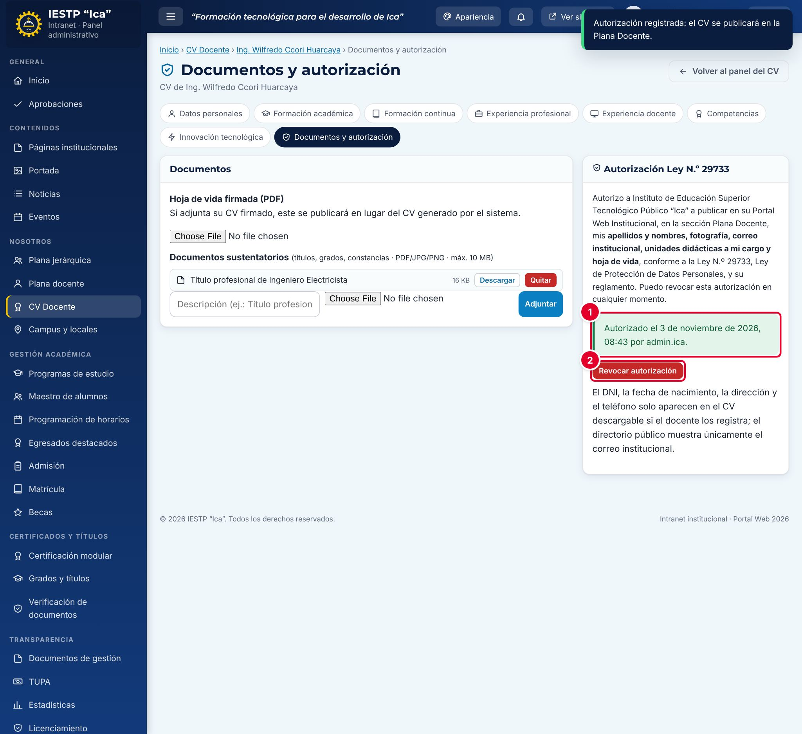

Aparece «Autorización registrada: el CV se publicará en la Plana Docente.». El recuadro verde ① indica la fecha y el usuario que registró la autorización.

Para retirar el CV del portal, pulsa **Revocar autorización** ② y confirma. El docente deja de mostrarse en el directorio **Plana docente**.

> Registra la autorización solo cuando el docente la haya dado. Si la registra el administrador o la secretaría, conserva el documento firmado por el docente como respaldo.

### Crear la cuenta de un docente

Para que el docente complete su propio CV, necesita una cuenta con el rol **Docente** vinculada a su ficha. Se hace en dos pasos.

**Paso 1 · Registrar su carga docente.** Ve a **Gestión académica** › **Programación de horarios** › pestaña **Configuración** › **Carga docente** y pulsa **+ Nuevo**.

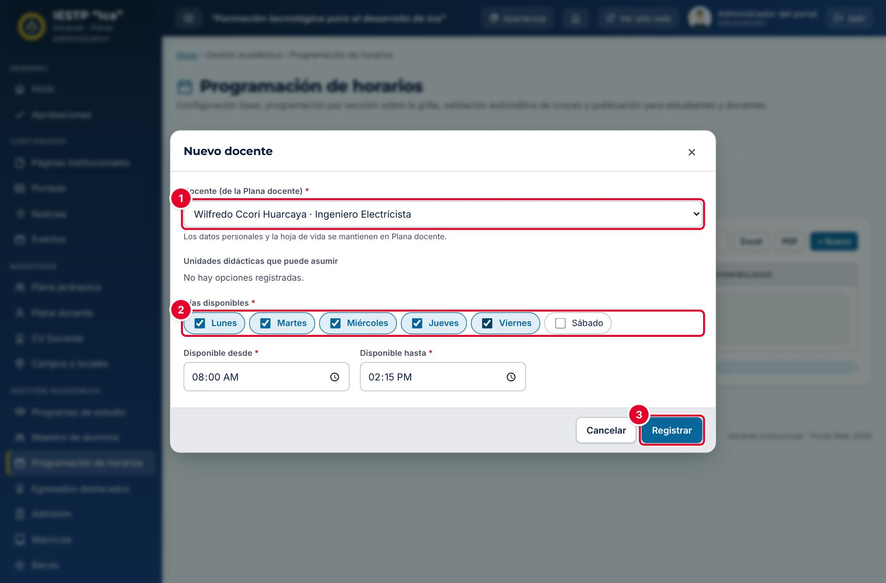

1. En **Docente (de la Plana docente)** ① elige al docente.
2. Marca los **Días disponibles** ② y revisa el horario de disponibilidad.
3. Pulsa **Registrar** ③.

**Paso 2 · Crear el usuario.** Ve a **Configuración y seguridad** › **Usuarios y roles** y pulsa **Nuevo usuario** (capítulo 34).

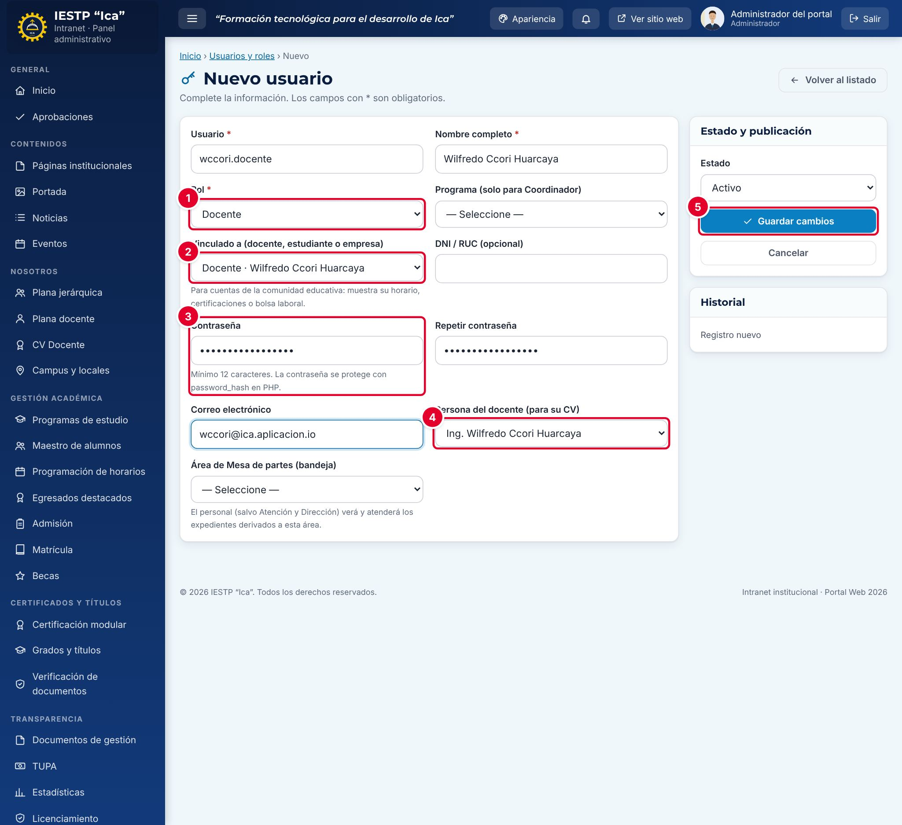

1. Escribe el **Usuario** y el **Nombre completo**.
2. En **Rol** ① elige **Docente**.
3. En **Vinculado a** ② elige **Docente · nombre del docente** (aparece después del paso 1).
4. Escribe una **Contraseña** temporal ③ de al menos 12 caracteres y repítela.
5. En **Persona del docente (para su CV)** ④ elige su ficha. Si la dejas vacía, se toma la persona de la carga docente.
6. Pulsa **Guardar cambios** ⑤.

Entrega al docente su usuario y la contraseña temporal. En su primer ingreso, el sistema le pide cambiar la contraseña.

### El docente completa su propio CV

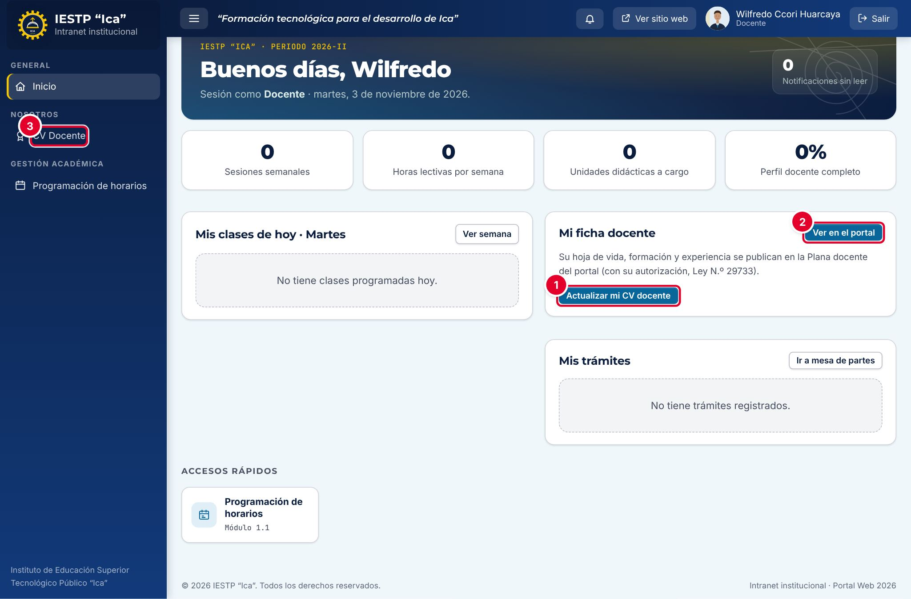

Al ingresar, el docente ve en su página de inicio el bloque **Mi ficha docente**:

| N.º | Elemento | Para qué sirve |
|---|---|---|
| 1 | **Actualizar mi CV docente** | Abre el panel de su CV. |
| 2 | **Ver en el portal** | Abre el directorio **Plana docente** del portal. |
| 3 | Menú **CV Docente** | Acceso directo a su CV. |

El indicador **Perfil docente completo** de esta página corresponde al portafolio de **Programación de horarios**, no al CV docente.

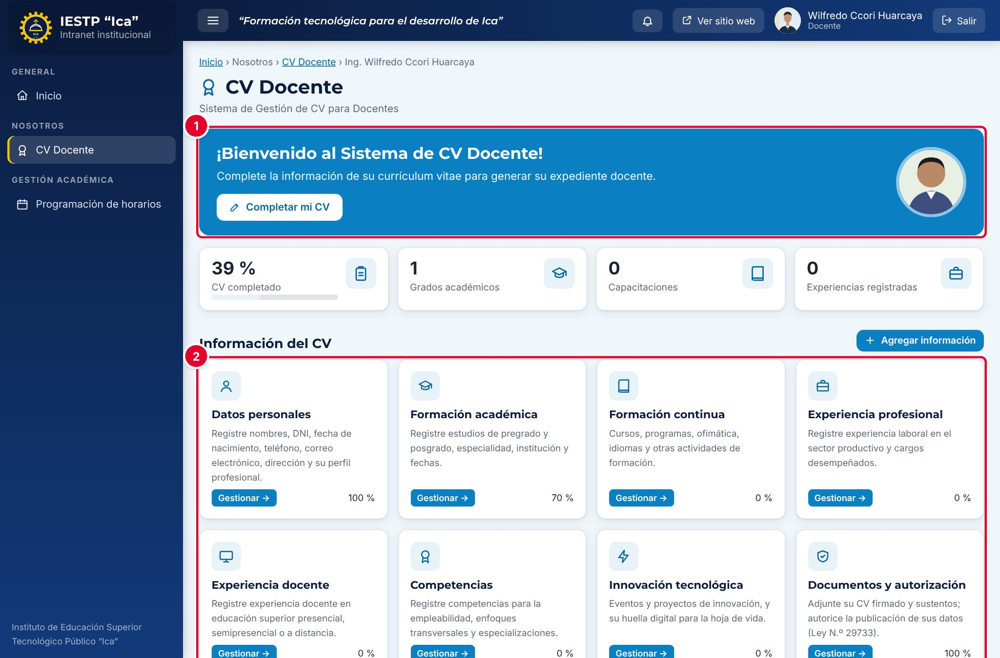

El docente ve solo su propio CV ①, con las mismas secciones ② que el administrador. Completa cada sección igual que en «Completar el CV de un docente».

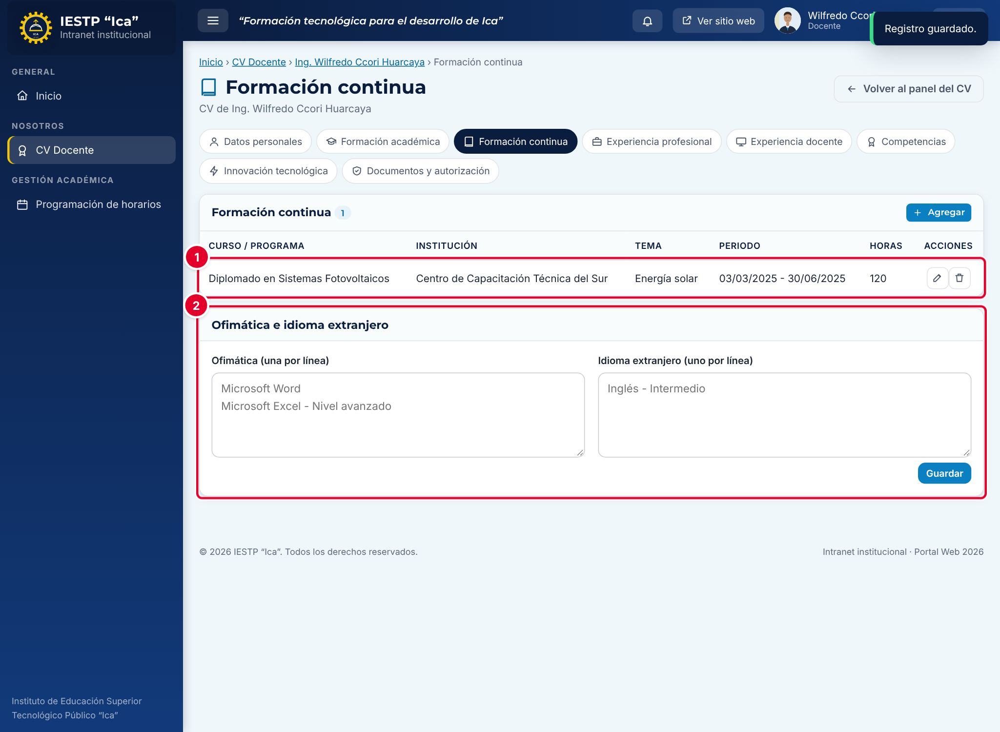

Por ejemplo, en **Formación continua** el docente pulsa **Agregar**, registra el curso y pulsa **Guardar**: el registro aparece en la tabla ①. En **Ofimática e idioma extranjero** ② escribe un elemento por línea y pulsa **Guardar**.

El docente también puede registrar o revocar su autorización de publicación en **Documentos y autorización**.

## Flujo y estados

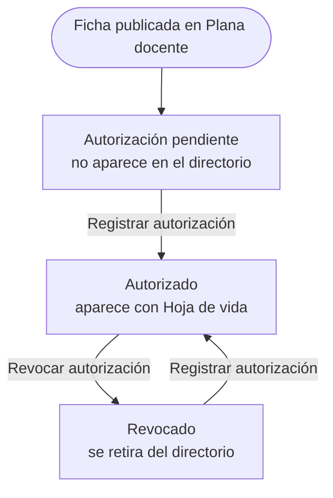

| Estado de la autorización | Significado | Visible en el directorio Plana docente |
|---|---|---|
| Pendiente | El docente no autorizó la publicación | No |
| Autorizado | Autorización registrada, con fecha y usuario | **Sí**, con el botón **Hoja de vida** |
| Revocado | La autorización se retiró | No |

Además, la ficha debe estar **Publicada** en **Plana docente** y asociada a un programa o a **Empleabilidad**.

## Resultado en el portal público

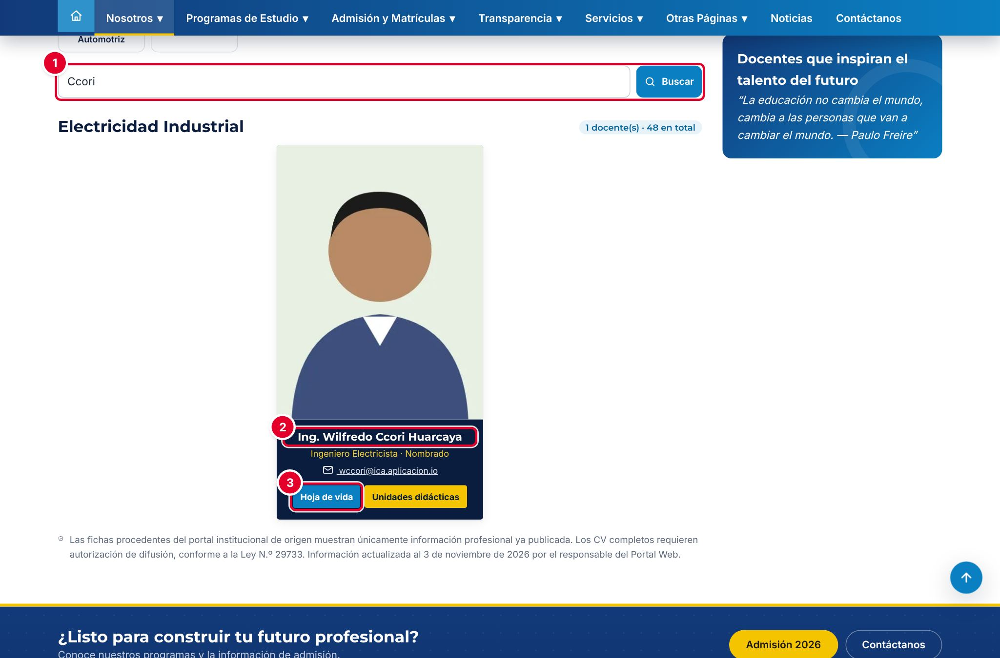

En `{{inst.dominio}}/#/nosotros/plana-docente`, al buscar al docente ①, aparece su tarjeta ② con el botón **Hoja de vida** ③, que abre el CV en PDF. El directorio público muestra solo el nombre, la foto, la especialidad, la condición, el correo institucional y las unidades didácticas. El DNI, la fecha de nacimiento, la dirección, el teléfono, el correo personal, la huella digital y los documentos sustentatorios **no se publican**.

## Mensajes y problemas frecuentes

| Mensaje o situación | Causa | Qué hacer |
|---|---|---|
| «Su usuario no está vinculado a una ficha docente. Solicite la vinculación al administrador.» | La cuenta del docente no tiene persona asignada | El administrador edita la cuenta y elige la **Persona del docente** |
| «Vincula la cuenta con el docente y su registro de persona.» | Al crear la cuenta no se eligió **Vinculado a** | Registra primero la carga docente y elígela en **Vinculado a** |
| «La persona de la cuenta debe coincidir con la carga docente vinculada.» | La persona elegida no es la de la carga docente | Elige la misma persona o deja el campo vacío |
| «El DNI debe tener 8 dígitos.» | DNI incompleto o con letras | Corrígelo |
| «Marque la casilla de autorización.» | Se pulsó **Registrar autorización** sin marcar la casilla | Marca **Acepto y autorizo la publicación de mis datos.** |
| «Seleccione el archivo.» | Se pulsó **Adjuntar** sin elegir un archivo | Elige el archivo y vuelve a pulsar **Adjuntar** |
| El docente no aparece en el directorio aunque tiene autorización | La ficha está en **Borrador** o sin programa | Publica la ficha y asígnale un programa en **Plana docente** |
| El docente no puede cambiar su nombre o su correo | Esos datos solo los cambian el Administrador y la Secretaría | Solicítalo a la Secretaría académica |

## Buenas prácticas

- Pide a cada docente que revise y actualice su CV al inicio de cada semestre.
- Adjunta los sustentos (títulos, grados y constancias) en PDF legible.
- Registra la autorización solo con el consentimiento expreso del docente y guarda el respaldo firmado.
- Usa **Vista previa** antes de publicar para revisar el CV generado.
- Si un docente deja la institución, revoca su autorización y despublica su ficha en **Plana docente**.
