# 07 · Libro de reclamaciones

## Para qué sirve

El Libro de Reclamaciones Virtual recibe los **reclamos** (disconformidad con el servicio educativo o con un trámite) y las **quejas** (malestar por la atención recibida, como el trato o la demora) que presenta cualquier persona desde el portal. En la intranet se derivan al área competente, se atienden y se responden dentro del plazo, y cada paso queda en un historial.

El proceso tiene dos lados:

- **Ciudadano (portal):** registra el reclamo o la queja, recibe un código de seguimiento y una constancia en PDF, y consulta el estado y la respuesta.
- **Institución (intranet):** recibe el registro, lo deriva, lo atiende, responde y lo cierra.

## Quién lo usa

| Rol | Puede |
|---|---|
| Administrador | Todo: configurar al responsable y los plazos, derivar, cambiar estados, responder, anular y exportar |
| Atención al ciudadano | Gestionar la bandeja: derivar, cambiar estados, responder, agregar notas y anular |
| Directivo | Consultar la bandeja y el detalle para hacer seguimiento |
| Ciudadano (sin cuenta) | Registrar desde el portal y consultar su caso con el código |

> Ningún rol puede **modificar ni borrar** el contenido original de un reclamo. Solo se gestiona su atención.

## Cómo se llega

- Intranet: menú lateral › **Atención al ciudadano** › **Libro de reclamaciones**. Ruta: `#/admin/reclamos`
- Portal: menú **Servicios** › **Libro de Reclamaciones**. Ruta: `{{inst.dominio}}/#/servicios/libro-de-reclamaciones`

## Flujo completo

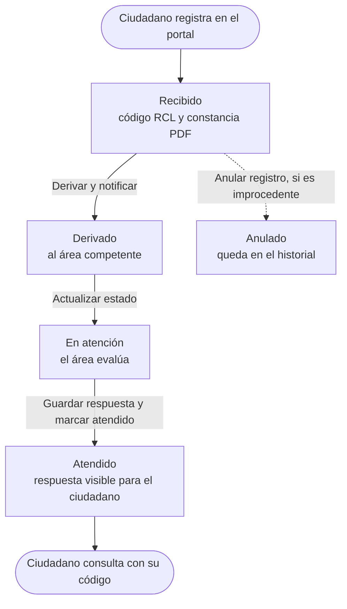

| Estado | Significado | Quién lo produce |
|---|---|---|
| Recibido | Registrado. Se generaron el código de seguimiento y la constancia | El ciudadano, al enviar el formulario |
| Derivado | Enviado al área que debe atenderlo | El responsable, con **Derivar y notificar** |
| En atención | El área lo está evaluando | El responsable o el área, con **Actualizar estado** |
| Atendido | Se registró la respuesta institucional | **Guardar respuesta y marcar atendido** |
| Anulado | Registro improcedente o duplicado. No se borra: queda en el historial y la auditoría | **Anular registro** |

El **plazo** se cuenta en **días hábiles**. Por defecto son 15 días para reclamos y 15 para quejas; ambos se pueden configurar entre 1 y 30. La intranet avisa cuando un caso está por vencer y cuando ya venció.

## Paso 1 · Configurar al responsable y los plazos (una sola vez)

Ruta: **Libro de reclamaciones** › pestaña **Responsable y plazos**. Solo puede modificarla el administrador.

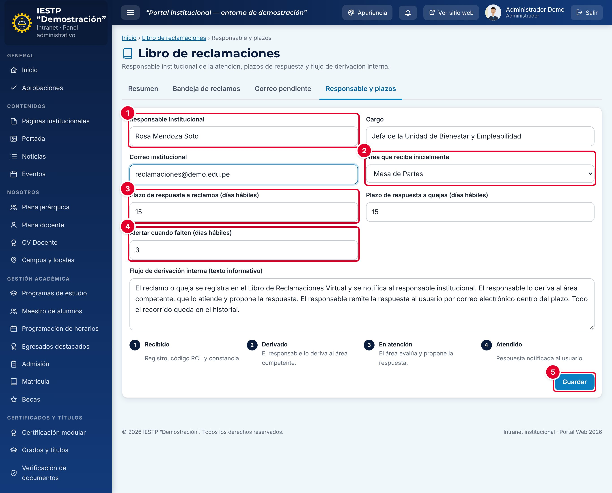

| N.º | Campo | Descripción |
|---|---|---|
| 1 | **Responsable institucional**, **Cargo** y **Correo institucional** | Persona designada para atender el Libro de Reclamaciones. Su nombre aparece en el portal y en la constancia. |
| 2 | **Área que recibe inicialmente** | Área que recibe los registros nuevos. |
| 3 | **Plazo de respuesta** a reclamos y a quejas | Días hábiles para responder (de 1 a 30). |
| 4 | **Alertar cuando falten** | Días hábiles antes del vencimiento en que el caso se marca «por vencer». |
| 5 | **Guardar** | Guarda la configuración. |

El campo **Flujo de derivación interna** es un texto informativo que describe el procedimiento de la institución.

> **Incidencia detectada al elaborar este manual (versión actual de la plataforma)**
> Al pulsar **Guardar** aparece «Configuración guardada.», pero los datos **no se guardan**: al recargar la página, el responsable y los plazos vuelven a sus valores anteriores. Lo mismo ocurre con la configuración de **Mesa de partes** y de **Bolsa laboral**. Ya se reportó para su corrección. Mientras tanto, el responsable debe cargarse con apoyo técnico. Para comprobar si tu institución tiene un responsable asignado, mira el recuadro **Responsable de la atención** en la página pública del Libro de Reclamaciones: si dice «Responsable pendiente de asignación», no lo tiene.

## Paso 2 · El ciudadano registra su reclamo (portal)

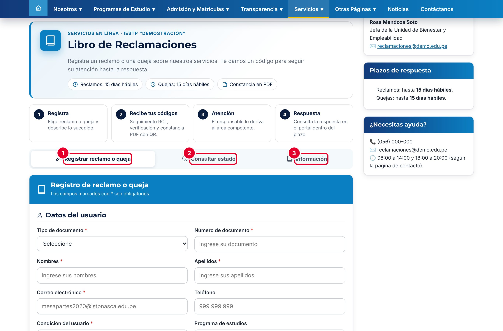

La página pública tiene tres pestañas: **Registrar reclamo o queja** ①, **Consultar estado** ② e **Información** ③. A la derecha muestra al responsable de la atención y los plazos de respuesta.

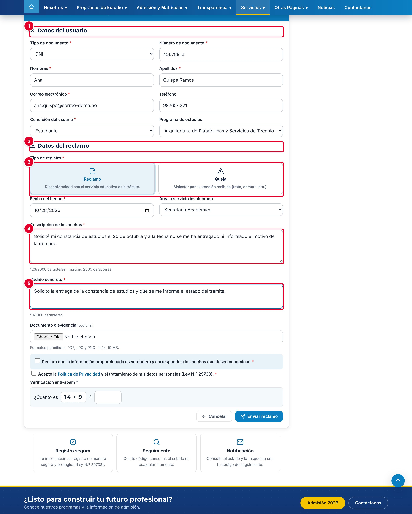

| N.º | Sección | Campos |
|---|---|---|
| 1 | **Datos del usuario** | Tipo de documento* (DNI, Carné de extranjería, Pasaporte o RUC), Número de documento*, Nombres*, Apellidos*, Correo electrónico*, Teléfono, Condición del usuario* (Estudiante, Egresado, Postulante, Padre/madre/apoderado, Docente, Personal administrativo o Público en general) y Programa de estudios |
| 2 | **Datos del reclamo** | — |
| 3 | Tipo de registro | **Reclamo** o **Queja** |
| 4 | **Descripción de los hechos*** | Hasta 2000 caracteres. También se piden la **Fecha del hecho*** y el **Área o servicio involucrado** |
| 5 | **Pedido concreto*** | Qué solución se solicita. Hasta 1000 caracteres |

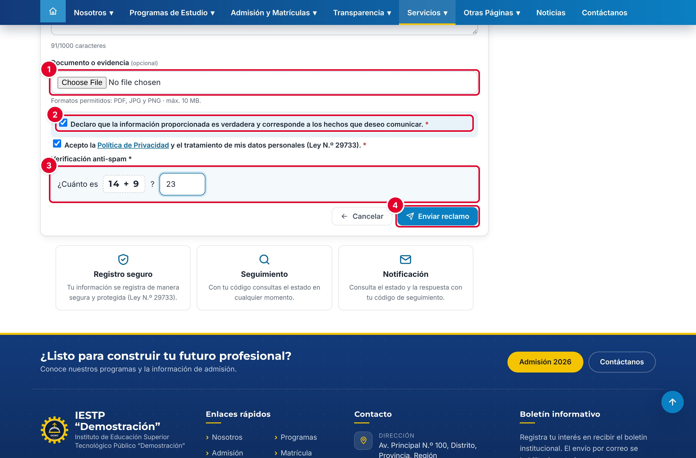

| N.º | Elemento | Descripción |
|---|---|---|
| 1 | **Documento o evidencia** (opcional) | PDF, JPG o PNG, hasta 10 MB |
| 2 | Declaraciones obligatorias | Veracidad de la información y aceptación de la Política de Privacidad (Ley N.º 29733) |
| 3 | **Verificación anti-spam** | Suma sencilla para evitar envíos automáticos |
| 4 | **Enviar reclamo** | Registra el caso |

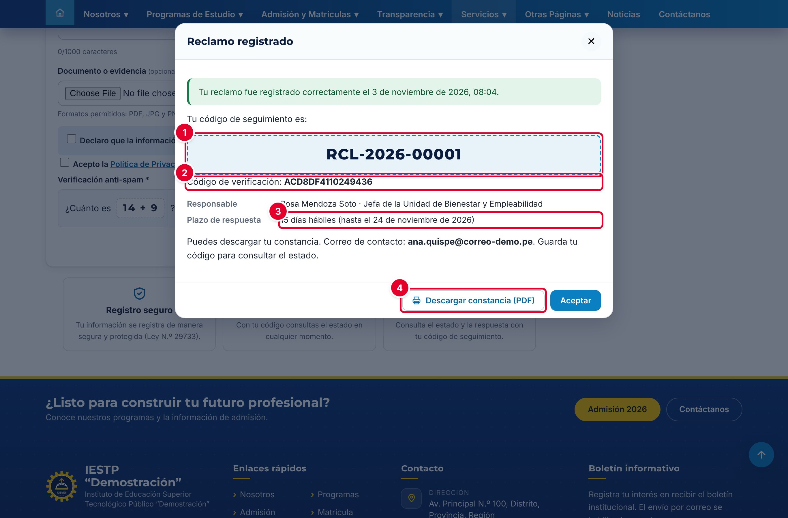

Al enviar, el ciudadano recibe:

| N.º | Dato | Uso |
|---|---|---|
| 1 | **Código de seguimiento** (RCL-AAAA-NNNNN) | Para consultar el estado de su caso |
| 2 | **Código de verificación** (16 caracteres) | Sirve en lugar del DNI para consultar y para validar la constancia |
| 3 | Responsable y **plazo de respuesta** | Fecha máxima de respuesta, en días hábiles |
| 4 | **Descargar constancia (PDF)** | Hoja de reclamación con código QR |

## Paso 3 · Revisar la bandeja (intranet)

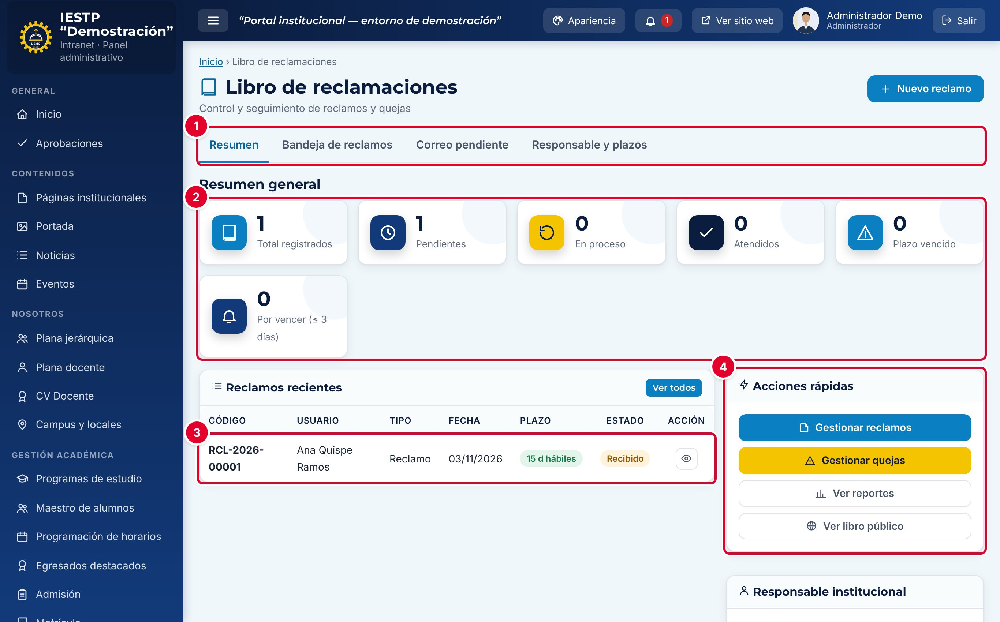

| N.º | Elemento | Para qué sirve |
|---|---|---|
| 1 | Pestañas | **Resumen**, **Bandeja de reclamos**, **Correo pendiente** y **Responsable y plazos** |
| 2 | Indicadores | Total registrados, pendientes, en proceso, atendidos, con plazo vencido y por vencer (3 días o menos) |
| 3 | **Reclamos recientes** | Últimos casos, con su plazo y su estado |
| 4 | **Acciones rápidas** | Atajos a reclamos, quejas, reportes y al libro público |

Cuando llega un reclamo nuevo, el menú lateral y la campana muestran un contador.

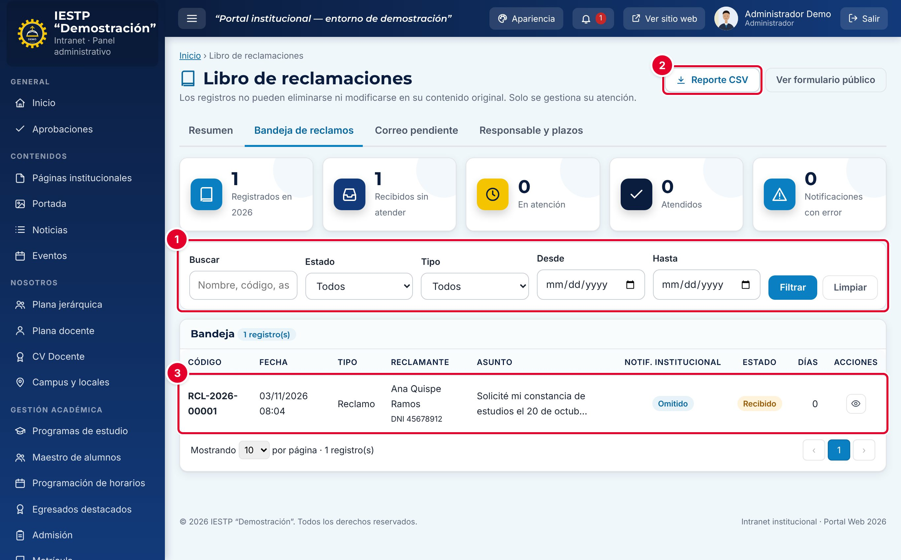

| N.º | Elemento | Para qué sirve |
|---|---|---|
| 1 | Filtros | Buscan por nombre, código o asunto, y filtran por **Estado**, **Tipo** (Reclamo o Queja) y rango de fechas (**Desde** y **Hasta**) |
| 2 | **Reporte CSV** | Descarga la bandeja filtrada para abrirla en Excel |
| 3 | Fila del caso | Código, fecha, tipo, reclamante, asunto, estado de la notificación, estado y días transcurridos. El ojo abre el detalle |

## Paso 4 · Abrir el detalle del caso

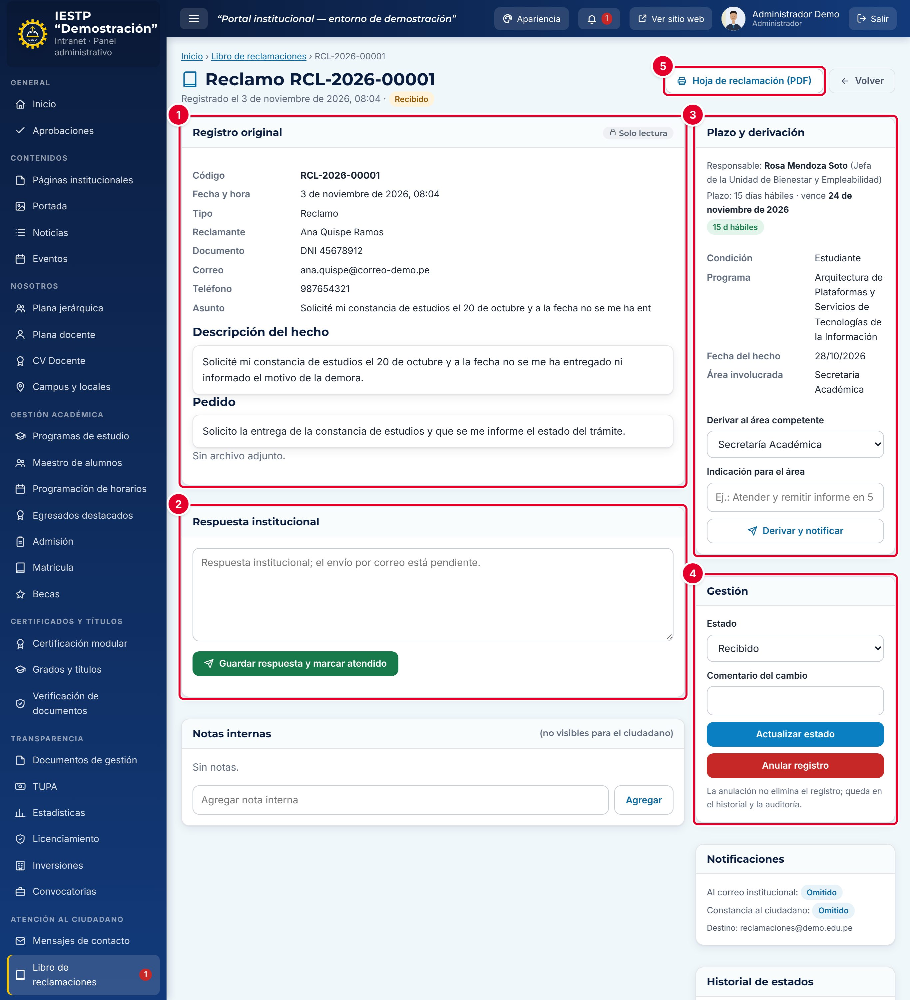

| N.º | Sección | Descripción |
|---|---|---|
| 1 | **Registro original** (solo lectura) | Datos del reclamante, descripción del hecho, pedido y adjunto. No se pueden modificar |
| 2 | **Respuesta institucional** | Texto de la respuesta que verá el ciudadano |
| 3 | **Plazo y derivación** | Responsable, plazo y vencimiento, y derivación al área competente |
| 4 | **Gestión** | Cambio de estado con un comentario, y anulación |
| 5 | **Hoja de reclamación (PDF)** | Descarga la constancia oficial del caso |

Más abajo están **Notas internas** (comentarios del equipo que el ciudadano **no ve**), **Notificaciones** e **Historial de estados**.

## Paso 5 · Derivar al área competente

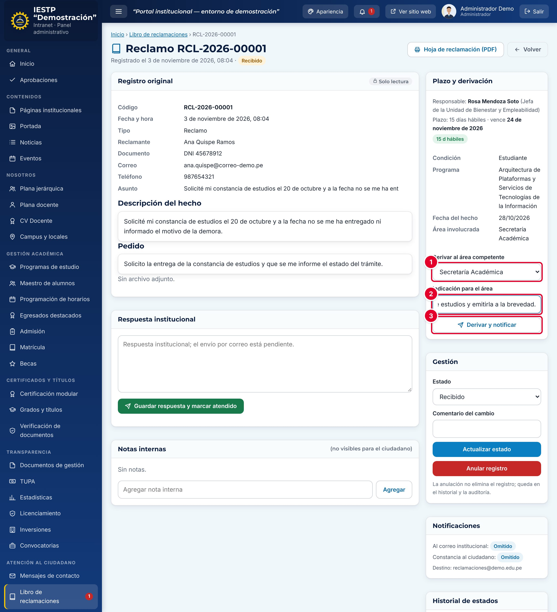

1. En **Plazo y derivación**, elige el área en **Derivar al área competente** ①.
2. Escribe la **Indicación para el área** ②: qué debe revisar o hacer.
3. Pulsa **Derivar y notificar** ③.

El caso pasa a **Derivado** y el historial registra el área y la indicación.

## Paso 6 · Registrar el avance

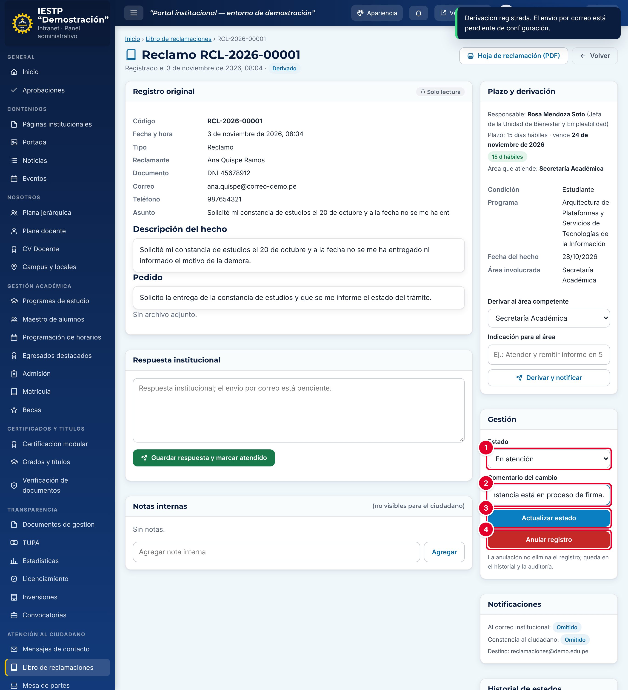

1. En **Gestión**, elige el nuevo **Estado** ①; por ejemplo, **En atención**.
2. Escribe un **Comentario del cambio** ② que explique el avance.
3. Pulsa **Actualizar estado** ③.

**Anular registro** ④ se usa solo para casos improcedentes o duplicados. La anulación no elimina el registro: queda en el historial y en la auditoría.

## Paso 7 · Responder y cerrar

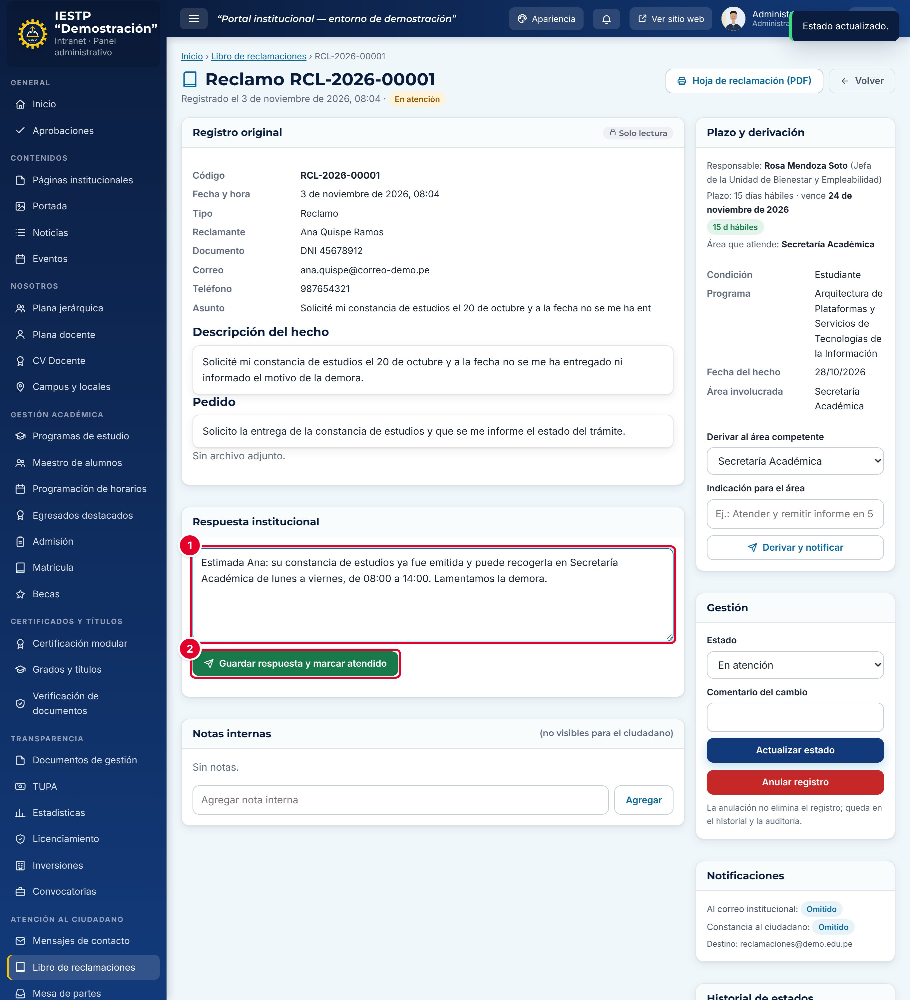

1. En **Respuesta institucional** ①, escribe la respuesta dirigida al ciudadano (mínimo 10 caracteres): qué se hizo y qué debe hacer la persona, si corresponde.
2. Pulsa **Guardar respuesta y marcar atendido** ②.

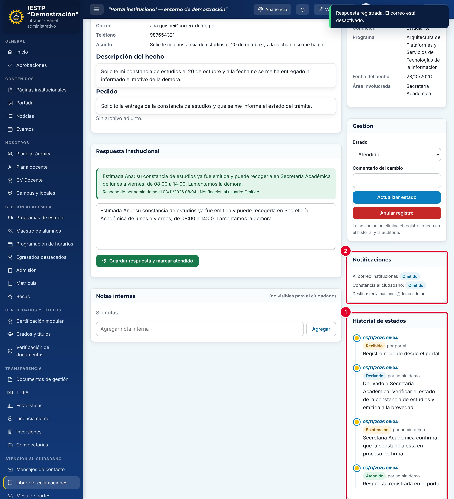

El caso pasa a **Atendido**. El **Historial de estados** ① muestra cada paso con la fecha, el usuario y el comentario. La sección **Notificaciones** ② registra los avisos por correo enviados a la institución y al ciudadano.

> **Correo electrónico:** en la versión actual, el envío automático de correos está **desactivado**. Las notificaciones aparecen como **Omitido** y la pestaña **Correo pendiente** guarda la bitácora de los mensajes que se habrían enviado. Por eso el ciudadano debe **consultar la respuesta en el portal con su código**. Si la institución necesita enviar la respuesta por correo, hay que hacerlo manualmente desde el correo institucional, hasta que se configure el envío SMTP.

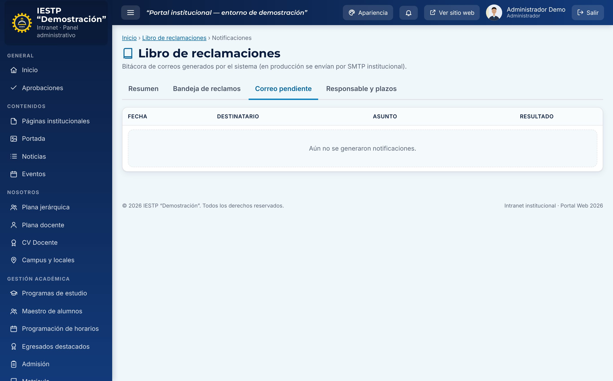

La pestaña **Correo pendiente** registra la fecha, el destinatario, el asunto y el resultado de cada correo que generó el sistema.

## Paso 8 · El ciudadano consulta la respuesta (portal)

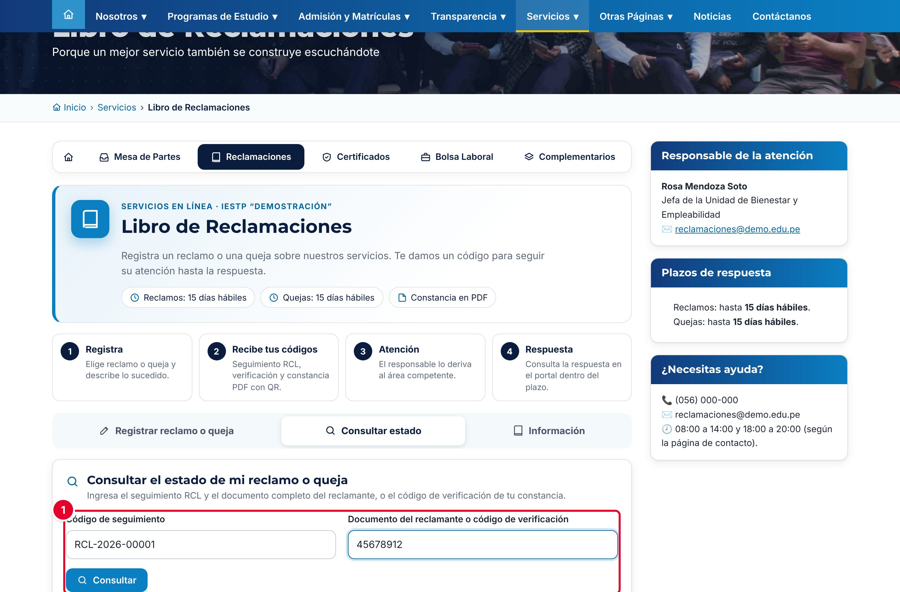

En la pestaña **Consultar estado** ①, el ciudadano escribe su **Código de seguimiento** y su **DNI** (o el código de verificación) y pulsa **Consultar**.

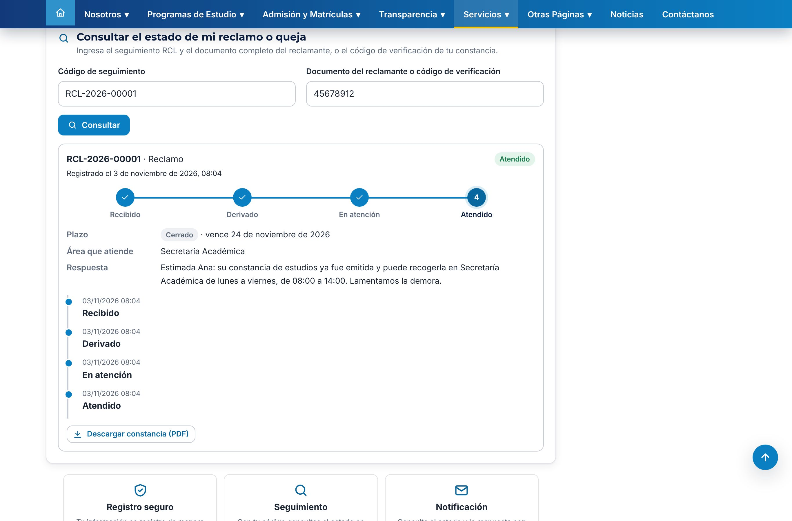

El portal muestra el avance (Recibido → Derivado → En atención → Atendido), el plazo, el área que atiende, la **respuesta institucional** y el historial. Desde ahí también se puede descargar la constancia.

## Mensajes y problemas frecuentes

| Mensaje o situación | Causa | Qué hacer |
|---|---|---|
| «Registra una respuesta institucional de al menos diez caracteres.» | La respuesta está vacía o es demasiado corta | Completa la respuesta antes de marcar el caso como atendido |
| El caso aparece como «Plazo vencido» | Pasaron los días hábiles configurados sin respuesta | Responde de inmediato y deja constancia en el comentario |
| Las notificaciones dicen «Omitido» | El envío de correo está desactivado | Ver la nota sobre el correo electrónico del paso 7 |
| El portal dice «Responsable pendiente de asignación» | No hay responsable configurado | Ver la incidencia del paso 1 |
| El ciudadano no encuentra su caso | Escribió mal el código o el documento | Verifica el código en la bandeja. El ciudadano puede usar el código de verificación de su constancia en lugar del DNI |

## Buenas prácticas

- Revisa la bandeja **todos los días hábiles** y deriva cada caso el mismo día en que llega.
- Usa las **Notas internas** para coordinar con las áreas. La respuesta institucional debe ser clara, respetuosa y comprensible para el ciudadano.
- No anules un reclamo solo porque es incómodo: la anulación queda registrada y puede ser revisada.
- Descarga el **Reporte CSV** cada mes para los informes de gestión y de control.
- Los datos del reclamante son personales (Ley N.º 29733): no los compartas fuera de las áreas que atienden el caso.
