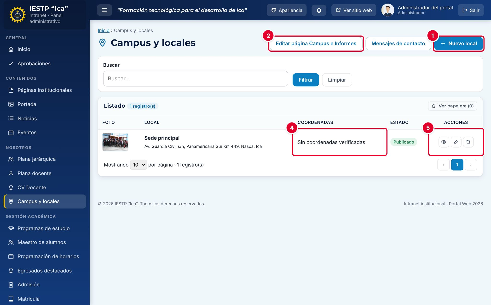
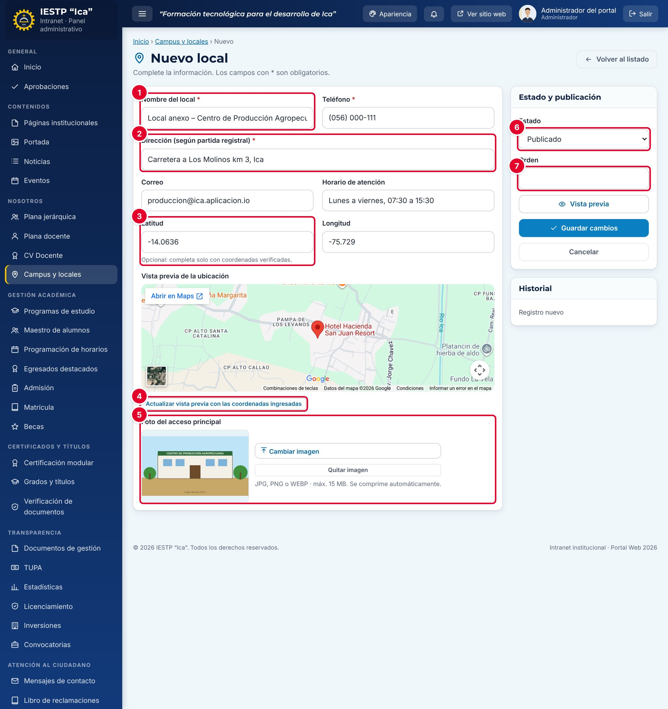
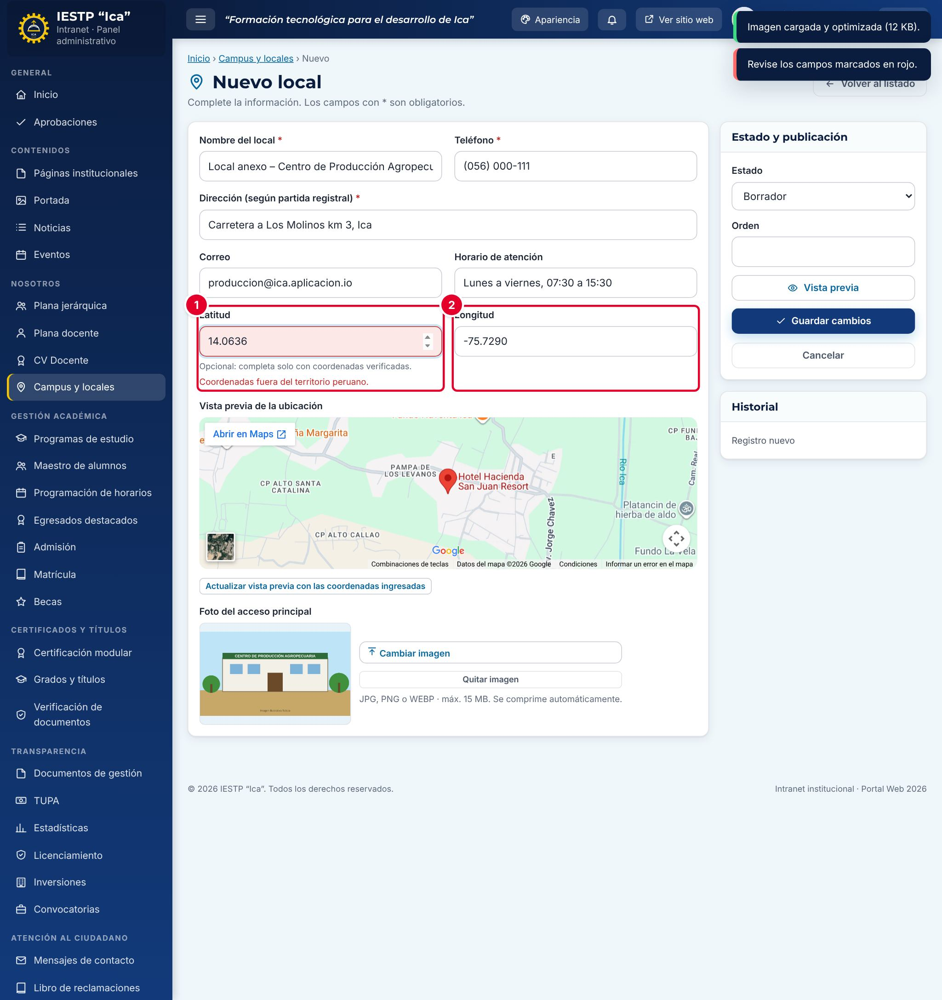
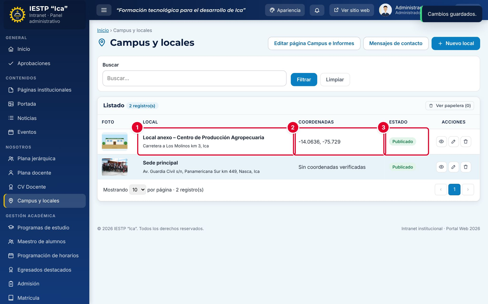
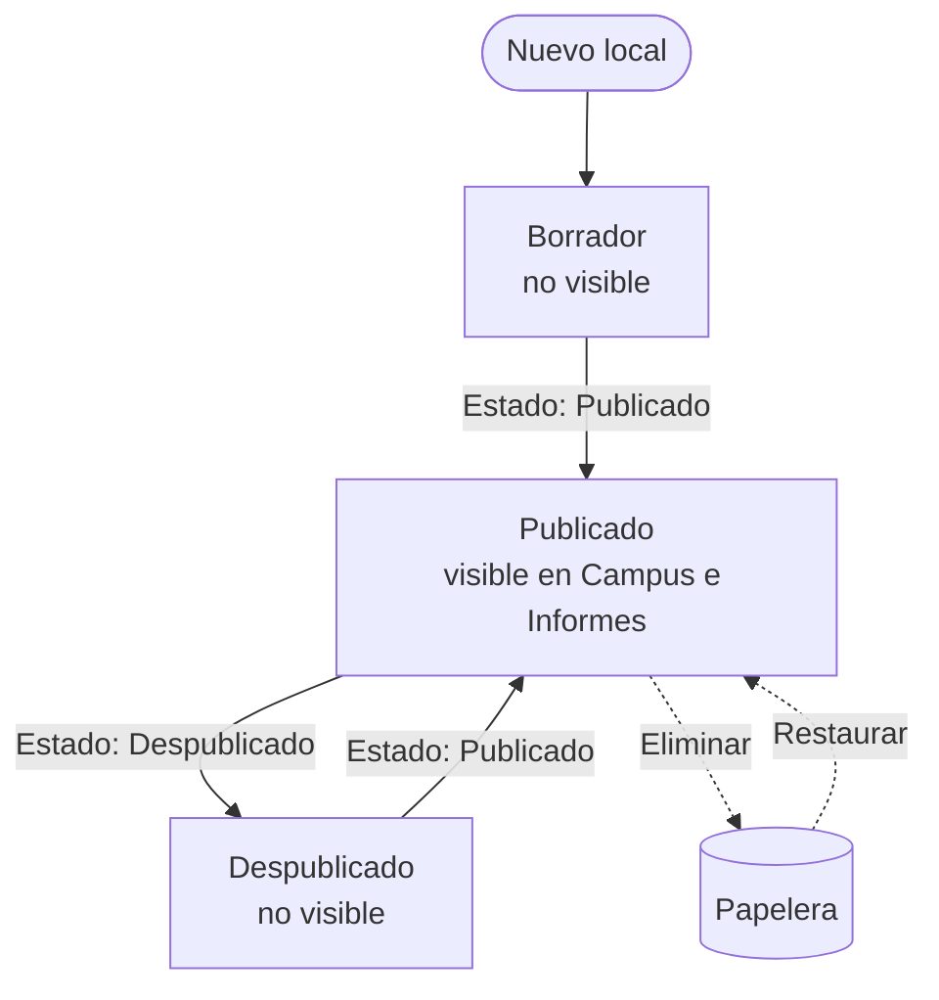
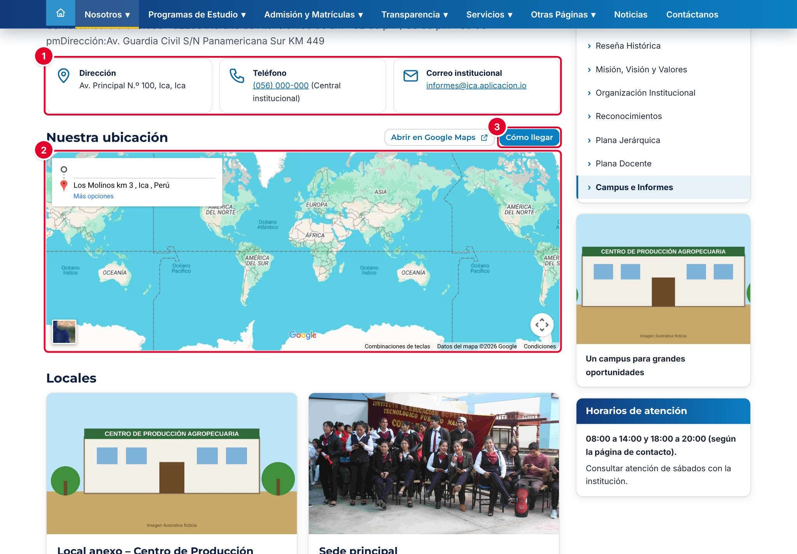
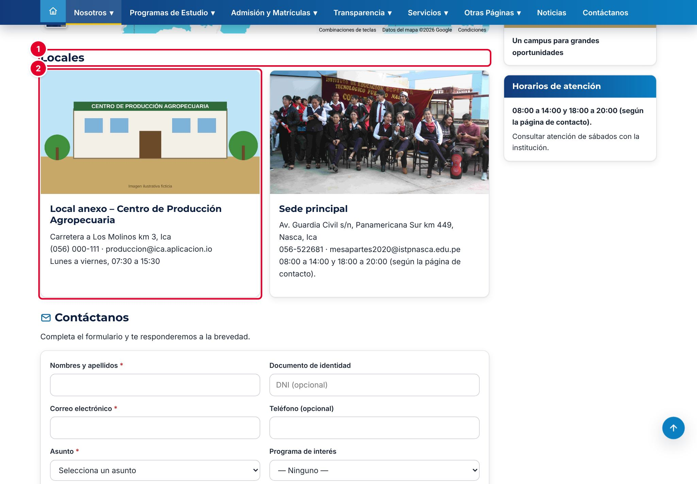

# 08 · Campus y locales

## Para qué sirve

En este módulo se registran los locales de la institución: la sede principal y los locales anexos (talleres, centros de producción, laboratorios externos). Cada local tiene nombre, dirección, teléfono, correo, horario y una foto del acceso principal.

Lo registrado se muestra en la página **Campus e Informes** del portal (`{{inst.dominio}}/#/nosotros/campus-e-informes`): el mapa de ubicación y, cuando hay más de un local publicado, las tarjetas de **Locales**.

## Quién lo usa

| Rol | Puede |
|---|---|
| Administrador | Todo, incluida la **eliminación definitiva** |
| Imagen institucional | Crear, editar, publicar, enviar a la papelera y restaurar locales |

## Cómo se llega

Menú lateral › **Nosotros** › **Campus y locales**. Ruta: `#/admin/locales`

## Pantalla principal

| N.º | Elemento | Para qué sirve |
|---|---|---|
| 1 | **Nuevo local** | Abre el formulario para registrar un local. |
| 2 | **Editar página Campus e Informes** | Abre la página **Campus e Informes** en **Páginas institucionales**, para cambiar su título, su descripción introductoria y su imagen. Solo aparece para los roles con acceso a **Páginas institucionales**. |
| 3 | **Mensajes de contacto** | Abre la bandeja de los mensajes enviados desde el formulario **Contáctanos** de la página (capítulo 25). Solo aparece para los roles con acceso a esa bandeja. |
| 4 | **Coordenadas** | Latitud y longitud registradas, o «Sin coordenadas verificadas». |
| 5 | Acciones de la fila | **Vista previa**, **Editar** y **Eliminar**. |

Encima del listado están el buscador y el botón **Ver papelera**, que muestra los locales eliminados.

## Formulario

| N.º | Campo | Descripción |
|---|---|---|
| 1 | **Nombre del local** \* | Nombre con el que se publica el local. |
| 2 | **Dirección (según partida registral)** \* | Dirección completa. El mapa del portal se ubica con esta dirección. |
| 3 | **Latitud** y **Longitud** | Coordenadas verificadas del local (opcionales). |
| 4 | **Actualizar vista previa…** | Vuelve a dibujar el mapa de **Vista previa de la ubicación**. |
| 5 | **Foto del acceso principal** | Foto de la fachada o del ingreso. |
| 6 | **Estado** | **Borrador**, **Publicado** o **Despublicado**. |
| 7 | **Orden** | Posición del local. El de menor número es el local principal. |

| Campo | Obligatorio | Formato o límite | Ejemplo |
|---|---|---|---|
| Nombre del local | Sí | Texto | Local anexo – Centro de Producción Agropecuaria |
| Teléfono | Sí | Texto | (056) 000-111 |
| Dirección (según partida registral) | Sí | Texto | Carretera a Los Molinos km 3, Ica |
| Correo | No | Correo válido | produccion@ica.aplicacion.io |
| Horario de atención | No | Texto | Lunes a viernes, 07:30 a 15:30 |
| Latitud | No | Número negativo entre −18,5 y 0. Se completan ambas coordenadas o ninguna | −14.0636 |
| Longitud | No | Número entre −82 y −68 | −75.7290 |
| Foto del acceso principal | No | JPG, PNG o WEBP, hasta 15 MB. Se comprime automáticamente | — |
| Estado | Sí | Borrador, Publicado o Despublicado | Publicado |
| Orden | No | Número desde 1; no puede repetirse entre locales activos | 2 |

## Procedimientos

### Registrar un local

1. Pulsa **Nuevo local**.
2. Escribe el **Nombre del local**, el **Teléfono** y la **Dirección** ①②.
3. Completa el **Correo** y el **Horario de atención**.
4. Si tienes coordenadas verificadas, escribe la **Latitud** y la **Longitud** ③. En Perú ambas son negativas.
5. Pulsa **Seleccionar imagen** en **Foto del acceso principal** ⑤ y carga la foto.
6. Elige el **Estado** ⑥ y escribe el **Orden** ⑦. Para un local anexo usa un número mayor que el de la sede principal.
7. Pulsa **Guardar cambios**.

Si las coordenadas no corresponden al territorio peruano (por ejemplo, una latitud sin el signo menos), el sistema marca la **Latitud** ① en rojo con el mensaje «Coordenadas fuera del territorio peruano.» y no guarda. Si completas solo una de las dos ②, el mensaje es «Completa ambas coordenadas o deja ambas vacías.».

El local aparece en el listado con su nombre y dirección ①, sus coordenadas ② y su estado ③.

> **Incidencia detectada al elaborar este manual (versión actual de la plataforma)**
> El botón **Actualizar vista previa con las coordenadas ingresadas** **no usa las coordenadas**: el mapa de la vista previa, y también el del portal, se ubican siempre con el texto de la **Dirección**. La latitud y la longitud solo se guardan y se muestran en el listado. Ya se reportó para su corrección. Mientras tanto, escribe la dirección completa (vía, número o kilómetro, distrito y provincia) y comprueba en la vista previa que el marcador quede en el lugar correcto.

### Editar, retirar o eliminar un local

- **Editar:** pulsa el lápiz, cambia los datos y pulsa **Guardar cambios**.
- **Retirar del portal sin borrar:** cambia el **Estado** a **Despublicado**.
- **Eliminar:** pulsa la papelera de la fila y confirma. El local va a la papelera y se puede restaurar desde **Ver papelera**. Solo el **Administrador** puede **Eliminar definitivamente**.

### Cambiar el texto de la página Campus e Informes

Pulsa **Editar página Campus e Informes**. Cambia la **Descripción introductoria** (texto simple, hasta 400 caracteres, sin etiquetas como `
`) o la **Imagen principal** y pulsa **Guardar cambios**. La dirección, el teléfono y el correo de los recuadros superiores de la página se toman de los datos de la institución en **Configuración** (capítulo 31), no de este módulo.

## Flujo y estados

| Estado | Significado | Visible en el portal |
|---|---|---|
| Borrador | En preparación | No |
| Publicado | Local activo | **Sí** |
| Despublicado | Retirado temporalmente | No |
| En papelera | Eliminado; se puede restaurar | No |

## Resultado en el portal público

| N.º | Elemento | Origen de los datos |
|---|---|---|
| 1 | Recuadros **Dirección**, **Teléfono** y **Correo institucional** | Datos de la institución en **Configuración** |
| 2 | **Nuestra ubicación** | Mapa ubicado con la dirección del **local principal** (el publicado con el menor **Orden**) |
| 3 | **Abrir en Google Maps** y **Cómo llegar** | Abren Google Maps con esa misma dirección |

Cuando hay **dos o más** locales publicados, aparece la sección **Locales** ①, con una tarjeta por local ②: foto, nombre, dirección, teléfono, correo y horario. Si solo hay un local publicado, la sección no se muestra.

Más abajo está el formulario **Contáctanos**; los mensajes llegan a **Mensajes de contacto**. En la columna lateral se ve la imagen de la página o, si no tiene, la foto del local principal.

## Mensajes y problemas frecuentes

| Mensaje o situación | Causa | Qué hacer |
|---|---|---|
| «Coordenadas fuera del territorio peruano.» | Latitud o longitud fuera del rango del Perú, o sin el signo menos | Escribe ambas coordenadas en negativo, por ejemplo −14.0636 y −75.7290 |
| «Completa ambas coordenadas o deja ambas vacías.» | Solo se escribió una coordenada | Completa la otra o borra ambas |
| «El orden N ya está asignado a …» | Otro local activo tiene el mismo orden | Usa otro número |
| El mapa muestra otro lugar o un mapa del mundo | Google Maps no encuentra la dirección del local principal | Escribe la dirección completa, con distrito y provincia |
| El mapa y la foto lateral cambiaron al registrar un local anexo | El local nuevo quedó con el **Orden** vacío o menor que el de la sede: pasó a ser el local principal | Asigna el orden 1 a la sede principal y un número mayor a los anexos |
| No aparece la sección **Locales** | Hay un solo local publicado | Es normal; publica los demás locales |
| La descripción de la página aparece con palabras pegadas | El texto se cargó con etiquetas HTML | Edita la página y escribe la descripción como texto simple |

## Buenas prácticas

- Asigna siempre el **Orden 1** a la sede principal.
- Usa la dirección que figura en la partida registral o en la licencia institucional.
- Verifica las coordenadas en un mapa antes de registrarlas.
- Usa fotos horizontales y actuales de la fachada o del ingreso, sin personas identificables.
- Revisa la página **Campus e Informes** del portal cada vez que cambies un local.
