# 09 · Programas de estudio

## Para qué sirve

Cada programa de estudio tiene una ficha única con su descripción, sus datos generales (duración, modalidad, turno y horario), el perfil de egreso, el campo laboral, la malla curricular (módulos profesionales y unidades didácticas), los documentos descargables (brochure e itinerario formativo), la coordinación y los convenios.

Con esa ficha se arma la página pública del programa (`{{inst.dominio}}/#/programas/<programa>`). La ficha también alimenta otras partes del sistema:

- El catálogo de unidades didácticas que se asigna a los docentes en **Plana docente** (capítulo 06).
- Las categorías del directorio **Plana docente**, la lista **Programas de estudio** del menú y la sección de programas de la página de inicio.
- El código y el nombre del programa en la **gestión académica** (Maestro de alumnos, horarios y certificación).

La plana docente y los egresados de la página pública se toman automáticamente de los módulos **Plana docente** y **Egresados destacados** (capítulo 12).

## Quién lo usa

| Rol | Puede |
|---|---|
| Administrador | Crear programas, editar y publicar cualquier programa |
| Coordinador de programa | Ver y editar **solo su programa** (el asignado en su cuenta), incluido el cambio de estado. No puede crear programas |

Los programas **no se eliminan** desde este módulo: no tienen papelera. Para retirar un programa del portal, cámbialo a **Borrador**.

## Cómo se llega

Menú lateral › **Gestión académica** › **Programas de estudio**. Ruta: `#/admin/programas`

## Pantalla principal

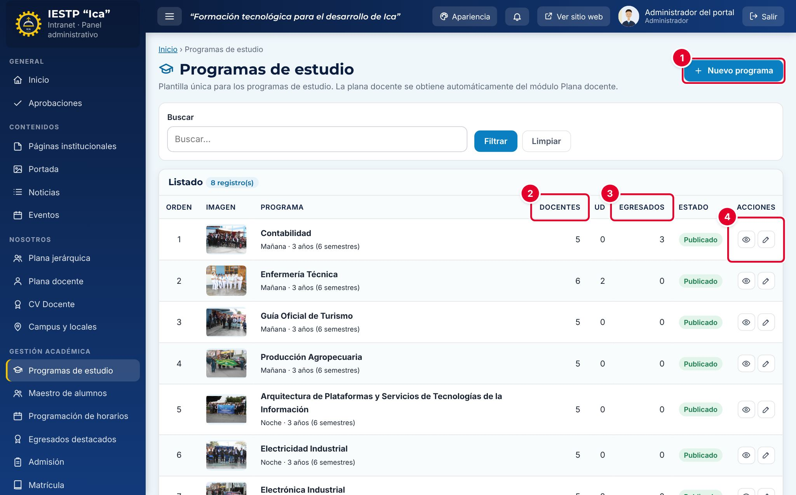

| N.º | Elemento | Para qué sirve |
|---|---|---|
| 1 | **Nuevo programa** | Abre el formulario para crear un programa. Solo lo ve el Administrador. |
| 2 | **Docentes** | Cantidad de docentes **publicados** en **Plana docente** que pertenecen al programa. La columna **UD** muestra cuántas unidades didácticas tiene su malla. |
| 3 | **Egresados** | Cantidad de egresados registrados en **Egresados destacados**. |
| 4 | Acciones de la fila | **Vista previa** de la página pública y **Editar**. |

Los programas se listan según su **Orden de presentación**, que es también el orden en que aparecen en el portal.

## Formulario

El formulario es largo; se recorre de arriba abajo.

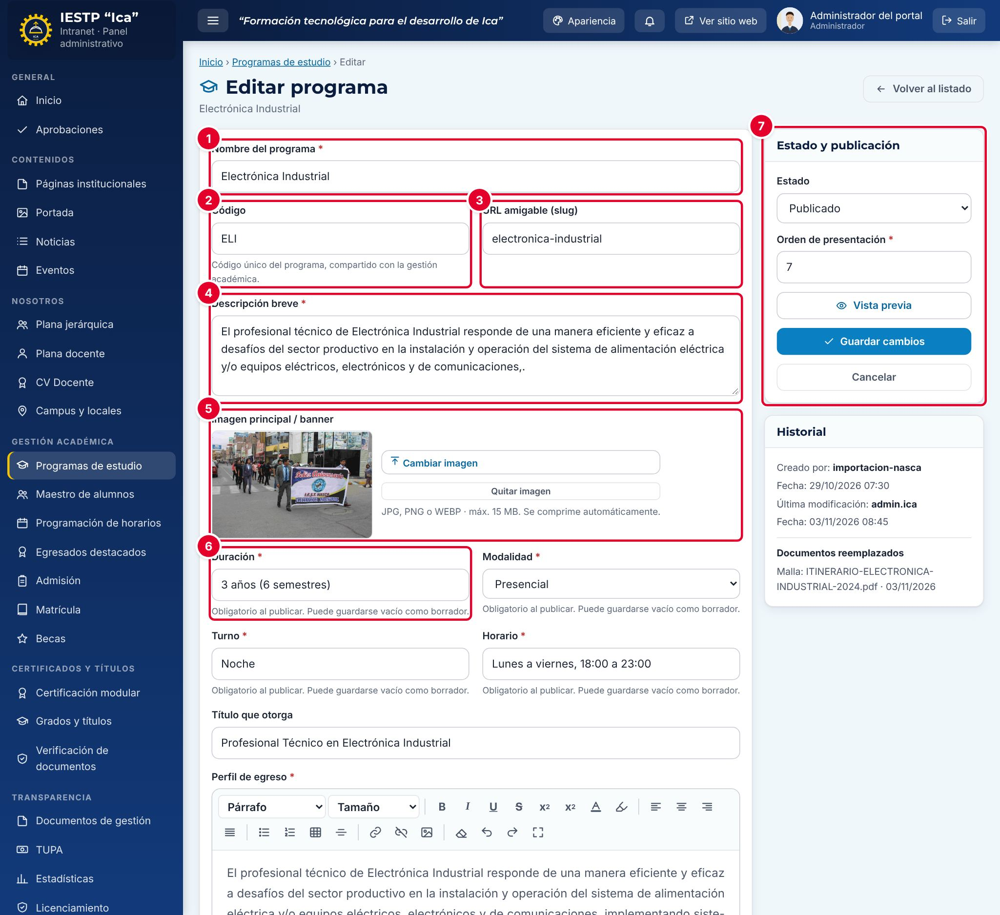

| N.º | Zona | Contenido |
|---|---|---|
| 1 | **Nombre del programa** | Nombre oficial. |
| 2 | **Código** | Código único del programa, compartido con la gestión académica. |
| 3 | **URL amigable (slug)** | Parte final de la dirección de la página pública. |
| 4 | **Descripción breve** | Texto de la tarjeta del programa y del encabezado de su página. |
| 5 | **Imagen principal / banner** | Fondo del encabezado de la página y foto de la tarjeta. |
| 6 | Datos generales | **Duración**, **Modalidad**, **Turno**, **Horario** y **Título que otorga**. |
| 7 | **Estado y publicación** | Estado, orden de presentación, vista previa y guardado. |

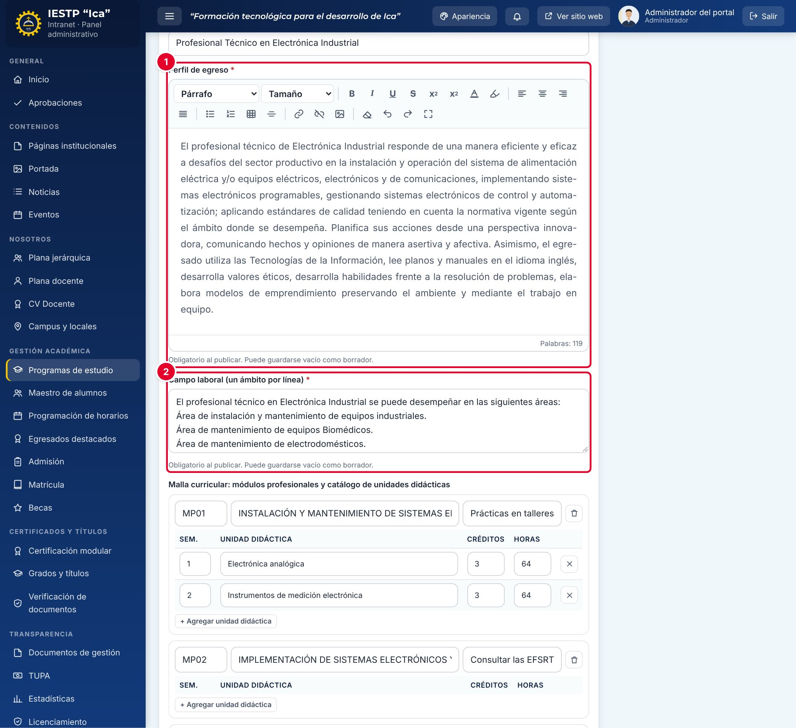

| N.º | Zona | Contenido |
|---|---|---|
| 1 | **Perfil de egreso** | Texto con formato (negrita, listas, tablas, enlaces). |
| 2 | **Campo laboral (un ámbito por línea)** | Cada línea se publica como un elemento de la lista. |

| Campo | Obligatorio | Formato o límite | Ejemplo |
|---|---|---|---|
| Nombre del programa | Sí | Texto; no puede repetirse | Electrónica Industrial |
| Código | No | Texto; no puede repetirse | ELI |
| URL amigable (slug) | No | Se genera a partir del nombre; no puede repetirse | electronica-industrial |
| Descripción breve | Sí | Hasta 300 caracteres | El profesional técnico de Electrónica Industrial… |
| Imagen principal / banner | No | JPG, PNG o WEBP, hasta 15 MB. Se comprime automáticamente | Foto horizontal |
| Duración | Al publicar | Texto | 3 años (6 semestres) |
| Modalidad | Al publicar | **Presencial**, **Semipresencial** o **A distancia** | Presencial |
| Turno | Al publicar | Texto | Noche |
| Horario | Al publicar | Texto | Lunes a viernes, 18:00 a 23:00 |
| Título que otorga | No | Texto | Profesional Técnico en Electrónica Industrial |
| Perfil de egreso | Al publicar | Texto con formato | — |
| Campo laboral | Al publicar | Un ámbito por línea | Área de mantenimiento de equipos industriales |
| Malla curricular | No | Módulos y unidades didácticas (ver el procedimiento) | — |
| Itinerario formativo (PDF) | No | PDF hasta 20 MB | Itinerario formativo 2024 |
| Brochure vigente (PDF) | No | PDF hasta 20 MB | Brochure del programa |
| Coordinador(a) del programa | No | Solo docentes asociados al programa en **Plana docente** | — |
| Mensaje del coordinador | No | Texto | — |
| Convenios para EFSRT | No | Una empresa o institución por línea | — |
| Estado | Sí | **Borrador** o **Publicado** | Publicado |
| Orden de presentación | Sí | Número desde 1; no puede repetirse | 7 |

## Procedimientos

### Editar los datos de un programa

1. En el listado, pulsa el lápiz (**Editar**) del programa.
2. Revisa los datos generales, el **Perfil de egreso** y el **Campo laboral**.
3. Pulsa **Vista previa** para ver la página como quedará en el portal, sin publicar los cambios.
4. Pulsa **Guardar cambios**. Aparece «Cambios guardados.».

### Armar la malla curricular

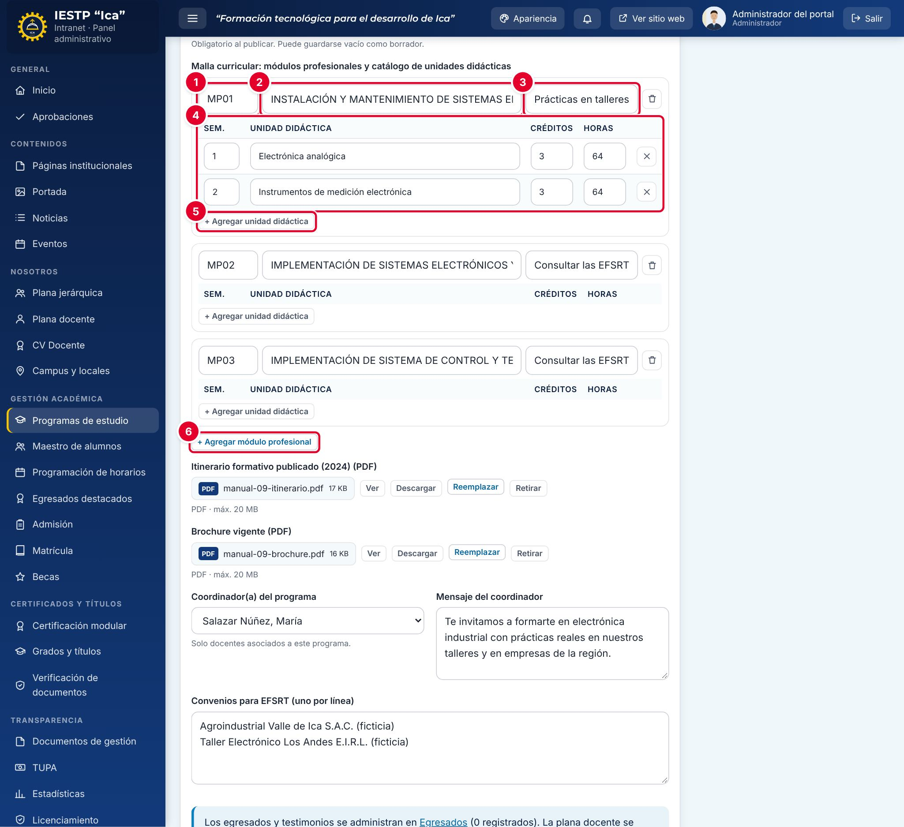

La malla se organiza en **módulos profesionales**, y cada módulo contiene sus **unidades didácticas**.

1. En cada módulo, completa el **Código** ① (por ejemplo, MP01), el **Nombre del módulo** ② y las **EFSRT** ③ (experiencias formativas en situaciones reales de trabajo).
2. Pulsa **+ Agregar unidad didáctica** ⑤ y completa la fila ④: **Sem.** (semestre, de 1 a 10), **Unidad didáctica**, **Créditos** y **Horas**. La **X** de la fila quita la unidad.
3. Para agregar otro módulo, pulsa **+ Agregar módulo profesional** ⑥. La papelera del módulo lo quita junto con sus unidades, previa confirmación.
4. Pulsa **Guardar cambios**.

Las unidades didácticas registradas aquí son las que luego se asignan a los docentes en **Plana docente**. No se puede quitar una unidad que ya está asignada a un docente: primero quita la asignación en **Plana docente**.

### Cargar o reemplazar el brochure y el itinerario

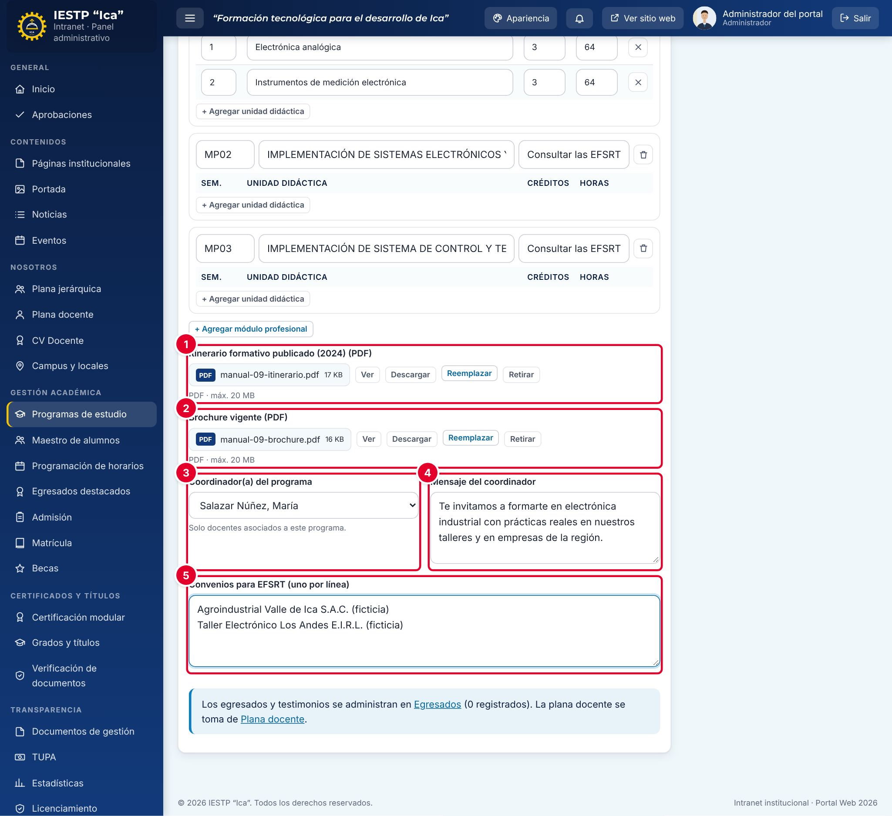

1. En **Itinerario formativo publicado (2024) (PDF)** ① o **Brochure vigente (PDF)** ②, pulsa **Cargar archivo** (o **Reemplazar**, si ya hay uno) y elige el PDF.
2. Si ya había un documento, confirma el reemplazo. La versión anterior queda en el historial.
3. Con **Ver** y **Descargar** revisas el archivo cargado; **Retirar** lo quita y deja de mostrarse en el portal.
4. Elige el **Coordinador(a) del programa** ③ y escribe su **Mensaje** ④. Solo aparecen los docentes asociados a este programa en **Plana docente**.
5. Escribe los **Convenios para EFSRT** ⑤, uno por línea.
6. Pulsa **Guardar cambios**.

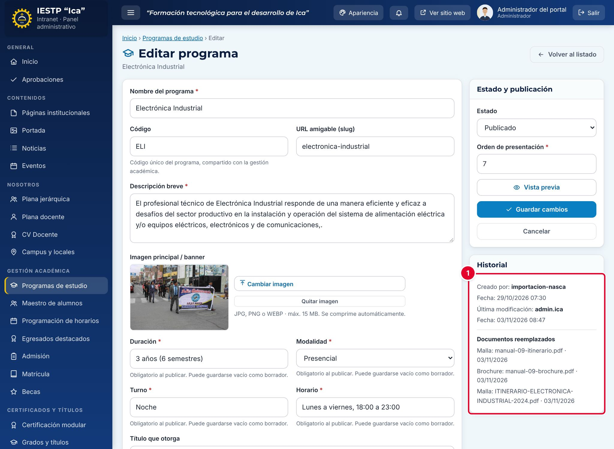

Después de guardar, el bloque **Historial** ① muestra quién modificó el programa y, en **Documentos reemplazados**, los documentos anteriores con su fecha de reemplazo.

### Retirar un programa del portal

Cambia el **Estado** a **Borrador** y pulsa **Guardar cambios**. El programa deja de mostrarse en el portal (su página, el menú, la página de inicio, las categorías de la plana docente y los formularios de contacto) y queda **inactivo** en la gestión académica.

### Crear un programa (solo Administrador)

Pulsa **Nuevo programa**, completa al menos el **Nombre**, la **Descripción breve** y el **Orden de presentación**, y guárdalo como **Borrador** hasta tener todos los datos. Al guardarlo se crea también en la gestión académica con el mismo nombre y código.

## Flujo y estados

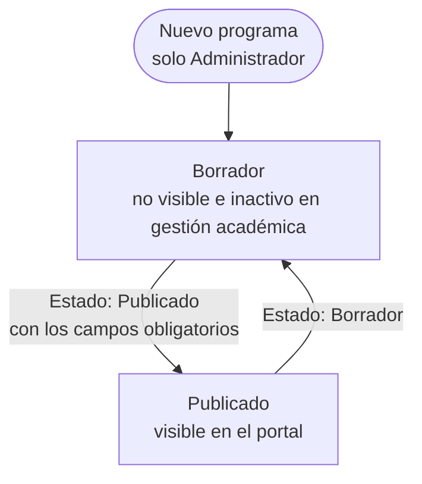

| Estado | Significado | Visible en el portal |
|---|---|---|
| Borrador | En preparación o retirado | No |
| Publicado | Programa vigente | **Sí** |

Para pasar a **Publicado** deben estar completos la **Duración**, la **Modalidad**, el **Turno**, el **Horario**, el **Perfil de egreso** y el **Campo laboral**.

## Resultado en el portal público

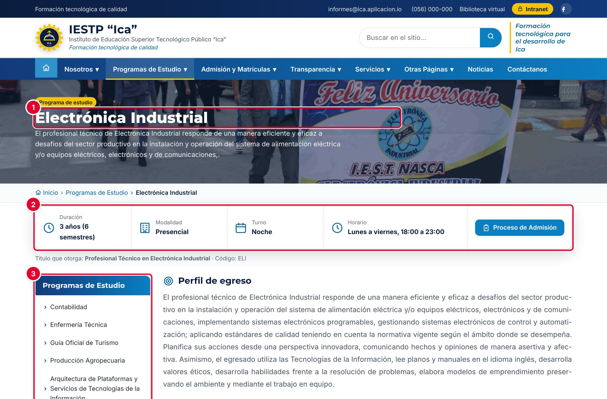

| N.º | Elemento | Descripción |
|---|---|---|
| 1 | Encabezado | Imagen principal, nombre y descripción breve. |
| 2 | Datos del programa | Duración, modalidad, turno y horario, y el botón **Proceso de Admisión**. Debajo, el título que otorga y el código. |
| 3 | Menú lateral | Lista de los programas publicados y el enlace **Ir a Campus e Informes**. |

A continuación se ven el **Perfil de egreso** y el **Campo laboral**, que se despliega al pulsarlo.

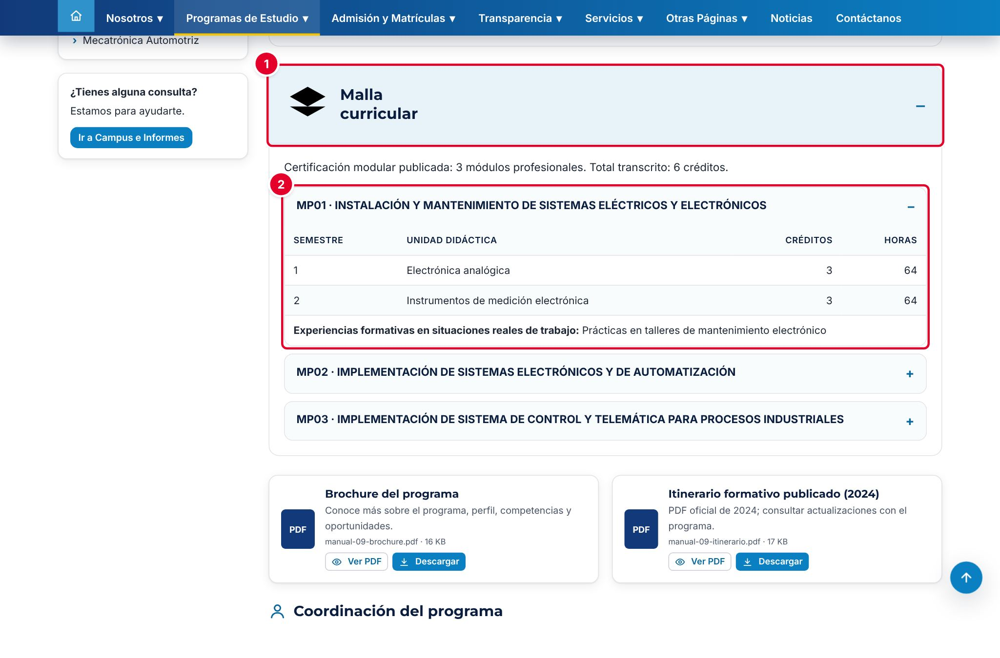

La sección **Malla curricular** ① se despliega al pulsarla. Indica la cantidad de módulos y el total de créditos, y cada módulo ② se abre para mostrar sus unidades didácticas por semestre, con créditos, horas y las EFSRT.

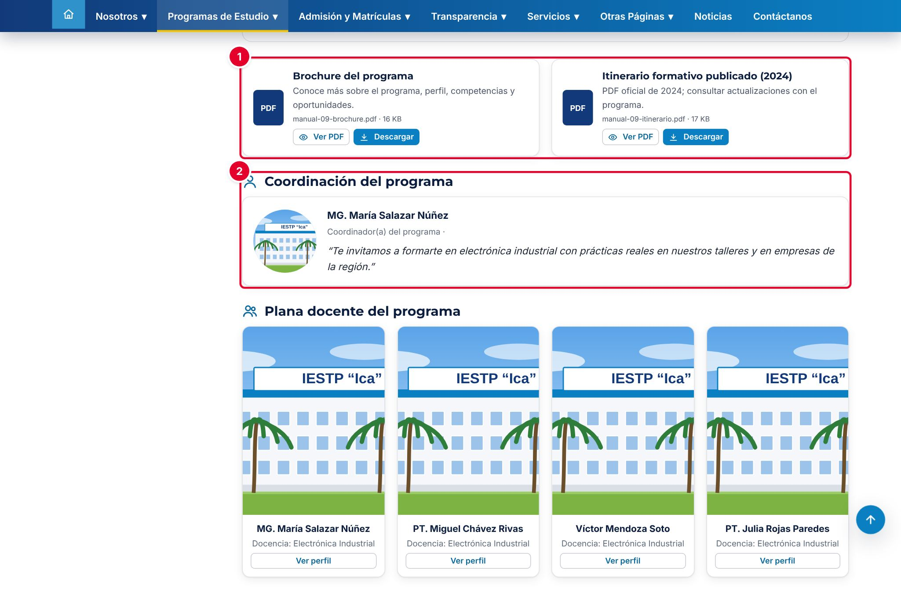

Los documentos cargados aparecen como tarjetas con **Ver PDF** y **Descargar** ①. La **Coordinación del programa** ② muestra la foto, el nombre, el correo y el mensaje del coordinador. Más abajo están la **Plana docente del programa**, los **Convenios para EFSRT** (si se registraron), **Nuestros egresados** y los botones **Consultar admisión** y **Contáctanos**.

## Mensajes y problemas frecuentes

| Mensaje o situación | Causa | Qué hacer |
|---|---|---|
| «Obligatorio para publicar (puede guardarlo como borrador).» | Falta un campo obligatorio para publicar (ver la captura siguiente) | Complétalo o guarda el programa como **Borrador** |
| «Ya existe un registro con este valor (…)» | El nombre, el código o la URL amigable ya los usa otro programa | Cambia el valor repetido |
| «Cada módulo debe tener nombre.» | Hay un módulo sin nombre | Escribe el nombre o quita el módulo |
| «Cada unidad didáctica debe tener nombre.» | Hay una fila de unidad sin nombre | Escribe el nombre o quita la fila |
| «Unidad didáctica duplicada en el programa: “…”.» | Dos unidades tienen el mismo nombre | Corrige o quita la repetida |
| «No puede retirar unidades didácticas asignadas a docentes: … Primero quite la asignación en Plana docente.» | Se quitó una unidad que dicta un docente | Quita la asignación en **Plana docente** y vuelve a intentarlo |
| «El orden N ya está asignado a …» | Otro programa tiene ese orden | Usa otro número |
| No aparece un docente en **Coordinador(a) del programa** | El docente no está asociado al programa | Asócialo en **Plana docente** |
| La página dice «Consulta las unidades didácticas… en el itinerario oficial descargable» | La malla no tiene unidades didácticas registradas | Agrégalas en **Malla curricular** o carga el itinerario en PDF |

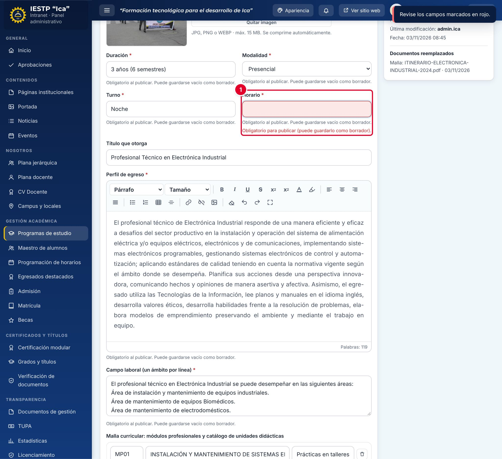

Si al guardar un programa **Publicado** falta un campo obligatorio, el campo se marca en rojo ① y aparece el aviso «Revise los campos marcados en rojo.».

## Buenas prácticas

- Mantén la malla igual al itinerario formativo oficial: mismos módulos, unidades, créditos y horas.
- Cuando cambie el plan de estudios, reemplaza el itinerario PDF en lugar de retirarlo: la versión anterior queda en el historial.
- Usa la **Vista previa** antes de guardar cambios importantes.
- Escribe el campo laboral en frases cortas, una por línea.
- Usa imágenes horizontales de buena calidad para el banner; el texto del encabezado se escribe encima.
- Coordina con la Secretaría académica antes de cambiar el código o el nombre: se comparten con la gestión académica.
