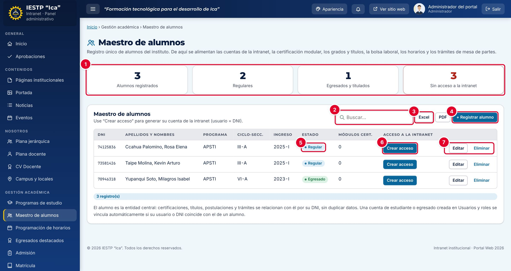
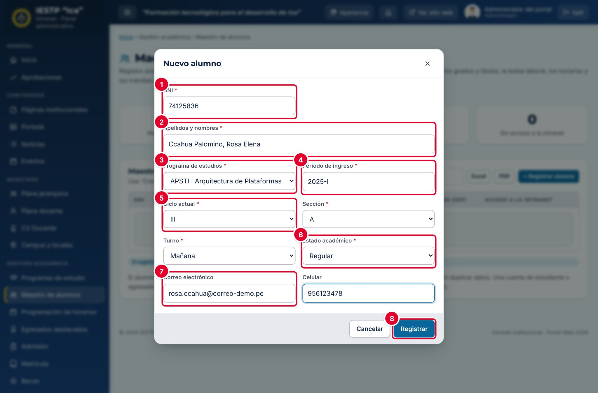
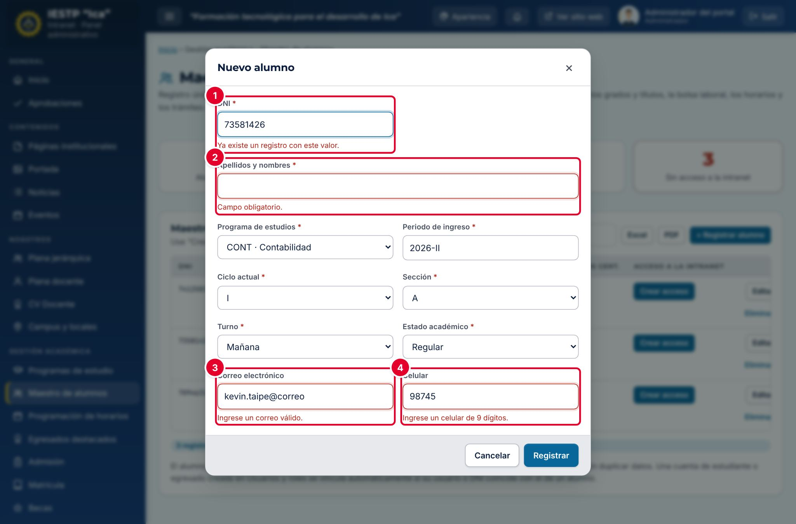
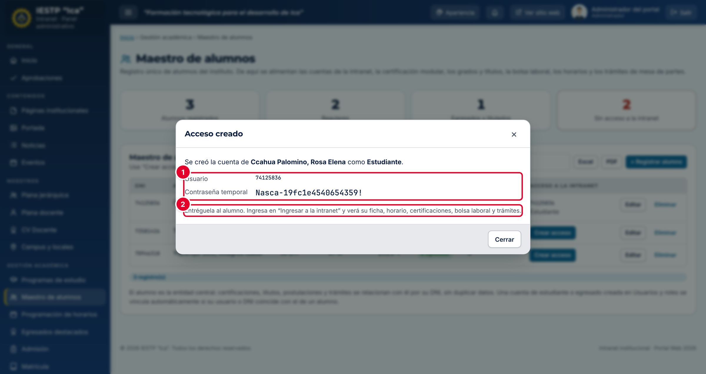
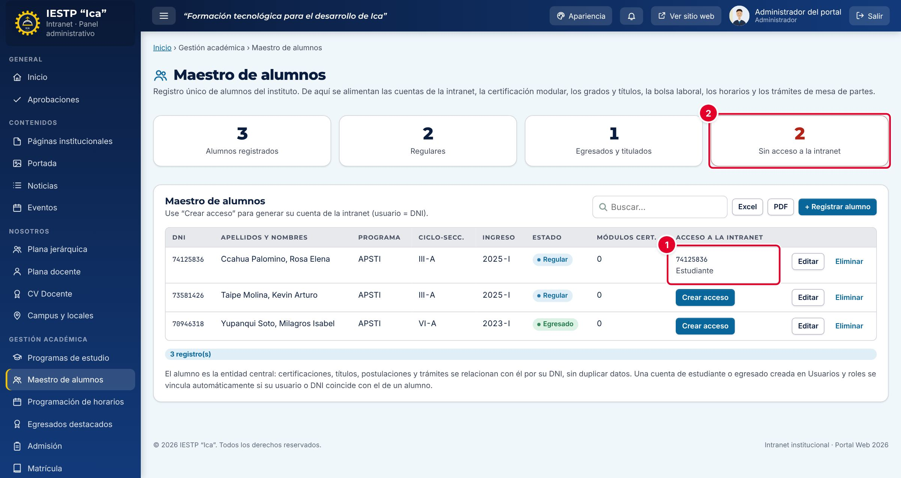
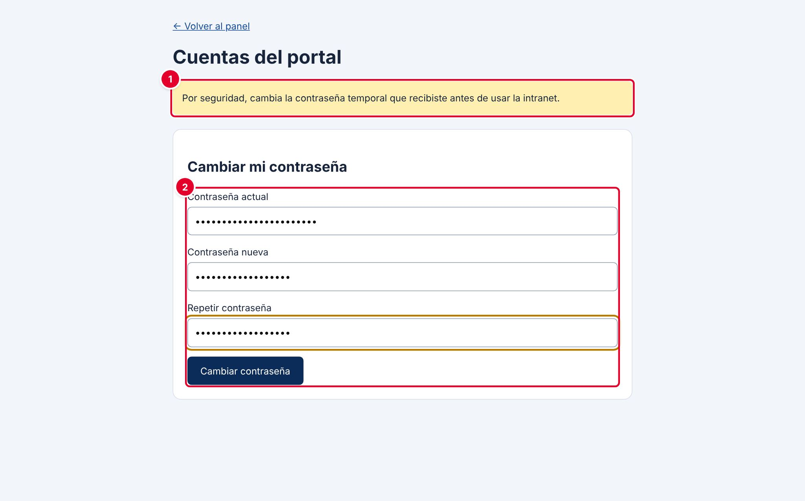
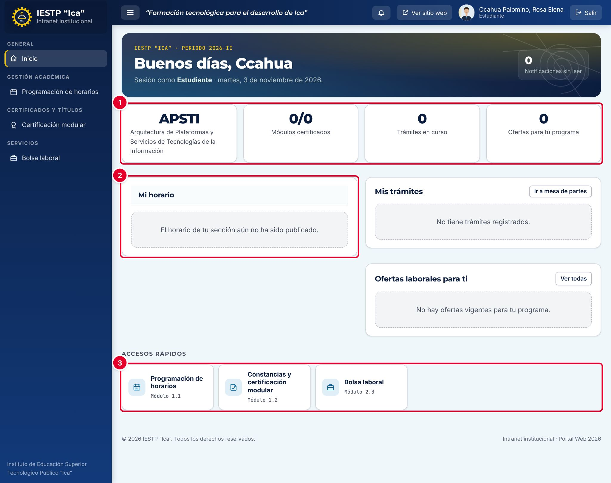
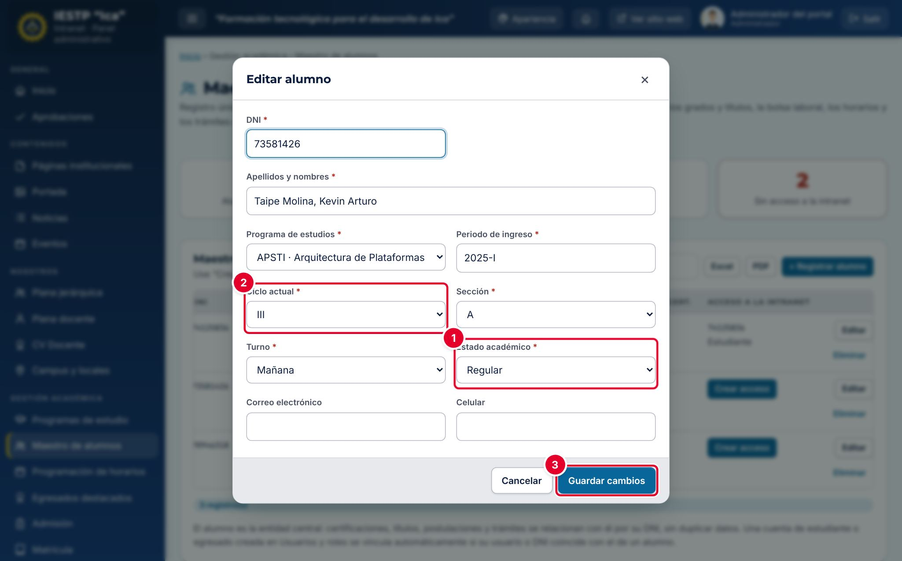
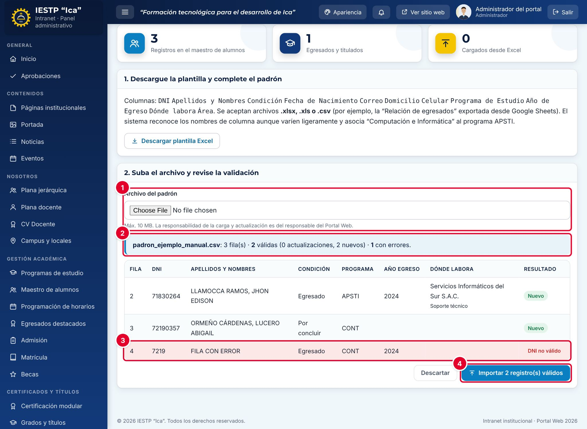
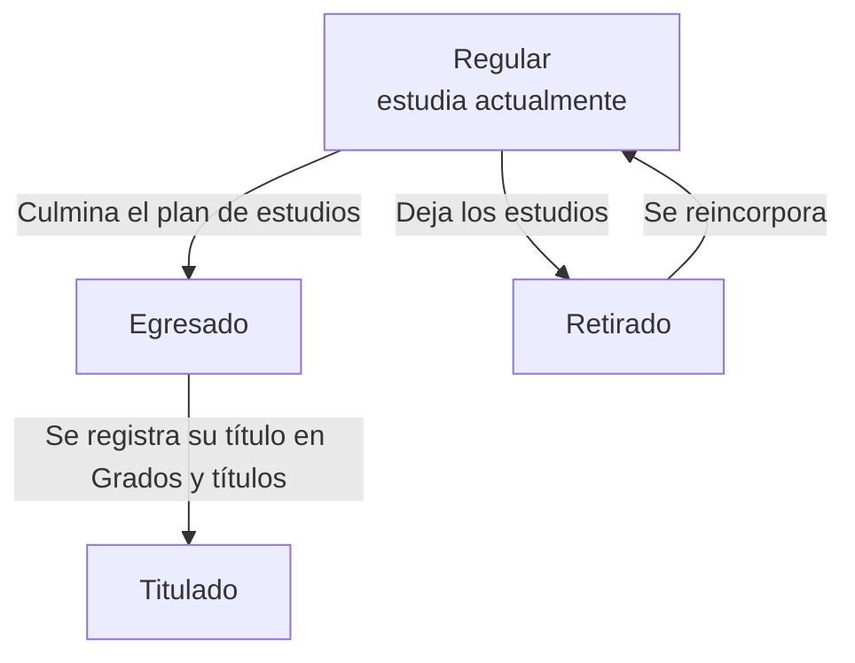

# 10 · Maestro de alumnos

## Para qué sirve

El Maestro de alumnos es el registro único de los estudiantes y egresados del instituto. Cada alumno se registra una sola vez, con su DNI, y de ese registro se alimentan los demás módulos académicos: la programación de horarios (por programa, ciclo, sección y turno), la certificación modular, los grados y títulos, la bolsa laboral y las cuentas de acceso a la intranet.

Desde aquí también se crea la **cuenta de la intranet** del alumno, con la que consulta su horario, sus certificaciones y la bolsa laboral.

## Quién lo usa

| Rol | Puede |
|---|---|
| Administrador | Todo: registrar, editar, crear accesos, exportar y **eliminar** |
| Secretaría académica | Registrar, editar, crear accesos y exportar |
| Coordinador de programa | Lo mismo que Secretaría académica, pero **solo con los alumnos de su programa** |
| Directivo | Consultar y exportar |
| Estudiante y egresado | No entran a este módulo. Ven su propia ficha en **Mi panel** |

> Solo el administrador puede eliminar un alumno. Si otro perfil lo intenta, el servidor rechaza el cambio con el mensaje «Solo el administrador puede eliminar definitivamente.».

## Cómo se llega

Menú lateral › **Gestión académica** › **Maestro de alumnos**. Ruta: `#/admin/ix-alumnos`

## Pantalla principal

| N.º | Elemento | Para qué sirve |
|---|---|---|
| 1 | Indicadores | **Alumnos registrados**, **Regulares**, **Egresados y titulados** y **Sin acceso a la intranet**. Este último se resalta en rojo mientras haya alumnos sin cuenta. |
| 2 | **Buscar…** | Filtra la tabla mientras escribes: DNI, nombre, programa, estado, etc. |
| 3 | **Excel** y **PDF** | Descargan la tabla tal como está filtrada. |
| 4 | **+ Registrar alumno** | Abre el formulario de un alumno nuevo. |
| 5 | **Estado** | Estado académico: Regular, Retirado, Egresado o Titulado. |
| 6 | **Crear acceso** | Crea la cuenta de la intranet del alumno (ver «Crear el acceso a la intranet»). |
| 7 | **Editar** y **Eliminar** | Modifican o borran el registro. |

La columna **Módulos cert.** cuenta las certificaciones modulares registradas en el capítulo 16, y **Acceso a la intranet** muestra el usuario de la cuenta cuando ya existe.

## Formulario

| N.º | Campo | Descripción |
|---|---|---|
| 1 | **DNI** | Identifica al alumno en todo el sistema. Será su usuario de la intranet. |
| 2 | **Apellidos y nombres** | Escríbelos en el orden «Apellidos, nombres», tal como figuran en el DNI. |
| 3 | **Programa de estudios** | Solo aparecen los programas activos (publicados en Programas de estudio). |
| 4 | **Periodo de ingreso** | Periodo en que ingresó. Por defecto se propone el periodo vigente. |
| 5 | **Ciclo actual**, **Sección** y **Turno** | Ubican al alumno en su grupo. Con estos datos ve el horario publicado de su sección. |
| 6 | **Estado académico** | Regular, Retirado, Egresado o Titulado. |
| 7 | **Correo electrónico** y **Celular** | Datos de contacto (opcionales). |
| 8 | **Registrar** | Guarda el alumno. Al editar, el botón dice **Guardar cambios**. |

| Campo | Obligatorio | Formato o límite | Ejemplo |
|---|---|---|---|
| DNI | Sí | 8 dígitos. No se puede repetir | 74125836 |
| Apellidos y nombres | Sí | Texto | Ccahua Palomino, Rosa Elena |
| Programa de estudios | Sí | Un programa activo | APSTI · Arquitectura de Plataformas… |
| Periodo de ingreso | Sí | `AAAA-I` o `AAAA-II` | 2025-I |
| Ciclo actual | Sí | I, II, III, IV, V o VI | III |
| Sección | Sí | A o B | A |
| Turno | Sí | Mañana o Tarde | Mañana |
| Estado académico | Sí | Regular, Retirado, Egresado o Titulado | Regular |
| Correo electrónico | No | Correo válido | rosa.ccahua@correo-demo.pe |
| Celular | No | 9 dígitos | 956123478 |

## Procedimientos

### Registrar un alumno

1. Pulsa **+ Registrar alumno**.
2. Completa el **DNI**, los **Apellidos y nombres** y el **Programa de estudios**.
3. Revisa el **Periodo de ingreso** y elige el **Ciclo actual**, la **Sección** y el **Turno**.
4. Elige el **Estado académico**. Para un alumno que estudia actualmente, deja **Regular**.
5. Opcional: escribe el **Correo electrónico** y el **Celular**.
6. Pulsa **Registrar**.

Aparece el aviso «Cambios guardados en el servidor.» y el alumno se agrega a la tabla, ordenada por apellidos.

Si un dato no es válido, el formulario no se cierra y el campo se marca en rojo con su mensaje:

| N.º | Mensaje | Causa |
|---|---|---|
| 1 | «Ya existe un registro con este valor.» | Ese DNI ya está registrado. Búscalo en la tabla: no lo registres dos veces. «El DNI debe tener 8 dígitos.» aparece si tiene otra longitud. |
| 2 | «Campo obligatorio.» | Falta un dato obligatorio. |
| 3 | «Ingrese un correo válido.» | El correo está incompleto (por ejemplo, sin `.pe` o `.com`). |
| 4 | «Ingrese un celular de 9 dígitos.» | El celular no tiene 9 dígitos. |

### Crear el acceso a la intranet

1. En la fila del alumno, pulsa **Crear acceso** (columna **Acceso a la intranet**).
2. Se muestra la ventana **Acceso creado**.

| N.º | Dato | Descripción |
|---|---|---|
| 1 | **Usuario** y **Contraseña temporal** | El usuario es el DNI. La contraseña temporal la genera el sistema y solo se muestra **esta vez**. |
| 2 | Indicación | Entrega estos datos al alumno de forma personal (no los publiques ni los envíes a grupos). |

El rol de la cuenta depende del estado académico: **Estudiante** si el alumno es Regular y **Egresado** si es Egresado o Titulado. El botón no aparece para los alumnos **Retirados**.

Al cerrar la ventana, la columna **Acceso a la intranet** ① muestra el usuario y el rol, y el indicador **Sin acceso a la intranet** ② disminuye.

> Si cierras la ventana sin anotar la contraseña temporal, no se puede volver a ver. Pide al administrador que restablezca la contraseña de esa cuenta desde **Usuarios y roles**.

### Primer ingreso del alumno

El alumno entra por **Ingresar a la intranet** con su DNI y la contraseña temporal. Antes de usar la intranet, el sistema le pide cambiarla:

| N.º | Elemento | Descripción |
|---|---|---|
| 1 | Aviso | «Por seguridad, cambia la contraseña temporal que recibiste antes de usar la intranet.» |
| 2 | **Cambiar mi contraseña** | Escribe la contraseña temporal en **Contraseña actual** y una nueva de **al menos 12 caracteres** dos veces. Pulsa **Cambiar contraseña** y luego **Ir a la intranet →**. |

| N.º | Zona | Descripción |
|---|---|---|
| 1 | Resumen | Programa, módulos certificados (por ejemplo, 0/3), trámites en curso y ofertas laborales para su programa. |
| 2 | **Mi horario** | Las clases del día, cuando el horario de su sección está publicado. Mientras no lo esté, dice «El horario de tu sección aún no ha sido publicado.». |
| 3 | **Accesos rápidos** | Programación de horarios (su horario), Constancias y certificación modular (su ficha) y Bolsa laboral. |

Un **egresado** ve, en lugar de **Mi horario**, el recuadro **Mi situación académica** con su estado, su programa y sus módulos certificados, y los botones **Ver mis certificaciones** y **Mi título**.

### Editar un alumno o cambiar su estado

1. Pulsa **Editar** en la fila del alumno.
2. Cambia los datos necesarios. Lo más frecuente al inicio de cada semestre es actualizar el **Ciclo actual** ② y, al terminar los estudios, el **Estado académico** ① a **Egresado**.
3. Pulsa **Guardar cambios** ③.

Cuando registras el título de un egresado (capítulo 17), su estado cambia solo a **Titulado**. No es necesario editarlo.

> Si un alumno ya tiene cuenta de **Estudiante** y luego pasa a **Egresado**, la cuenta conserva su rol. Para que tenga el rol **Egresado**, el administrador debe cambiarlo en **Usuarios y roles**.

### Eliminar un alumno

Solo el administrador puede eliminar. Pulsa **Eliminar** y confirma. El sistema **no permite** eliminar a un alumno que tiene certificaciones, títulos o postulaciones a la bolsa laboral: muestra «No se puede eliminar» y sugiere cambiar su estado a **Retirado** (ver la captura 16-10 del capítulo 16). Tampoco se puede eliminar a un alumno con una cuenta activa vinculada.

### Carga masiva desde Excel (padrón)

Para registrar muchos alumnos o egresados a la vez se usa el padrón de la **Bolsa laboral**. Ruta: **Servicios** › **Bolsa laboral** › pestaña **Padrón de estudiantes y egresados** (`#/admin/ix-bolsa/padron`). Requiere permiso de gestión del Maestro de alumnos.

1. Pulsa **Descargar plantilla Excel** y complétala. Columnas: DNI, Apellidos y Nombres, Condición (Egresado, Titulado o Por Concluir), Fecha de Nacimiento, Correo, Domicilio, Celular, Programa de Estudio, Año de Egreso, Dónde labora y Área.
2. En **Archivo del padrón**, elige el archivo (.xlsx, .xls o .csv, hasta 10 MB).
3. Revisa la validación antes de importar.

| N.º | Elemento | Descripción |
|---|---|---|
| 1 | **Archivo del padrón** | Archivo con el padrón. |
| 2 | Resumen | Filas leídas, filas válidas (nuevas o actualizaciones) y filas con errores. |
| 3 | Fila con error | Se marca en rojo con la causa: «DNI no válido», «DNI repetido en el archivo», «Falta apellidos y nombres» o «Programa no reconocido». Las filas con error no se importan. |
| 4 | **Importar N registro(s) válidos** | Importa solo las filas válidas, después de confirmar. **Descartar** cancela la carga. |

Si el DNI ya existe en el maestro, se **actualizan** sus datos; si no, se registra un alumno nuevo. Los alumnos importados quedan con la sección A, el turno Mañana y el ciclo VI: revísalos y corrígelos en el Maestro de alumnos si estudian actualmente.

## Flujo y estados

| Estado | Significado | Efecto |
|---|---|---|
| Regular | Estudia actualmente | Ve el horario de su sección. Su cuenta se crea con rol Estudiante |
| Egresado | Culminó sus estudios | Puede recibir un título. Su cuenta se crea con rol Egresado |
| Titulado | Tiene título registrado | Lo asigna el sistema al registrar el título |
| Retirado | Dejó los estudios | No se le puede crear acceso. Se usa en lugar de eliminar |

## Mensajes y problemas frecuentes

| Mensaje o situación | Causa | Qué hacer |
|---|---|---|
| «Ya existe un registro con este valor.» o «Ya existe un alumno con ese DNI.» | El DNI ya está registrado | Busca el DNI y edita ese registro |
| «El alumno ya tiene la cuenta «74125836».» | Ya se creó su acceso antes | Si olvidó la contraseña, que el administrador la restablezca |
| No aparece el botón **Crear acceso** | El alumno está Retirado o tu perfil solo tiene consulta | Cambia el estado o pide apoyo a Secretaría académica |
| El programa no aparece en el formulario | El programa no está publicado en **Programas de estudio** | Publica el programa |
| «No se puede eliminar» | El alumno tiene certificaciones, títulos o postulaciones | Cambia su estado a **Retirado** |
| «Solo el administrador puede eliminar definitivamente.» | Tu rol no puede eliminar | Pide la eliminación al administrador |
| El alumno no ve su horario | Su sección no está publicada, o su ciclo, sección o turno están desactualizados | Revisa sus datos y la publicación (capítulo 11) |

## Buenas prácticas

- Verifica el DNI con el documento físico o la ficha de matrícula antes de registrar: es la llave de todo el sistema.
- Actualiza el **Ciclo actual** de todos los alumnos al inicio de cada semestre, antes de publicar los horarios.
- Entrega la contraseña temporal en persona y pide al alumno que la cambie el mismo día.
- No elimines alumnos: cambia su estado a **Retirado** para conservar su historial.
- Los datos de los alumnos son personales (Ley N.º 29733): descarga el Excel o el PDF solo cuando lo necesites y no lo compartas fuera de la institución.
