# 11 · Programación de horarios

## Para qué sirve

En este módulo se arma el horario de cada sección (programa, ciclo, sección y turno) para el periodo académico vigente. Primero se registra la configuración base: unidades didácticas, carga docente, ambientes y bloques horarios. Luego se programan las clases sobre una grilla semanal. El sistema detecta automáticamente los cruces de docentes, de ambientes y de secciones, y solo permite **publicar** un horario sin errores. Una vez publicado, lo ven los estudiantes de esa sección en su intranet.

## Quién lo usa

| Rol | Puede |
|---|---|
| Administrador | Todo: configuración base, programación, validación, publicación y exportación |
| Secretaría académica | Programar, validar, publicar y exportar. Ve la configuración base, pero no puede modificarla |
| Coordinador de programa | Lo mismo que Secretaría académica, **solo para su programa** |
| Directivo | Consultar la programación, las validaciones y las vistas por docente y por ambiente |
| Docente | Ver **Mi horario** y **Mis unidades** |
| Estudiante | Ver **Mi horario** de su sección, cuando está publicado |

## Cómo se llega

Menú lateral › **Gestión académica** › **Programación de horarios**. Ruta: `#/admin/ix-horarios`

El periodo académico sobre el que se programa es el **periodo vigente** (capítulo 32). Al cambiar de periodo, la grilla empieza vacía.

## Orden de trabajo

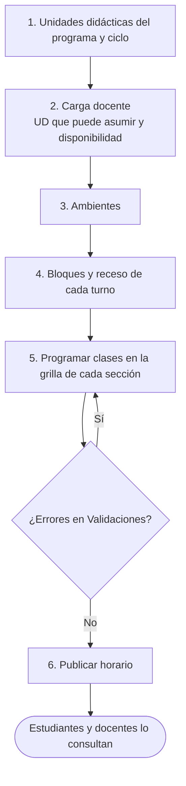

## Paso 1 · Configuración base

Pestaña **Configuración**. Al entrar se muestra la tabla **Programas de estudios**; con los botones de la parte superior se cambia entre **Unidades didácticas**, **Carga docente**, **Ambientes** y **Bloques y receso**. Solo el administrador puede modificar estas listas.

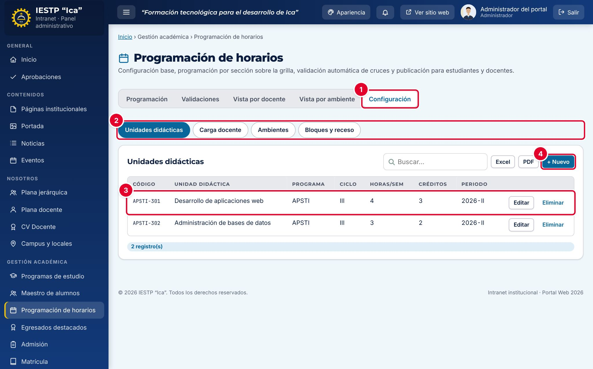

| N.º | Elemento | Para qué sirve |
|---|---|---|
| 1 | Pestaña **Configuración** | Reúne los catálogos que usa la grilla. |
| 2 | Catálogos | **Unidades didácticas**, **Carga docente**, **Ambientes** y **Bloques y receso**. |
| 3 | Fila | Cada registro, con **Editar** y **Eliminar**. |
| 4 | **+ Nuevo** | Registra un elemento nuevo. **Excel** y **PDF** descargan la lista. |

> La tabla **Programas de estudios** se alimenta de **Programas de estudio** del portal: el código, el nombre y el estado se administran allí. En esta tabla solo se ajustan la **Duración** y los **Semestres académicos**.

### Unidades didácticas

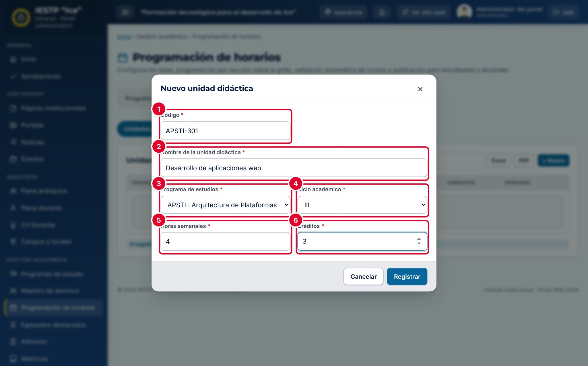

| N.º | Campo | Obligatorio | Formato o límite |
|---|---|---|---|
| 1 | **Código** | Sí | Único. Se guarda en mayúsculas. Ej.: APSTI-301 |
| 2 | **Nombre de la unidad didáctica** | Sí | Texto |
| 3 | **Programa de estudios** | Sí | Un programa registrado |
| 4 | **Ciclo académico** | Sí | I a VI |
| 5 | **Horas semanales** | Sí | De 1 a 12. El sistema avisa si la sección tiene menos horas programadas |
| 6 | **Créditos** | Sí | De 1 a 8 |

Una unidad que ya está programada en el horario no se puede eliminar.

### Carga docente

Registra qué docentes dictan, qué unidades pueden asumir y cuándo están disponibles. Los docentes se eligen de la **Plana docente** (sus datos personales y su hoja de vida se mantienen allí).

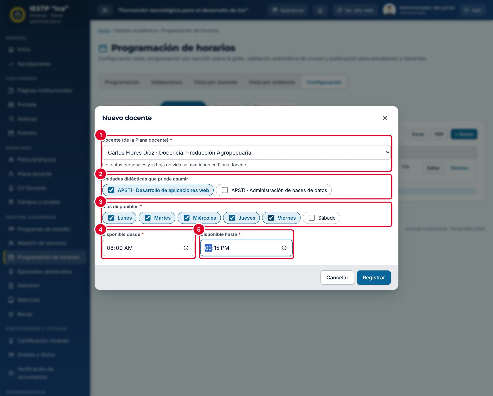

| N.º | Campo | Descripción |
|---|---|---|
| 1 | **Docente (de la Plana docente)** | Obligatorio. Cada docente tiene un solo registro de carga: «Ese docente ya tiene su carga registrada.» |
| 2 | **Unidades didácticas que puede asumir** | Si se le asigna una unidad que no está marcada, el sistema muestra la advertencia «Docente no habilitado». |
| 3 | **Días disponibles** | Obligatorio. Lunes a sábado. |
| 4 | **Disponible desde** | Hora de inicio de su disponibilidad (por defecto 08:00). |
| 5 | **Disponible hasta** | Debe ser posterior a la hora de inicio (por defecto 14:15). |

Una clase fuera de los días u horas disponibles es un **error** que bloquea la publicación.

### Ambientes

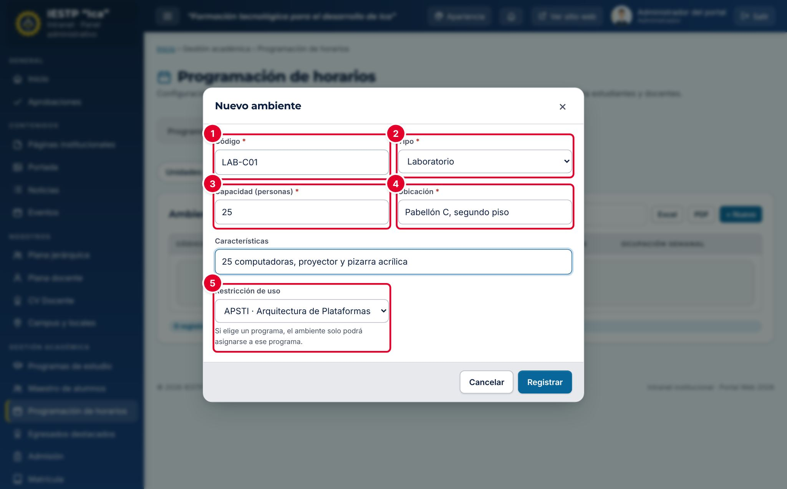

| N.º | Campo | Obligatorio | Formato o límite |
|---|---|---|---|
| 1 | **Código** | Sí | Único. Ej.: LAB-C01 |
| 2 | **Tipo** | Sí | Aula, Laboratorio o Taller |
| 3 | **Capacidad (personas)** | Sí | De 1 a 200 |
| 4 | **Ubicación** | Sí | Ej.: Pabellón C, segundo piso. El campo **Características** (opcional) describe el equipamiento |
| 5 | **Restricción de uso** | No | «Uso libre para todos los programas» o un programa. Si eliges un programa, el ambiente solo puede asignarse a ese programa |

La tabla de ambientes muestra la **Ocupación semanal** en horas. Un ambiente asignado a clases no se puede eliminar.

### Bloques y receso

Define a qué hora empieza cada turno, cuánto dura cada hora de clase y dónde hay recesos. Por defecto: **Mañana** de 08:00 a 14:15 (6 horas de 60 minutos, receso de 11:00 a 11:15) y **Tarde** de 14:30 a 19:45 (5 horas, receso de 17:30 a 17:45).

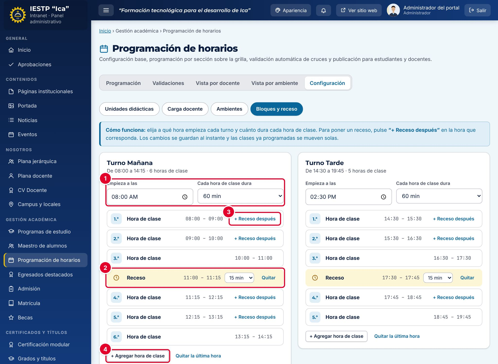

| N.º | Elemento | Para qué sirve |
|---|---|---|
| 1 | **Empieza a las** y **Cada hora de clase dura** | Hora de inicio del turno y duración de cada hora: 40, 45, 50, 55, 60 o 90 minutos. |
| 2 | **Receso** | Duración (5 a 60 minutos) y **Quitar**. |
| 3 | **+ Receso después** | Agrega un receso de 15 minutos después de esa hora. |
| 4 | **+ Agregar hora de clase** | Agrega una hora al final del turno (máximo 10). **Quitar la última hora** la elimina. |
| 5 | **Volver al horario original** | Restablece los valores por defecto. |

Los cambios se guardan al instante y las clases ya programadas se mueven a las nuevas horas. El sistema no permite que la mañana termine después de que empiece la tarde, que un turno termine después de las 23:00, ni quitar una hora que tiene clases.

> Cambia los bloques **antes** de programar las clases del periodo. Cambiarlos con horarios publicados modifica las horas que ya ven los estudiantes.

> **Incidencia detectada al elaborar este manual (versión actual de la plataforma)**
> El perfil **Secretaría académica** ve activos los controles de **Bloques y receso**, aunque no tiene permiso para cambiar la configuración. Si cambia, por ejemplo, la duración de la hora de clase, aparece el aviso de éxito («Turno Mañana: cada hora dura 45 min.») y **las clases ya programadas se mueven** a las nuevas horas, pero los bloques **no se guardan**. Resultado: las clases quedan desalineadas con la grilla (por ejemplo, de 08:00 a 09:30 en una grilla de horas de 60 minutos), las secciones publicadas siguen como **Publicado** con las horas cambiadas y aparecen advertencias de «Horario incompleto». Ya se reportó para su corrección. Mientras tanto, **solo el administrador** debe usar **Bloques y receso**; si ocurrió, el administrador debe corregir la hora de término de cada clase afectada o restablecer los bloques.

## Paso 2 · Programar las clases de una sección

Pestaña **Programación**.

1. Elige el **Programa**, el **Ciclo**, la **Sección** y el **Turno**. La grilla muestra las clases de ese grupo.
2. Pulsa una celda vacía (**+**) en el día y la hora de inicio de la clase.
3. Completa la ventana **Programar clase** y pulsa **Agregar al horario**.

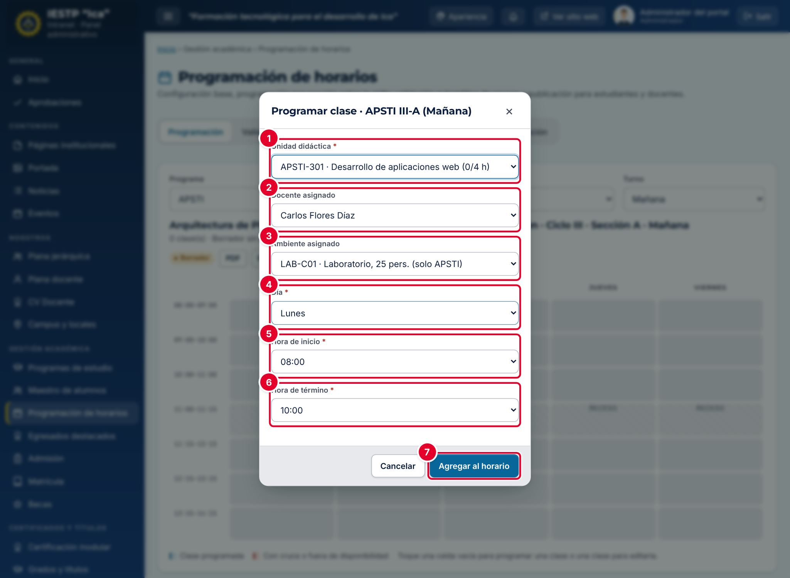

| N.º | Campo | Descripción |
|---|---|---|
| 1 | **Unidad didáctica** | Obligatorio. Solo aparecen las unidades del programa y ciclo elegidos, con las horas ya programadas y las requeridas, por ejemplo «(0/4 h)». |
| 2 | **Docente asignado** | Docentes con carga registrada. Puede quedar «Sin asignar» (genera una advertencia). |
| 3 | **Ambiente asignado** | Ambientes registrados, con su tipo, su capacidad y su restricción. Puede quedar «Sin asignar» (advertencia). |
| 4 | **Día** | Se toma de la celda pulsada. Se puede cambiar. |
| 5 | **Hora de inicio** | Inicio de una hora de clase del turno. |
| 6 | **Hora de término** | Fin de la clase. Para una clase de dos horas, elige el fin de la segunda hora. Debe ser posterior al inicio. |
| 7 | **Agregar al horario** | Guarda la clase en la grilla. |

Para modificar una clase, pulsa sobre ella en la grilla: se abre **Editar clase**, con **Guardar cambios** y **Quitar del horario**.

> Si no aparecen unidades, el sistema avisa «No hay unidades didácticas»: regístralas primero en **Configuración** › **Unidades didácticas** para ese programa y ciclo.

## Paso 3 · Detectar y corregir cruces

Al guardar una clase, el sistema la compara con todo el periodo. Si hay un error, la ventana lo muestra antes de guardar:

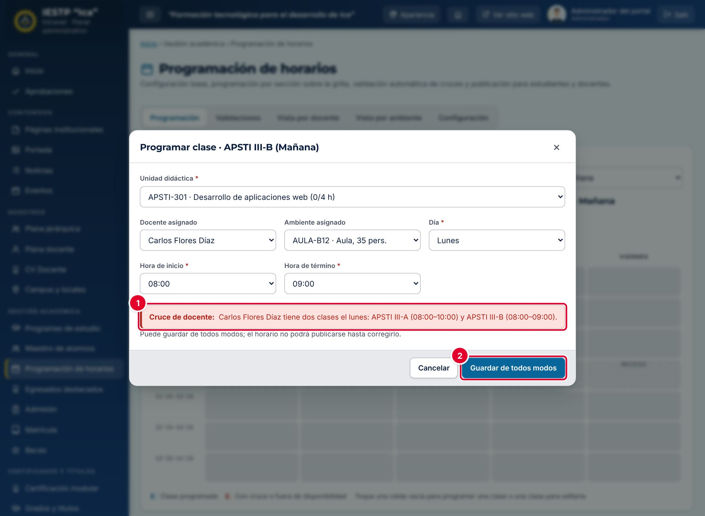

| N.º | Elemento | Descripción |
|---|---|---|
| 1 | Aviso | Tipo y detalle del problema. En el ejemplo, el docente ya tiene clase el lunes a esa hora en la sección III-A. |
| 2 | **Guardar de todos modos** | Guarda la clase con el error. La sección **no podrá publicarse** hasta corregirlo. Si cambias cualquier campo, el aviso desaparece y se vuelve a validar. |

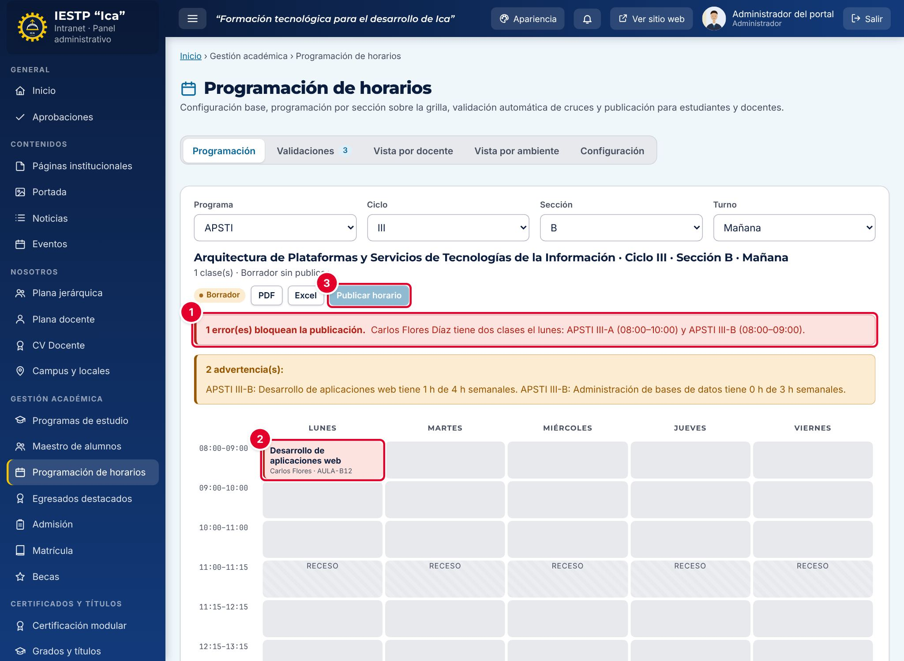

| N.º | Elemento | Descripción |
|---|---|---|
| 1 | Error | «1 error(es) bloquean la publicación.», con el detalle. Las advertencias se muestran debajo, en amarillo. |
| 2 | Clase con error | Se pinta en rojo en la grilla. |
| 3 | **Publicar horario** | Queda desactivado mientras haya errores o la sección no tenga clases. |

### Pestaña Validaciones

Revisa **todas las secciones** del periodo a la vez. La pestaña muestra un contador con el total de observaciones.

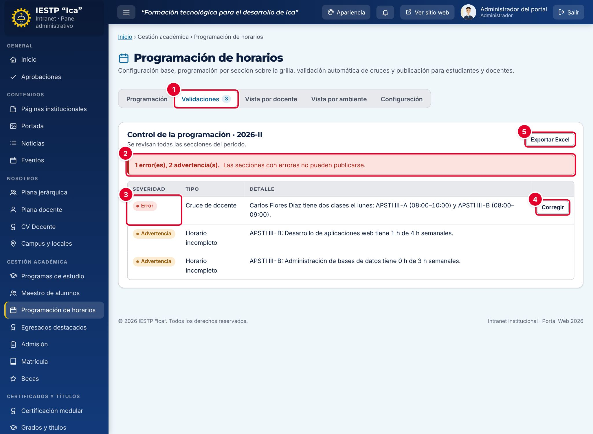

| N.º | Elemento | Para qué sirve |
|---|---|---|
| 1 | **Validaciones** | Pestaña con el número de observaciones. |
| 2 | Resumen | Cantidad de errores y advertencias. «Las secciones con errores no pueden publicarse.» |
| 3 | **Severidad** | **Error** (bloquea la publicación) o **Advertencia** (permite publicar). |
| 4 | **Corregir** | Abre la grilla de la sección y la ventana de una de las clases involucradas. Revisa cuál de las clases debes cambiar. |
| 5 | **Exportar Excel** | Descarga la lista de observaciones. |

| Tipo | Severidad | Cuándo aparece |
|---|---|---|
| Cruce de docente | Error | El docente tiene dos clases que se superponen el mismo día |
| Cruce de ambiente | Error | El ambiente está asignado a dos clases a la misma hora |
| Superposición en la sección | Error | La sección tiene dos unidades a la misma hora |
| Fuera de disponibilidad | Error | La clase está fuera de los días u horas disponibles del docente |
| Ambiente restringido | Error | El ambiente es exclusivo de otro programa |
| Sin docente | Advertencia | La clase no tiene docente |
| Ambiente no asignado | Advertencia | La clase no tiene ambiente |
| Docente no habilitado | Advertencia | La unidad no está entre las que el docente puede asumir |
| Clase cruza el receso | Advertencia | La clase incluye el horario del receso |
| Horario incompleto | Advertencia | Una unidad del ciclo tiene menos horas programadas que sus horas semanales |

## Paso 4 · Publicar el horario

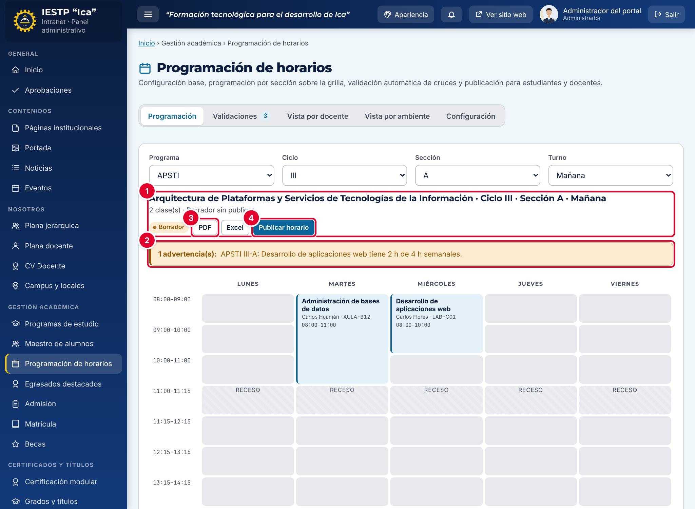

| N.º | Elemento | Descripción |
|---|---|---|
| 1 | Encabezado de la sección | Programa, ciclo, sección y turno; número de clases y estado de publicación («Borrador sin publicar»). |
| 2 | Resultado de la validación | «Sin observaciones.» en verde cuando no hay cruces y todas las unidades tienen sus horas completas. |
| 3 | **PDF** y **Excel** | Descargan el horario de la sección (con el formato del capítulo 32). |
| 4 | **Publicar horario** | Publica el horario de la sección. |

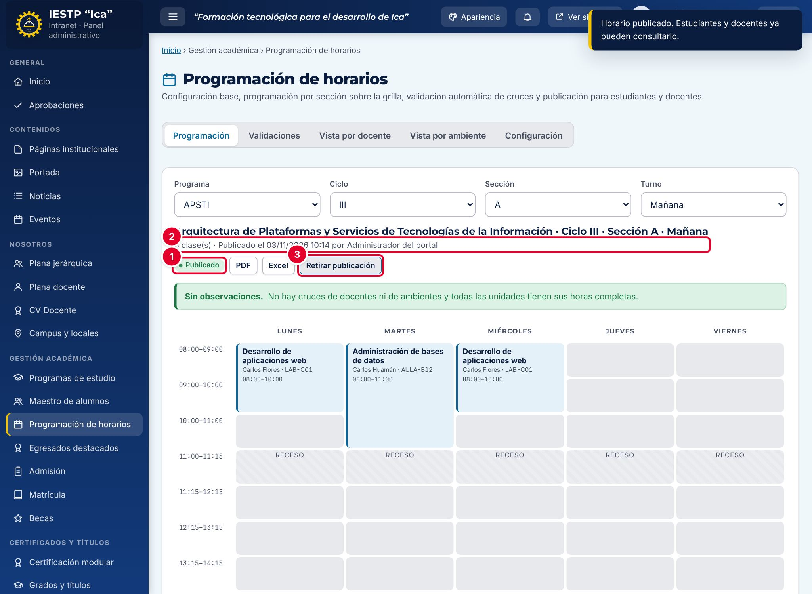

Al publicar aparece «Horario publicado. Estudiantes y docentes ya pueden consultarlo.». La etiqueta cambia a **Publicado** ①, se registra la fecha y quién publicó ②, y los estudiantes de la sección con cuenta en la intranet reciben una notificación. **Retirar publicación** ③ devuelve el horario a borrador.

> Si agregas, editas o quitas una clase de un horario publicado, el horario **vuelve a borrador** («El horario volvió a borrador: publíquelo de nuevo.»). Revisa los cambios y publícalo otra vez.

## Vistas por docente y por ambiente

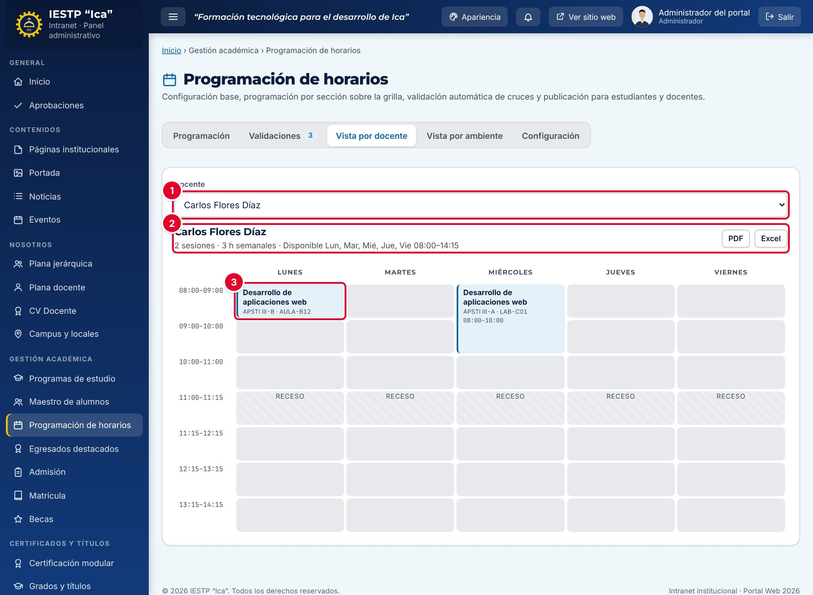

| N.º | Elemento | Descripción |
|---|---|---|
| 1 | **Docente** | Elige el docente. |
| 2 | Resumen | Sesiones, horas semanales y disponibilidad registrada. **PDF** y **Excel** descargan su horario. |
| 3 | Clase | Unidad didáctica, sección y ambiente. |

La pestaña **Vista por ambiente** muestra, del mismo modo, la ocupación semanal de cada aula, laboratorio o taller.

## Lo que ven el estudiante y el docente

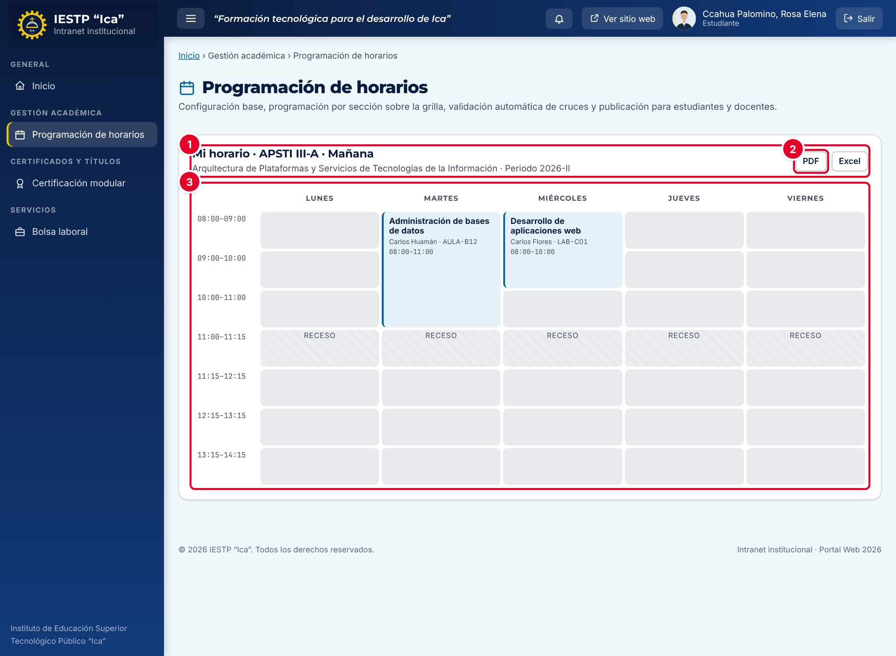

El **estudiante** entra a **Programación de horarios** y ve **Mi horario** ① de su sección (según el programa, ciclo, sección y turno de su ficha en el Maestro de alumnos), con los botones **PDF** y **Excel** ② y la grilla semanal ③. Si la sección no está publicada, ve «El horario de tu sección aún no ha sido publicado por la Jefatura de Unidad Académica.».

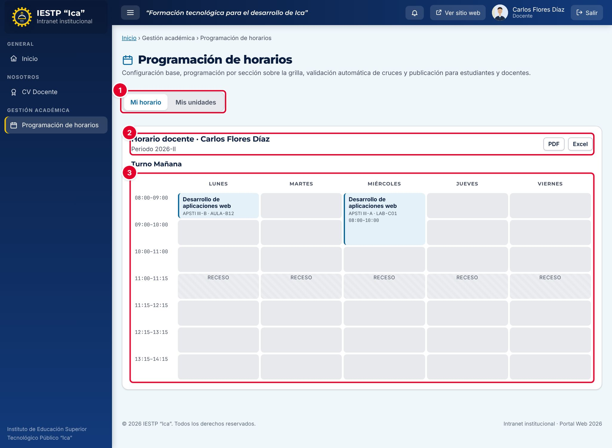

El **docente** tiene dos pestañas ①: **Mi horario**, con todas sus clases del periodo ② ③, y **Mis unidades**, con la lista de unidades, secciones, horas, ambientes y el estado de publicación de cada sección.

> El docente ve en **Mi horario** también las clases de secciones **aún no publicadas** (en el ejemplo, la clase de III-B del lunes). Para saber si una clase es definitiva, debe revisar la columna **Publicación** en **Mis unidades**.

Para que un docente vea su horario, su cuenta de la intranet debe estar **vinculada a su carga docente** (lo hace el administrador en **Usuarios y roles**, campo **Vinculado a**). Si no lo está, ve «Cuenta sin docente vinculado.».

## Flujo y estados

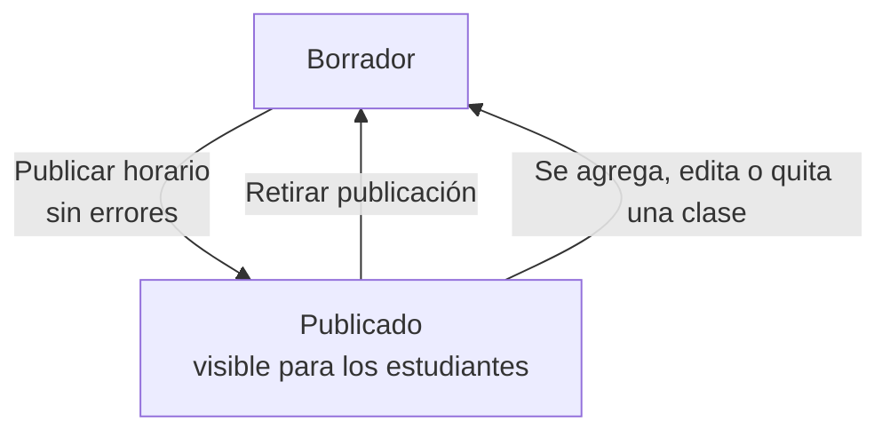

| Estado | Significado | Visible para el estudiante |
|---|---|---|
| Borrador | Horario en preparación o modificado después de publicarse | No |
| Publicado | Horario revisado y sin errores | Sí |

## Mensajes y problemas frecuentes

| Mensaje o situación | Causa | Qué hacer |
|---|---|---|
| **Publicar horario** está desactivado | La sección tiene errores o no tiene clases | Corrige los errores (pestaña **Validaciones**) |
| «El horario tiene un cruce de docente, ambiente o sección. Corrígelo antes de publicar.» | El servidor detectó un cruce al publicar | Revisa la pestaña **Validaciones** |
| «No hay unidades didácticas» | El programa no tiene UD registradas para ese ciclo | Regístralas en **Configuración** |
| «Debe ser posterior a la hora de inicio.» | La hora de término es igual o anterior al inicio | Elige otra hora de término |
| «Sesiones superpuestas: …» debajo de la grilla | Dos clases ocupan la misma celda y una no se puede dibujar | Pulsa **Editar** en el aviso y muévela |
| «No se puede: hay N clase(s) en la última hora…» | Intentaste quitar una hora de clase ocupada | Mueve o quita esas clases primero |
| «No se puede eliminar» | La UD, el docente o el ambiente están usados en el horario | Reasigna o quita esas clases antes |
| El estudiante no ve su horario | La sección no está publicada o sus datos (ciclo, sección, turno) no coinciden | Revisa la publicación y su ficha en el Maestro de alumnos |

## Buenas prácticas

- Completa la configuración base (UD, carga docente, ambientes y bloques) antes de empezar a programar el periodo.
- Pide a cada docente su disponibilidad real y regístrala: así el sistema detecta las clases imposibles.
- Programa primero las unidades que usan laboratorios o talleres restringidos.
- Revisa la pestaña **Validaciones** antes de publicar: aunque las advertencias no bloquean, un «Horario incompleto» suele indicar una clase olvidada.
- Publica todas las secciones antes del inicio de clases y evita cambiarlas después; cada cambio devuelve la sección a borrador.
